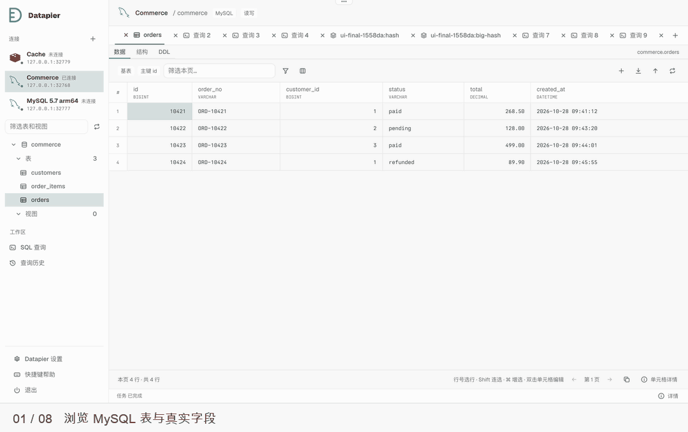
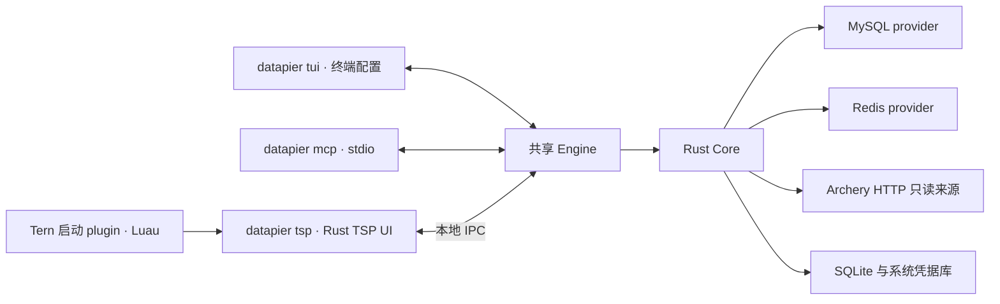

# Datapier

面向开发者与 AI agent 的多数据库工作台。统一连接、资源浏览、查询和数据编辑体验，保留不同数据库的数据模型与操作语义。

当前开发版本为 **0.2.0**，提供 MySQL／Redis 直连、Archery 只读来源、普通终端 TUI、Tern 工作台和 MCP stdio 接入，已完成本轮 **macOS arm64** 实施与适用运行验收；正式发布版本仍为 0.1.0。其他平台保留实现与 CI 配置，未声明运行已验收，详见[0.2.0 技术方案](docs/technical-design-0.2.0.md#15-风险与当前完成状态)。

## 当前开发功能

围绕“连接 → 浏览／查询 → 编辑 → 提交 → 导入导出”完成日常数据库工作流：

- **连接与工作区**：认证、TLS、数据库选择、只读／读写模式，多 tab、最近连接、草稿与布局恢复；多个 UI 共享 Engine。应用语言支持跟随系统、简体中文和英文，偏好按数据目录全局持久化并同步多窗口。
- **原生工作台**：共享连接导航与收展状态，MySQL database 进入资源树并按需展开；Redis 自动探测逻辑 DB 数量，探测失败显示未知，可手动覆盖。颜色跟随 TSP 主题。
- **MySQL**：支持 5.7／8.0／8.4；浏览 database、表、视图、字段及真实列注释、索引、约束和 DDL；过滤、多列排序、分页、可靠唯一键定位的基表增删改，以及二次确认后的数据库／表删除。
- **Redis**：单节点 DB 选择，SCAN 增量浏览与 pattern／type 过滤；列表或按 `:` 分段的多级 key 树，目录默认折叠、逐级展开；key 多选、具名右键操作及共同 WATCH 基线的批量删除草稿。String、Hash、List、Set、ZSet 的查看和编辑，复合条目多选复制／删除、key 重命名／删除、TTL 管理及完整原始 value 复制。
- **查询与命令**：执行全文、选区或当前 SQL，SQL 高亮、行号和逐语句执行，普通 `EXPLAIN FORMAT=JSON`、纯 Rust 选区格式化及撤销；首次执行前隐藏结果面板，保留执行状态、取消／停止等待、结果、错误、历史和查询文件。
- **数据 grid**：MySQL 列宽按当前页内容与可用空间自适应，自动列宽上限 480px，原位编辑期间保持列宽；支持手动列宽、隐藏／冻结列、单格与 Shift 矩形选择、行号单选和 Shift 连选，以及按 UI 系统使用 Command／Ctrl 增选。支持单元格／矩形选区和选中行复制、MySQL 基表 INSERT 复制、原位文本编辑和长值／JSON／NULL 编辑，直接预览真实变更 SQL／Redis 命令、有序参数、撤销、丢弃及冲突反馈。
- **数据交换**：单文件 CSV／JSON 导入导出、列映射与失败记录。查询结果仅保留在有界会话内存；安全只读来源导出时显式重新查询并流式写入，其他结果仅导出仍保留的数据并说明范围。
- **Archery 来源**：登录服务，批量选择 MySQL／Redis 实例与 DB；实例和数据库分组展示，配置与变更预览分步完成，表单适配窄屏。MySQL 浏览结构和只读查询，Redis 执行受控只读命令，查看平台查询历史及检查 MySQL 上线 SQL。结果可查看、复制并导出本次缓存的 CSV／JSON；平台限制和脱敏影响随结果说明。Archery 不支持数据库编辑、导入和工单执行，Redis 返回平台文本，SCAN 不代表全库结果。
- **Archery 结果交互**：请求上限可选 100／500／1000，执行时来源和限制通过结果说明浮层查看；缓存结果支持每页 20／50／100 行及准确页码，翻页不重执行。关闭末标签仍保留当前连接和 DB。
- **MCP 与普通终端**：`datapier tui` 在普通终端管理数据源、认证和设置；`datapier mcp` 提供 23 个 stdio tools。访问受保存的可见范围、连接模式及可选细粒度权限约束；危险操作需要审批，审批不能扩大权限。TSP 使用窗口内 toast 提醒，通过 MCP 待办入口处理审批和认证；系统通知与通知点击定位留待后续版本。
- **实时分页**：MySQL 表和安全只读 SQL 默认每页 100 行，翻页重新读取；总数需显式统计。不能安全重放的语句只执行一次并分批读取，历史不保存结果行。

从 0.1.x 升级前退出所有旧客户端和 Engine，并备份一致的数据目录。0.2.0 使用配置 schema 3 和 IPC v3，不能与旧版本混用；旧结果缓存默认保留但不再恢复为查询结果，回退需恢复升级前备份。详见[升级与回退](docs/technical-design-0.2.0.md#11-持久化与升级)。

Archery SQL 检查取决于平台权限和配置；例如 v1.8.4 需管理员将账号 ID 加入 `api_user_whitelist` 并授予 SQL 提交权限。基础 Web 查询不要求这两项，详见[技术方案](docs/technical-design-0.1.1.md#65-mysql-上线-sql-检查)。

直连 MySQL 和 Redis 按单节点设计。视图与任意 SQL 结果提供只读浏览；直连读写连接仍可显式执行写 SQL。Redis Cluster／Sentinel、鼠标拖拽列宽、鼠标框选和连续虚拟滚动不在当前范围内。

## 安装与运行

正式发布的版本为 0.1.0：从 [GitHub Releases](https://github.com/huspx/datapier/releases) 下载 `datapier-plugin-0.1.0.zip`，解压后在解压目录执行 `tern plugin install ./datapier`，然后在 Tern 命令面板选择 `New Datapier block`。该 plugin 自动下载并校验对应程序；运行基线为 Tern 0.9.9。

0.2.0 尚未正式发布。取得与操作系统和架构匹配的候选二进制归档后，可手工解包直接运行，无须 Rust 或 Tern。以下以 Unix 的 tar.gz 为例，将归档和路径替换为实际位置；Windows 使用对应 zip 与 `datapier.exe`：

```sh
tar -xzf /absolute/path/to/datapier-0.2.0-TARGET.tar.gz -C /absolute/path/to/install-directory
/absolute/path/to/install-directory/datapier tui
```

在 TUI 中配置连接和认证；需要 Tern 工作台时，可运行 `tern -e /absolute/path/to/install-directory/datapier tsp`。开发构建和 plugin 启动见[贡献指南](CONTRIBUTING.md#开发环境)。

支持 stdio 的 MCP 客户端可按其配置格式加入下例，将路径和连接 UUID 替换为实际值；省略 `--allow-connection` 时使用保存的可见范围，指定时只能进一步收窄范围：

```json
{
  "mcpServers": {
    "datapier": {
      "command": "/absolute/path/to/install-directory/datapier",
      "args": ["mcp", "--allow-connection", "00000000-0000-0000-0000-000000000001"]
    }
  }
}
```

连接 ID 可通过 MCP 的连接发现工具获取；秘密通过 TUI／TSP 配置，不写入客户端配置。MCP stdout 专用于协议通信。

## 操作演示



## 常用操作

- **打开**：在 Tern 命令面板选择 `New Datapier block`；本地开发启动见贡献指南。
- **右键菜单**：连接提供设置、复制名称和确认删除；数据库提供展开／折叠、刷新、复制名称和确认删除；表另有结构、DDL 和删除入口。删除连接前先处理所属草稿与任务，确认后关闭当前工作区相关会话；其他窗口仍占用时明确报错。库／表删除仅用于可写 MySQL，使用独立会话并保留停止等待入口。
- **连接表单**：每次新建使用独立的空白表单；测试与保存为文字按钮，TLS 与证书入口左对齐。进入连接设置前，先整体检查并关闭该连接在当前工作区的全部标签，等待会话关闭确认后打开表单；草稿或任务阻止整个关闭动作，其他连接标签保留。保存应用新配置，已有所属标签的重连重新加载权限及编辑基线；已关闭标签不自动重建。
- **行操作与复制**：右击单元格可通过应用菜单“复制选中单元格”复制单格或矩形选区，底部 copy 图标也可复制；grid 不绑定 Ctrl+C 或 Command+C。复制会在后台完整读取大值，保留 TSV、NULL 和二进制语义。宿主自动附加的原生 `Copy` 只复制右击节点展示文字，不能读取应用选区或完整大值。右击已选行保留精确行集；复制选中行和两种 INSERT 包含隐藏列，生成列始终省略，第二种 INSERT 额外排除自增主键。编辑器有焦点时复制编辑文本。删除 N 行经确认后形成草稿，显式提交才写库；单元格详情从底部入口打开。
- **Redis 多选**：key 普通单击单选，复合条目通过行号选择；Shift 连选，Command／Ctrl 增选，右击已选项保留选集。key 菜单打开右击目标，复制／删除作用于选集；复合类型菜单打开所属 key，复制／删除作用于选中条目。标题删除整个 key，内容工具栏删除选中条目，按钮沿用 quiet 背景，仅 trash 图标使用危险色。删除经确认形成草稿，显式提交才写库；导入、导出为独立入口。
- **Redis 完整值**：String 大值可通过“读取完整值”分块加载后按 Text／JSON／HEX 查看；只读复合类型可选中单元格，通过底部详情读取完整值，无需创建编辑草稿。
- **Redis CLI**：头部明确当前输入目标及定位结果的实例、DB 和耗时；逐次保留命令、执行时目标、状态、耗时与结果引用，切换 DB 或执行后续命令不覆盖旧记录。点击记录内容定位当前仍存活的结果并恢复分页；复制和导出仅使用仍保留的结果与大字段，过期或释放后只保留记录，不恢复数据或重放命令。直连 CLI 的 SELECT 成功后后续命令使用所选 DB，浏览连接仍使用原 DB；AUTH 在创建任务前拒绝。直连 CLI 支持拖拽调整比例；输入区 Tab 可进入高度控制，方向键每次调整 5 个百分点，Home／End 设置 15%／85% 偏好，受上下区域最小可用空间约束。比例在当前 UI 工作区会话内保留，收起重开及切换标签后恢复，窗口缩放按比例重算；Archery CLI 占满剩余工作区。
  直连批次可跨 DB：记录保留批次开始的 DB，每项结果与复制日志标记对应命令执行时的 DB；失败时显示最后确认的命令 DB，连接失效时当前输入目标显示未知。
- **退出**：点击侧栏底部退出入口或按 `Ctrl+Q`，保存工作区后返回 shell；待提交变更保留为草稿，保存失败时留在工作台。设置、快捷键帮助和退出在展开导航中显示左对齐的图标与文字，窄轨中图标居中。
- **连接失败**：错误条提供“重试连接”和“连接设置”。MySQL 5.7 等实例启用 `require_secure_transport` 后，3159 错误另提供“启用 TLS”：打开并勾选连接表单，按证书配置填写 CA，保存后重新打开连接。表单测试失败保留输入，CA／身份校验失败保留原始原因。
- **认证与写入**：首次打开 Archery 连接需要登录时，登录成功自动续接原连接请求一次；已失败的 SQL／Redis 命令需手动重试。MySQL 启用 TLS 时校验证书链和主机身份；结构化写入使用严格模式并检查字符列长度，避免静默截断。CALL 未消费终态时若本地缓存或解码失败，结果标为待确认并保留诊断。
- **SQL 选区与执行计划**：通过 Shift＋方向键／Home／End、全选维护应用自己的 UTF-16 选区；Command／Ctrl＋Enter 执行选区或当前语句，追加 Shift 执行全文。工具栏“查看执行计划”优先使用选区，否则使用当前语句，只发送普通 `EXPLAIN FORMAT=JSON`。宿主协议不报告可用于执行的鼠标拖选范围，查询高级操作使用键盘选区；表单和数据编辑保留 native editing。剪切等待宿主确认剪贴板写入后才删除文本。
- **品牌入口**：应用侧栏显示自绘 Datapier SVG；Tern plugin 和命令面板使用内置 `database` 图标。
- **快捷键**：点击设置与退出之间的键盘图标打开帮助，键位随 UI 平台显示 Command／Ctrl。完整绑定和系统辅助键适配边界见[设计说明](docs/ui-redesign.md#快捷键与系统适配)。macOS 标签关闭按钮在名称左侧，Windows／Linux 在右侧；网格撤销支持 Command／Ctrl+Z。
- **批量关闭标签**：右击标签可关闭其左侧、右侧或全部标签；以右击目标的位置为准，整批检查草稿和任务。关闭全部后保留零标签空态，可新建查询或选择连接，重开工作区保持该状态。
- **任务详情与表单**：任务详情显示创建时冻结的连接和资源、真实开始时间与耗时、实际结果集及执行文本；历史缺失字段明确显示“未记录”。表单提交校验必填、条件必填与类型范围，错误保留输入并定位字段；SQL 空字符串、NULL、默认值和 Redis 空字节按各自语义处理。


## 目标平台

| 平台 | CPU 架构 | 原生构建目标 |
|---|---|---|
| macOS | x86-64、arm64 | Darwin |
| Linux | x86-64、arm64 | GNU／glibc |
| Windows | x86-64、arm64 | MSVC |

六种组合作为实现与构建目标保留；本轮 0.2.0 仅验证 **macOS arm64**，其余五个原生目标及六目标 CI 不作为本轮实施验收门禁，未验证的平台不声明运行已验收。CI 使用 macOS 15、Ubuntu 24.04、Windows Server 2022／Windows 11 ARM runner；这些是构建基线，尚未验证更低系统版本。Linux 构建依赖 `pkg-config`、`libdbus-1-dev`，系统凭据使用 Secret Service；TLS 使用 Rustls，SQLite 随程序构建。

当前最低设计基线为 **Tern 0.9.9 与 tern-sdk 0.2.0**；本候选的原生运行使用 Tern 0.9.12，尚不能据此证明在 0.9.9 上通过。直连数据库验收范围为 MySQL 5.7／8.0／8.4、Redis 6.2／7.2／8.0 单节点。数据库服务可以运行在独立服务器上；实际验证及未完成项见[0.2.0 技术方案](docs/technical-design-0.2.0.md#15-风险与当前完成状态)。

## 架构设计



Rust Core 负责资源、类型、执行、变更与数据库语义；Engine 持有连接和任务，界面通过本地 IPC 访问。macOS／Linux 使用 Unix domain socket，Windows 使用 Named Pipe。Tern 原生渲染 TSP 界面，Luau 负责启动和窗口入口。

主要技术栈为 Rust stable／edition 2024、Tokio、Serde、官方 `tern-sdk`、SQLx、redis-rs、SQLite、keyring、sqlparser-rs 和 sqlformat。原生格式化直接链接 Rust 库，不启动 Node、JavaScript runtime 或 WebView；数据库 provider 首期随 Engine 编译发布，PostgreSQL、MongoDB 属于后续扩展方向。

数据处理遵循类型保真、增量读取和显式提交：大整数与精确小数保持精度，二进制可逆传输，Redis 修改默认保留 TTL；写入结果无法确认时记录待确认状态，不自动重放。

任务状态由事件及时通知，结果数据通过分页读取；界面同时保留轮询核对遗漏。事件按客户端隔离，不携带 SQL、凭据或结果行。

本地磁盘满导致最终任务记录无法保存时，Engine 在存活期间返回明确存储错误；可能已发送的写入进入待确认状态，需人工核对。该内存状态不保证跨 Engine 重启保留，重启后仍按已保存的发送阶段恢复。

结果释放后不再提供对应内存数据；重启后历史结果不可恢复。改用会话密码时先清除旧系统凭据，删除失败会保留连接配置并报告错误。

## 版本路线

| 版本 | 目标 |
|---|---|
| 0.1.0 | MySQL／Redis 基础数据库工作台 |
| 0.1.1 | Archery 只读访问与 MySQL 上线 SQL 检查，历史开发记录 |
| 0.2.0 | MCP stdio 与审批、独立 TUI 数据源管理、实时分页与结果不落盘，验收中 |
| 0.3.0 | 结构设计、批量修改与高级值编辑 |
| 0.4.0 | 数据交换、迁移与项目文件 |
| 0.5.0 | 分析展示、显示规则与数据库维护 |

后续版本尚未承诺发布日期。MCP 不属于 0.1.1，PostgreSQL／MongoDB 暂未绑定交付版本。

## 文档与开发

- [产品规划](docs/product-plan.md)：产品范围、架构、平台矩阵、版本路线与质量标准。
- [0.1.0 技术方案](docs/technical-design-0.1.0.md)：模块、IPC、数据模型、数据库实现、分发及验收要求。
- [0.1.1 技术方案](docs/technical-design-0.1.1.md)：Archery 来源、升级边界和当前验收记录。
- [0.2.0 技术方案](docs/technical-design-0.2.0.md)：MCP 工具、独立配置、权限与审批、实时查询、升级设计及验收状态。
- [UI 设计规范](docs/ui-guidelines.md)、[交互设计稿](docs/ui-redesign.html)及[设计说明](docs/ui-redesign.md)：通用视觉与组件约定、界面交互、文字约束和视觉对照要求。
- [贡献指南](CONTRIBUTING.md)：文档职责、开发环境、编码与模块边界、隔离验证及 PR 说明。
- [发布指南](RELEASING.md)：产品版本来源与派生、发布前检查、原生组包及人工发布核对。
- [变更记录](CHANGELOG.md)：按版本维护的变更内容；实际发布状态以 GitHub Release 为准。
- [Agent 工作入口](AGENTS.md)：必读文档、执行授权和交付约束。

本地开发与发布脚本使用 Python 3.15 标准库，格式化沿用 dprint 的 Ruff Wasm 插件；安装和运行 Datapier 无需 Python。构建、Tern 启动及 plugin 开发方式见[贡献指南](CONTRIBUTING.md#开发环境)，常规检查与真实数据库回归见[测试与验证](CONTRIBUTING.md#测试与验证)。PR 仅在 runner 内打包验证，合并到 main 后直接上传版本草稿 Release，全程不保留 Actions artifact；草稿须经维护者验收和发布，具体见[发布指南](RELEASING.md)。

已执行与待完成的 0.2.0 验收见[技术方案](docs/technical-design-0.2.0.md#15-风险与当前完成状态)。

## 许可证

项目采用 [MIT License](LICENSE)。
