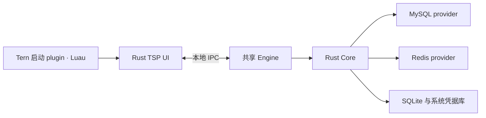

# Datapier

面向开发者与 AI agent 的多数据库工作台。统一连接、资源浏览、查询和数据编辑体验，保留不同数据库的数据模型与操作语义。

首批计划支持 **MySQL 与 Redis**，通过 **Rust TSP（Tern Surface Protocol）应用＋[Tern](https://docs.stencil.so/tern/) 启动 plugin** 交付。

> 当前处于设计阶段：仓库包含产品规划与 0.1.0 技术方案，尚未实现应用源码，也没有可安装版本。以下功能与平台均为规划目标，实际支持范围以发布记录和运行验证结果为准。

## 0.1.0 计划

围绕“连接 → 浏览／查询 → 编辑 → 提交 → 导入导出”完成日常数据库工作流：

- **连接与工作区**：认证、TLS、数据库选择、只读／读写模式，多 tab、最近连接、草稿与布局恢复；多个 UI 共享 Engine。
- **MySQL**：浏览 database、表、视图、字段、索引、约束和 DDL；过滤、多列排序、分页，以及可靠唯一键定位的基表增删改。
- **Redis**：单节点 DB 选择，SCAN 增量浏览与 pattern／type 过滤；String、Hash、List、Set、ZSet 的查看和编辑，key 重命名／删除及 TTL 管理。
- **查询与命令**：执行全文、选区或当前 SQL，语法高亮、关键词／资源补全、执行状态、取消／停止等待、结果、错误、历史和查询文件。
- **数据 grid**：列宽设置、隐藏／冻结列、单元格／行选择、键盘与 Shift 选择、复制粘贴、文本／JSON／NULL 编辑；支持变更预览、撤销、丢弃及冲突反馈。
- **数据交换**：单文件 CSV／JSON 导入导出，列映射、类型转换和失败记录；完整结果增量落盘，大字段按需读取。

0.1.0 按直连 MySQL 和 Redis 单节点设计。视图与任意 SQL 结果提供只读浏览；读写连接仍可显式执行写 SQL。Redis Cluster／Sentinel、鼠标拖拽列宽、鼠标框选和连续虚拟滚动不在该版范围内。

## 目标平台

| 平台 | CPU 架构 | 原生构建目标 |
|---|---|---|
| macOS | x86-64、arm64 | Darwin |
| Linux | x86-64、arm64 | GNU／glibc |
| Windows | x86-64、arm64 | MSVC |

六种组合均要求原生运行验收，交叉编译成功不等于已完成平台支持。最低系统版本和运行库要求将在构建验证后随发布说明公布。

设计验收基线为 Tern 0.9.5、MySQL 8.0／8.4、Redis 6.2／7.2／8.0 单节点；数据库服务可以运行在独立服务器上。

## 架构设计

Rust Core 负责资源、类型、执行、变更与数据库语义；Engine 持有连接和任务，界面通过本地 IPC 访问。macOS／Linux 使用 Unix domain socket，Windows 使用 Named Pipe。Tern 原生渲染 TSP 界面，Luau 负责启动和窗口入口。

主要技术栈为 Rust stable／edition 2024、Tokio、Serde、官方 `tern-sdk`、SQLx、redis-rs、SQLite、keyring 和 sqlparser-rs。数据库 provider 首期随 Engine 编译发布；PostgreSQL、MongoDB 属于后续扩展方向。

数据处理遵循类型保真、增量读取和显式提交：大整数与精确小数保持精度，二进制可逆传输，Redis 修改默认保留 TTL；写入结果无法确认时记录待确认状态，不自动重放。

## 版本路线

| 版本 | 目标 |
|---|---|
| 0.1.0 | MySQL／Redis 基础数据库工作台 |
| 0.2.0 | MCP stdio 接入与 Agent 协作，共用 Engine，可脱离 Tern 使用 |
| 0.3.0 | 结构设计、批量修改与高级值编辑 |
| 0.4.0 | 数据交换、迁移与项目文件 |
| 0.5.0 | 分析展示、显示规则与数据库维护 |

版本按完整工作流推进，尚未承诺发布日期。MCP 不属于 0.1.0，PostgreSQL／MongoDB 暂未绑定交付版本。

## 文档与开发

- [产品规划](docs/product-plan.md)：产品范围、架构、平台矩阵、版本路线与质量标准。
- [0.1.0 技术方案](docs/technical-design-0.1.0.md)：模块、IPC、数据模型、数据库实现、分发及七步实施顺序。
- [开发与 Agent 约定](AGENTS.md)：实现边界、工程规范及验证要求。

应用源码与构建入口尚未创建，当前开发入口是上述设计文档。后续随实现补齐可执行的构建、运行与安装说明。欢迎通过 GitHub Issues 讨论需求、设计与平台适配；开始较大改动前先对齐相应设计。

## 许可证

项目采用 [MIT License](LICENSE)。
