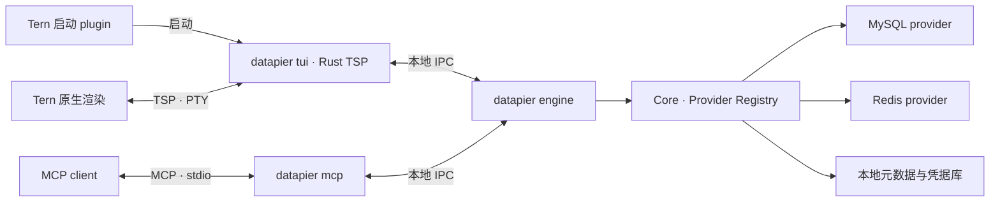

# Datapier 技术产品规划

## 1. 产品定位

Datapier 是面向开发者与 AI agent 的多数据库工作台，统一连接、资源浏览、查询和数据编辑体验，同时保留不同数据库的数据模型与操作语义。

首批支持 **MySQL 与 Redis**，以 **Rust TSP 应用＋Tern 启动 plugin** 交付。共享 Engine 独立于界面；数据库采用内置 provider 扩展，后续可接入 PostgreSQL、MongoDB 及其他界面。MCP 和 Agent 接入属于 0.2.0 规划，当前尚未实现；本文涉及 MCP 的架构、接口与验收均为未来目标。

正式目标平台为 **macOS、Linux、Windows**，每个平台覆盖 **x86-64 与 arm64**，共六种原生运行组合。0.1.0 以此范围交付 UI 与 Engine，0.2.0 规划 MCP 同样覆盖全部目标；既有运行记录见[0.1.0 技术方案](technical-design-0.1.0.md#11-实现与运行记录)，当前 0.1.1 状态见[运行记录](technical-design-0.1.1.md#12-实现与验证记录)。

核心使用场景：

- 开发调试：查表、执行 SQL、检查缓存、修改测试数据。
- 数据处理：筛选、编辑、导入导出，以及结构和数据迁移。
- Agent 协作：通过 MCP 访问同一工作区的数据库能力，在界面中查看执行状态与结果。

产品以本地工作区为中心；连接凭据、历史和草稿保存在用户设备，数据库访问由用户配置的账号授权。

## 2. 技术选型与架构

### 2.1 技术栈

| 层次 | 选型 | 职责 |
|---|---|---|
| Tern 界面 | Rust、官方 tern-sdk 0.2.0、Tern 0.9.9 原生渲染 | 工作区、资源树、查询编辑器、数据 grid 与交互状态 |
| Tern 启动集成 | Tern 内嵌 Luau、Plugin SDK | 命令面板入口、快捷键、定位并启动 Rust 程序 |
| 业务内核与 Engine | Rust、Tokio、Serde | 连接、provider、执行任务、结果、变更、持久化与生命周期 |
| 内部通信 | macOS／Linux 使用 Unix domain socket，Windows 使用字节模式 Named Pipe；共用长度分帧的 JSON 消息 | UI／MCP 到 Engine 的请求、响应和任务事件；支持协议版本握手 |
| MySQL | SQLx 0.9，启用 MySQL、BigDecimal、JSON 与 TLS 支持 | 动态 SQL、元数据、事务和结果流 |
| Redis | redis-rs 1.8，启用 Tokio 与 TLS 支持 | 命令、游标扫描、类型化数据操作 |
| 内部存储 | SQLite，通过 SQLx 访问 | 连接配置、工作区、草稿、查询历史和执行记录；不作为首批外部数据库入口 |
| 凭据存储 | keyring 4.2，启用 `v1`；macOS Keychain、Windows Credential Manager、Linux Secret Service | 密码等秘密数据，与普通配置分离；凭据服务不可用时仅会话内保存 |
| SQL 辅助 | sqlparser-rs、sqlformat、数据库元数据 | 语句定位、基础诊断、补全与原生选区格式化；保留 token 语义，实际执行以数据库反馈为准 |
| Agent 接入 | 官方 Rust MCP SDK rmcp 3.8、stdio | 0.2.0 提供 MCP tools 与结构化结果 |

Rust 使用 stable toolchain、edition 2024；TSP SDK 在 workspace 精确固定为 `0.2.0`，依赖由 `Cargo.lock` 锁定。界面使用 Tern 公开语义控件，表单与主操作保留明确层级；导航行、标签、grid 和状态入口按唯一 HTML 设计使用局部样式，不维护旧 SDK 兼容层。IPC 编解码和会话层共用异步字节流接口，平台实现负责连接建立、端点命名、访问权限、实例锁及进程启动／退出；业务逻辑不按 OS 分叉。

### 2.2 组件与进程边界



- **TSP UI** 管理界面文本、光标、选区、单元格焦点、编辑状态和展示窗口；向 Engine 请求数据与提交变更。Tern 负责原生绘制、布局、命中和输入事件。
- **Engine** 是运行状态的唯一所有者。所有 UI 与 MCP 会话共享连接配置、连接池及有权查看的执行记录；事务和有状态数据库操作属于具体会话，不共享未提交事务。
- **Core** 定义资源、值类型、能力、执行和变更契约；provider 实现数据库行为。Core 不依赖 Tern、TSP 或 MCP。
- **Luau plugin** 使用 window entry，负责启动集成；界面与业务状态由 Rust 实现。
- **MCP adapter** 只做协议转换、权限上下文传递和会话管理，复用 Engine 的 provider、任务及提交逻辑。

发布一个 `datapier` 可执行文件，按子命令启动独立进程：`tui` 运行 TSP 界面，`engine` 运行共享内核，0.2.0 增加 `mcp`。UI 与 MCP 按同一用户数据目录发现或启动唯一 Engine；不同工作区可由同一 Engine 管理。

TSP 和 MCP 分属不同进程及通道：UI 的 PTY 承载 TSP，MCP 的 stdin／stdout 仅承载 MCP 消息。Engine 不继承或持有这两套协议的 stdio，日志也不写入协议输出。

### 2.3 Provider 扩展契约

首期使用编译期注册的内置 provider。MySQL、Redis 随 Engine 一起构建与发布；不实现 Rust 动态库加载、独立安装或热卸载。新增 provider 需要发布新版 Engine；出现第三方独立分发需求后，再评估版本化 IPC 的进程级插件。

公共契约覆盖 provider 描述与连接配置、连接会话、资源枚举与描述、原生操作执行、增量结果读取与释放、变更提交及能力查询。Engine 负责访问控制、任务生命周期和操作记录；provider 负责实际驱动、类型转换、事务、取消、并发检查及资源关闭。

| Provider | 原生操作与结果 | 扩展边界 |
|---|---|---|
| MySQL | SQL、字段与行 | SQL 方言、catalog、类型、行定位及事务语义 |
| Redis | 命令及参数、标量／集合／键值结果 | key／field／member／index、游标、TTL 与命令原子性 |
| PostgreSQL，后续扩展 | SQL、字段与行及特有类型 | 可使用 SQLx PostgreSQL driver，单独实现方言、catalog 和类型映射 |
| MongoDB，后续扩展 | filter、CRUD、aggregation pipeline、BSON 文档 cursor | 使用 MongoDB driver，增加文档浏览和类型化编辑，不转换为 SQL 表模型 |

UI 与 MCP 根据当前连接的 capabilities 开放操作；能力结合服务端版本、部署方式及账号权限确定，不能只按数据库名称写死。错误保留数据库原始错误码及必要的诊断信息。新增数据库仍需相应的数据模型、交互和真实数据库验证，不能仅注册驱动便声明支持。

PostgreSQL、MongoDB 不绑定现有版本的交付日期；当前版本验收仍以 MySQL 与 Redis 为准。

### 2.4 TSP 编辑器与 grid

使用公开 TSP 元素组合数据 grid：表头、行、单元格具有稳定 ID／key 和 action；Rust 保存 active cell、选择锚点、选区、列配置和编辑状态。公开 `table` 用于只读展示，可编辑单元格通过 `input`／`editor` 呈现。内置 SQLite／Database grid 不作为可直接复用的 widget。

单元格从浏览进入编辑，修改本地草稿，确认后进入待提交变更集；只有显式提交才写入数据库。编辑使用文本、UTF-16 光标和选区；支持 Tern 的原生编辑事件时由 Rust 声明能力并处理 `edit`／`undo`，否则由程序处理键盘编辑。native editing 只承担文本编辑，不替代 grid 导航、选择和变更管理。

变更预览由 Core 共享的实际执行构造器产生：MySQL 展示参数化 SQL、绑定参数与事务／校验边界，Redis 展示真实字节命令、脚本和 TTL。预览不写库、不消费编辑令牌，提交时继续复核；截断展示明确标记，不能当作完整执行参数。

标签可按右击目标关闭左侧、右侧或全部；关闭前整批预检草稿和任务，会话关闭等待确认。编辑连接前关闭当前工作区该连接全部标签，其他连接保留。全部关闭后显示零标签空态并持久化，不自动建立占位标签。

0.1.0 包含分页、列宽设置、隐藏／冻结列、点击与键盘导航、Shift 选择、复制粘贴和单元格编辑。列宽可通过设置入口调整。鼠标拖拽列宽、跨单元格鼠标拖选、连续虚拟滚动先验证公开协议和实际运行效果，不作为 0.1.0 的交付承诺，也不依赖未公开的 Tern 事件。

grid 的单格和矩形选区通过应用右键菜单或底部 copy 图标复制，不绑定 Ctrl+C 或 Command+C；后台完整读取大值并保留 TSV、NULL 与二进制语义。行复制和 MySQL INSERT 复制保留。Tern 自动附加的原生 `Copy` 只复制右击节点展示文字，不能读取应用选区或完整大值。

结果展示按行数和字节数限量，只构建当前窗口的节点；编辑时保持其他节点标识稳定，更新受影响的展示部分。首个真实 UI 场景必须验证表头与行列对齐、分页、冻结、选择、中文／emoji 输入、撤销、编辑切换及大字段处理。

### 2.5 Engine 生命周期与恢复

Engine 的存活依据是有效客户端会话。IPC 握手后注册会话并建立租约，正常消息和心跳刷新租约；主动释放、IPC EOF／断连或租约过期时回收该会话。心跳独立于查询等待和界面渲染运行。PID 只作诊断信息，不用于判断会话仍有效。

| 默认配置 | 初始值 | 含义 |
|---|---|---|
| 心跳间隔 | 10 秒 | 客户端无其他业务请求时仍续租 |
| 会话租约 | 45 秒 | 超时未续租则回收会话及其资源 |
| 无会话收尾期限 | 30 秒 | 最后有效会话离开后启动，收尾到期退出 |

- 关闭一个 UI 或 MCP 仅释放该客户端的资源；其他有效会话及其任务继续运行。一次 MCP tool 调用结束不等于 MCP 客户端退出。
- Tern 窗口关闭但 daemon 仍保留 TSP 程序时，该 UI 会话仍可有效；UI 程序或 pane 退出后释放会话。
- MCP adapter 监听上游 stdin EOF、transport 错误和退出信号；上游结束即释放 Engine 会话、停止心跳并关闭 IPC。
- 任一会话离开时，停止其未开始请求，取消其只读查询／扫描，回滚其未提交的私有事务；无法确认已清理的专属连接关闭且不放回连接池。资源回收不等待其他会话退出。
- 该会话已发送的写入／COMMIT 由 Engine 等待并记录最终结果；所有会话均离线时，等待受无会话收尾期限约束。到期仍无法确认的写入落盘标记“结果待确认”并关闭连接，不自动重试。关闭连接不代表数据库已撤销操作。
- 不提供脱离所有客户端永久运行的后台任务。草稿、历史和已完成任务记录持久保存，但不用于保活 Engine。

Engine 启动后尚未获得有效会话时，同样按无会话收尾期限退出。收尾期间新客户端接入时，在同一实例内取消退出计时；已取消或已回滚的旧任务不恢复。正式退出前，在同一临界区内再次检查会话数量并进入停止接入状态，防止新会话与退出并发。

Engine 使用私有数据目录和 OS 文件锁保证实例唯一；运行描述文件仅当前用户可访问。macOS／Linux 的 UDS 位于私有运行目录，Windows Named Pipe 使用当前用户 SID 的访问控制并拒绝远程客户端；端点名称按用户身份及规范化数据目录生成。发现实例时实际探测连接和协议版本，不依赖端点或描述文件是否存在。崩溃后取得实例锁并确认旧实例不可达，再清理残留描述文件及 Unix socket；Windows 管道由系统在句柄关闭后回收。新实例不重放未完成写入，结果不能确认的写操作保留待确认状态。

### 2.6 数据与一致性约束

1. **类型保真。** 大整数、精确小数使用带类型的字符串传输，二进制使用可逆编码；NULL、空字符串与 Redis key 不存在分别表达。未来 BSON 等类型保留原生类型信息，不经普通 JSON 数值或显示字符串静默降级。
2. **增量结果。** Core 增量读取并管理结果缓存或临时文件；IPC 设置帧大小上限，按行数和编码后字节数取页，大字段按需读取。导入导出由 Engine 处理文件，不把完整结果推入 TSP 或 MCP。
3. **编辑与提交。** 未提交编辑支持撤销和丢弃。MySQL 行级编辑要求完整主键或非空唯一键，以参数化 SQL 和原值检查处理并发冲突；无可靠行标识的结果保持只读。Redis 按 key、field、member、index 的实际语义提交，检查并发变化，修改值默认保留 TTL。
4. **执行语义。** 事务绑定所属会话的专属物理连接。MySQL DDL 按服务端隐式提交规则处理；取消使用控制连接请求 `KILL QUERY` 并等待最终状态。Redis 停止等待不等于撤销服务端命令；不承诺统一的跨数据库回滚。
5. **权限一致。** 连接区分只读与读写模式，Core 校验操作权限，数据库账号权限作为最终约束。自由 SQL／命令不能只靠字符串前缀或 MCP annotations 判断安全性；无法判定的操作不在只读模式执行。
6. **恢复边界。** 工作区、草稿和布局由 Engine 持久化；重开 UI 恢复这些状态，不恢复已失效的数据库事务，也不自动重发查询或写入。

### 2.7 平台与架构

| OS | CPU 架构 | Rust target | Engine IPC |
|---|---|---|---|
| macOS | x86-64 | `x86_64-apple-darwin` | Unix domain socket |
| macOS | arm64 | `aarch64-apple-darwin` | Unix domain socket |
| Linux | x86-64 | `x86_64-unknown-linux-gnu` | Unix domain socket |
| Linux | arm64 | `aarch64-unknown-linux-gnu` | Unix domain socket |
| Windows | x86-64 | `x86_64-pc-windows-msvc` | Named Pipe |
| Windows | arm64 | `aarch64-pc-windows-msvc` | Named Pipe |

Linux 发布采用 GNU／glibc 目标，Windows 采用 MSVC 目标。发布前须明确最低 OS／glibc 要求，并在发布说明记录实际验证的系统版本及运行库依赖；最低版本需要同时满足 Tern、TSP SDK 与锁定依赖的要求。现有 CI runner 只是构建基线，Rust target 可用不代表宿主或依赖已完成运行验证。

TSP UI 使用各目标平台对应的 Tern 原生构建。Windows 使用 Tern 随附的 ConPTY，交由官方 SDK 处理 APC／OSC 877 的输入差异；macOS／Linux 使用 PTY。快捷键按平台适配 Command／Ctrl，文本与 IPC 的类型和编码语义保持一致。

路径、用户数据／缓存／运行目录、文件锁、权限和进程退出集中在平台适配代码中处理；兼容含空格、中文及长路径的文件名。Unix socket 使用长度受限的短端点名；Windows 不依赖 Unix 信号或文件权限。Linux Secret Service 不存在或未解锁时执行会话内凭据策略，不写明文配置。


## 3. 项目结构

项目按实际版本新增可运行模块；不预建空壳 crate 或未接线的接口。以下为职责示意，包含后续版本规划，实际路径以源码为准。

```text
datapier/
├── Cargo.toml
├── Cargo.lock
├── crates/
│   ├── datapier/                   # 单一可执行文件，分派 tui／engine；mcp 为后续规划
│   ├── datapier-core/
│   │   └── src/
│   │       ├── model/              # 资源、值类型、能力描述
│   │       ├── connection/         # 数据库连接与会话
│   │       ├── execution/          # 任务、结果读取与取消
│   │       ├── changes/            # 变更集与冲突处理
│   │       ├── providers/          # 公共契约、registry 及内置实现
│   │       │   ├── mysql/
│   │       │   └── redis/
│   │       └── storage/            # 内部元数据与凭据访问
│   ├── datapier-engine/            # Core、IPC、租约、收尾及 OS 平台适配
│   ├── datapier-tsp/               # TSP 界面、编辑器、grid、Engine client
│   └── datapier-mcp/               # 0.2.0 新增，编入 datapier mcp
├── plugins/
│   └── datapier/
│       ├── plugin.toml
│       ├── window.luau            # 启动命令与快捷键
│       └── lib/bootstrap.luau     # 定位、获取和启动对应版本二进制
├── tests/
│   ├── fixtures/                  # 数据库与文件样本
│   └── scenarios/                 # 真实交互、协议与恢复场景
└── docs/
    ├── product-plan.md
    └── technical-design-0.1.0.md
```

- Engine 实例化并持有 Core；TSP UI 与 MCP adapter 通过本地 IPC 访问 Engine，不直接连接数据库。内部 IPC 契约与 client 在两个入口之间复用，不复制业务实现。
- provider 先保留为 Core 内部模块，使用同一公共契约和显式注册；依赖和实现规模需要时再拆 crate，不要求每个 provider 首期独立成包。
- `plugins/datapier` 是可安装的 Tern 启动包；plugin ID 为 `datapier`，命令面板入口保留 `New Datapier block`，实际启动 pane 内的 TSP 应用。
- Rust 构建产物、二进制缓存、数据库文件、日志和运行描述文件放在启动包外，避免触发 plugin 热重载。工作区和秘密数据不依赖启动包目录存续。

## 4. 版本规划

### 4.1 0.1.0：基础数据库工作台

目标：完整覆盖“连接 → 浏览／查询 → 编辑 → 提交 → 导入导出”的日常工作流。当前实现和运行验收范围见 [README](../README.md) 与[技术方案](technical-design-0.1.0.md#11-实现与运行记录)。

| 功能 | 交付内容 |
|---|---|
| 连接与工作区 | 保存、测试、编辑连接；密码／ACL 认证、TLS、数据库选择、只读模式；多 tab、最近连接、草稿与布局恢复；多 UI 共享 Engine |
| MySQL 资源浏览 | database、表、视图、字段、索引、约束与 DDL 查看／复制；刷新结构 |
| MySQL 数据浏览 | 分页、过滤、多列排序、列宽设置、隐藏／冻结列、点击／键盘／Shift 选择、复制粘贴 |
| MySQL 数据编辑 | 有可靠唯一标识的基表行增删改；文本、JSON、NULL 编辑；待提交变更、撤销／丢弃、提交结果与冲突提示 |
| Redis 数据浏览与编辑 | DB 选择，SCAN 增量浏览与 pattern／type 过滤；String、Hash、List、Set、ZSet 的查看与增删改；key 重命名／删除、TTL 设置／移除 |
| 查询与命令 | SQL／Redis 命令多 tab；执行全文、选区、当前 SQL 语句；语法高亮、关键词／资源补全、执行状态、取消／停止等待、结果与错误、历史、查询文件保存／打开 |
| 基础数据交换 | 单文件 CSV／JSON 导入导出；MySQL 表／查询结果、Redis key 与类型化内容；列映射、NULL／类型转换、失败记录反馈 |

0.1.0 按直连 MySQL 和 Redis 单节点交付，Redis Cluster／Sentinel 不作为该版支持声明。Redis 浏览使用游标，不承诺全库任意排序或一致性分页快照。MySQL 视图和任意 SQL 结果先提供只读浏览，用户仍可显式执行 SQL 完成 DDL 与写操作。

SQL 当前语句定位使用 MySQL tokenizer 识别引号、注释和语句边界；遇到不支持的客户端脚本指令或无法定位的语句，显示原因，保留全文／选区执行，不按分号盲切。

首期 grid 范围以第 2.4 节为准；拖拽列宽、鼠标框选和连续虚拟滚动不作为该版验收要求。先以公开 TSP 完成真实交互验证，再扩展数据操作，不以示意节点代替可用编辑器。

**验收：** 用户能在同一工作区操作 MySQL 与 Redis，完成查询、编辑、冲突处理和数据交换；关闭／重开 UI 后恢复草稿与布局。十万行结果可增量浏览，UI 不持有整个结果；中文、emoji、BIGINT、DECIMAL、NULL、二进制和 Redis TTL 不发生静默失真。多个 UI 复用同一 Engine；全部会话退出后按租约与收尾规则释放资源，未确认写入可在重开后识别。

实施细节见 [0.1.0 技术方案](technical-design-0.1.0.md)。

### 0.1.1：Archery 只读来源

0.1.1 增加 Archery 服务登录和 MySQL／Redis 实例与 DB 批量选择。MySQL 支持结构浏览、只读 SQL 与上线 SQL 检查；Redis 提供受控只读命令及平台文本结果。本次缓存与 JSON 导出保留来源、范围和保真度信息；CSV 仅包含列和值，不生成附属元数据文件。结果不承诺全库或原始字节。平台历史打开即加载第一页，不自动执行历史语句。

Archery 来源不提供数据库写入、编辑、导入或工单执行；Direct 的现有能力保持独立。配置升级、数据保留、回退及最低版本限制见 [0.1.1 技术方案](technical-design-0.1.1.md)。本版尚未正式发布；原生运行验收范围为 macOS arm64，其他五个目标保留实现，在 PR 阶段验证编译。实际验证及环境见[运行记录](technical-design-0.1.1.md#12-实现与验证记录)。

Archery 是受控数据库访问来源，保留 MySQL／Redis 类型、平台权限、查询限制和审计语义。新建与设置共用服务器连接管理，支持多个实例及 DB 的配置与变更预览；本地批量变更须完整校验基线与占用，失败不部分应用，不影响远端数据和本地历史。

认证支持手动验证码和可选本机 TOTP，同账号跨窗口共享登录；首次连接认证成功后自动续接原连接请求一次，失败的 SQL／Redis 命令不自动重放。历史支持全量检索和分页，打开仅回填文本，保留当前执行目标。

交互与视觉规则统一见 [UI 设计说明](ui-redesign.md)，数据契约、升级及验收要求见 [0.1.1 技术方案](technical-design-0.1.1.md)。产品规划不重复字段校验、角标位置、控件样式或逐步操作文案。


### 4.2 0.2.0：MCP 与 Agent 协作

目标：让 agent 使用与人相同的数据库能力与运行状态。

- 提供 `datapier mcp` stdio server，可由 omp 和其他标准 MCP client 启动；支持不打开 Tern 界面的独立使用。
- tools 覆盖连接发现、资源枚举、结构描述、查询／命令执行、分页取结果、任务状态、取消及变更提交。
- 结果包含字段类型、执行 ID、分页引用、完成／截断状态与结构化错误；大结果按需获取。
- agent 任务进入共享执行记录，Tern 工作区可查看状态并打开结果。UI 与 MCP 的事务会话互相隔离；MCP 不产生 TSP 输出，也不要求 Tern 启动。
- 每个连接分别配置 UI 与 agent 的访问级别，agent 默认只读；显式开启 agent 读写后才开放写命令与变更提交。Core 统一校验，MCP 权限不超过连接及数据库账号权限。

**验收：** 标准 MCP client 能查询 MySQL、浏览 Redis、分批读取结果，并在 Tern 中打开同一任务；默认模式拒绝写入，开启读写后实际变更可由 UI 刷新观察。一次 tool 调用结束保持会话有效；宿主退出或异常断连能释放会话，其他 UI／MCP 会话的连接和任务继续运行。无 Tern 时仍能完成 MCP 查询与结果读取。

### 4.3 0.3.0：结构设计与高级编辑

目标：减少结构调整、批量修改及复杂值处理对手写脚本的依赖。

- MySQL 可视化表结构、字段、主外键、约束、索引、视图和触发器编辑；执行前展示生成的 DDL 与服务端提交语义。
- 仅对可确认唯一基表映射的 MySQL 可更新视图开放编辑；其他视图继续只读。
- 文本／正则查找替换、批量变更预览；提交时复用冲突检查和逐项结果。
- Hex、JSON、XML 编辑，图片／SVG 预览，值文件导入导出与外部编辑器联动。数据库不支持的值类型不展示对应编辑入口。

**验收：** 用表单完成字段／索引调整并读回确认；批量替换可预览、丢弃与提交；二进制文件导入导出保持字节一致，外部编辑返回时能发现数据已变化。

### 4.4 0.4.0：数据交换与迁移

目标：支持可重复的数据迁移流程和可携带的项目配置。

- 多文件导入、字段／类型映射、编码与分隔符设置；冲突策略明确为新增、跳过或覆盖。
- MySQL schema／data 的 SQL 逻辑导出与恢复；支持同类数据库之间的表数据迁移。
- Redis 按类型迁移 key、集合内容与 TTL；展示已执行、失败和未执行项，不承诺跨 key 回滚或在线一致性快照。
- 流式处理大文件，提供进度、取消和错误定位；取消后明确已生效范围。
- 导出／导入 Datapier 项目文件，包含连接引用、查询、布局和显示配置；密码与访问 token 不进入项目文件。

**验收：** 将 MySQL 表和 Redis 各基础类型迁移到另一测试实例，核对类型、内容与 TTL；中途失败能定位已完成范围；项目文件在新工作区恢复配置并重新获取凭据。

### 4.5 0.5.0：分析展示与数据库维护

目标：在工作台内完成结果分析和常见维护操作。

- Plot 支持折线、柱状、散点、多序列、堆叠、双轴、对数轴、缩放及图表导出；输入采用明确的结果范围或聚合结果。
- 显示规则支持时间戳、日期、数字格式、表达式格式与条件着色；规则不改变原始值。
- MySQL 提供参数查看、表检查、统计信息更新和表优化入口；Redis 提供内存、key 大小、TTL 分布及过期清理辅助。
- 维护操作展示对象、影响范围和执行结果；Redis 批量清理先扫描预览，不执行全库阻塞式枚举。
- provider capabilities 决定专属入口；SQLite Pragmas、VACUUM、Attach 等专属功能不迁移到 MySQL／Redis 产品界面。

**验收：** 查询结果能生成并导出图表；显示规则不会改变导出原值；维护动作的影响对象与实际结果一致，大数据集分析与扫描不阻塞工作区交互。

## 5. 开发环境与质量标准

### 5.1 开发环境

macOS 开发使用 Homebrew 安装的 Rust 与 Cargo，不强制引入 rustup；Linux 与 Windows 准备对应 stable Rust／Cargo 和本地链接工具，Windows 使用 MSVC 构建工具及目标架构的链接库。六种目标使用一致的锁定依赖；0.1.1 在 macOS arm64 使用实际 Tern 验证，其他目标在 PR 阶段核对构建。CodeGraph 用于 AI 定位符号、调用关系和影响范围，Cargo 编译诊断作为实现反馈；LSP 不列为必需条件，格式化规则统一见[贡献指南](../CONTRIBUTING.md#代码格式化)。

Luau 由 Tern 内嵌执行，不要求单独安装 Luau runtime。修改启动 plugin 时可由目标版本的 `tern plugin types` 生成声明供参考，真实行为通过 Tern 加载和启动验证，不以类型声明或 LSP 检查代替运行。TSP SDK 负责协议编码与事件接入，grid 和数据库工作流仍由 Datapier 实现。

0.1.0 的实现与历史运行范围见[技术方案](technical-design-0.1.0.md#11-实现与运行记录)。后续 MCP 与高级功能计划复用现有能力。

### 5.2 验证标准

研发按 0.1.0 → 0.2.0 → 0.3.0 → 0.4.0 → 0.5.0 顺序推进，不绑定未经评估的日历日期。每版必须形成完整用户流程和可安装产物，再进入下一版。

| 验证场景 | 输入与预期结果 |
|---|---|
| 基础正确性 | MySQL 含重复行、无主键表、唯一键、NULL、超大整数、精确小数、中文和二进制；只允许可靠定位的行编辑，读写与导出保真 |
| Redis 语义 | 五种基础类型、空值、二进制 key、无过期／将过期／已不存在的 key；按类型操作，更新值保留 TTL，过期状态不混淆 |
| 并发与失败 | 两个独立客户端修改同一对象、认证失败、断线、任务取消；冲突不静默覆盖，写入结果未知不自动重试 |
| TSP 交互与恢复 | 在实际 Tern 中验证分页、列宽设置、隐藏／冻结、键盘／Shift 选择、复制粘贴、编辑和撤销；输入中文／emoji，选择 SQL 执行；重开 UI 后恢复草稿和布局 |
| 大数据 | 十万行结果、百万 key 扫描、大文件；页大小同时受行数与字节数约束，只生成当前窗口节点，导出不只包含当前页 |
| Engine 会话 | 多个 UI／MCP 共享实例；主动退出、崩溃、EOF 和租约过期均回收所属资源，不影响其他会话 |
| Engine 收尾与恢复 | 最后会话退出后取消读任务、回滚未提交事务；写入超时留待确认记录；收尾期接入复用实例；验证 Unix 残留 socket、Windows 管道断连、实例锁及运行描述文件恢复；不自动重放写入 |
| MCP | 实际 initialize、tools/list、tools/call；执行查询、取后续页、取消和权限拒绝；任务可在 UI 定位；宿主退出传播至 Engine；无 Tern 时独立运行 |
| 安装与版本 | 在本版原生验收平台从干净环境安装，取得正确架构的匹配二进制；保留 Windows `.exe`、Unix 执行权限、空格／中文路径及所需运行库的跨平台实现；下载失败可重试且不留下可执行的半文件；IPC 不兼容时明确报错，不抢占活动实例 |

平台实现与构建保留第 2.7 节全部六种组合。0.1.1 原生运行验收仅覆盖 macOS arm64，验证安装启动、TSP 交互、数据库读写及 TLS、类型保真、凭据存取、多客户端 IPC、退出收尾和恢复；其他五个目标在 PR 阶段验证编译、默认测试和版本 smoke，不要求本轮原生运行验收。构建与运行记录分别说明，不把编译通过写成实际运行通过。后续版本的运行范围在对应方案中确认；0.2.0 起的 MCP 验收仍包括 stdio 及无 Tern 的独立运行。

当前宿主验收基线为 Tern 0.9.9，数据库范围为 MySQL 5.7／8.0／8.4、Redis 6.2／7.2／8.0 单节点。数据库实例可部署于独立测试服务器，不要求数据库服务端与客户端在同一台机器。TSP SDK、协议事件及 native editing 以验收平台 Tern 的实际行为为准；其他平台保留对应实现，包括 Windows 随附 ConPTY，运行状态按实际证据说明。

凭据库不可用时只在当前 Engine 会话保存秘密，重启后重新输入，不写入明文配置。Engine 或数据库不可达时保留草稿、显示失败原因并提供重新连接，不伪造空结果。

## 6. 分发与版本兼容

- **开发：** 本地构建 `datapier`，启动 plugin 链接 `plugins/datapier` 并使用开发二进制路径。修改 Rust 后重新构建并运行；修改 Luau 后由 Tern 重载启动入口。
- **发布：** 提供通用 Tern Luau 启动包及第 2.7 节六种 Rust target 的原生可执行产物，按版本和 target 分包，Windows 程序名为 `datapier.exe`。Tern 的 Git 安装器只安装启动包，不编译 Rust；bootstrap 按 OS 与原生 CPU 架构定位或下载匹配产物，规范化 x86-64／x86_64／amd64 和 arm64／aarch64 名称，校验后原子写入版本化缓存，再启动 UI。缓存同时区分版本、OS 和 CPU 架构；更新 Windows 正在运行的程序时使用新版本目录，不原地覆盖活动二进制。
- **MCP：** 标准 MCP client 配置对应平台的可执行文件并传入 `mcp` 参数；首次使用可独立启动 Engine，无须经过 Luau bootstrap 或安装 Tern。启动参数独立传递，兼容 Windows 路径与空格，不依赖 shell 字符串拼接。
- **版本：** 启动包声明匹配的二进制版本；IPC 握手校验协议版本。不兼容时提示更新组件或在现有会话结束后重启 Engine，不强杀活动实例，不在同一数据目录并行启动不兼容实例。
- **数据：** 升级或删除启动包不删除用户数据库、连接配置与草稿；缓存、运行文件、持久数据和凭据按用途分离。

## 7. 参考依据

- [Tern TSP](https://docs.stencil.so/tern/protocol/index.md)、[官方 SDK](https://docs.stencil.so/tern/protocol/sdks.md)、[TSP 元素](https://docs.stencil.so/tern/elements/index.md)、[输入与原生编辑](https://docs.stencil.so/tern/protocol/input.md)
- [Tern Plugin 架构](https://docs.stencil.so/tern/concepts/architecture.md)、[输入元素](https://docs.stencil.so/tern/elements/input.md)、[table 的交互边界](https://docs.stencil.so/tern/elements/data.md#table)
- [Tern 包结构与 CLI](https://docs.stencil.so/tern/reference/cli.md)、[运行限制](https://docs.stencil.so/tern/reference/limits.md)、[grid 组合实现参考](https://github.com/zerx-lab/tern-office-preview)
- [SQLx 0.9 MySQL 类型映射](https://docs.rs/sqlx/0.9.0/sqlx/mysql/types/index.html)、[SQLx 数据库 features](https://docs.rs/crate/sqlx/0.9.0/features)、[MySQL 查询取消](https://dev.mysql.com/doc/refman/8.4/en/kill.html)
- [redis-rs 1.8](https://docs.rs/redis/1.8.0/redis/)、[Redis SCAN 语义](https://redis.io/docs/latest/commands/scan/)
- [Rust MCP SDK](https://github.com/modelcontextprotocol/rust-sdk)、[MCP stdio](https://modelcontextprotocol.io/specification/2025-11-25/basic/transports#stdio)、[Tokio UnixStream](https://docs.rs/tokio/latest/tokio/net/struct.UnixStream.html)
- [MongoDB Rust driver](https://github.com/mongodb/mongo-rust-driver)、[Rust ABI 稳定性](https://doc.rust-lang.org/reference/items/external-blocks.html#abi)
- [keyring](https://docs.rs/keyring/latest/keyring/)、[sqlparser-rs](https://github.com/apache/datafusion-sqlparser-rs)
- [Tern 三平台支持矩阵](https://docs.stencil.so/tern/concepts/support-matrix.md)、[TSP Windows transport](https://docs.stencil.so/tern/protocol/transport.md#windows)
- [Tokio Windows Named Pipe](https://docs.rs/tokio/latest/tokio/net/windows/named_pipe/index.html)、[Windows Named Pipe 安全](https://learn.microsoft.com/en-us/windows/win32/ipc/named-pipe-security-and-access-rights)、[Rust 平台与 target 支持](https://doc.rust-lang.org/rustc/platform-support.html)
- [keyring v1 平台凭据后端](https://docs.rs/keyring/4.2.0/keyring/v1/index.html)
