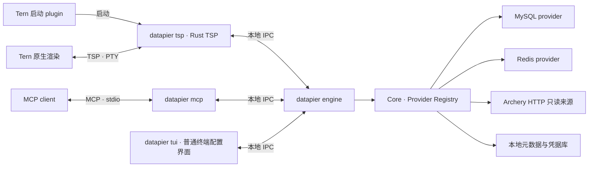

# Datapier 技术产品规划

## 1. 产品定位

Datapier 是面向开发者与 AI agent 的多数据库工作台，统一连接、资源浏览、查询和数据编辑体验，同时保留不同数据库的数据模型与操作语义。

当前 0.5.1 候选支持 **MySQL 与 Redis** 直连及 Archery 只读来源，提供 Rust TSP／Tern 工作台、普通终端 TUI 和 MCP stdio。共享 Engine 独立于界面。数据库采用内置 provider 扩展，PostgreSQL、MongoDB 为后续方向。正式发布状态以 [GitHub Releases](https://github.com/huspx/datapier/releases) 为准，本版契约见 [0.5.1 技术方案](technical-design-0.5.1.md)。

目标平台为 **macOS、Linux、Windows**，每个平台覆盖 **x86-64 与 arm64**。当前候选原生运行证据来自 macOS arm64；六目标构建、默认测试和打包结果须按对应提交的 CI 核对，其他五目标尚无完整运行验收，历史记录不能代替本候选验证。

核心使用场景：

- 开发调试：查表、执行 SQL、检查缓存、修改测试数据。
- 数据处理：筛选、编辑、导入导出，以及结构和数据迁移。
- Agent 协作：通过 MCP 访问同一工作区的数据库能力，在界面中查看执行状态与结果。

产品以本地工作区为中心；连接凭据、历史和草稿保存在用户设备，数据库访问由用户配置的账号授权。

## 2. 技术选型与架构

### 2.1 技术栈

| 层次 | 选型 | 职责 |
|---|---|---|
| Tern 界面 | Rust、官方 tern-sdk 0.2.0、Tern 0.9.29 或更新 | 工作区、资源树、查询编辑器、数据 grid 与交互状态 |
| 普通终端 TUI | Ratatui 0.30.2、Crossterm 0.29.0 | 无 Tern 的数据源、认证与全局设置管理，不提供查询 grid 或审批 |
| Tern 启动集成 | Tern 内嵌 Luau、Plugin SDK | 命令面板入口、快捷键、定位并启动 Rust 程序 |
| 业务内核与 Engine | Rust、Tokio、Serde | 连接、provider、执行任务、结果、变更、持久化与生命周期 |
| 内部通信 | macOS／Linux 使用 Unix domain socket，Windows 使用字节模式 Named Pipe；共用长度分帧的 JSON 消息 | UI／MCP 到 Engine 的请求、响应和任务事件；支持协议版本握手 |
| MySQL | SQLx 0.9，启用 MySQL、BigDecimal、JSON 与 TLS 支持 | 动态 SQL、元数据、事务和结果流 |
| Redis | redis-rs 1.8.2，启用 Tokio 与 TLS 支持 | 命令、游标扫描、类型化数据操作 |
| 内部存储 | SQLite，通过 SQLx 访问 | 连接配置、工作区、草稿、查询历史和执行记录；不作为首批外部数据库入口 |
| 凭据存储 | keyring 4.2，启用 `v1`；macOS Keychain、Windows Credential Manager、Linux Secret Service | 密码等秘密数据，与普通配置分离；凭据服务不可用时仅会话内保存 |
| SQL 辅助 | sqlparser-rs 0.64.0、sqlformat 0.5.0、数据库元数据 | 语句定位、基础诊断、补全与原生选区格式化；保留 token 语义，实际执行以数据库反馈为准 |
| Agent 接入 | 官方 Rust MCP SDK rmcp、stdio | 23 个 tools、结构化结果与能力协商后的用户确认；不提供远程 transport |

Rust 最低使用 1.100.0 稳定工具链、edition 2024，CI 固定 Rust 1.100.0；TSP SDK 在 workspace 精确固定为 `0.2.0`，依赖由 `Cargo.lock` 锁定，当前版本说明见[贡献指南](../CONTRIBUTING.md#开发环境)。界面使用 Tern 公开语义控件，表单与主操作保留明确层级；导航行、标签、grid 和状态入口按唯一 HTML 设计使用局部样式，不维护旧 SDK 兼容层。IPC 编解码和会话层共用异步字节流接口，平台实现负责连接建立、端点命名、访问权限、实例锁及进程启动／退出；业务逻辑不按 OS 分叉。

### 2.2 组件与进程边界

当前候选组件与进程边界如下，具体实现以源码为准。



- **TSP UI** 管理界面文本、光标、选区、单元格焦点、编辑状态和展示窗口；向 Engine 请求数据与提交变更。Tern 负责原生绘制、布局、命中和输入事件。
- **Engine** 是运行状态的唯一所有者。所有 UI 与 MCP 会话共享连接配置、连接池及有权查看的执行记录；事务和有状态数据库操作属于具体会话，不共享未提交事务。
- **Core** 定义资源、值类型、能力、执行和变更契约；provider 实现数据库行为。Core 不依赖 Tern、TSP 或 MCP。
- **Luau plugin** 使用 window entry，负责启动集成；界面与业务状态由 Rust 实现。
- **MCP adapter** 只做协议转换、权限上下文传递和会话管理，复用 Engine 的 provider、任务及提交逻辑。

一个 `datapier` 可执行文件按子命令启动独立进程：`tui` 运行普通终端的数据源与认证管理，`tsp` 运行 Tern 工作台，`mcp` 运行 stdio server，`engine` 运行共享内核。各入口按同一用户数据目录发现或启动唯一 Engine；不同工作区可由同一 Engine 管理。旧 `tui` 不再分派 TSP。

TSP 和 MCP 分属不同进程及通道：UI 的 PTY 承载 TSP，MCP 的 stdin／stdout 仅承载 MCP 消息。Engine 不继承或持有这两套协议的 stdio，日志也不写入协议输出。

### 2.3 Provider 扩展契约

首期使用编译期注册的内置 provider。MySQL、Redis 随 Engine 一起构建与发布；不实现 Rust 动态库加载、独立安装或热卸载。新增 provider 需要发布新版 Engine；出现第三方独立分发需求后，再评估版本化 IPC 的进程级插件。

公共契约覆盖 provider 描述与连接配置、连接会话、资源枚举与描述、原生操作执行、增量结果读取与释放、变更提交及能力查询。Engine 负责访问控制、任务生命周期和操作记录；provider 负责实际驱动、类型转换、事务、取消、并发检查及资源关闭。

| Provider | 原生操作与结果 | 扩展边界 |
|---|---|---|
| MySQL | SQL、字段与行 | SQL 方言、catalog、类型、行定位及事务语义 |
| Redis | 命令及参数、标量／集合／键值结果 | key／field／member／index、游标、TTL 与命令原子性 |
| PostgreSQL，后续扩展 | SQL、字段与行及特有类型 | 可使用 SQLx PostgreSQL driver，单独实现方言、catalog 和类型映射 |
| MongoDB，后续扩展 | filter、CRUD、aggregation pipeline、BSON 文档 cursor | 使用 MongoDB driver，增加文档浏览和类型化编辑，不转换为 SQL 表模型 |

UI 与 MCP 根据当前连接的 capabilities 开放操作；能力结合服务端版本、部署方式及账号权限确定，不能只按数据库名称写死。错误保留数据库原始错误码及必要的诊断信息。新增数据库仍需相应的数据模型、交互和真实数据库验证，不能仅注册驱动便声明支持。

PostgreSQL、MongoDB 不绑定现有版本的交付日期；当前版本验收仍以 MySQL 与 Redis 为准。

### 2.4 TSP 编辑器与 grid

使用公开 TSP 元素组合数据 grid：表头、行、单元格具有稳定 ID／key 和 action；Rust 保存 active cell、选择锚点、选区、列配置和编辑状态。公开 `table` 用于只读展示，可编辑单元格通过 `input`／`editor` 呈现。内置 SQLite／Database grid 不作为可直接复用的 widget。

单元格从浏览进入编辑，修改本地草稿，确认后进入待提交变更集；只有显式提交才写入数据库。编辑使用文本、UTF-16 光标和选区；支持 Tern 的原生编辑事件时由 Rust 声明能力并处理 `edit`／`undo`，否则由程序处理键盘编辑。native editing 只承担文本编辑，不替代 grid 导航、选择和变更管理。

变更预览由 Core 共享的实际执行构造器产生：MySQL 展示参数化 SQL、绑定参数与事务／校验边界，Redis 展示真实字节命令、脚本和 TTL。预览不写库、不消费编辑令牌，提交时继续复核；截断展示明确标记，不能当作完整执行参数。

标签可按右击目标关闭左侧、右侧或全部；关闭前整批预检草稿和任务，会话关闭等待确认。编辑连接前关闭当前工作区该连接全部标签，其他连接保留。全部关闭后显示零标签空态并持久化，不自动建立占位标签。

0.1.0 包含分页、列宽设置、隐藏／冻结列、点击与键盘导航、Shift 选择、复制粘贴和单元格编辑。列宽可通过设置入口调整。鼠标拖拽列宽、跨单元格鼠标拖选、连续虚拟滚动先验证公开协议和实际运行效果，不作为 0.1.0 的交付承诺，也不依赖未公开的 Tern 事件。

grid 的单格和矩形选区通过应用右键菜单或底部 copy 图标复制，不绑定 Ctrl+C 或 Command+C；后台完整读取大值并保留 TSV、NULL 与二进制语义。行复制和 MySQL INSERT 复制保留。Tern 自动附加的原生 `Copy` 只复制右击节点展示文字，不能读取应用选区或完整大值。

结果展示按行数和字节数限量，只构建当前窗口的节点；编辑时保持其他节点标识稳定，更新受影响的展示部分。首个真实 UI 场景必须验证表头与行列对齐、分页、冻结、选择、中文／emoji 输入、撤销、编辑切换及大字段处理。

### 2.5 Engine 生命周期与恢复

Engine 的存活依据是有效客户端会话。IPC 握手后注册会话并建立租约，正常消息和心跳刷新租约；主动释放、IPC EOF／断连或租约过期时回收该会话。心跳独立于查询等待和界面渲染运行。PID 只作诊断信息，不用于判断会话仍有效。

| 默认配置 | 初始值 | 含义 |
|---|---|---|
| 心跳间隔 | 10 秒 | 客户端无其他业务请求时仍续租 |
| 会话租约 | 45 秒 | 超时未续租则回收会话及其资源 |
| 无会话收尾期限 | 30 秒 | 最后有效会话离开后启动，收尾到期退出 |

- 关闭一个 UI 或 MCP 仅释放该客户端的资源；其他有效会话及其任务继续运行。一次 MCP tool 调用结束不等于 MCP 客户端退出。
- Tern 窗口关闭但 daemon 仍保留 TSP 程序时，该 UI 会话仍可有效；UI 程序或 pane 退出后释放会话。
- MCP adapter 监听上游 stdin EOF、transport 错误和退出信号；上游结束即释放 Engine 会话、停止心跳并关闭 IPC。
- 任一会话离开时，停止其未开始请求，取消其只读查询／扫描，回滚其未提交的私有事务；无法确认已清理的专属连接关闭且不放回连接池。资源回收不等待其他会话退出。
- 该会话已发送的写入／COMMIT 由 Engine 等待并记录最终结果；所有会话均离线时，等待受无会话收尾期限约束。到期仍无法确认的写入落盘标记“结果待确认”并关闭连接，不自动重试。关闭连接不代表数据库已撤销操作。
- 不提供脱离所有客户端永久运行的后台任务。草稿、历史和已完成任务记录持久保存，但不用于保活 Engine。

Engine 启动后尚未获得有效会话时，同样按无会话收尾期限退出。收尾期间新客户端接入时，在同一实例内取消退出计时；已取消或已回滚的旧任务不恢复。正式退出前，在同一临界区内再次检查会话数量并进入停止接入状态，防止新会话与退出并发。

Engine 使用私有数据目录和 OS 文件锁保证实例唯一；运行描述文件仅当前用户可访问。macOS／Linux 的 UDS 位于私有运行目录，Windows Named Pipe 使用当前用户 SID 的访问控制并拒绝远程客户端；端点名称按用户身份及规范化数据目录生成。发现实例时实际探测连接和协议版本，不依赖端点或描述文件是否存在。崩溃后取得实例锁并确认旧实例不可达，再清理残留描述文件及 Unix socket；Windows 管道由系统在句柄关闭后回收。新实例不重放未完成写入，结果不能确认的写操作保留待确认状态。

### 2.6 数据与一致性约束

1. **类型保真。** 大整数、精确小数使用带类型的字符串传输，二进制使用可逆编码；NULL、空字符串与 Redis key 不存在分别表达。未来 BSON 等类型保留原生类型信息，不经普通 JSON 数值或显示字符串静默降级。
2. **按需结果。** 查询结果不落盘、仅保留有界会话内数据；普通只读查询实时分页，不能安全重复的语句只执行一次并分批读流。IPC 按字节限制传输，大字段按需读取；历史不保存结果行。TSP 导出安全只读源时显式重查流写，其他来源只导出仍保留数据并注明范围；MCP 不提供导入导出。0.1.x 的结果缓存与导出契约保留在对应历史方案。
3. **编辑与提交。** 未提交编辑支持撤销和丢弃。MySQL 行级编辑要求完整主键或非空唯一键，以参数化 SQL 和原值检查处理并发冲突；无可靠行标识的结果保持只读。Redis 按 key、field、member、index 的实际语义提交，检查并发变化，修改值默认保留 TTL。
4. **执行语义。** 事务绑定所属会话的专属物理连接。MySQL DDL 按服务端隐式提交规则处理；取消使用控制连接请求 `KILL QUERY` 并等待最终状态。Redis 停止等待不等于撤销服务端命令；不承诺统一的跨数据库回滚。
5. **权限一致。** Core 校验连接原有只读／读写模式，数据库账号与平台权限作为上限。0.2.0 MCP 基准范围与保存的资源树可见范围一致；细粒度控制默认关闭，关闭时沿用连接模式，开启时叠加 MySQL DB 级／Redis 实例级授权。自由 SQL 分析实际读写范围，未知范围拒绝，危险审批不能扩权；annotations 和 SQL 前缀不替代检查。
6. **恢复边界。** 工作区、草稿意图和布局由 Engine 持久化；重开 UI 不恢复已失效的数据库事务，不自动重发查询或写入。0.2.0 不恢复历史查询结果，审批与写入发送阶段等必要事实独立保留，旧缓存迁移与显式清理见版本方案。

### 2.7 平台与架构

| OS | CPU 架构 | Rust target | Engine IPC |
|---|---|---|---|
| macOS | x86-64 | `x86_64-apple-darwin` | Unix domain socket |
| macOS | arm64 | `aarch64-apple-darwin` | Unix domain socket |
| Linux | x86-64 | `x86_64-unknown-linux-gnu` | Unix domain socket |
| Linux | arm64 | `aarch64-unknown-linux-gnu` | Unix domain socket |
| Windows | x86-64 | `x86_64-pc-windows-msvc` | Named Pipe |
| Windows | arm64 | `aarch64-pc-windows-msvc` | Named Pipe |

Linux 发布采用 GNU／glibc 目标，Windows 采用 MSVC 目标。发布前须明确最低 OS／glibc 要求，并在发布说明记录实际验证的系统版本及运行库依赖；最低版本需要同时满足 Tern、TSP SDK 与锁定依赖的要求。现有 CI runner 只是构建基线，Rust target 可用不代表宿主或依赖已完成运行验证。

TSP UI 使用各目标平台对应的 Tern 原生构建。Windows 使用 Tern 随附的 ConPTY，交由官方 SDK 处理 APC／OSC 877 的输入差异；macOS／Linux 使用 PTY。快捷键按平台适配 Command／Ctrl，文本与 IPC 的类型和编码语义保持一致。

路径、用户数据／缓存／运行目录、文件锁、权限和进程退出集中在平台适配代码中处理；兼容含空格、中文及长路径的文件名。Unix socket 使用长度受限的短端点名；Windows 不依赖 Unix 信号或文件权限。Linux Secret Service 不存在或未解锁时执行会话内凭据策略，不写明文配置。


## 3. 项目结构

当前候选由六个 crate 组成；以下为职责示意，实际路径以源码为准。

```text
datapier/
├── Cargo.toml
├── Cargo.lock
├── crates/
│   ├── datapier/                   # tui／tsp／mcp／engine 命令分派
│   ├── datapier-core/
│   │   └── src/
│   │       ├── model/              # 资源、值类型、能力描述
│   │       ├── connection/         # 数据库连接与会话
│   │       ├── execution/          # 任务、结果读取与取消
│   │       ├── changes/            # 变更集与冲突处理
│   │       ├── providers/          # 公共契约、registry 及内置实现
│   │       │   ├── mysql/
│   │       │   └── redis/
│   │       └── storage/            # 内部元数据与凭据访问
│   ├── datapier-engine/            # Core、IPC、租约、收尾及 OS 平台适配
│   ├── datapier-tsp/               # TSP 界面、编辑器、grid、Engine client
│   ├── datapier-tui/               # 普通终端配置、认证与设置
│   └── datapier-mcp/               # MCP stdio 适配
├── plugins/
│   └── datapier/
│       ├── plugin.toml
│       ├── window.luau            # 启动命令与快捷键
│       └── lib/bootstrap.luau     # 定位、获取和启动对应版本二进制
├── tests/
│   ├── fixtures/                  # 数据库与文件样本
│   └── scenarios/                 # 真实交互、协议与恢复场景
└── docs/
    ├── product-plan.md
    ├── technical-design-0.1.0.md
    ├── technical-design-0.1.1.md
    └── technical-design-0.2.0.md
```

- Engine 实例化并持有 Core；TSP、TUI 和 MCP adapter 都通过本地 IPC 访问 Engine，不直接连接数据库。内部契约与 client 在各入口复用，不复制业务实现。
- provider 先保留为 Core 内部模块，使用同一公共契约和显式注册；依赖和实现规模需要时再拆 crate，不要求每个 provider 首期独立成包。
- `plugins/datapier` 是可安装的 Tern 启动包；plugin ID 为 `datapier`，命令面板入口保留 `New Datapier block`，实际启动 pane 内的 TSP 应用。
- Rust 构建产物、二进制缓存、数据库文件、日志和运行描述文件放在启动包外，避免触发 plugin 热重载。工作区和秘密数据不依赖启动包目录存续。

## 4. 版本规划

### 4.1 0.1.0：基础数据库工作台

目标：完整覆盖“连接 → 浏览／查询 → 编辑 → 提交 → 导入导出”的日常工作流。当前实现和运行验收范围见 [README](../README.md) 与[技术方案](technical-design-0.1.0.md#11-实现与运行记录)。

| 功能 | 交付内容 |
|---|---|
| 连接与工作区 | 保存、测试、编辑连接；密码／ACL 认证、TLS、数据库选择、只读模式；多 tab、最近连接、草稿与布局恢复；多 UI 共享 Engine |
| MySQL 资源浏览 | database、表、视图、字段、索引、约束与 DDL 查看／复制；刷新结构 |
| MySQL 数据浏览 | 分页、过滤、多列排序、列宽设置、隐藏／冻结列、点击／键盘／Shift 选择、复制粘贴 |
| MySQL 数据编辑 | 有可靠唯一标识的基表行增删改；文本、JSON、NULL 编辑；待提交变更、撤销／丢弃、提交结果与冲突提示 |
| Redis 数据浏览与编辑 | DB 选择，SCAN 增量浏览与 pattern／type 过滤；String、Hash、List、Set、ZSet 的查看与增删改；key 重命名／删除、TTL 设置／移除 |
| 查询与命令 | SQL／Redis 命令多 tab；执行全文、选区、当前 SQL 语句；语法高亮、关键词／资源补全、执行状态、取消／停止等待、结果与错误、历史、查询文件保存／打开 |
| 基础数据交换 | 单文件 CSV／JSON 导入导出；MySQL 表／查询结果、Redis key 与类型化内容；列映射、NULL／类型转换、失败记录反馈 |

0.1.0 按直连 MySQL 和 Redis 单节点交付，Redis Cluster／Sentinel 不作为该版支持声明。Redis 浏览使用游标，不承诺全库任意排序或一致性分页快照。MySQL 视图和任意 SQL 结果先提供只读浏览，用户仍可显式执行 SQL 完成 DDL 与写操作。

SQL 当前语句定位使用 MySQL tokenizer 识别引号、注释和语句边界；遇到不支持的客户端脚本指令或无法定位的语句，显示原因，保留全文／选区执行，不按分号盲切。

首期 grid 范围以第 2.4 节为准；拖拽列宽、鼠标框选和连续虚拟滚动不作为该版验收要求。先以公开 TSP 完成真实交互验证，再扩展数据操作，不以示意节点代替可用编辑器。

**验收：** 用户能在同一工作区操作 MySQL 与 Redis，完成查询、编辑、冲突处理和数据交换；关闭／重开 UI 后恢复草稿与布局。十万行结果可增量浏览，UI 不持有整个结果；中文、emoji、BIGINT、DECIMAL、NULL、二进制和 Redis TTL 不发生静默失真。多个 UI 复用同一 Engine；全部会话退出后按租约与收尾规则释放资源，未确认写入可在重开后识别。

实施细节见 [0.1.0 技术方案](technical-design-0.1.0.md)。

### 0.1.1：Archery 只读来源

0.1.1 增加 Archery 服务登录和 MySQL／Redis 实例与 DB 批量选择。MySQL 支持结构浏览、只读 SQL 与上线 SQL 检查；Redis 提供受控只读命令及平台文本结果。本次缓存与 JSON 导出保留来源、范围和保真度信息；CSV 仅包含列和值，不生成附属元数据文件。结果不承诺全库或原始字节。平台历史打开即加载第一页，不自动执行历史语句。

Archery 来源不提供数据库写入、编辑、导入或工单执行；Direct 的能力保持独立。配置升级、数据保留、回退及最低版本限制见 [0.1.1 技术方案](technical-design-0.1.1.md)，实际发布状态见 [GitHub Releases](https://github.com/huspx/datapier/releases)。

Archery 是受控数据库访问来源，保留 MySQL／Redis 类型、平台权限、查询限制和审计语义。新建与设置共用服务器连接管理，支持多个实例及 DB 的配置与变更预览；本地批量变更须完整校验基线与占用，失败不部分应用，不影响远端数据和本地历史。

认证支持手动验证码和可选本机 TOTP，同账号跨窗口共享登录；首次连接认证成功后自动续接原连接请求一次，失败的 SQL／Redis 命令不自动重放。历史支持全量检索和分页，打开仅回填文本，保留当前执行目标。

交互与视觉规则统一见 [UI 设计说明](ui-redesign.md)，数据契约、升级及验收要求见 [0.1.1 技术方案](technical-design-0.1.1.md)。产品规划不重复字段校验、角标位置、控件样式或逐步操作文案。


### 4.2 0.2.0：MCP、独立配置与实时查询

目标：Agent 与人复用数据库内核，脱离 Tern 仍可配置和使用；共享查询模型按需读取。本轮验收平台按用户确认限定为 macOS arm64，其他平台保留实现与 CI 配置；详细接口、迁移、保证边界及验证状态见 [0.2.0 技术方案](technical-design-0.2.0.md)。

- `datapier mcp` 提供本机 stdio server；23 个 tools 覆盖发现、会话、结构、浏览、执行与审批、分页、显式统计、大值、任务、事务、历史和 Archery SQL 检查。不提供 MCP 导入导出、结构化变更提交或工单执行。
- `datapier tui` 提供普通终端的数据源、认证与设置管理；现有 Tern 工作台改为 `datapier tsp`。TUI 不提供审批和查询 grid。
- MCP 可见基准与保存的资源树数据库／实例范围一致，额外启动白名单只能缩小范围。全局细粒度控制默认关闭，沿用连接模式；开启时使用 MySQL 每 DB、Redis 每实例的关闭／只读／读写授权，权限控件随之显隐但保存值保留。
- 连接级危险审批独立于细粒度开关；危险批次先冻结、同意后只执行一次，默认有效 10 分钟。在线通过窗口 toast 提醒并由工作台待办入口处理，离线走审批工具；原生确认不可用时明确信任宿主取得用户同意。0.2.0 仅提供窗口提醒与待办面板，系统通知及通知点击定位进入后续规划。秘密仍由 TUI／TSP 输入。
- 查询结果不持久化。MySQL 表与安全只读 SQL 默认每页 100，翻页重查；不安全重放语句保持单次执行流。总行数仅显式点击统计且每次重算。历史保存命令与必要元数据，审批／写入日志独立保留。
- MySQL、SQL、Redis 复合值、历史和 Archery grid 共用分页器，行数选择置于翻页按钮之前。Redis key 默认每批 1000 个新 key，加载更多追加与去重；资源目录不设行数上限，按字节续取。
- Direct Redis 自动探测 logical DB 配置数量，失败显示未知，不把默认 16 当事实；支持显式覆盖。Archery 保持平台选定 DB 范围。
- TSP 安全只读导出独立重查并流式写文件；Archery 与不可安全重放结果只导出当前仍保留数据并注明范围。Agent 任务可在 TSP 查看状态与存活结果，不承诺重启后恢复结果。

**验收：** 在 macOS arm64 上由真实标准 MCP client、普通终端和 Tern 分别完成对应闭环；验证范围过滤、跨库授权、两条审批路径一次执行、统一分页／手动 COUNT、Redis 发现／增量浏览、内存与生命周期、旧缓存退出运行链路。宿主退出只释放所属会话，不重发可能写入的操作，不影响其他客户端。

### 4.3 0.3.0：结构设计与高级编辑

目标：减少结构调整、批量修改及复杂值处理对手写脚本的依赖。详细模型、执行边界、资源限制、迁移与验收见 [0.3.0 技术方案](technical-design-0.3.0.md)；当前实现及已验证范围以代码和该方案运行记录为准。

- MySQL 连接级新建数据库与关闭连接，时区、连接超时及查询超时设置；传输固定 UTF-8，SQL 模式继承服务器。建表／改表及字段、表选项、主外键、约束和索引表单；视图、触发器正文使用 SQL 编辑器。预览完整 DDL，Direct 沿用连接配置独立执行并读回，不恢复原对象创建上下文；多条 DDL 遇错停止，不承诺整批回滚。
- 对可证明单一基表映射与可靠键的视图，分别开放插入、更新和删除；DML 发往视图本身，冲突检查保护完整可见原值，保留视图权限及 CHECK OPTION。
- MySQL 文本／正则替换支持当前表选中行、当前页和筛选范围；Redis 支持已选 key 的内容及 key／field／Set、ZSet member 身份替换。完整有界预览冻结目标，身份碰撞拒绝，Redis 跨 key 遇错停止并报告真实已生效范围。
- Hex、JSON、XML 编辑，图片／SVG 静态预览，单值文件导入导出；应用启动外部编辑器，用户显式读取修改并核对基线后回填草稿，不自动提交。显式生成的派生媒体预览允许由 Tern 缓存，入口说明该行为；Engine 查询结果与原值基线仍不落盘。
- MCP 沿用既有 SQL／命令执行与审批，不新增结构化变更工具。Archery 保持只读，支持适用预览、结构 SQL 草拟、复制与已有 SQL 检查，不增加工单执行。
- 全局设置以紧凑分组和宽窄屏自适应提高有效内容面积，保留明确保存作用域和未保存保护；Redis key 浏览沿 SCAN cursor 加载更多，累计已加载 key，按预算停止并释放放弃的扫描，具体交互由 UI 规范维护。

**验收：** 表单调整字段／索引并读回；视图按操作校验且不绕过视图权限；批量替换可预览、排除、丢弃与提交，跨页不改写未冻结目标；Redis 碰撞不覆盖，保留 TTL／score，首错后不执行后续命令；单值文件字节一致，外部编辑回填发现基线冲突，重启后文件可找回但旧 token 不恢复。

### 4.4 0.4.0：数据交换与迁移

目标：支持人工触发、配置可复用的数据交换与同类数据库迁移，以及适合 Git 和团队共享的项目目录。相关能力已纳入当前候选；详细契约见 [0.4.0 技术方案](technical-design-0.4.0.md)，运行验收按实际证据报告。

- 同时提供源目标直接迁移和文件中转；多文件 CSV／Datapier 类型化 JSON 支持逐文件映射、编码、分隔符及严格类型转换。新增、跳过、覆盖含义明确，默认新增。
- MySQL 支持多表、逐表条件过滤及显式库／表／列映射；可创建缺失表，也可比较并逐项调整已有表结构，破坏性变更单独确认，目标独有表默认保留。覆盖按可靠键更新映射列，不删除再插入。
- MySQL SQL 逻辑导出／恢复覆盖表、数据、视图、触发器、过程、函数与事件；自身导出可往返，兼容明确范围的常见 mysqldump 文件。默认 InnoDB 同一只读事务读取，跨版本按目标能力检查；恢复显式映射身份、保留 SQL SECURITY，触发器在数据之后创建，事件默认禁用。
- Redis 支持 key／pattern／DB 范围及前缀映射，按五种基础类型保留字节、内容和绝对到期时间；覆盖替换整个 key，已过期跳过，不承诺跨 key 回滚或在线快照。
- 流式处理大文件，提供阶段进度、取消及已完成／失败／未执行／待确认范围；默认首错停止，可选择跳过转换错误。人工核对后发起新任务，不自动重放或承诺重启后精确续传。
- 项目以可读目录供 Git 管理，以单文件归档交换，包含逻辑连接引用、查询、布局、已有显示配置及迁移预设；连接和环境绑定留在本机，密码、token 与 Agent 授权不进入项目。本机工作区自动保存，共享项目显式保存。
- 新增流程通过 TSP 使用；MCP 沿用既定工具范围，Archery 只沿用受限响应导出。查询结果与原值基线继续不落盘。

**验收方向：** 真实实例完成 MySQL 全部应用对象的 SQL 往返、跨实例结构差异与数据迁移，以及 Redis 五类型／二进制／TTL 迁移；中断报告与真实生效范围一致。大文件、十万行及百万 key 不要求 UI 持有全量数据；项目可在新工作区导入、显式绑定本机连接，Git 外部变更不被覆盖。修复前迭代已有自身全对象 SQL 导出恢复、跨版本直接迁移、Redis 类型与绝对 TTL、十万行 CSV／JSON 往返及大文件交换的真实实例证据；本轮修复结果以 [0.4.0 验收记录](technical-design-0.4.0.md#14-验收矩阵与运行证据)为准。

### 4.5 0.5.0：SQL 补全、Tern MCP 与本机项目环境

目标：减少 MySQL 查询编写和 agent 接入配置，在多个仓库之间辅助发现项目环境及实例／DB，并完善 Tern 运行集成、工作台交互和版本更新。0.5.0 候选包含 SQL 上下文补全、Tern MCP 自动登记、本机项目与环境管理及 MCP 资源推荐、plugin 更新；Tern 优化范围与历史基线统一见 [0.5.0 技术方案第 2.4 节](technical-design-0.5.0.md#24-本版-tern-集成优化清单)。

- 直连 MySQL 和 Archery MySQL 查询编辑器提供关键词、常用内置函数、数据库、表／视图与字段候选，按当前语句及真实表别名选择上下文。
- 字段候选展示真实类型和可用注释，函数候选展示签名与用法；支持输入时自动提示、手动触发、方向键选择、Tab／Enter 或点击接受、Esc 关闭。
- 补全只形成一次可撤销的本地文本修改；元数据按需异步读取，不查询业务行，不与正在执行的 SQL 争用查询会话锁，保留平台权限和元数据不完整状态。
- 本版只推导真实表／视图及其别名的字段，CTE／派生表字段推导留待后续；不增加 AI 生成、完整语法诊断、Redis 命令补全或 MCP 工具。
- Tern plugin 加载后异步准备并校验程序，通过公开设置接口向本机 host 的 `agents.mcp` 自动登记 stdio server，使用绝对路径及与工作台一致的数据目录；保留其他 server、用户禁用和自定义项，重复加载／多窗口不重复登记，升级更新受管路径。核实远端 tab 与多 host 的设置归属，禁止将本机路径写入其他 host。复用现有 23 个 MCP tools 和 Engine 权限，不新增 MCP 工具。
- 仓库目录、项目说明、环境名称／类型／用途和默认环境保存在 Datapier 本机；按环境关联已有 MySQL／Redis 实例及实际 DB，不设置资源别名，也不要求在仓库新增声明文件。
- 管理入口位于“项目 → MCP 项目”，默认展示项目、环境与数据库关联清单；创建、编辑和项目设置使用独立 dialog，仓库列表与新增步骤分开。连接及数据库右键提供“关联到项目…”快捷入口，两处维护同一关系。已有 Git 项目文件工作流位于“项目文件”。
- MCP client 根据 roots 或显式启动路径独立解析仓库，优先展示关联项目、环境、资源与用途，保留全部原本可访问资源。关联只辅助发现，不增加项目白名单或跨库／Redis DB 权限限制；实际访问沿用现有授权。推荐解析不额外探测数据库；显式调用既有目录工具仍按原契约建连、认证、读取及刷新，不因冷缓存返回假空目录。
- 完善 plugin 重载与启动进程恢复；pane 事件加低频对账维护桥接候选，每个窗口复用一个桥接子进程，批次保留原有身份、租约及外部编辑器交接。
- 审批／认证共用真实待办摘要，通过原生程序 waiting 状态、可操作 TSP toast 和持续 Widget 展示并定位待办；点击仅导航，不代替审批或认证。窗口通知不等同于系统通知点击路由。
- 完成隐藏 pane 调度、稳定 UI 子树复用、原生分隔布局、只读列表原生组件和长内容布局优化，保留可编辑 grid、草稿、分页、复制和键盘行为，并补齐触屏长按操作；性能收益按同场景实际测量。
- 增加 Files 项目快捷入口、已保存文件的临时预览及 Carly 轻量导航，保留 host／目录身份并复用项目和待办入口，数据库操作继续通过现有 MCP／Engine。
- Plugin 默认自动检查正式版本并提示，自动下载和退出后自动应用默认关闭。macOS 实现安全退出、锁及备份条件满足后的自动安装；非 macOS 拒绝自动切换。0.4.0 首次升级须手工备份并安装，linked 及 `DATAPIER_BINARY` 开发安装不自动覆盖。活动使用者或无法证明安全时停止切换，保留诊断与恢复路径。
- 待办 Widget 展示分区计数与导航，项目文档可只读预览，文本变更采用原生 Diff。工作台使用自适应布局、滚动隔离及遵守系统动效偏好的列表过渡；插件更新分别报告插件包和程序归档的下载字节。

**验收方向：** SQL 补全验证候选及撤销，Tern MCP 验证配置保护及真实 agent，项目验证仓库、环境、推荐和权限。更新验证两段下载、校验、安全退出、备份和失败恢复。O1—O23 全部纳入验收，完整功能以 Tern 0.9.29／SDK 0.2.0 为最低基线；schema 6 与 IPC v6 的兼容和回退按实际运行证据核对。

### 4.6 0.5.1 Tern 路径与工作台交互

- 本机项目目录随 Datapier pane 启动保存，用于查询文件的相对路径。Files 快捷入口在当前 tab 定位或分屏打开工作台。
- 常用本机路径入口通过 Tern 原生选择器选择文件、多个文件、目录或保存位置。表单继续接受手输路径。
- 分离 Tern pane 与 Engine 的工作目录，保持受管 MCP 和工作台共享 Engine。更新入口拒绝降级并提示版本。
- 工作台背景、可点击项、输入和拖拽手柄按各自语义显示鼠标形状。验收以 [0.5.1 技术方案](technical-design-0.5.1.md#5-验收矩阵)为准。


## 5. 开发环境与质量标准

### 5.1 开发环境

macOS 开发使用 Homebrew 安装的 Rust 与 Cargo，不强制引入 rustup；Linux 与 Windows 准备对应 stable Rust／Cargo 和本地链接工具，Windows 使用 MSVC 构建工具及目标架构的链接库。六种目标使用一致的锁定依赖；当前候选运行证据来自 macOS arm64，其他目标的候选 CI 和运行尚未执行。CodeGraph 用于 AI 定位符号、调用关系和影响范围，Cargo 编译诊断作为实现反馈；LSP 不列为必需条件，格式化规则统一见[贡献指南](../CONTRIBUTING.md#代码格式化)。

Luau 由 Tern 内嵌执行，不要求单独安装 Luau runtime。修改启动 plugin 时可由目标版本的 `tern plugin types` 生成声明供参考，真实行为通过 Tern 加载和启动验证，不以类型声明或 LSP 检查代替运行。TSP SDK 负责协议编码与事件接入，grid 和数据库工作流仍由 Datapier 实现。

0.1.0 的实现与历史运行范围见[技术方案](technical-design-0.1.0.md#11-实现与运行记录)；当前候选能力与限制见 [README](../README.md)。

### 5.2 验证标准

各版本按交付范围推进。0.5.1 正式发布前须核对对应提交的验收结果和发布产物。

| 验证场景 | 输入与预期结果 |
|---|---|
| 基础正确性 | MySQL 含重复行、无主键表、唯一键、NULL、超大整数、精确小数、中文和二进制；只允许可靠定位的行编辑，读写与导出保真 |
| Redis 语义 | 五种基础类型、空值、二进制 key、无过期／将过期／已不存在的 key；按类型操作，更新值保留 TTL，过期状态不混淆 |
| 并发与失败 | 两个独立客户端修改同一对象、认证失败、断线、任务取消；冲突不静默覆盖，写入结果未知不自动重试 |
| TSP 交互与恢复 | 在实际 Tern 中验证分页、列宽设置、隐藏／冻结、键盘／Shift 选择、复制粘贴、编辑和撤销；输入中文／emoji，选择 SQL 执行；重开 UI 后恢复草稿和布局 |
| 大数据 | 十万行查询、百万 key 扫描、大文件；0.2.0 验证首批展示、按需读取、行数与字节预算、结果内存上限及显式导出范围，不以全量结果缓存解决分页 |
| Engine 会话 | 多个 UI／MCP 共享实例；主动退出、崩溃、EOF 和租约过期均回收所属资源，不影响其他会话 |
| Engine 收尾与恢复 | 最后会话退出后取消读任务、回滚未提交事务；写入超时留待确认记录；收尾期接入复用实例；验证 Unix 残留 socket、Windows 管道断连、实例锁及运行描述文件恢复；不自动重放写入 |
| MCP | 实际 initialize、tools/list、tools/call；查询、分页、显式 COUNT、取消、范围拒绝与一次审批执行；任务可在 TSP 定位，窗口关闭转离线，宿主退出传播至 Engine，无 Tern 时独立配置与运行 |
| 安装与版本 | 在本版原生验收平台从干净环境安装，取得正确架构的匹配二进制；保留 Windows `.exe`、Unix 执行权限、空格／中文路径及所需运行库的跨平台实现；下载失败可重试且不留下可执行的半文件；IPC 不兼容时明确报错，不抢占活动实例 |

平台实现与构建保留第 2.7 节全部六种组合。0.1.1 的历史原生运行验收仅覆盖 macOS arm64；本轮 0.2.0 另经用户确认，仅在 macOS arm64 验证安装启动、TUI／TSP／MCP、数据库读写及 TLS、类型保真、凭据存取、多客户端 IPC、退出收尾和恢复。其他五个目标保留实现与 CI 配置，本轮不要求其原生运行或六目标 CI 通过。构建与运行记录分别说明，历史或编译证据不能替代本候选实际运行。MCP 验收仍包括 stdio 及无 Tern 的独立配置和运行。

0.3.0 历史实施验收覆盖 macOS arm64 和当时的 Tern 0.9.18。当前候选的宿主基线与实际验收范围见 [0.5.0 技术方案](technical-design-0.5.0.md#24-本版-tern-集成优化清单)。数据库范围为 MySQL 5.7／8.0／8.4、Redis 6.2／7.2／8.0 单节点，实例可部署于独立测试服务器。TSP SDK、协议事件及 native editing 以实际验收行为为准。

凭据库不可用时只在当前 Engine 会话保存秘密，重启后重新输入，不写入明文配置。Engine 或数据库不可达时保留草稿、显示失败原因并提供重新连接，不伪造空结果。

## 6. 分发与版本兼容

- **开发：** 本地构建 `datapier`，启动 plugin 链接 `plugins/datapier` 并使用开发二进制路径。修改 Rust 后重新构建并运行；修改 Luau 后由 Tern 重载启动入口。
- **发布：** 提供通用 Tern Luau 启动包及第 2.7 节六种 Rust target 的原生可执行产物，按版本和 target 分包，Windows 程序名为 `datapier.exe`。Tern 的 Git 安装器只安装启动包，不编译 Rust；bootstrap 按 OS 与原生 CPU 架构定位或下载匹配产物，规范化 x86-64／x86_64／amd64 和 arm64／aarch64 名称，校验后原子写入版本化缓存，再启动 UI。缓存同时区分版本、OS 和 CPU 架构；更新 Windows 正在运行的程序时使用新版本目录，不原地覆盖活动二进制。
- **MCP／TUI，0.2.0 规划：** 使用对应平台的独立原生可执行文件，MCP client 传入 `mcp` 参数；人工运行 `tui` 管理数据源与认证，无须经过 Luau bootstrap 或安装 Tern。Tern plugin 启动 `tsp`。参数独立传递，兼容 Windows 路径与空格，不依赖 shell 字符串拼接。
- **版本：** 启动包声明匹配的二进制版本；IPC 握手校验协议版本。不兼容时提示更新组件或在现有会话结束后重启 Engine，不强杀活动实例，不在同一数据目录并行启动不兼容实例。
- **数据：** 升级或删除启动包不删除用户数据库、连接配置与草稿；缓存、运行文件、持久数据和凭据按用途分离。

## 7. 参考依据

- [Tern TSP](https://docs.stencil.so/tern/protocol/index.md)、[官方 SDK](https://docs.stencil.so/tern/protocol/sdks.md)、[TSP 元素](https://docs.stencil.so/tern/elements/index.md)、[输入与原生编辑](https://docs.stencil.so/tern/protocol/input.md)
- [Tern Plugin 架构](https://docs.stencil.so/tern/concepts/architecture.md)、[输入元素](https://docs.stencil.so/tern/elements/input.md)、[table 的交互边界](https://docs.stencil.so/tern/elements/data.md#table)
- [Tern 包结构与 CLI](https://docs.stencil.so/tern/reference/cli.md)、[运行限制](https://docs.stencil.so/tern/reference/limits.md)、[grid 组合实现参考](https://github.com/zerx-lab/tern-office-preview)
- [SQLx 0.9 MySQL 类型映射](https://docs.rs/sqlx/0.9.0/sqlx/mysql/types/index.html)、[SQLx 数据库 features](https://docs.rs/crate/sqlx/0.9.0/features)、[MySQL 查询取消](https://dev.mysql.com/doc/refman/8.4/en/kill.html)
- [redis-rs 1.8](https://docs.rs/redis/1.8.0/redis/)、[Redis SCAN 语义](https://redis.io/docs/latest/commands/scan/)
- [Rust MCP SDK](https://github.com/modelcontextprotocol/rust-sdk)、[MCP stdio](https://modelcontextprotocol.io/specification/2025-11-25/basic/transports#stdio)、[Tokio UnixStream](https://docs.rs/tokio/latest/tokio/net/struct.UnixStream.html)
- [MongoDB Rust driver](https://github.com/mongodb/mongo-rust-driver)、[Rust ABI 稳定性](https://doc.rust-lang.org/reference/items/external-blocks.html#abi)
- [keyring](https://docs.rs/keyring/latest/keyring/)、[sqlparser-rs](https://github.com/apache/datafusion-sqlparser-rs)
- [Tern 三平台支持矩阵](https://docs.stencil.so/tern/concepts/support-matrix.md)、[TSP Windows transport](https://docs.stencil.so/tern/protocol/transport.md#windows)
- [Tokio Windows Named Pipe](https://docs.rs/tokio/latest/tokio/net/windows/named_pipe/index.html)、[Windows Named Pipe 安全](https://learn.microsoft.com/en-us/windows/win32/ipc/named-pipe-security-and-access-rights)、[Rust 平台与 target 支持](https://doc.rust-lang.org/rustc/platform-support.html)
- [keyring v1 平台凭据后端](https://docs.rs/keyring/4.2.0/keyring/v1/index.html)
