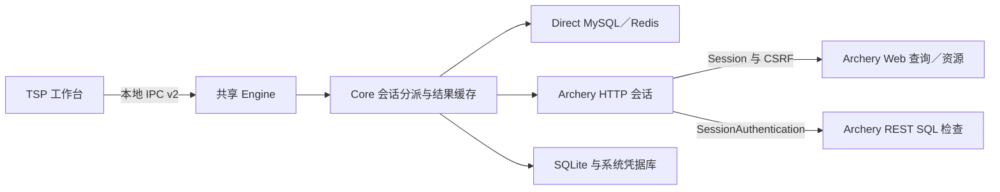
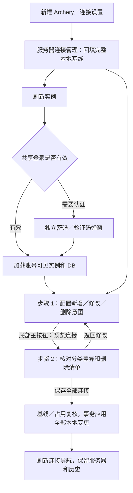

# Datapier 0.1.1 技术方案

## 1. 目标、依据与交付范围

依据 [Archery 接入调研报告](archery-integration-research.md)，0.1.1 增加 Archery 来源的 MySQL／Redis 只读访问，交付“登录服务 → 批量选择实例与 DB → 浏览／查询 → 查看、复制与导出本次结果”的完整路径。MySQL 另提供平台上线 SQL 检查，为未来 MCP 接入复用 Core 和 Engine 能力。

本方案定义 0.1.1 的目标设计；实际运行证据与环境见[第 12 节](#12-实现与验证记录)，不得将历史验证扩展为本方案全部行为的验收。源码事实及外部接口限制以调研报告和固定版本公开源码为依据，本文不包含任何组织的部署、账号、权限配置或业务数据。

### 1.1 范围

| 功能 | 0.1.1 交付 |
|---|---|
| 连接来源 | 底层保留 MySQL／Redis 类型和 Direct／Archery 来源；新建入口以 MySQL、Redis、Archery 同级展示 |
| Archery 认证 | Web Session、CSRF、独立密码／验证码弹窗；同 Engine、同服务器账号的全部实例和窗口共享登录；可选标准 TOTP 链接本机生成 |
| 服务器连接管理 | 新建和右键设置共用两步管理视图，展示同服务器全部实例；统一预览新增／修改／删除，本地连接变更一次提交 |
| MySQL | DB／关系名称、字段、索引及 DDL 浏览；受控表浏览、只读 SQL、普通 EXPLAIN |
| Redis | 所选 DB 切换、精确校验的只读命令、平台返回的文本结果；SCAN 仅作为单次命令结果展示 |
| 结果 | 现有 grid、分页、大字段读取和复制；导出本次已缓存的 CSV／JSON 结果，明确范围与保真度 |
| 历史 | 直连默认读取工作区本地历史，存储层分页和全量搜索；Archery 默认读取当前服务器、账号可见的平台历史，统一分页器 |
| 上线 SQL 检查 | MySQL 调用平台 `sqlcheck`，区分通过、警告、错误与未完成；不创建工单 |
| 数据升级 | 已发布 0.1.0 的配置 schema 1 升级到 schema 2；cache 保持 schema 1，IPC 使用 v2，保留连接、工作区、历史及缓存 |
| 平台 | 保留 macOS／Linux／Windows 的 x86-64、arm64 六目标实现和 Tern 交付；原生运行仅验收 macOS arm64，其他目标在 PR 阶段验证编译 |

### 1.2 明确不在本版交付的能力

- Archery 来源的数据库写 SQL、数据编辑、导入、库表删除和 Redis 修改。
- 工单提交、审批、执行、定时、取消、回滚；这些能力仅记录未来接口边界，不预建空实现。
- MCP 子命令、tools、独立 Python 服务、通用远端 provider 插件框架。
- Archery 来源的数据库事务、持久会话变量、临时表和跨请求 WATCH 状态。
- Redis 原始字节保真、完整 key 资源树、全库导出、Cluster／Sentinel。
- 自动获取或绑定平台 TOTP 种子、自动开通权限、SSO 浏览器接管及首次 2FA 绑定。仅接受用户主动配置的 `otpauth://totp/...`；不提供 HTTP 取码、打开系统密码 App 或密码管理器专属集成。
- 修改 Archery 服务端或绕过其权限、查询限制及脱敏策略。

这些限制仅适用于新增 Archery 来源。现有 Direct MySQL／Redis 的读写、事务、编辑、导入导出和类型保真契约继续按 [0.1.0 技术方案](technical-design-0.1.0.md)执行。

### 1.3 技术决策

| 决策 | 理由 |
|---|---|
| 在 Core 增加 Archery HTTP 会话分支 | 复用现有 Engine／UI 边界，避免复制工作台和结果逻辑 |
| 使用 Web Session，必要 REST 也复用该会话 | 官方查询是普通 Django Web 接口；REST 支持 SessionAuthentication，首期不需要第二套 JWT 状态 |
| 一个服务账号对应一份服务配置，一个远端实例对应一个 Profile | 多实例共享凭据，DB 选择不复制连接或密码 |
| Archery 来源固定只读 | 上游接口不具备 Direct 的安全编辑、事务及取消契约 |
| Core 保留精确只读策略 | 官方 Redis 前缀检查会误放行写命令，不能单独作为约束 |
| HTTP 结果有界接收，本地缓存分页 | 上游返回整份 JSON，没有数据库流式 cursor；客户端不伪造流式全量读取 |
| SQL 工单仅接入 MySQL 检查 | 检查不创建工单；审批和执行存在独立的身份、状态及幂等前置问题 |
| 同服务器账号跨窗口共享登录，查询及任务归属仍按客户端隔离 | 减少重复认证，同时保留关闭窗口、停止等待和草稿的既有隔离 |
| 地址与账号固定，CA 为可编辑认证配置 | 防止实例 ID 被重绑定到另一平台，也允许更新企业证书 |
| 本地与平台历史依来源选择，不合并审计记录 | 保留平台权限语义，同时让直连完整历史可搜索、翻页 |


## 2. 架构、模块与依赖

### 2.1 运行边界



保留四个 crate。TSP 不能持有 HTTP Cookie 或直接调用 Archery；Core 不依赖 TSP 或未来 MCP。Engine 管理客户端归属、认证会话引用、任务、配置修订及结束等待，Core 实现 HTTP、远端契约和结果转换。

`ProviderKind` 仍为 `Mysql/Redis`；MySQL／Redis／Archery 三入口是 UI 组织，不新增第三种数据库类型。`ProviderSession` 按 Profile 来源建立 Direct 或 `Archery(ArcherySession)`。ArcherySession 是客户端逻辑会话，不冒充专属数据库物理连接；HTTP 登录槽由同 Engine 的服务器账号共享，逻辑连接、任务及停止等待仍归各客户端。

### 2.2 文件落点

下表记录主要实现落点，沿用相邻模块约定，不按每个对象拆 crate。

| 路径 | 状态 | 实施职责 |
|---|---|---|
| `crates/datapier-core/src/model/mod.rs` | 现有 | Profile 来源、服务、capabilities、结果来源与停止等待语义 |
| `crates/datapier-core/src/providers/mod.rs` | 现有 | 新会话分支、能力查询、关闭与方法分派 |
| `crates/datapier-core/src/providers/archery/` | 新增 | `mod.rs` 会话、`client.rs` HTTP／认证、`catalog.rs` MySQL 元数据、`query.rs` 执行／转换及平台检查 |
| `crates/datapier-core/src/providers/mysql/sql.rs` 及 `src/providers/mysql/mod.rs` | 现有 | 完整 AST 只读检查、受控 SHOW INDEX；复用 tokenizer，向 Core／TSP 提供无状态 SQL 范围解析入口 |
| `crates/datapier-core/src/providers/redis/command.rs` | 现有 | 提取供两种来源复用的命令词法与只读判定，Direct 原有规则不被 Archery 限制覆盖 |
| `crates/datapier-core/src/storage/` | 现有 | 入口保留初始化与共享状态；`profiles.rs` 管理连接与凭据，`tasks.rs` 管理任务历史，`results.rs`／`values.rs` 管理结果和大字段，`archery.rs` 管理服务器及批量连接 |
| `crates/datapier-core/migrations/0002_config.sql` | 0.1.1 迁移 | 完整定义配置 schema 2，保留 schema 1 数据，含 TOTP 元数据及地址／账号唯一约束 |
| `crates/datapier-core/src/execution/transfer.rs` 及 `transfer/` | 现有 | 父模块协调共享边界，子模块按导出、MySQL 导入、Redis 导入导出及 JSON 解析分工；缓存结果导出先于数据库类型分派 |
| `crates/datapier-engine/src/server.rs` 及 `server/` | 现有 | 父模块保留唯一状态及客户端生命周期；`rpc.rs`／`tasks.rs` 分离请求与任务，`archery/` 分离认证、连接和配置操作 |
| `crates/datapier-engine/src/lib.rs`、`src/server/session.rs` | 现有 | IPC v2 握手和旧进程拒绝接入 |
| `crates/datapier-tsp/src/connections.rs`、`src/navigation.rs` 及其子模块 | 现有 | 三入口、服务器选择与共用编辑、逐实例命名、只读身份回填及目标配置 |
| `crates/datapier-tsp/src/views/archery.rs`、`src/views/history.rs` | 现有 | 独立认证弹窗、服务器设置摘要、批量预览及统一历史分页 |
| `crates/datapier-tsp/src/app.rs`、`workspace.rs`、`requests.rs`、`resource_context.rs`、`input.rs`、`values.rs` | 现有 | 初始化与字段、快照及标签运行态、请求路由、连接与资源上下文、输入和大字段；`lib.rs` 仅组合共享状态与私有模块 |
| `crates/datapier-tsp/src/workbench/`、`grid/`、`views/`、`styles/` 及相应父模块 | 现有 | 按编辑、CLI、布局、选择、复制及视图组件分工；样式按原级联顺序静态拼接，运行时仅追加动态列宽 |
| 各 crate 的 `tests/` | 现有目录 | 行为、迁移、权限边界及本地 HTTP fixture 回归 |

新增模块只随完整路径交付，不注册空 provider。实施时必须更新所有 Profile、能力、任务状态和导出调用方，不保留旧字段别名或双协议分支。

### 2.3 HTTP 依赖

选用 `reqwest = "=0.13.5"`，关闭 default features，仅启用 `rustls-no-provider`、`cookies`、`form`、`query`、`stream`。响应由现有 `serde_json` 解码，不依赖 reqwest 的 JSON 转换来绕过体积检查。使用 Rustls 0.23 的 ring provider，与现有 SQLx TLS 方向一致；在唯一程序启动入口明确安装同一 provider，避免隐式选中不同 crypto backend。实施时通过锁文件固定 Rustls 具体 patch 和传递依赖，并核对六目标原生链接。

reqwest v0.13.5 的公开 manifest 声明最低 Rust 1.85.0，低于当前 workspace 的 1.94；这只证明版本声明匹配，不等于六目标编译和 TLS 已验收。关闭 HTTP 库的自动重试，不引入 retry middleware；应用运行时不依赖 Python 或 Node，开发与发布工具的 Python 要求见下一节。

依据：[reqwest v0.13.5 manifest](https://github.com/seanmonstar/reqwest/blob/v0.13.5/Cargo.toml)、[reqwest 文档](https://docs.rs/reqwest/0.13.5/reqwest/)。

### 2.4 开发与发布工具

开发与发布脚本采用 Python 3.15，仅使用标准库；CI 通过 `actions/setup-python@v7` 配置 `python-version: '3.15'`，跟随该分支补丁版本，解释器架构跟随原生 runner。迁移作为独立 PR 随 0.1.1 交付，不单独发布产品版本，与原生 UI 对齐分别审查和验证。

`scripts/version.py` 统一提供版本读取、源码 plugin 显式同步和只读发布检查；`scripts/package-target.py` 和 `scripts/assemble-release.py` 分别负责单目标组包和六目标汇总，`scripts/draft_release.py` 负责草稿 Release 的准备、目标资源直传和汇总。旧开发发布 `.ps1` 已移除。workflow 的版本读取、原生架构检查及二进制版本 smoke 统一调用 Python。根 `Cargo.toml` 继续作为唯一产品版本来源，保留只读检查、显式版本一致性校验和临时 plugin 副本同步。

沿用六目标原生构建、归档命名与内容、归档及程序摘要、缓存和下载地址契约。PR 与非 main 手动运行在 runner 内打包验证，不上传资源；main 将单目标归档直传同一版本草稿 Release，并从草稿完成六目标汇总，全程不使用 Actions artifact，草稿仍需维护者验收后发布。Windows 用户安装器继续使用系统自带 Windows PowerShell 5.1，保留源码 UTF-8 BOM 与 stdout 无 BOM UTF-8 JSON；macOS／Linux 安装器继续使用 `/bin/sh`，安装和运行 Datapier 无需 Python。

Python 脚本与 workflow 已切换；贡献指南和 `dprint.json` 定义 Python 开发环境、Ruff Wasm 格式化与标准库回归入口。实际命令和组包步骤见[发布指南](../RELEASING.md#python-315-工具环境)，运行结果及尚未验证的平台范围见第 12 节。

## 3. 连接模型、持久化与升级

### 3.1 Profile 和服务

统一将 Profile 的直连字段迁入带标签的 `connection`，字段约定如下。

| 类型 | 字段与约束 |
|---|---|
| `Profile` | `id/name/provider/access_mode/connection`；provider 只表示数据库类型 |
| `DirectConnection` | `kind=direct`、`host/port/username/database/visible_databases/redis_db/tls`；语义保持 0.1.0 |
| `ArcheryConnection` | `kind=archery`、`server_id/instance_id/instance_name/databases/default_database`；不含数据库地址、密码或数据库 TLS 字段 |
| `ArcheryServer` | `id/name/base_url/username/http_tls/revision/totp_mode`；`totp_mode=manual/automatic`，默认 manual；秘密不进入序列化结果 |
| `HttpTls` | 可选 `ca_path`；默认验证证书链和主机身份，不提供跳过校验开关 |
| `ArcheryInstance` | 远端 ID、名称、数据库类型；仅接受 mysql、redis |
| `Capabilities` | 明确表示查询、关系浏览、结构、编辑、导入、结果导出、数据库导出、事务、平台历史、SQL 检查、停止等待及服务端取消能力 |

能力字段使用类型化名称，固定不支持项返回 unsupported；查询、平台历史和 SQL 检查等还区分 unknown、available、denied，附可选原因。unknown 仅表示允许用户显式尝试，不能显示为已授权；明确拒绝后标记 denied，手动重试必须再次经过平台。Direct 按当前真实能力转换；能力展示不能替代每次 Core 操作检查。

Archery 来源的 `Profile.access_mode` 必须为 `read_only`；读写请求在保存和执行边界均拒绝。`databases` 为非空、去重的 DB 名称列表；Redis 使用 u32 范围内、无前导零的非负整数十进制字符串。`default_database` 必须属于列表。

Archery Profile 不使用 `visible_databases=None` 表示无限范围。所选 DB 决定该连接可打开的请求目标，UI 只显示所选集合；它不是数据库授权，也不构成自由 SQL 的跨库沙箱。SQL 中显式跨库引用仍由本地只读检查和 Archery 查询授权共同处理，不能宣传为只读以外的强 schema 隔离。

服务器唯一身份为规范化的 `(base_url, username)`，同地址不同账号分开维护；CA 不属于身份。地址和账号创建后不可修改。已有 Profile 的 UUID、来源、服务器、实例 ID／名称及数据库类型固定，名称、DB 范围和默认 DB 可改。同服务器同实例只有一个 Profile。管理页回填全部已保存实例并允许编辑；取消勾选已有实例进入待删除集合，不立即落盘，也不删除远端实例。

服务器名称是显示配置，更新后同步所有关联连接的所属服务器文案，不改自定义连接名，也不注销有效登录。密码、CA、TOTP 属于认证配置，修改前用候选配置验证，成功后推进 revision 并更新共享登录代次；失败保留原配置和可用会话。有运行任务、发现或其他认证占用时返回 busy；当前保存请求自己的候选验证上下文不算阻塞。用户结束占用后再保存，空闲逻辑连接不必仅为修改密码而全部关闭。CA 更新不得沿用旧 HTTP 客户端的证书信任配置。

沿用 server_id 粒度服务门；认证槽／逻辑连接登记、修改或删除占用检查、batch 最终 revision 检查和提交使用同一同步边界。远端预检在门外等待，完成后重新入门核对身份、修订和占用；登记请求必须先于远端发送。固定顺序为服务门 → 按 UUID 排序的 Profile 锁 → Store 凭据／配置锁；不持 Engine 全局锁等待网络或 keyring。引用已有服务器且字段未变时，不重写服务器或推进修订。

### 3.2 SQLite 配置 schema 2

配置库 `datapier.sqlite3` 为 `user_version=2`；缓存库 `cache.sqlite3` 保持 1，历史分页复用既有 `executions`，不新建历史副本。IPC 与 SQLite 分别版本化。

| 对象 | 目标约束 |
|---|---|
| `archery_servers` | 保留 `id/name/base_url/username/http_tls/revision/credential_saved`；增加 `totp_mode` 和独立的 `totp_credential_saved`，只保存模式和条目追踪，不保存种子 |
| 服务器去重 | 唯一约束为 `(base_url, username)`；CA 更新不能绕过同账号去重或创建第二份共享身份 |
| `profiles` | 保留 UUID、payload、关联列及凭据追踪，文本主键显式 NOT NULL、JSON 字段校验有效性；Direct／Archery 关联分支用表级 CHECK 统一约束 INSERT 和 UPDATE，FK 继续 RESTRICT |
| 实例去重 | 继续唯一索引 `(archery_server_id, archery_instance_id)`，所有新 Profile 在同一事务保存 |
| `executions` | 保留既有记录、`wait_stopped`、结果引用和 `(workspace_id, created_at)` 索引；不按条数或日期清理 |
| 工作区、设置、缓存 | 保留 ID、revision、查询文本、草稿、布局及结果；删除本地连接也不改写历史执行时归属 |

关系列与 JSON payload 必须在同一事务由同一输入生成，读取校验一致性。远端实例类型变化报告目标失效，不在同一个 Profile 中隐式切换 MySQL／Redis。服务器删除在应用层明确删除确认集合中的 Profile 后再删除服务器，不改为无条件 SQL 级联。

#### 3.2.1 配置库完整目标 DDL

以下为配置 schema 2 的完整目标结构，`0002_config.sql` 从已发布 schema 1 迁移并形成相同结构；空库依次执行 0001、0002。迁移须预检、复制并验证数据后在事务中切换。文本主键统一显式 NOT NULL，明确的 JSON 文本字段统一检查 `json_valid`；JSON 业务结构、UUID 格式及 payload 与关系列一致性仍由 Store 校验。

```sql
PRAGMA foreign_keys = ON;

CREATE TABLE archery_servers (
    id TEXT NOT NULL PRIMARY KEY,
    name TEXT NOT NULL,
    base_url TEXT NOT NULL,
    username TEXT NOT NULL,
    http_tls TEXT NOT NULL CHECK(json_valid(http_tls)),
    revision INTEGER NOT NULL CHECK(revision > 0),
    credential_saved INTEGER NOT NULL DEFAULT 0
        CHECK(credential_saved IN (0, 1)),
    totp_mode TEXT NOT NULL DEFAULT 'manual'
        CHECK(totp_mode IN ('manual', 'automatic')),
    totp_credential_saved INTEGER NOT NULL DEFAULT 0
        CHECK(totp_credential_saved IN (0, 1)),
    UNIQUE(base_url, username)
);

CREATE TABLE profiles (
    id TEXT NOT NULL PRIMARY KEY,
    name TEXT NOT NULL,
    payload TEXT NOT NULL CHECK(json_valid(payload)),
    credential_saved INTEGER NOT NULL DEFAULT 0
        CHECK(credential_saved IN (0, 1)),
    archery_server_id TEXT
        REFERENCES archery_servers(id) ON DELETE RESTRICT,
    archery_instance_id INTEGER,
    CHECK (
        (archery_server_id IS NULL AND archery_instance_id IS NULL)
        OR (
            archery_server_id IS NOT NULL
            AND archery_instance_id IS NOT NULL
            AND credential_saved = 0
        )
    )
);

CREATE UNIQUE INDEX profiles_archery_instance
    ON profiles(archery_server_id, archery_instance_id);

CREATE TABLE workspaces (
    id TEXT NOT NULL PRIMARY KEY,
    revision INTEGER NOT NULL CHECK(revision > 0),
    payload TEXT NOT NULL CHECK(json_valid(payload))
);

CREATE TABLE executions (
    id TEXT NOT NULL PRIMARY KEY,
    owner TEXT NOT NULL,
    workspace_id TEXT NOT NULL,
    method TEXT NOT NULL,
    params TEXT NOT NULL CHECK(json_valid(params)),
    state TEXT NOT NULL CHECK(state IN (
        'queued', 'running', 'cancelling', 'succeeded',
        'failed', 'cancelled', 'outcome_unknown', 'wait_stopped'
    )),
    sent INTEGER NOT NULL DEFAULT 0 CHECK(sent IN (0, 1)),
    may_write INTEGER NOT NULL DEFAULT 0 CHECK(may_write IN (0, 1)),
    summary TEXT NOT NULL DEFAULT 'null' CHECK(json_valid(summary)),
    error TEXT,
    created_at REAL NOT NULL DEFAULT (unixepoch('subsec')),
    updated_at REAL NOT NULL DEFAULT (unixepoch('subsec'))
);

CREATE INDEX executions_workspace
    ON executions(workspace_id, created_at);

CREATE TABLE app_settings (
    id INTEGER PRIMARY KEY CHECK(id = 1),
    payload TEXT NOT NULL CHECK(json_valid(payload))
);

-- 仅空库初始化；升级保留已有设置。
INSERT INTO app_settings(id, payload)
VALUES (1, '{"language":"system"}');

PRAGMA user_version = 2;
```

目标共 5 表、2 个显式索引；主键和 UNIQUE 的内部索引由 SQLite 生成。Profile 关联分支由表级 CHECK 同时覆盖插入和更新。未给 executions 的历史目标加配置删除级联，删除连接不改写执行时归属。`totp_credential_saved` 是独立条目追踪，不与 automatic 模式强绑定，因为会话内种子也可生成验证码。

#### 3.2.2 缓存库完整 DDL 与独立改进项

本轮保持 cache schema 1，其完整结构如下；它与配置库是两个数据库，不能为 `execution_id` 添加跨库外键。`value_files` 是文件归属及待清理记录，结果删除后仍可能保留，不能给它增加 ON DELETE CASCADE 而丢失清理依据。

```sql
PRAGMA foreign_keys = ON;

CREATE TABLE results (
    id TEXT PRIMARY KEY,
    execution_id TEXT NOT NULL,
    columns TEXT NOT NULL,
    kind TEXT NOT NULL,
    row_count INTEGER NOT NULL DEFAULT 0,
    complete INTEGER NOT NULL DEFAULT 0,
    summary TEXT NOT NULL DEFAULT 'null'
);
CREATE INDEX results_execution ON results(execution_id);

CREATE TABLE result_rows (
    result_id TEXT NOT NULL REFERENCES results(id) ON DELETE CASCADE,
    row_no INTEGER NOT NULL,
    payload BLOB NOT NULL,
    PRIMARY KEY(result_id, row_no)
) WITHOUT ROWID;

CREATE TABLE value_files (
    id TEXT PRIMARY KEY,
    result_id TEXT NOT NULL
);
CREATE INDEX value_files_result ON value_files(result_id);

PRAGMA user_version = 1;
```

缓存文本主键显式 NOT NULL、`row_count/row_no >= 0`、`complete IN (0,1)` 和明确 JSON 文本字段检查，是已识别的独立结构改进项。实施这些约束须新增 cache schema 2 迁移并校验旧数据，不能改写 schema 1 后继续宣称缓存版本未变。本轮不实施该扩展；配置和缓存继续按各自版本检查。结果行是类型化 JSON 字节，大值文件保存在 `values/<id>`，不作为普通配置 JSON 或密码存储。


### 3.3 schema 1 → 2 与开发库处理

1. Engine 取得数据目录排他实例锁，先读取两个库版本并校验必需对象，拒绝较新版本或部分 schema；版本 0 仅接受真正空库。
2. cache 已为完整 1 时只校验；允许初始化的空 cache 先在独立事务安装并验证 schema 1。
3. 空配置库依次执行 0001、0002；已发布 0.1.0 的 schema 1 在单个配置事务中执行完整 0002，保留 UUID、连接读写模式、DB、凭据账户名、工作区文本／草稿／布局和全部历史参数及结果引用。新服务器的 TOTP 默认为 `manual`、`totp_credential_saved=0`。
4. 预检并拒绝旧数据中的空主键、无效 JSON、非法关联及唯一性冲突，不自动修补或丢弃。按完整目标 DDL 重建受约束表，保留数据和引用并重建索引；验证后设置配置 `user_version=2` 并提交。失败回滚配置；已完成 cache 1 可保留，不宣称跨库原子回滚。
5. 未发布的本地 schema 2 开发库不能仅凭版本号视为兼容：打开前核对全部表、列、约束、索引与目标结构，并核查数据和关联一致性；完全兼容才直接打开。结构不一致则拒绝打开并给出明确说明，绝不降版本、覆盖或自动清空。先关闭所有 Engine，以 SQLite 一致方式备份完整数据目录及凭据追踪，保留原目录；在新的独立数据目录重新初始化。若需保留开发数据，实施前先在备份副本上核对实际旧结构、所有 Profile／服务器及规范化地址账号冲突、工作区、历史、缓存引用和系统凭据归属；只有能无损映射且验证数量、身份、引用和凭据追踪时，才可使用明确的一次性离线转换在副本中生成目标库，原目录不变。无法证明完整性或有冲突时停止转换，保留备份，由用户处理冲突；不得自动合并、删除或猜测数据。路径摘要关联的 keyring 条目须明确迁移或重新配置并保留旧条目追踪，不以复制 SQLite 假定凭据可用。

表重建使用迁移专属连接：在事务外暂时关闭该连接的 foreign_keys，再开启配置事务，创建新表、复制校验数据、替换旧表并重建索引；不先重命名旧父表而让 SQLite 将外键自动改指向备份名。提交前执行 foreign_key_check，失败即回滚；提交或回滚后在事务外恢复 foreign_keys 并验证，无法恢复则丢弃连接。整个迁移期不接受业务请求，其他连接不能参与写入；不能在事务内设置 foreign_keys 后假定它已经生效。

迁移不能访问网络或 keyring，不改写 Direct 既有系统凭据名称。Workspace/Tab 仍只持久化 profile_id，不持久化认证句柄或秘密。schema 1 仅支持 Direct，0002 为对象型历史摘要写入 `_migration={source:direct,config_schema:1}` 作为来源证据，保留其他摘要字段及历史参数；若既有同名字段会被覆盖则预检拒绝并保留原数据，非对象摘要不猜测来源。

Store::open 先预检、再初始化 cache、最后迁移配置；配置大于 2、cache 大于 1、必需对象缺失或 schema 2 结构不匹配均拒绝打开。

### 3.4 凭据与批量保存

Direct 保持现有系统凭据账户名。Archery 密码沿用数据目录摘要与 `archery:<server_id>` 的独立账户名，TOTP 使用另一个服务器专属账户 `archery:<server_id>:totp`，不覆盖旧密码条目。两个秘密分别报告 keyring／session／unknown 状态；库不可用只在当前 Engine 内存保存，不将种子、链接或密码落到 SQLite、工作区、日志、任务参数和导出。

服务器列表按各自持久化标记保留已知的 keyring 保存位置，无须为显示开关提前读取秘密；会话内已有值优先报告其实际保存模式。该位置说明不保证条目仍可读取，系统授权或外部删除仍由实际认证返回。

密码及 TOTP 更新都明确区分保留、替换、清除；编辑留空表示保留，清除必须显式操作。种子编辑只显示已配置状态，不回填原链接；条目追踪标记不等于实际读取成功。OTP、Cookie、CSRF 和临时 challenge 只在内存中；自动生成的本次码也按 OTP 处理，认证结束后清除。

显式提供新密码必须重新认证；已有 challenge 不能代替候选密码验证。认证槽只保留已验证且待保存的候选秘密，保存完成后清除候选副本；元数据更新不重写已有秘密。系统凭据授权等待可停止，读取沿用全进程最多一个独立线程，许可持续到原生调用结束；取消后的结果不更新槽，也不阻止 Engine 退出。写入／删除必须完成条目所有权交接，不放宽系统权限。TOTP 解析和生成约束见[第 4.4 节](#44-可选自动-totp)。

一次批量添加分为两个可观察阶段：

1. 保存服务及凭据：沿用现有“先登记可能存在的系统条目，再写 keyring，最后完成配置”的所有权规则。未提供新密码的更新保留旧凭据；删除失败不能降级并丢失追踪。
2. 保存服务器连接计划：明确基线、最终选中集合及逐项差异，预检通过后在一个 SQLite 事务中应用全部新增、修改和删除；任一冲突、占用或失败整批不提交，不留下部分连接变更。删除连接不清理服务器共享凭据。

若阶段 1 成功而阶段 2 失败，返回 `service_saved=true/profiles_saved=false`，保留可管理服务器及未提交计划；不宣称 keyring 与 SQLite 跨系统原子成功。已有项回填名称／DB／默认 DB，不再标记为不可编辑。所有已保存项取消勾选时允许预览并提交全部本地连接删除，服务器记录保留；完全无变更的计划不发保存请求。

新服务器在认证前生成固定 UUID，新增 Profile 在预览前生成固定 UUID；已有 Profile 必须沿用原 UUID 和实例绑定。初次加载本地配置时记录 `expected_profiles`（同服务器完整公开配置基线，或其按 UUID 排序、确定性编码的摘要）；远端刷新不会更改这份基线，也不以发现列表缺项推导删除。保存响应未知时先读 server.list／profile.list，与预期最终配置及固定 ID 核对：一致才确认完成，不一致则显示冲突，不盲目重放 apply_batch 或重写凭据。

预览按基线与最终集合区分新增、修改、删除、未变化；修改展示原值和新值，删除明确列出连接名、实例和原 DB。取消勾选后可勾回恢复该项保存值，取消未保存的新实例仅撤销新增。未被发现的已有实例仍以本地记录显示并标注异常，不能刷新后自动删掉；明确删除不可发现的旧连接不要求重新获得远端查询权限。

最终提交在服务门下核对服务器修订及整份 Profile 基线，再按 UUID 排序锁定受影响对象。新建／DB 调整验证实际实例及 DB，所有已有身份固定；草稿、任务、连接操作或其他窗口对受影响对象的占用阻止整批保存。UI 整体预检并关闭受影响连接后才提交，未变化对象不因同服务器归属就被关闭。完成后一次广播 connections.changed，历史和缓存保留；不存在通过 UI 取消勾选直接删除远端实例的路径。

### 3.5 删除服务器及关联本地连接

确认框列出服务器和关联连接名称，明确“删除服务器及 N 个连接”；无关联连接时也允许从全局设置删除。请求携带服务器 expected_revision 与确认时的 Profile ID 集合。Engine 在服务门及有序 Profile 锁下重新核对集合、修订和全部客户端的运行占用，变化或占用返回冲突／busy，不能继续按旧数量删除。

UI 先整体预检相关草稿、恢复意图、运行任务及连接操作；任一阻塞保留全部标签和配置。通过后等待相关逻辑连接关闭 ACK；其他窗口仍引用时拒绝，不代替其他窗口关闭或取消任务。只有无运行占用、无认证控制者时才进入删除交接，空闲 ready 缓存不构成阻塞。

先按追踪记录清理密码与 TOTP 凭据；任一失败保留服务器和全部 Profile，并明确已清理的凭据状态供再次操作，不能假报跨系统回滚。凭据交接完成后，在一个 SQLite 事务删除确认集合的 Profile，再删除服务器；SQLite 失败仍保留追踪，缺失的凭据按已有清理规则核对。成功后清除共享登录并广播配置变化。历史执行记录、缓存和原始目标归属保留，远端实例、DB、数据和平台历史不受影响。

## 4. HTTP、认证和服务生命周期

### 4.1 URL、TLS 与有界请求

`base_url` 允许 HTTP／HTTPS，拒绝 URL 内嵌账号密码、query 和 fragment。规范化末尾斜线并保留路径前缀；拼接端点不能通过绝对 `/query/` 丢弃前缀。服务地址来自用户明确配置，不根据查询返回内容切换服务。

默认关闭自动跳转和重试。仅登录页的同 origin、同服务路径前缀 GET 跳转可手动跟随，最多 3 次；不转发跨 origin Cookie、密码或 CSRF。业务请求收到登录重定向进入 `auth_required`；意外 HTML、SSO 跳转或未知响应结构返回明确错误，不当成空查询结果。

HTTPS 保持证书和身份校验，可加载显式 CA。HTTP 按配置使用，不自动从 HTTPS 降级。CSRF 请求从当前 Cookie jar 读取最新 token，按需填写同 origin Referer／Origin，不缓存旧登录前 token。

| 边界 | 本版约定 |
|---|---|
| TCP 连接超时 | 10 秒 |
| 登录／元数据请求总超时 | 30 秒 |
| 查询／SQL 检查总超时 | 120 秒；表示客户端等待边界，不配置远端数据库超时 |
| 认证 challenge | 最多 5 分钟，且不超过远端实际有效期 |
| HTTP 响应体 | 解码后的实际字节最多 16 MiB，不能只依赖 Content-Length |
| SQL／命令文本 | 单次用户执行最多 1 MiB，最多 100 条；先校验整批再发送 |
| 查询行数 | 默认请求 100 行，UI 可选 100／500／1000；客户端最多请求 10,000 行。禁止传 0 追求无限结果，远端仍可收紧 |
| 并发 | 每个客户端、每个服务最多 4 个数据请求；认证转换独占，网络等待不持有 Engine 全局锁 |

使用 chunk 累计字节并在超限时停止，再由一次 DTO 解码同时校验完整 JSON，随后分批写入 ExecutionSink；不先解析为通用 JSON 再整包转换／复制。取消保持可响应，较大的解析和转换不阻塞 Tokio 心跳。上游整包响应使内存有界，但不能宣称行级网络流式读取。

超过大小边界返回 `response_too_large`，建议用户缩小选择和查询范围；不能丢行后标记成功，也不自动重发缩限查询。收到压缩响应时同样按解码后体积限制；未启用的编码返回不支持错误。

### 4.2 认证状态与隔离

Engine 以 `server_id` 定位同数据目录内唯一共享登录槽，槽保留当前配置修订和独立 `auth_generation`。同一服务器账号的全部实例及窗口引用该槽；不同账号使用不同 server_id，不同 Engine／数据目录不共享。新增服务器与已有服务器的认证配置变更均使用发起客户端专属候选上下文和独立 HTTP 客户端；已有服务器候选验证期间保留原共享登录及可用 Cookie，验证失败或取消不改变共享槽。保存成功后在服务门下发布候选配置及客户端。ArcherySession 持有共享槽引用，不固定捕获旧 Cookie 客户端。

认证状态：`disconnected → authenticating → challenge_required/ready`；失败为 `auth_failed`，过期为 `auth_required`，删除／Engine 收尾为 `closed`。只有 ready 可发送资源与查询请求。纯名称更新推进配置修订并刷新槽绑定，不推进认证代次；密码、CA、TOTP 验证后保存时才原子发布新客户端和新代次。

各客户端仍取得自己的不可持久化 `auth_id`，跨客户端使用句柄仍被拒绝；共享的是 Engine 内部登录槽，不是 UI 句柄。每一轮认证仅一个客户端取得控制者令牌，负责提交密码／验证码及展示弹窗；其他窗口只订阅状态、显示正在重新登录，不能重复提交。令牌绑定客户端、服务器和认证代次，不进入工作区或任务；取消、超时或客户端退出后失效。

有效槽直接复用，不提示密码或验证码。会话缺失／过期时，一轮自动恢复先读取已保存密码；平台要求 OTP 才读取已配置种子并生成本次码。缺密码才显示密码阶段；需要手动 OTP 时同一独立认证弹窗切换到验证码阶段。自动验证失败转手动输入；错误密码、权限拒绝、403 或 429 停止本轮，不循环尝试。密码成功返回临时 session 时仍须完成平台 2FA，不能提前进入 ready。首次绑定或未知验证方式返回 `interactive_login_required`。

认证失效阻止新远端请求并保留文本、目标、session_id 和缓存结果。并发失效请求加入同一轮，不重复读取凭据、登录或弹窗；事件唤醒等待者不自动开启新的失败认证轮次。成功后下一次显式请求使用新代次，不重建全部逻辑连接，不重放已经失败的 SQL／命令。旧代次的迟到失效响应不能覆盖新 ready 状态；已发送查询独立记录实际结果。UI 在提交后清空 OTP，错误不回显秘密。
首次 `connection.open` 因缺少认证而等待时，登录成功自动续接该原始连接请求一次；这不重放已失败的 SQL／Redis 命令。登记控制者后读取系统凭据失败或取消须清理本轮控制权，不影响其他有效 ready 会话。

### 4.3 结束与配置变更

关闭逻辑连接、连接表单或窗口只释放所属句柄、操作及运行引用，不注销其他窗口的共享 Cookie，也不取消他人任务。ready 槽作为 Engine 级缓存保留到认证配置变化、服务器删除或 Engine 收尾；空闲槽不构成配置占用。认证控制者离开时结束所属网络等待并撤销令牌，其他等待窗口可以重新取得控制权，不沿用退出客户端的候选秘密或自动重放请求；用户取消本轮认证后各窗口回到待登录状态。最后有效客户端结束后，Engine 仍按既有生命周期收尾并清除全部 Cookie、challenge 和内存凭据。

Profile 设置先预检所属 tab 并等待关闭确认。Archery Profile 的修改／删除还须在服务门和 Profile 锁下检查所有客户端对该 Profile 的运行占用，有占用则 busy；不能只靠当前 UI 预检缩小 DB 范围。更改后不自动重建已关闭 tab，恢复目标不再被选中时保留文本并要求重新选择；Direct 设置保持既有快照与重连规则。

配置变化广播不含秘密的 `connections.changed`，其他 UI 重新读取名称、引用及修订。共享认证另广播 `archery.auth.changed`，只含 server_id、state 和 auth_generation；各窗口以自己的句柄读取是否拥有控制权。事件不携带 Cookie、种子、验证码、SQL 或结果，不自动重连、重启失败认证或执行查询。

### 4.4 可选自动 TOTP

默认手动输入，支持整段验证码粘贴；用户主动选择自动生成后，接受标准 `otpauth://totp/...` 链接，仅在本机解析和生成，不访问取码网站。Core 负责 URI 校验与符合 RFC 6238 的生成，Engine 在平台要求 OTP 时调用，TSP 只维护编辑中的秘密输入和已配置摘要。实施时按贡献指南选用并锁定已有 Rust TOTP 实现，不自行发明算法。

解析 `secret/algorithm/digits/period`，拒绝非 TOTP、无效 Base32 或不支持参数，不默默忽略链接参数；未声明时沿用标准默认值。算法、位数和周期必须与目标平台配置一致，生成时保留前导零，使用当前系统时间。参数的可用范围须以库能力及隔离平台验收为准，不能把 URI 合法等同于平台接受。任一参数验证失败时 UI、IPC 错误、日志及诊断均不得回显完整 URI 或其秘密；自动码失败后允许手动输入，不自动等待下个周期反复提交。

已保存密码和种子可恢复认证，不代表保证免交互：系统凭据库授权、时钟偏差或平台配置变化仍可能要求用户处理。用户输入种子不能开启／关闭平台 2FA；清除或切回手动只改变 Datapier 的取码方式。手动模式下若清除已保存种子，沿用独立凭据条目的追踪及失败处理。

macOS、Windows、Linux 共用本轮输入和生成路径，不增加“打开密码 App”入口或密码管理器专属桥接。系统验证码填入仅是 Tern 宿主能力待验证项，不作为本轮交付承诺，不以 Keychain 保存功能证明系统验证码填充已支持。

## 5. IPC v2 与内部契约

### 5.1 协议升级

0.1.1 的完整开发契约统一使用 `protocol_version=2`；帧为 4 字节大端长度＋UTF-8 JSON，上限 8 MiB。历史返回形状、共享认证控制及删除请求契约与已发布 0.1.0 的 v1 不兼容，不混用 v1／v2 UI 与 Engine，不保留旧字段别名或双协议分支；未知协议版本明确拒绝。IPC 与 SQLite schema 分别管理，本版两者版本均为 2。

发现旧 Engine 返回 `protocol_incompatible`，提示结束旧会话后重启，不强杀、不另起第二个同目录 Engine。配置 schema 升级只能在新 Engine 取得排他锁后进行。

### 5.2 新增 RPC

以下名称和字段为本版内部契约，不是对 Archery 新增 REST API。所有入口校验客户端归属，错误不记录认证请求原文。

| 方法 | 请求关键字段 | 结果与语义 |
|---|---|---|
| `archery.server.list` | 无 | 服务器公开字段、revision、关联连接数、独立密码／TOTP 凭据模式；不能确认时 unknown，不返回秘密 |
| `archery.auth.begin` | `operation_id/server/expected_revision`；可选 `candidate`、候选 `password/totp_uri` | `server` 是新增或已有服务器的完整候选配置；已有服务器按 ID 读取保存配置并校验固定身份及修订。配置认证变更使用 `candidate=true` 创建私有上下文，包括仅清除本机凭据；普通恢复可用 `candidate=false`。返回客户端专属 `auth_id`、`state/auth_generation/controller/controller_token`；未变更且 ready 时复用共享登录 |
| `archery.auth.status` | `auth_id` | 返回 `state/auth_generation/controller/controller_token`，不触发新一轮登录或自动重试 |
| `archery.auth.verify` | `operation_id/auth_id/controller_token/auth_generation/otp` | 仅本轮控制者可提交；返回 `state/auth_generation/controller/controller_token` 或错误，不返回 Cookie |
| `archery.auth.close` | `auth_id`，控制者取消时附令牌和代次 | 释放当前客户端绑定／认证控制，不注销其他窗口的 ready 槽；查询任务取消另走原路径 |
| `archery.instances` | `operation_id/auth_id` | MySQL／Redis 实例 ID、名称、类型；与全部已有 Profile 合并显示，缺失旧项保留并标异常，不据此自动删除 |
| `archery.databases` | `operation_id/auth_id/instance_id` | databases/discovery；discovery=platform_reported，不无依据标为完整配置 |
| `archery.server.save` | `server/expected_revision`、候选 `auth_id`、`password_update/totp_update` | 名称更新可不重新登录；认证变更须核对已验证候选快照及 revision、检查占用后发布，分别返回两个凭据模式；结果不确定先查询核对 |
| `archery.profile.apply_batch` | `server_id/expected_server_revision/expected_profiles/desired_profiles`；新增／DB 变更附 auth_id | 根据冻结基线和最终集合应用新增／修改／删除，返回各类固定 ID 及最终公开配置；任何失败整批回滚。仅删除或本地名称调整不强制要求远端发现成功，新增／DB 变更须验证认证与目标 |
| `archery.server.delete` | `server_id/expected_revision/expected_profile_ids` | 重新检查确认集合及所有客户端占用，清理密码和种子，再事务删除本地关联配置，保留历史和远端数据 |
| `archery.query_history` | `operation_id/session_id/offset/limit/search` | 当前账号可见的平台 `rows/total/offset/limit`；默认 20，上限 100 |
| `archery.sql_check` | `session_id/workspace_id/database/text` | 先返回 task_id；execution.get 返回状态、计数和 result_id，明细通过 result.page/value 读取 |
| `archery.operation.cancel` | `operation_id` | 仅结束当前客户端操作；不能通过取消观察者请求终止其他窗口的共享认证或任务 |

`password_update` 与 `totp_update` 均为 `{kind: "keep" | "replace" | "clear", value?, persist?}`：`keep` 不带 `value/persist`，保留旧条目；`clear` 不带 `value/persist`，显式清除；`replace` 必须提供非空 `value` 与布尔 `persist`，分别表示密码或标准 TOTP URI 及是否尝试持久化。非法组合在 UI 和 Engine 边界拒绝；不传更新对象时按 `keep` 处理。Engine 对照客户端专属候选 `auth_id` 验证替换值与已验证配置一致，交由 Core 执行独立凭据交接；`persist=true` 而凭据库不可用时只保留会话并明确返回实际模式。响应不含秘密。

认证响应统一包含 `state`、`auth_generation`、布尔 `controller` 和可空 `controller_token`；仅当前客户端为控制者时返回令牌，观察者为 `controller=false`、`controller_token=null`。`auth_id` 绑定创建它的客户端，begin、status、verify、close 及引用候选的 save 均校验所属客户端，不能因共享登录跨客户端复用句柄。`auth.begin` 的 `password` 与 `totp_uri` 是可选候选值，仅在本轮客户端认证上下文内使用，不自动持久化；已有认证轮次由其他控制者持有时，不接受观察者候选值，返回 busy，避免秘密被忽略或跨客户端混用。

`auth.begin` 统一传完整 `server` 对象：新增服务器使用预生成 ID 和 `expected_revision=0`；已有服务器必须传当前 `expected_revision`，Engine 按 `server.id` 读取已保存配置并核对 revision，要求 `id/base_url/username` 与保存值一致。已有服务器认证候选可调整 `http_tls`、`totp_mode` 等认证配置，密码和 TOTP URI 仅通过专属候选字段传入；显示名称按普通服务器保存规则处理，不参与认证身份。Engine 冻结候选认证配置、身份、预期修订与候选秘密的关联，使用独立客户端验证，不能在验证时替换共享客户端或推进共享认证代次。仅完整认证配置及秘密均未变化的已有 ready 会话可直接复用；候选认证失败、取消或超时不影响原配置和原 ready 会话。

配置保存前的认证验证显式使用 `candidate=true`，即使仅清除密码或 TOTP 的本机条目、公开服务器字段没有变化，也不能被误判为普通共享登录。候选可读取已有凭据完成验证，缺失时按需交互；清除动作只在成功保存时执行。普通登录恢复使用 `candidate=false`，共享槽未就绪时允许当前控制者补充密码；ready 槽收到显式新密码仍按私有候选验证，保留原共享会话。

服务器保存核对规范化身份与客户端专属候选 `auth_id` 一致，不能用 A 的认证保存 B。新增时 `expected_revision=0`、成功为 1；已有服务器按 ID 重新读取并检查预期修订及固定 `id/base_url/username`。认证变更时在服务门内对照保存请求和已验证候选快照，包括 `http_tls/totp_mode`、秘密更新意图及其值，检查配置与修订未变、占用允许后再完成凭据交接并发布共享客户端和新认证代次；不匹配、验证失败或修订冲突均保留原配置和可用共享登录。名称按独立显示配置保存，候选所有者始终为当前客户端。保存响应丢失时用 server.list 核对，不以重新写配置恢复认证。

认证、发现和平台历史使用 operation_id，不建立执行历史；操作归客户端，认证发布还检查控制者和代次。取消表单、切换服务器、停止历史加载都使所属 UI 轮次失效；只有控制者可以结束其认证尝试，观察者取消只退出等待。查询／检查使用 task_id 和 execution.cancel。持久化服务、批量配置与凭据交接不因客户端取消或断开而直接 abort。

HTTP 的 16 MiB 接收预算与 IPC 的 8 MiB 帧上限分开处理。Archery 来源的所有非分页 RPC（包括复用的 resource.list/describe、connection.info、profile.* 及错误响应）按包含封装的 4 MiB 序列化预算检查，超限返回有界 response_too_large，不等协议层拒帧或静默截断。平台历史超限允许用户显式调小 limit，单条仍超限则提示在平台查看；DDL／结构超限明确报错。配置写入在变更前核对预计响应预算，不能提交后才因返回体积宣告失败。

### 5.3 现有 RPC 的变化

| 接口 | 0.1.1 约定 |
|---|---|
| `profile.list/save/test/delete/databases` | Direct 保持既有流程；Archery UI 的新增和设置统一 apply_batch，不再通过单项 save 修改；单项删除入口沿用冻结目标及占用保护，test/databases 复用所属认证槽 |
| `connection.open` | 按来源建立会话；Archery MySQL 可传 `database`，Redis 沿用 `redis_db`；目标必须属于已选 DB |
| `connection.info` | 返回来源、默认目标、capabilities 和 query_semantics；Archery 为 stateless，不伪造连接 ID、事务状态或 sql_mode |
| `resource.list/describe/browse` | Archery MySQL 映射远端资源与受控 SQL；Redis 的 key 资源方法返回 capability_unavailable |
| `execution.start` | Archery 显式提供 database，Engine 校验所选 DB 后冻结实际目标与文本；Direct 保持会话行为，Cookie 不进入任务参数 |
| `execution.cancel` | 返回本地任务终态及远端状态认知；已发送但未取得远端终态时为 wait_stopped，已完成任务不改写 |
| `transfer.export` | 有 result_id 时先走缓存结果导出；Archery 必须提供 result_id，不触发库表或 key 重新查询 |
| `change.*`、`transfer.import`、库表删除 | Archery 一律 capability_unavailable；包括工作区恢复的旧提交意图 |
| `history.list` | `workspace_id/offset/limit/search`；返回 `items/total/offset/limit`，在完整本地历史上先筛选计数、再稳定排序分页，默认 20、上限 100；不再返回最近 500 条后由 UI 切页 |

Direct Redis CLI 批次可跨 DB：`execution.get` 终态的 `summary.command_db` 为最后确认的命令连接 DB，连接失效时为 null；`summary.redis_results` 将每个 `result_id` 映射到发送该命令前的 DB，`result.page` 的 `result.summary.redis_db` 保留相同归属。批次历史目标仍是开始时的 DB。`connection.info` 和命令连接建立可取消；关闭直接释放物理连接，不等待 QUIT。取消等待不代表服务端撤销。

Direct MySQL 的 CALL 若尚未消费终态即发生本地缓存或解码失败，保留原始诊断并标记结果待确认；结果流中断后关闭该物理查询连接，后续操作需重新打开连接，不能重放 CALL。独立前序写入已完成、后续 SELECT 发生缓存失败时按该 SELECT 的失败报告，不将前序写入重新标记为待确认。

批量计划保存前重新核对本地基线、服务器修订和受影响对象占用，再用当前认证身份验证新增及 DB 调整所需的实例／DB。未变化对象不重复要求远端发现；明确删除本地旧连接不受其远端可见性阻断。DB 发现不证明查询权限，真实查询仍可能被平台拒绝；同名不同 ID 不自动替换。目标 apply_batch 替代旧仅创建的 save_batch，实施时迁移全部调用方，不保留旧 RPC 别名。

能力检查位于 Engine::provider 分派之前，覆盖当前独立分派的 transfer.preview/import/export；Core transfer 入口和 ArcherySession::call 再检查各自允许方法，不能只依赖 provider 拒绝写方法。浏览从 target.database、自定义查询和检查从显式 database 取目标，UI 必须发送当前 tab 的 DB，不能仅修改 self.database 或复用连接默认值。Redis 请求还需与该逻辑连接选定 DB 一致。

### 5.4 错误

沿用 AppError，新增或明确使用 `auth_required`、`auth_failed`、`otp_required`、`interactive_login_required`、`target_changed`、`target_not_selected`、`capability_unavailable`、`metadata_incomplete`、`response_too_large`、`remote_protocol`、`rate_limited`、`wait_stopped`。403 查询拒绝与认证失效区分，不把任意权限错误都转成重新登录。

错误保留必要 HTTP 状态和平台消息，并去除认证秘密。按端点使用独立 DTO：query／instance_resource 等 Web 信封以 status=0 判断成功；querylog 使用 total/rows；REST sqlcheck 使用检查结果对象，不能套用 status=0 规则。未知结构返回 remote_protocol，不当成空数据。认证 DTO 禁止进入任务 params／通用日志，不能仅依赖现有递归 redact 清除 Cookie 和 OTP。

## 6. 数据库访问、只读与结果

### 6.1 MySQL 查询与结构

MySQL 只读检查复用既有模块并覆盖完整 AST 遍历，验证嵌套查询、CTE、函数及其他 callable；非 ASCII、带引号和带 schema 的调用不能绕过函数白名单，未知节点或调用一律拒绝。Archery 没有 Direct 的服务端 READ ONLY 约束。允许可证明只读的 SELECT、受控 SHOW／普通 EXPLAIN，拒绝写语句、CALL、会话修改、文件输出、用户变量、可执行注释和 EXPLAIN ANALYZE；WITH 仍以平台实际支持为准，不改写。该补齐服务于共享只读契约，不收紧 Direct 显式读写路径。

未知 `IGNORE_SPACE` 时，`COUNT (1)`、`TRIM (1)` 等可能调用同名存储函数并写入数据。只读入口同时检查原文：允许的内置调用必须紧邻左括号，拒绝函数名后的空格、TAB 或换行；不通过格式化改变用户 SQL 的绑定含义。检查先于 AST 中 SHOW 过滤表达式等内容的重建，覆盖嵌套查询、CTE、普通 EXPLAIN 和 SHOW 条件。

全文执行先识别并检查整批语句，再逐条单独请求；失败或结束等待后剩余项标为未执行。Core 复用既有 tokenizer 提供窄的无状态范围入口：先拒绝反斜线、双引号及不支持的注释／客户端指令等模式敏感输入，只对与 sql_mode 无关的共同子集定位。TSP 明确区分 Session(MysqlMode) 与 Stateless 解析上下文；Stateless 使用共享入口并转换 UTF-16 范围，不把 sql_mode=None 送入现有逐句／EXPLAIN／格式化入口，也不伪造服务端模式。Direct 仍使用真实模式；HTTP 语句之间不延续事务或会话状态。

| 能力 | 实现 |
|---|---|
| 实例 | `GET group/user_all_instances/`，不用管理 REST 的全实例列表作为授权集合 |
| DB／关系名 | `GET instance/instance_resource/`；只选择和显示 MySQL／Redis 范围 |
| 字段 | 受控 `SHOW FULL COLUMNS`，按字段名解析类型、NULL、默认值、Extra、注释 |
| 索引 | 受控 `SHOW INDEX`，可靠唯一键判定复用现有规则，但不因此开启编辑 |
| DDL | `POST instance/describetable/` 的 SHOW CREATE 结果；视图按已确定类型使用 SHOW CREATE VIEW |
| 表浏览 | 基于实际列显式投影的有界 SELECT，过滤／排序变化新建结果 ID |
| 执行计划 | 仅普通 `EXPLAIN FORMAT=JSON`，与当前查询相同目标和权限路径 |

资源仅返回名称时，关系类型保留 `unknown`，不假定都是基表。SHOW FULL COLUMNS／SHOW INDEX 也会受到平台行数限制，status=0 不能证明结构完整；只有契约已核实的完整计数与实际 rows 一致、且没有截断信号时才能将组件标记完整。可信 affected_rows 大于已返回行数时标记 metadata_incomplete；缺少可信完整性证据时仅展示已取得结构并标记未知，不据此生成受控表浏览投影或可靠键。关键字段结构失败或不完整则拒绝受控浏览，索引不完整则不推导唯一键。`TableSchema.details` 记录 relation_kind、组件完整性和未知字段；UI 不将默认值当成已知来源信息。

标识符必须来自已确认资源并按 MySQL 规则引用。HTTP 不支持参数绑定，浏览筛选需共用既有过滤语义并生成受控字面量；字符串使用单引号加倍，对当前只读策略不能证明安全的反斜线等输入明确拒绝，不拼接原始用户表达式。SHOW INDEX 的放行补在共享只读检查的受限语法中，不另设可接受任意 SHOW 的旁路。

### 6.2 Redis 命令

Redis 默认打开命令界面，显示所选 DB 和“平台文本结果”。本版不加载 key 列表、不生成 `key_b64`、不提供 key 点击后续操作和数据类型编辑器。用户可手工执行受支持读取命令；其结果是表格化查询结果，不是可恢复的 Redis key 对象。

复用现有命令词法与精确只读判断，但不能复用整个 RedisSession。Archery 在此基础上移除 SELECT、WATCH、事务、脚本及上游不支持的命令，只接受受审阅的命令与参数组合。平台支持范围以调研的 safe_cmd 为基础，禁止前缀匹配，尤其拒绝 GETDEL、GETSET、SUNIONSTORE、SDIFFSTORE 和 ZRANGESTORE。

客户端先完成命令词法和精确只读校验，再保持 ASCII 命令名大写且不加引号，仅将参数按上游 POSIX shlex 规则引用，保证前缀检查可识别命令且参数可往返。仅接受 UTF-8 文本，空参数、空白、引号和反斜线需验证；非 UTF-8、NUL 或无法往返输入直接拒绝。原始输入与实际文本分开记录，不声称具备 redis-cli 任意字节能力。

SCAN 只显示本次返回的 cursor 和行，始终标记扫描覆盖范围未知，不提供自动续扫、“已扫描全库”或基于 cursor=0 的完整性承诺。COUNT 只是提示，不能解决平台按行截断的问题。HSCAN／SSCAN／ZSCAN／HLEN 等平台不支持命令明确拒绝，不用其他高成本命令静默替代。

DB 候选使用平台资源响应，但 discovery 只记 `platform_reported`。响应无法说明 CONFIG 或 INFO 来源时不能伪造准确性；加载失败保留真实错误，不补造 0–15，不自动执行 CONFIG 授权探测。本版支持与验收范围限定单节点；远端明确报告 Cluster 等模式时拒绝多 DB 使用。用户实例／资源接口未提供模式时，不据 DB 列表声称已检测拓扑，也不为取得模式而要求实例管理权限。

### 6.3 结果契约

保留列序、重复列名、原始平台类型和行数组。不同列数量、非法行结构或无法读取的编码返回 `remote_protocol`，不使用 zip 丢弃多余值。NULL、空字符串和数值零保留区别；Redis affected_rows 受真假值计算影响，展示行数以实际 rows 计算，不据其推断 key 存在。

整数和 Decimal 使用现有字符串数值，JSON 数字不经过 f64。类型明确才映射对应 Value；模糊二进制、BIT、编码回退或脱敏值保留平台值和来源，不反推 bytes。Redis 不构造原始 key 身份；单元格内嵌套数组／对象统一保留为 Value::Json，使 CSV 使用既有 JSON 单元格编码，不误入仅用于原生语义的 Value::Array/Map 或 key 备份格式。

`ResultMeta.summary` 新增以下可选来源信息，Direct 旧结果缺失时保留原语义：

| 字段 | 意义 |
|---|---|
| `origin` | `source=archery`、服务与实例 ID、数据库、数据库类型和本地只读策略版本 |
| `coverage` | `returned_response`，并记录 `requested_limit`、实际 `returned_rows`、原查询覆盖 `unknown` 或有证据的 `limited` |
| `fidelity` | `platform_values` 或 `platform_text`，已知有损类型及未知信息列表 |
| `masking` | `masked/unmasked/unknown/not_supported`；Redis 为 not_supported；不能由字段缺失推出 unmasked |
| `remote` | 平台耗时、限制信息、最多 4 KiB 的执行文本预览及截断标记；实际文本通过 task_id／语句序号关联任务详情，缺失保持未知 |

`ResultMeta.complete` 表示本结果定义的数据范围已全部写入缓存。Archery 的范围是平台本次响应，不是无限原查询；因此只有 `complete=true` 且 coverage／fidelity 同时可见时才能展示成功缓存，UI 禁止把它翻译为“数据库全量结果”。HTTP JSON 未完整取得或写盘失败时不得置 complete。

大字段外置、按字节分页、结果释放与磁盘错误沿用 0.1.0。缓存内固定行序，不在翻页时重执行 SQL。`result.pagination` 按同一行数和字节预算返回全部缓存页起点、行数及完成状态；仅读取行长度，超宽行先复用实际分页的外置投影，再按归一化后的长度计算边界，不按行数直接推算总页数。UI 等待页计划完成后读取实际页，避免投影与取页并发导致跳行。每页 20／50／100 行，按结果分别保留页大小与位置；未完成缓存的页数只代表当前已缓存范围，空结果为第 1 / 1 页。

Archery 结果的 summary 序列化预算为 32 KiB，包含列定义的 ResultMeta 预算为 256 KiB，给默认 1 MiB 分页保留行数据空间。不能把完整平台 full_sql、逐条检查结果或原始响应放入每页重复返回的摘要；预览截断需显式标记，来源与范围等必需字段不得被截断丢失。列定义等必需元数据自身超限时明确返回大小错误，不生成永远无法翻页的结果。任务实际执行文本走既有按需详情和文本截断标记，不承诺超出已保存预算的全文可恢复。

### 6.4 复制与导出

复制使用已缓存的完整字段，不重复访问远端。Archery 隐藏 INSERT 复制，避免把已脱敏或类型不确定的显示值生成可写 SQL。

有 result_id 时先读取缓存元数据，按结果 origin 选择编码，再走数据库无关缓存 writer；不能按当前连接来源决定历史结果格式。来源缺失时，只接受创建任务明确记录的 Direct 来源，或 schema 1 升级留下的 Direct 迁移证据及数据库类型，否则报错。Archery 导出不要求远端 ready，但必须提供 result_id，不进入 key 备份或库表重新读取；Direct 按目标导出保持原路径。

Archery 结果的 JSON 使用独立 `format=datapier-query-result/version=1`，保存列、类型化 rows 和上述来源信息，不标记为可恢复的数据库备份。Direct MySQL 的既有 `format=datapier/version=1` 及 Direct Redis 的 key 导出格式保持不变，不因提取公共 writer 而更换契约。Archery CSV 只导出列和返回值，界面提前说明其不携带来源元数据，不额外生成隐藏 sidecar。Archery 两种格式都称为“导出本次返回结果”；缓存未完成时拒绝普通导出，不自动补查或续扫。

### 6.5 MySQL 上线 SQL 检查

`archery.sql_check` 只接受 Archery MySQL 逻辑会话和明确 DB，将原始待检查 DDL／DML 发往 `POST api/v1/workflow/sqlcheck/`。它与只读查询是不同操作：本地只读 SQL 判定不阻止检查 DDL／DML，但检查入口绝不调用 `/query/` 或提交／执行工单接口。

sqlcheck 独立解码 checked：已核实的字符串 "True"／"False" 映射真／假，null 或未知表示未完成，不按字符串真假强制转换；其他表示只在相应版本契约已验证后接收。status 可为 null，不是 Web 零状态码。check_state=completed/failed/unavailable 与 verdict=pass/warning/error/unknown 分开：有效且 checked 为真的响应表示检查完成，按 error、error_count、errlevel 给结论；任务 succeeded 表示取得完整检查结果，即使 verdict=error。拒绝、超时、结构未知或未完成则任务 failed，不能显示通过。明细进结果缓存，大 SQL／错误外置，execution.get 只返有界计数和引用，不承诺提交通过。

能力受账号权限及服务端配置影响：Archery v1.8.4 的 REST SQLcheck 默认使用 `IsInUserWhitelist`，管理员须在 `api_user_whitelist` 中允许该账号 ID，并授予 `sql.sql_submit` 权限；基础 Web 查询不要求这项 API 白名单或 SQL 提交权限。客户端不绕过平台校验，其他版本也不能仅凭版本号推定默认可检查。接口明确拒绝后当前会话标记不可用，并保留原因和手动重试入口。本版不接 Redis 工单检查，避免将其逐行占位成功解释成安全审核。

### 6.6 历史来源、分页与搜索

查询历史按当前连接来源自动选择：Direct 读取当前 workspace 的本地记录；Archery 通过 `query/querylog/` 读取当前服务器、账号实际可见的平台历史，注明管理员可能看到其他人记录。不额外限制成当前实例，不把不同账号的历史合并；平台返回的实例／DB 保留用于识别来源，不用于切换当前目标。

本地历史继续持久化在 executions，保留既有查询执行方法范围，不扩展成所有后台任务审计列表。Store 接受 workspace_id、offset、limit、search，SQL 在全量记录上用同一搜索条件计数及取页，稳定按 created_at DESC、rowid DESC 排序；总数与页数据使用同一读取快照。搜索覆盖查询／命令文本、状态和界面显示时间，缺失文本保持未记录；参数绑定并转义字面搜索通配符，不能只过滤已加载项。Engine 在查询前固定未落盘终态覆盖，传入 Store 参与有效状态筛选、计数和分页，再按同一覆盖展示，不能仅翻页后改状态导致搜索或总数不一致。时间搜索按统一时区／格式处理，不把用户输入拼接为 SQL。

统一分页模型包含 items、total、offset、limit；平台 rows 仅由适配层归一为 items，不按 SQL 文本去重或拼接本地审计记录。UI 默认每页 20，可选 20／50／100；换来源、账号、搜索或页大小回第一页，翻页清除失效选中并选择当前页有效项，空页无文本打开操作。若刷新后 offset 越界，定位到最后有效页再读取，不改查询执行行为。

本地旧于最近 500 条的记录必须能被搜索和访问；当前没有按时间／数量清理，本轮也不增加自动删除。Archery 本地任务记录继续用于状态、结果缓存和恢复，不作为平台历史加载失败时的替代数据。平台加载、权限拒绝、空结果和登录过期分别显示，不能以空表掩盖失败。

历史记录只允许显式复制或打开草稿；不自动执行、不切换实例／DB、不授权新目标。保留当前编辑草稿和运行任务保护；连接或服务器删除不改写历史的执行时归属，不能依当前显示名称重算旧目标。

## 7. 任务、取消与恢复

查询和检查经 Engine::start/provider/finish_task，创建任务时冻结实际 database、服务／实例身份和文本。每次远端数据库查询或检查发送前，在同一 transition 下检查取消并经 ExecutionSink::mark_sent(false) 持久化阶段；认证／发现不冒充数据库发送。用户原文和有界平台执行文本分开保存，缺失保持未知，不复制到结果页摘要。

| 时点 | 结束等待后的任务语义 |
|---|---|
| 尚未发送 | `cancelled`，明确未发送远端 |
| HTTP 已发送但尚未取得最终结果 | 新终态 `wait_stopped`，`remote_completion=unknown`，不声称 SQL 已取消 |
| 完整响应已取得，正在本地落盘 | 完成与取消通过同一 transition 决定；校验后的最终响应可记 remote_completion=completed，缓存未完整提交则为 wait_stopped／不完整，不把已知远端完成退回 unknown |
| 请求超时或连接丢失 | `failed` 并记录远端完成未知；不自动重试或重放 |
| Engine 重启 | 仍在运行的 Archery 读取任务恢复为 interrupted 类失败，已完成缓存保留；不恢复 Cookie、challenge 或自动查询 |

wait_stopped 为明确终态：Engine::finish_task 映射对应错误，Store::recover_tasks 按来源恢复，任务列表／详情／历史、SQL 和 Redis CLI 完成判定及 i18n 统一支持，不能在现有终态字符串名单外持续轮询。远端成功但本地落盘失败仍返回 failed 并保留已观察状态，不能记为 wait_stopped；Direct 写入待确认保持原样。

关闭逻辑连接或最后客户端收尾时，只停止所属本地等待，不通过管理接口随意 KILL 远端会话。保存服务和批量配置的凭据交接不能被调用方断线强行 abort；断线后按已保存配置核对结果。

## 8. TSP 交互

### 8.1 添加与管理连接



MySQL／Redis 保持直连表单；Archery 新建和右键设置进入同一“服务器连接管理”。新建可选择服务器，右键设置固定所属服务器并自动展开、定位当前实例；两者都回填该服务器全部已保存连接，允许编辑多个已有项并选择其他实例新增。已有 Profile 身份不变。服务器选择显示名称与账号，新增／编辑服务器后返回并保留管理草稿；显式切换服务器才更换候选与轮次。

服务器表单支持名称、地址、账号、密码和保存策略；已有地址／账号只读，显示影响的关联连接数。CA 与 TOTP 摘要常驻、详情默认收起：CA 默认信任链或已配文件名，HTTP 下入口可见但禁用并提示 HTTPS 使用；TOTP 显示手动输入或已配置自动验证码，不宣称平台 2FA 已开关。展开后可替换／清除配置，种子不回填。认证变更有任务时禁止保存，名称更新不要求中断查询。

实例区采用“显示在资源树中的实例与数据库”，标题旁放真实刷新图标和 tooltip，不放筛选／搜索／选中匹配操作。点击刷新先复用共享登录，缺密码或需要 OTP 时打开独立认证弹窗，成功后自动继续本次实例发现；失败或取消保留原配置及选择。已保存节点先以本地值回填，远端补全不覆盖用户已编辑内容；DB 按展开加载。此处续读仅是用户发起的元数据刷新，不授权重放 SQL／Redis 命令。

步骤 1 就地编辑连接名称、DB 范围和默认 DB；每个选中实例至少一个 DB，默认 DB 必须在范围内。已有实例取消勾选标记待删除，新实例取消仅撤销新增；勾回已有实例恢复保存值。选择全部清空但有删除差异时仍允许下一步。正文只放配置，底部保留取消和主按钮“预览连接”；无变更不提交，未完成加载或无效字段按必填规则就地提示。

步骤 2 正文分新增、修改、删除，非零组显示数量、实例、最终名称和 DB，数量为零的组不渲染；修改项展示前后差异，删除项用危险样式明确“仅删除本地连接配置，不删除远端实例／DB／数据”。底部提供“返回修改”和主按钮“保存全部连接”。管理已有连接也必须预览；预览与保存共同构成删除确认，不再叠第三个确认框。返回完整保留输入；保存时按第 3.4 节核对基线和占用，任何阻塞保留整个计划且不部分提交。

新建与预览都保留 MySQL、Redis、Archery 三种同级入口；预览期间锁定类型，返回配置后恢复，不丢失待确认计划。品牌图形、右上 Archery 来源角标、右下连接状态及操作按钮规范统一见 [UI 设计说明](ui-redesign.md#品牌与图标)。来源与底层数据库类型独立，不能让来源角标或连接状态改变 provider、权限或目标绑定。

基础右键继续提供连接设置、复制名称和删除本地连接，设置的管理页自动定位右击项。全局设置共用服务器表单，展示名称、地址、账号及关联连接数；删除须二次确认并遵循第 3.5 节占用保护。服务器成功保存但连接计划失败时分别显示阶段状态；控件位置和图标语义由 UI 设计说明维护。

### 8.2 浏览、查询和检查

MySQL 沿用导航、结构、DDL、查询和结果布局；同一 Archery 实例通过左侧 DB 树导航，右侧不显示 DB 切换下拉。编辑、导入、删除和 INSERT 复制按能力关闭。逐句、EXPLAIN 和格式化按 query_semantics 选择 Session 或 Stateless 解析；选择 DB 后查询／检查携带目标，缺失或越出选择范围即拒绝。表浏览显示本次返回行数，过滤／刷新新建查询，本地翻页不发远端请求。

查询工具栏提供 100／500／1000 行请求上限，默认 100；修改仅影响下次显式执行，运行中禁用。执行时上限、实例／DB 与范围说明冻结到所属结果，修改控件或切换目标不改变旧缓存。结果底部展示本页与已返回行数、每页数量和真实页码；达到执行时请求上限提示“已达上限”，不据此承诺数据库总行数。

Archery 结果说明由头部 quiet info 图标打开非模态 popup，逐项展示执行时来源、实例、数据库、请求上限、已返回行数、原查询总行数、原始类型、原始字节、覆盖范围、脱敏与保真度，缺失信息统一标为“未提供”，已知类型损失单独列出。浮层不挤压编辑器或 grid；再次点击、关闭图标、外部点击及 Escape 可关闭，关闭图标与 Escape 恢复说明按钮焦点。切换标签、DB、实例、结果或重新执行关闭旧说明。工具栏的检查使用文档与放大镜图标并明确“不执行”，只读身份集中在目标上下文。

Redis 使用占满右侧剩余高度的 CLI 主界面，复用直连 CLI 的命令／结果与固定底部输入结构，不提供收起入口或完整 key 浏览器。DB 下拉只列已选值，切换前保护当前文本与任务归属；结果保留平台文本和覆盖限制，用户输入的 SCAN 不触发自动续扫。布局细节见 [UI 设计说明](ui-redesign.md#查询结果与停止等待)。

仅在 Archery MySQL 显示“检查上线 SQL”，取选区或全文并冻结实例／DB；Direct 和 Redis 不显示。检查结果分别显示平台完成状态、审核结论、逐条错误／警告和耗时，不把任务 succeeded 翻译成审核通过，也不自动提交。

认证弹窗独立于服务器表单和实例选择，显示服务器名、账号及本阶段输入；验证码支持整段粘贴。缺密码先输入密码，平台要求时再切换验证码阶段；有效共享登录直接复用，自动 TOTP 失败可转手动。其他窗口只显示正在重新登录，不再弹第二个窗口。认证完成保留文本和目标，由用户重新执行已失败查询；不提供打开密码 App 或专属取码入口。范围、脱敏与保真度说明继续跟随缓存。

### 8.3 共享约定

沿用 Tern 公开语义控件、现有工作台样式、UTF-16 编辑及 Command／Ctrl 平台适配，不为连接向导重写全局控件。新增文字同时提供简体中文和英文；平台消息保留原文。

原生品牌入口、导航角标与形状连接状态、CLI 连续记录、Direct 比例高度调整和 Archery 全高布局已接入，运行证据见第 12 节；HTML 示例与原生运行分别验收。

CLI 执行记录归所属连接／标签会话，冻结每次执行时的命令和实例／DB，按执行顺序追加，完成响应只更新对应记录；切换 DB、编辑输入、后续执行及调整高度保留旧记录及其归属。点击记录内容恢复对应分页，不提供编号切换按钮；保留辅助技术可访问名称和点击动作。复制冻结当前全部记录，在后台逐页读取每个缓存并解析完整大字段；切换标签或记录集合改变后丢弃迟到响应，剪贴板分批发送沿用现有上下文检查。普通重绘和高度变化保留滚动阅读位置，显式执行后显示新记录；切换标签或连接时恢复各自记录。具体交互见 [CLI 公共规则](ui-redesign.md#redis-类型编辑与-cli)。

直连 Redis CLI 使用公开 Tern split，比例偏好由当前 UI 工作区会话共享，默认 35%，范围 15%–85%；方向键按 5 个百分点调整，Home／End 设置边界。上下 pane 各有 8 个宿主文本行的最小尺寸，由宿主约束实际布局；程序不从夹紧后的实际高度反推偏好。收起重开及切换标签保留比例，窗口缩放按比例重算，记录与阅读位置不重置。高度控制先清除宿主输入字段的 native editing，避免 Home／End 被输入框消费；Tab／Shift+Tab 和 Enter／Escape 恢复输入焦点。Archery CLI 继续占满剩余工作区。

必填红色 `*` 与标签保持同一行，是全局表单规则，覆盖直连、Archery、认证、文件及导入导出等表单；同时设置 required／aria-required，按实际字段语义和当前操作校验，错误就地关联并聚焦首项，保留全部输入。编辑密码留空表示保留；认证缺密码、平台要求 OTP、自动 TOTP 没有已保存种子时才条件必填。CA、历史条件可空；SQL NULL、合法空字符串及 Redis 空 key 不被统一非空规则拒绝。应用和 Core 仍校验业务约束，星号不能代替实际校验。

异步响应携带并校验 tab ID、generation、表单轮次、auth_id 和目标身份。服务登录、切 DB、检查结果、平台历史和批量保存不能用旧响应覆盖新目标。UI 心跳与慢 HTTP 请求独立运行。

快捷键帮助是全局动作，不以连接或 tab 存在为前置条件；无连接空态及已有连接状态均可打开同一 overlay，支持关闭与键盘操作。

关闭末标签进入无标签空态时，保留连接 ID 和当前 MySQL database／Redis DB，并随工作区保存；不保留已关闭会话或结果。恢复时等待连接列表校验，配置已删除则清除上下文；重新打开同一连接沿用保留目标，选择其他连接使用其自身默认目标。

### 8.4 查询历史布局

两来源历史复用同一个视图骨架：顶部查询条件与“查询”按钮、左侧记录列表、右侧完整文本预览、统一分页和底部打开操作；仅范围摘要及数据适配不同。首次打开立即以空条件加载第一页；输入只修改 `draft_search`，点击查询或 Enter 才提交为 `applied_search`、回第一页并读取数据；清空后查询读取全部。编辑条件不清空或替换旧结果，翻页和页大小使用上次已提交条件，不意外应用尚未查询的输入。

分页器与 grid 一致放内容底部，左侧“本页 N 条 · 共 M 条”，右侧每页条数、上一页、页码／总页数和下一页；默认 20，可选 20／50／100。提交新查询、换来源或页大小回第一页；加载中／空结果／无有效选中项时禁用打开。平台失败不退成本地历史；打开草稿继续保护修改和运行任务，不执行文本或切换目标。

## 9. Archery 版本与能力兼容

### 9.1 支持目标和下限

以公开官方 v1.12.0 契约为设计基线，覆盖已调研的 v1.13.0、v1.14.0；统一最低适配候选为 v1.8.4。不是因为它首次支持 Web 查询，而是它已经具备本版采用的 Session REST SQL 检查等统一接口。

| 版本 | 实施策略与验收要求 |
|---|---|
| v1.8.4 | 必须验证登录、OTP 可用路径、实例／DB／查询与 MySQL 检查，作为最低版本验收点 |
| v1.8.5、v1.9.x、v1.10.0、v1.11.3 | 核对响应契约及已知 Redis 枚举差异；不能把较新 tag 的结果套用为已实测 |
| v1.12.0 | 主路径完整验收 |
| v1.13.0、v1.14.0 | 主路径兼容验收，不能因路由一致省略认证和响应验证 |
| 其他补丁或未来版本 | 能力探测、严格响应校验和明确不兼容错误；不无条件承诺 |
| v1.8.3 及更早 | 不纳入统一支持承诺；调研中的更早 Web 查询事实不等于本方案适配 |

发布说明只列实际验收版本及条件。若最低候选无法通过，不得静默抬高下限或写成全版本已支持，需明确记录阻塞并重新评审支持范围。

### 9.2 能力探测

可以按需读取 `api/info` 记录公开版本，但不依赖版本字符串授权或决定接口成功。实例发现、资源读取、真实查询与显式检查分别校验实际响应；基础查询不要求用户拥有实例管理权限或 SQL 提交权限。

已知 Redis CONFIG／INFO 回退问题按远端失败表达。DB 枚举成功也不证明真实配置全集，不能补造准确性或把推定的 DB 列表当成授权范围。不会为兼容旧版而改用管理账号、导出数据库密码或转为数据库直连。

工单列表、审批身份、资源组和审批节点的公开缺陷不阻塞本版只读查询，但构成未来接入相关写入工具的前置条件。本版不得借复用客户端新增未开放的工单调用。

## 10. 实施顺序与验收

### 10.1 实施顺序

| 阶段 | 改动 | 完成标准 |
|---|---|---|
| 1 | 配置 schema 2 的完整 0002、IPC v2、独立 TOTP 凭据追踪 | 空库和已发布 schema 1 升到 2，开发库结构不一致安全拒绝；秘密不落盘，失败回滚和数据保留 |
| 2 | 服务器共享登录、认证控制权、可选 TOTP、本地配置级联删除 | 双窗口只一轮登录；退出不影响他人；失败不重放；凭据与配置交接可核对 |
| 3 | 两步服务器连接管理、刷新认证续读、共用表单、图标设置和全局必填 | 当前项定位；增改删非零组预览，勾回恢复，全部删除保留服务器，占用和基线冲突阻止整批保存 |
| 4 | 本地全量历史分页／搜索、Archery 默认平台历史及共用查询视图 | 首次立即加载第一页，点击／Enter 查询，输入不发请求，翻页沿用已提交条件，旧记录可达，平台失败不回退 |
| 5 | 既有查询、SQL 检查、只读、结果与 Direct 回归，实际 Tern 验收 | 本章矩阵提供新证据；macOS arm64 原生运行，其他五目标在 PR 阶段验证编译 |

阶段之间不保留可发布的空壳 provider；功能未接线不能算阶段完成。每个阶段更新影响的调用方和真实行为验证，最后按候选变更统一运行必要检查。

### 10.2 行为回归

永久测试只覆盖可见行为、边界、错误和不变量，不测试源码文字、机械转发或偶然默认值。测试仍放各 crate 的 `tests/` 或 `tests/unit/`。

| 领域 | 必须覆盖 |
|---|---|
| 数据迁移 | 空库及已发布 schema 1 升到 2、默认手动 TOTP；开发 schema 2 全结构预检，冲突或结构不一致安全拒绝并保留原目录；空主键／无效 JSON 拒绝、表级分支 CHECK 同时保护 INSERT／UPDATE；UUID／草稿／历史及凭据归属保留，cache 保持 1 |
| IPC | v1 与 v2 双向拒绝，未知协议版本拒绝；旧 Engine 不强杀；历史新形状和共享认证字段所有调用方统一，超限帧不污染后续请求 |
| 认证 | 无 2FA、正确／错误／过期 OTP、CSRF、种子替换／清除／只在会话；keep／replace／clear 参数组合和候选身份核验，TOTP 任一参数错误不回显 URI；同服务器双窗口只一轮认证、一个弹窗，控制者退出可接手；成功保留 session_id 和目标，失败不重放，旧代次不覆盖新认证 |
| HTTP | 前缀、跳转、TLS、HTML、429、超时及体积边界；UI 保持心跳时主动取消慢认证／发现／历史并释放额度；复用资源 RPC 的大 DDL 不触发协议拒帧，配置不在提交后才拒帧 |
| 所有权与配置 | 同账号共享、不同账号／目录隔离；客户端句柄与控制令牌不越权，关闭窗口不取消他人任务；已有服务器使用完整候选配置验证新 CA，旧共享会话在候选失败／取消时仍可用，成功保存才发布；ID／地址／账号变化、候选快照或 revision 不匹配均拒绝；名称不注销、密码／TOTP 失败保留原配置；运行任务阻止认证修改和删除，凭据部分清理失败保留配置与追踪 |
| 服务器连接管理 | 类型卡片置顶、原创图标和来源小角标及 tooltip、真实刷新图标、服务器图标操作和确认按钮位置；全部实例与当前项定位；新增／多项修改／取消已有项删除及勾回恢复；仅新增和 DB 变更须校验远端实例／DB，仅本地改名或删除不强制远端发现；全取消允许删除但保留服务器；仅非零组预览，占用／基线冲突整批回滚；响应未知按固定 ID 核对 |
| MySQL | Archery 实例通过 DB 树导航且右侧无 DB 下拉；空结果、重复列、精度、脱敏、未知类型；非 ASCII／引号／schema 及嵌套函数不得绕过只读；Stateless 逐句／计划／格式化与实际 DB；长 SQL 分页及被截断 SHOW |
| Redis | GETDEL／GETSET／STORE 变体拒绝、参数引用往返、非 UTF-8 输入拒绝、零／空／NULL 区分、SCAN 不推断完整 |
| 任务恢复 | 发送前取消、mark_sent 后 wait_stopped、超时、落盘失败、重启不重查；SQL／Redis CLI 均结束轮询，旧响应不改新目标 |
| 导出 | 只读缓存；更换当前连接后仍按结果来源编码；Redis 命令结果不进入 key 备份，Direct 格式不变，来源保留，磁盘满不发布完整文件 |
| 检查和历史 | REST checked=True／status=null 不误判；本地旧于 500 条可搜索，两源共用布局；首次立即加载第一页、输入无请求、查询／Enter 提交、分页沿用已提交条件；平台错误不回退；打开不执行或切目标 |
| Direct 回归 | 连接和事务、可靠键编辑、Redis WATCH／TTL、CSV／JSON 往返、查询多结果及取消竞态 |
| 全局交互 | 必填星号与标签同一行、字段级条件校验与保留合法空值；无连接／无 tab 和有连接／有 tab 时快捷键帮助均可打开并关闭 overlay |
| 设计还原 | 品牌入口收展、右上来源角标与右下非纯颜色连接状态、名称旁无重复状态文字；CLI 连续记录与执行目标冻结、切 DB 和切标签恢复、重绘保持阅读位置；直连拖拽／键盘比例调整、最小可用空间与短视口输入可达、收起与切标签恢复比例、窗口缩放按比例重算，Archery CLI 保持全高；在实际 Tern 验证，HTML 仅作设计对照 |
| 开发与发布工具 | 版本同步及重复执行、只读检查不改文件、无效／重复版本和显式版本不一致拒绝；实际本机二进制的版本 smoke、组包内容及摘要核对，六目标 CI 的 Python 环境、原生架构检查与 smoke；完整汇总要求六目标同提交产物，缺失或无效 sidecar 拒绝，临时 plugin 同步不修改源码；步骤见发布指南 |

既有本地 HTTP fixture 位于 `crates/datapier-core/tests/archery.rs` 和 `crates/datapier-core/tests/unit/archery/client.rs`；Engine 回归位于 `crates/datapier-engine/tests/unit/archery.rs` 和 `crates/datapier-engine/tests/unit/archery_boundaries.rs`，实施时按新共享控制契约迁移相关用例。这些测试不替代真实平台验收。手动 OTP 运行时交互输入；自动 TOTP 使用隔离环境的临时种子验证 RFC 参数、前导零和失败转手动，不将种子或验证码写入日志、截图、样本或报告。

### 10.3 实现后的检查命令

以下为验收命令；各项是否执行及结果以第 12 节和候选提交的实际记录为准：

```sh
cargo fmt --all --check
cargo check --workspace --all-targets --locked
cargo clippy --workspace --all-targets --locked -- -D warnings
cargo test --workspace --locked
cargo test -p datapier-core --test archery --locked
cargo build --locked -p datapier
tern -e "$PWD/target/debug/datapier" tui
```

实施后须在实际 Tern 验证三入口、共用服务器表单、跨窗口快速登录、自动 TOTP、多实例定制、级联删除保护、两源历史分页及既有查询／检查／导出；观察客户端退出、控制权释放和 Engine 收尾。按既有方案运行受影响 Direct 回归，不以 HTML 示例或 fixture 冒充运行验收。

0.1.1 原生运行验收仅覆盖 macOS arm64，验证 HTTP TLS、系统凭据、IPC、认证和 TSP 交互。其他五个目标保留跨平台实现，在 PR 阶段通过现有六目标 CI 验证编译、默认测试和版本 smoke，不要求本轮原生运行验收。发布步骤仍沿用 [发布指南](../RELEASING.md)。Archery 版本矩阵至少真实覆盖 v1.8.4、v1.12.0、v1.13.0、v1.14.0，历史中间版本用响应样本和相应环境补充，未实测部分明确记录，不扩大声明。

## 11. 发布、风险与后续边界

### 11.1 版本和回退

当前开发版本的 workspace／锁文件本地包、TSP／plugin、安装器、组包 guard、workflow smoke 和 Release 资源名同步为 0.1.1；这不代表正式发布。历史 0.1.0 文档与验收记录保留。

配置 schema 2 不能由仅支持 schema 1 的 0.1.0 原地打开。升级前在 Engine 全部关闭且 SQLite 一致时备份完整用户数据目录，不在 WAL 写入时只复制主文件。回退前保留完整目标目录及密码、TOTP 的新增凭据追踪；需要清理时使用支持对应条目的版本，不能因恢复旧目录丢失种子条目的管理依据。

将升级前备份恢复到原规范化数据目录路径，再启动匹配旧程序；Direct keyring 名称包含该路径摘要。目录备份不包含系统 keyring，回退不会回退新近修改的密码或种子，必要时重新配置。禁止降低 PRAGMA、删表伪造兼容或清理无关凭据。

README、产品规划、UI 设计说明和 CHANGELOG 记录当前功能及验证范围。发布步骤继续只在发布指南维护，方案不授权提交、推送、tag 或发布。

### 11.2 风险与处理

| 风险 | 本版处理与完成条件 |
|---|---|
| 官方 Web 契约没有独立稳定版本 | 按固定 tag 的响应建立契约测试，真实版本验收；未知结构明确拒绝 |
| Redis 字节丢失及扫描截断 | 仅文本命令结果，不构建原始 key 身份／完整资源树，不提供恢复或编辑 |
| 查询限制与脱敏影响结果 | 来源元数据、范围和保真度随缓存与 JSON 导出保存；不伪造全量或原值 |
| 上游只读及授权缺陷 | Core 精确只读检查，业务请求继续走平台权限；不开放工单写入 |
| 认证跨窗口影响 | 同服务器共享登录，但控制令牌、操作和任务按客户端隔离；单轮认证、代次校验和退出接手须实测 |
| schema／IPC 升级影响旧程序 | 单向事务迁移、旧握手拒绝、备份后回退，不维护双模型 |
| Rustls／HTTP 新依赖的跨平台成本 | 统一 ring provider、锁定依赖；macOS arm64 完成原生运行验收，其他目标在 PR 阶段验证构建与链接 |
| OTP、服务样本或部分版本环境不可用 | 保留具体验收阻塞，不写成已兼容或已验收 |
| TOTP 种子与系统填充 | 用户主动配置、独立凭据追踪、不明文回填；系统验证码填入仅待验证，不提供密码 App 入口或专属集成 |
| 开发库结构与服务器身份 | 开发库按完整目标结构预检，结构不一致时保留原目录并隔离重建；离线转换须证明无损和身份唯一 |
| 历史全量搜索 | 统一筛选条件与计数快照，验证旧记录可达、未落盘终态覆盖及平台权限范围；不引入自动清理 |

### 11.3 未来 MCP 与工单

未来 MCP 复用本版 Engine 连接、目标冻结、结果分页、只读策略和 SQL 检查，不从 MCP 层直接请求 Archery。服务／实例／DB 引用必须明确，审批操作者从可信认证上下文取得，不能让模型传入任意 engineer。

工单提交、审批、执行及定时接入前，必须处理调研记录的列表读取、操作者绑定、所选资源组和审批节点校验问题，并设计远端工单状态、未知结果及无幂等键时的核对流程。SQL 检查通过不代表提交获准或执行安全；Redis 的工单检查不能沿用 MySQL 保证。

本版不为这些未来功能创建空 RPC、占位表、默认成功结果或未接线 UI。

## 12. 实现与验证记录

本节按验证范围汇总结果和限制，不记录逐轮修复过程。0.1.1 尚未发布，配置 schema 1 → 2、cache schema 1 和 IPC v2 已实现。原生运行证据限于 macOS arm64；其他五个目标保留实现，在 PR 阶段验证编译、默认测试和版本 smoke，尚不能写为通过。

最近一次功能修复的本机回归证据为 `target/accepted-fixes/evidence.json`，对应开发二进制 SHA-256 为 `58c65907c89237bfbea5bd06c22c8c95b0b647af6c30cd3ceaa386b73da88076`。后续源码结构整理的验证另见 `target/structure-cleanup/evidence.json`；下表证据分别对应各自候选，不能合并为当前源码的一次完整验收。

| 验证范围 | 已观测结论、候选与限制 |
|---|---|
| 功能修复候选 | macOS arm64：workspace 默认测试 416 通过、58 忽略；Redis 集成回归 15 通过，Engine Redis 生命周期回归 5 通过；MySQL 私有 CA／主机身份及 CALL 缓存失败路径已运行验证。Clippy（`-D warnings`）、rustfmt、dprint 和 5 项 Python 回归通过。实际 Tern 验证首次 Archery 登录续接（loopback fixture）、表单名称及必填提示、英文超长输入就地拒绝、Redis 满行多行编辑、只读大值 Text／JSON／HEX、筛选导航、SQL 补全失效和 375×640 CLI 输入可达；未重跑真实 Archery 版本矩阵或六目标 CI。 |
| 真实 Archery、认证与凭据 | macOS arm64 上对 1.8.4／1.12／1.13／1.14 验证共享登录、实例与 DB、MySQL 查询及检查、平台历史和 Redis GET；1.8.4 SQL 检查要求管理员配置 API 白名单和提交权限。OTP、Keychain 和 HTTPS 自定义 CA／主机名拒绝分别在隔离环境验证；历史中间版本未逐一实测。行为候选 `4c21e95ac9bfd21c7163c8a91b53a5d11b366fed1c18efa7d872b5f1bbac05c7`，证据 `target/archery-011-revision-proof/evidence-final.json`、`target/archery-011-revision-runtime/native-evidence.json`；最低版本 OTP 候选 `13c4ed88d03581b83563980b58b2a1e2ebeaa195466de8eb1891526d9d0f7f30`，证据 `target/archery-011-runtime/audit184/`；HTTPS 前轮候选 `af646bc5a6baa155062b822a5618de41cf6a3a0fe8c1e8f6598371d235e5fd86`。 |
| 升级与直连 | schema 1 隔离库升级保留 Direct 配置、工作区、历史和缓存，不兼容开发结构安全拒绝；候选 `d640e82427df3890a7d25db9c56047512b0ec33921818a00c20434fa6a6d6525`，证据 `target/archery-011-revision-runtime/migration-evidence.json`。另以 `13c4ed88…` 候选验证 MySQL 5.7.42／8.0.46／8.4.13、Redis 6.2.24／7.2.17／8.0.6 的适用直连用例及十万行导出；5.7 使用 amd64 容器，记录位于 `target/archery-011-direct-matrix/`。 |
| Tern、IPC 与 UI | 实际 Tern 覆盖连接管理、查询、结果、Redis、历史及窄屏；部分使用真实服务，部分使用 loopback fixture，认证失效不重放及历史目标保持属于 fixture 证据。IPC v2、旧协议拒绝及浏览器交互有独立候选记录。证据包括 `target/archery-011-revision-ui/`、`target/archery-011-goal-audit/evidence.json`、`target/archery-011-task-auth-ui/`、`target/ui-review-011/evidence.json` 和 `target/refresh-button-review/evidence.json`；未构造 Archery 编辑草稿的原生场景。 |
| 后续交互和分发 | CLI 连续记录、大值复制、目标冻结、比例调整、缓存分页与导出、结果说明和表单在实际 Tern 与本地 fixture 上有候选证据；Python 3.15 脚本及本机组包也有记录。证据为 `target/design-version-review/evidence.json`、`target/python-native315/evidence.json`、`target/result-ui-smoke/evidence.json`、`target/ui-fixes-smoke/evidence.json`；各文件记录对应程序或归档摘要。这些候选未重跑真实平台矩阵或六目标 CI。 |

最低历史实测 Archery 版本为 1.8.4，缺失的 `column_type` 保持 unknown；后续功能修复与结构整理未重跑真实平台矩阵，历史版本和平台结论不自动适用于新的候选。

验证命令与发布门禁分别由 [贡献指南](../CONTRIBUTING.md#测试与验证)和[发布指南](../RELEASING.md#发布前检查)维护。详细命令、计数、截图及诊断留在对应本地结果或 CI artifact，不纳入 Git；发布需将实际候选关联到具体提交和 workflow run，并单独获得发布授权。
