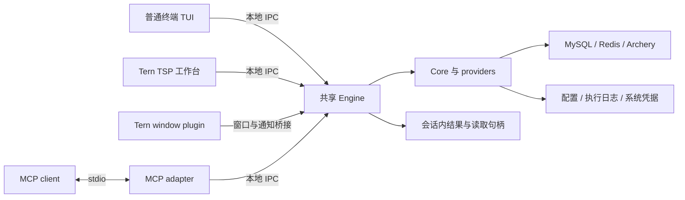
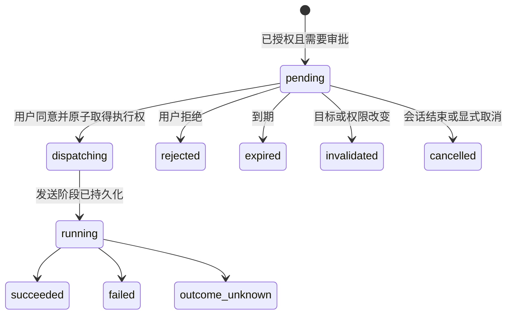

# Datapier 0.2.0 技术方案

## 1. 状态、依据与范围

本文记录 **0.2.0** 的设计契约与验收要求。当前开发版本已接入 MCP、普通终端 TUI、TSP 入口迁移、权限审批、内存结果与分页、Redis 探测及 schema／IPC 迁移；正在进行真实运行验收，具体结果和未解决项见第 15 节。设计要求不等同于端到端验收或正式发布。

依据为 [产品规划](product-plan.md)、[贡献指南](../CONTRIBUTING.md)、[0.1.0 技术方案](technical-design-0.1.0.md)、[0.1.1 技术方案](technical-design-0.1.1.md) 及已确认的需求。0.1.x 方案保留为历史；本文明确替代其查询结果持久化、分页、TSP 导出及 `tui` 入口设计。发布操作仍只按 [发布指南](../RELEASING.md) 执行，本方案不构成提交、推送、合并或发布授权。

### 1.1 交付目标

| 主线 | 完整用户路径 |
|---|---|
| MCP 与 Agent 协作 | 标准 MCP client 启动本机 stdio server，发现允许的连接、建会话、浏览与查询、分页和统计、审批危险命令、查看状态、取消及关闭 |
| 独立数据源管理 | 无 Tern 时运行普通终端 TUI，配置 Direct／Archery、认证、测试连接、管理可见范围、MCP 权限与全局设置 |
| 共享查询模型调整 | TSP 与 MCP 使用同一 Engine；结果不落盘、按需读取，普通只读查询实时分页，其他语句一次执行；历史不保存结果行 |
| 统一交互与配置 | 所有数据分页器统一，Redis key 每批追加加载，logical DB 自动探测；TSP 保留明确范围的导入导出能力 |

数据库范围沿用 MySQL 5.7／8.0／8.4、Redis 6.2／7.2／8.0 单节点，以及当前已适配 Archery 来源。保留 macOS／Linux GNU／Windows MSVC、x86-64／arm64 六个原生目标。Redis Cluster／Sentinel、PostgreSQL／MongoDB 不由本版增加支持。

### 1.2 不交付的能力

- HTTP／SSE 远程 MCP server；数据库与 Archery 服务仍可在远端。
- MCP 数据导入导出、grid 式结构化行／key 变更集编辑、连接或凭据管理、修改权限与全局设置。
- Archery 工单提交、平台工单审批及执行；本地危险命令审批不等于 Archery 工单审批。
- TUI 查询编辑器、数据 grid 和审批界面；这些交互继续由 TSP 承担。
- 查询结果持久化、结果跨 Engine 重启恢复、无界内存结果副本、自动重放写入。
- 以 SQL 前缀、工具 annotations 或 Agent 传入的目标 DB 字段替代真实访问范围校验。

### 1.3 对照当前实现

| 当前实现及落点 | 0.2.0 改动 |
|---|---|
| `crates/datapier/src/main.rs` 仅分派 `tui`／`engine`，`tui` 实际运行 TSP | 新增真正终端 TUI、MCP；原 TSP 迁至 `tsp` |
| `datapier-core/src/execution/mod.rs` 的 `ExecutionSink` 向 Store 追加结果 | 将结果发送到会话内有界结果存储／读取通道；发送阶段记录继续持久化 |
| `providers/mysql/results.rs` 每批追加缓存，TSP `response.rs` 在任务终态后取第一页 | 首批数据可用即展示；普通读取使用实时页查询，其余使用单次结果流 |
| `storage/results.rs`／`0001_cache.sql` 及 `values/` 持久化行和大字段 | 新执行不再写结果库和大值文件；旧文件按迁移与回退规则保留、显式清理 |
| `navigation/state.rs` 从 Direct `visible_databases` 或 Archery `databases` 决定导航范围 | Engine/Core 对 MCP 使用同一保存范围并强制校验，不能只过滤 UI |
| `model::AppSettings` 当前仅保存语言 | 增加分页、限制、MCP 细粒度授权开关、通知与历史保留设置 |
| TSP `views.rs::redis_db_picker` 对 Direct 固定提供 0–15 | Direct 探测实际配置数量；Archery 使用平台选定列表 |
| `transfer/export.rs` 在有 `result_id` 时导出磁盘缓存 | TSP 安全只读导出独立重查并流式落文件，其余只导出仍保留数据 |

## 2. 架构与进程边界

### 2.1 入口与模块

| 入口／模块 | 设计职责 |
|---|---|
| `datapier tui`／新增 `crates/datapier-tui` | Ratatui 普通终端的数据源、认证与设置管理，不直接连接数据库 |
| `datapier tsp`／现有 `crates/datapier-tsp` | Tern 工作台、grid、审批及认证界面，通过 IPC 访问 Engine |
| `datapier mcp`／新增 `crates/datapier-mcp` | MCP stdio adapter，管理上游协议与交互，复用 Engine client |
| `datapier engine`／现有 `crates/datapier-engine` | 唯一运行状态所有者；授权、任务、审批、读取资源、租约与窗口路由 |
| `crates/datapier-core` | 类型、SQL／命令分析、provider、持久化日志与凭据；不依赖三种界面协议 |
| Tern plugin | 启动 `tsp`，窗口存在性和通知桥接；不持有数据库凭据或执行数据库命令 |

同一规范化 `--data-dir` 仍发现／启动唯一 Engine，沿用 `DATAPIER_DATA_DIR`。`--workspace` 用于 UI 工作区与历史归属，不形成授权边界。MCP 可通过重复 `--allow-connection ID` 限定实例范围；未指定不额外收窄。名称只用于展示，工具参数引用稳定 ID。

公开子命令为 `tui`、`tsp`、`mcp`、`engine`；plugin 和开发命令使用 `tsp`，不保留把旧 `tui` 当 TSP 的兼容分派。workspace 为六个 crate，产品版本为 0.2.0。

### 2.2 技术选型

| 领域 | 决定与依据 |
|---|---|
| MCP | 官方 Rust SDK `rmcp = 3.9.0`，启用 server、macros、transport-io、elicitation 所需功能，关闭 HTTP／OAuth 等无关功能；类型 schema 使用其对应 schemars 版本 |
| TUI | `ratatui = 0.30.2`，Crossterm backend；`crossterm = 0.29.0` 的事件流，复用现有 Tokio 与 futures-util |
| 查询与存储 | 保留 SQLx 0.9、redis-rs 1.8、sqlparser 0.62 visitor、SQLite 与 keyring；不另引入数据库代理或第二套连接实现 |
| IPC | 保留 UDS／Named Pipe、长度分帧 JSON、8 MiB 帧上限；业务响应默认预算 1 MiB |

上述新增依赖已纳入 workspace 和 Cargo.lock；本轮仅在 macOS arm64 完成适用构建与运行验证，其他目标保留实现与 CI 配置。依赖解析不能代替平台验收。

TUI 采用单一拥有 terminal 的事件循环，异步 IPC、keyring 与网络等待不阻塞输入；只在状态改变时重绘。退出、错误和 panic 均恢复 raw mode／alternate screen。保留简体中文、英文和系统语言选项；TUI 全键盘可操作，秘密输入掩码且提交后清除。

### 2.3 三层身份

- `client_session_id`：一次 UI／MCP 上游生命周期；MCP `tools/call` 返回不结束客户端租约。
- `session_id`：具体数据库会话，专属物理连接与事务状态；与其他客户端隔离。
- `execution_id`：一次操作，包括待审批命令；用于状态、发送阶段和最终结果追踪。

`client_kind=tui|tsp|mcp|window_bridge` 由入口与 Engine client 建立，MCP tool 参数不能改写。MCP 入口强制使用 MCP 权限上下文，不能通过转发任意内部 method 取得 UI 权限。IPC 信任当前 OS 用户和其本地进程，不声称防御同用户恶意进程；跨客户端句柄、任务及事务归属仍逐请求检查。

## 3. 数据源与全局设置

### 3.1 TUI 管理闭环

首页提供连接列表、Direct／Archery 新建、连接测试、设置、登录状态与退出。Direct 编辑名称、地址、账号、TLS、连接模式、默认 DB、MySQL 保存的可见 DB 范围，以及 Redis DB 数量覆盖。Archery 沿用服务账号共享登录、实例／DB 选择、默认 DB 与批量变更预览，按现有 revision 和占用检查提交。

TUI 与 TSP 共用 Engine 表单契约与 Core 校验，不共享界面状态。密码更新保留／替换／清除语义、系统凭据与仅会话保存、CA 与 TOTP 配置、并发修改失败的处理沿用 0.1.1。TUI 不展示审批按钮；发现需要审批时只能说明应在 TSP 或 MCP client 处理。

现有 Direct 连接卡片没有独立隐藏实例字段；因此已保存连接构成实例可见基准。MySQL 的 DB 基准继续读取保存的 `visible_databases`：`null` 表示账号实际可发现的全部 DB，空数组表示一个也不显示。此范围由 TUI／TSP 编辑，不从当前 tab、折叠节点或搜索结果反推。

### 3.2 设置模型与默认值

设置按数据目录全局共享，并带 `revision`；保存携带 `expected_revision`，冲突后重新加载，不覆盖其他窗口更新。保持现有 `language` 字段，新增以下分组。

TSP 全局设置分为“常规”和“MCP”两个 tab：常规管理语言、分页、通用限制、历史和 Archery 服务；MCP 管理响应行数、并发、审批、通知及各连接权限。字段统一左 label、右值，布尔项使用原生 Switch；保存主按钮与重新加载放在 dialog 底部，正文独立滚动。MySQL、Redis、Archery 连接表单不展示 MCP 配置；普通编辑保留已有审批策略，新建连接采用全局默认策略，已保存连接只在全局 MCP tab 选择后管理策略和权限。切 tab 保留输入、连接选择及错误，不自动保存。

| 字段 | 默认值 | 作用 |
|---|---:|---|
| `mcp.fine_grained_access` | `false` | 开关关闭仍允许 MCP，跳过 Agent 分项规则，使用可见范围和连接原有模式 |
| `paging.mysql_table_rows` | 100 | MySQL 表浏览初始页大小 |
| `paging.sql_rows` | 100 | SQL 结果初始页／批大小 |
| `paging.redis_value_rows` | 100 | Redis 复合值初始页大小 |
| `paging.history_rows` | 20 | 本地／平台历史初始页大小 |
| `paging.archery_grid_rows` | 100 | 平台响应内 grid 初始页大小 |
| `paging.redis_key_batch` | 1000 | 首次及每次加载的目标新 key 数量 |
| `archery.request_rows` | 100 | 平台单次请求行数，区别于本地 grid 页大小 |
| `limits.mcp_response_rows` | 1000 | MCP 数据结果单次最大行数，不限制资源目录条数 |
| `limits.response_bytes` | 1048576 | 单次业务结果默认字节预算，必须小于 IPC 帧上限并预留封装空间 |
| `limits.value_preview_bytes` | 4096 | 大字段默认预览预算 |
| `limits.connect_timeout_seconds` | 10 | 新建数据库连接／探测连接的等待期限 |
| `limits.query_timeout_seconds` | 30 | 实际执行／读取请求的等待期限，不计等待人工审批时间 |
| `limits.count_timeout_seconds` | 10 | 每次总行数统计独立期限 |
| `limits.result_idle_seconds` | 300 | 结果／流读取空闲回收期限 |
| `limits.result_memory_bytes_per_client` | 67108864 | 每个客户端保留结果、字段、扫描去重及待消费数据的总预算 |
| `limits.running_tasks_per_mcp_client` | 4 | 每个 MCP client 的并行任务上限，同一 DB 会话仍串行 |
| `approval.ttl_seconds` | 600 | 从创建起计算的审批有效期 |
| `approval.default_policy` | `dangerous` | 新连接默认危险操作审批，可选 `all_writes`；连接可显式关闭审批 |
| `notifications.approval`／`notifications.authentication` | `true` | TSP 窗口通知，不抢焦点 |
| `history.auto_cleanup_enabled` | `false` | 默认仅手动清理 |
| `history.retention_days`／`history.max_entries` | `null` | 显式启用自动清理后应用的可选保留规则 |

不增加资源目录行数配置。数据库／表／视图目录没有条数上限，超过字节预算用续取引用，不静默截断。Redis key 仍按加载批次管理，不属于“无限制目录”例外。

默认值仅影响新查询；当前 tab 的临时页大小独立保存。工具可传临时行数，但不能修改全局默认值或突破硬上限。Engine 校验正数、持续时间、字节预算与相互约束；不接受以零表示无限资源。上游固定上限只影响对应来源能力，不伪装成已支持更大请求。

设置修改广播 `settings.changed`，profile／策略更新广播相应 revision 事件，事件只含 ID／revision。权限和硬限制在下一次操作重新检查，待审批请求按策略版本失效；已发送写入继续确认终态。自动清理不得删除未完成／待确认写入和仍需核对的审批执行日志。

### 3.3 Redis logical DB 自动探测

Direct 连接成功后，用独立元数据连接执行准确的 `CONFIG GET databases`，解析正整数 `N`，生成 `0..N-1`，包括空 DB；不使用 `CONFIG GET *`、`CONFIG SET` 或现有事务连接上的 SELECT。首次连接、重连和显式刷新重新探测，同一 Engine 内同配置 revision 的结果共享，不每次切 DB 重查。

`DatabaseDiscovery` 返回 `state=known|unknown`、`source=server_config|manual_override|platform_reported`、`databases`、可选 `configured_count`、错误原因和更新时间。手动覆盖显示为“用户指定”，不冒充服务端探测成功；清除覆盖后恢复自动探测。

权限不足、空返回、非法数量、超时或不支持命令时保留有效当前 DB，显示数量未知及原因，不回退为“已确认 16 个”。允许在连接设置中手动覆盖数量。`INFO keyspace` 不用于推断包含空 DB 的总数。当前已选 DB 不因刷新结果而静默切换；不再有效则显示目标失效，停止该目标的新请求。

Archery 继续使用平台发现、用户已选择的 DB 列表；它代表平台可见范围，不能宣称是实例配置总数。发现由现有 `list_databases(refresh=true)` 能力承载，不新增 MCP tool。探测是内部固定参数元数据读取，不因此允许 Agent 任意执行 CONFIG 子命令；服务器 ACL 拒绝仍正常返回。

## 4. MCP 访问控制

### 4.1 规则与基准范围

有效权限按以下顺序求交集：来源与服务器真实能力 → 保存的资源树范围 → MCP 实例启动白名单 → 连接原有只读／读写模式 → 开关开启时的 Agent 分项规则。审批在权限检查之后，不能扩权。

| 全局开关 | MySQL | Redis | 权限控件 |
|---|---|---|---|
| 关闭，默认 | 可见 DB 内按原连接模式 | 可见实例内按原连接模式 | 隐藏，保留分项配置 |
| 开启 | 每个可见 DB 单独设置 disabled／read_only／read_write | 每个实例单独相同三级规则，logical DB 不单独授权 | 显示，未配置默认 disabled |

Archery 的原模式始终只读，其已选择实例／DB 仍构成上限。新 DB 在细粒度控制开启时默认 disabled；关闭且可见范围为“全部”时，按账号新发现的可见 DB 动态扩展。节点折叠、树搜索、当前标签与布局不影响权限。

关闭该开关不是关闭 MCP，也不关闭危险操作审批。TUI／TSP 修改授权；23 个 MCP tools 均没有配置写入口。UI 原有工作台权限与 MCP 附加范围分开，不能用 MCP 规则隐式削减人工 UI 的既有能力。

### 4.2 SQL 范围证明

每次发送前，基于同一物理会话的实际 `DATABASE()`、`sql_mode` 与标识符大小写语义，生成 `AccessProof`：规范化 read DB 集合、write DB 集合、对象依赖、解析模式、proof 版本及可证明／拒绝原因。它与命令、参数、实际目标、profile／策略 revision 一起冻结。

- CTE 名与真实表名分开，递归遍历子查询、JOIN、限定表、写目标及读取来源。
- `INSERT INTO b.t SELECT ... FROM a.t` 要求 a 可读、b 可写；跨库 UPDATE／DELETE 分别判断所有来源和目标。未限定表使用执行时当前 DB，缺失则拒绝。
- `USE` 先检查目标，成功后更新会话 DB 与状态代次；后续语句使用新状态。解析状态改变后不能继续使用旧的批次证明；无法完整模拟的混合批次在发送前拒绝。
- SQL 级 PREPARE／EXECUTE、无法识别的动态调用、未知函数／表因子、解析器与服务端解释可能分歧的语句，若无法证明范围，MCP 直接拒绝。不是把任意写 SQL 都限定为只读语法，而是补齐明确支持的读写 AST 分类；未覆盖节点不默认放行。
- 普通 EXPLAIN 校验其被解释语句；不将可能实际执行的 EXPLAIN ANALYZE 作为自动预览或可重复读取。
- 不把当前 DB 参数当作 SQL 内所有访问 DB 的证明。读写连接也必须校验跨库范围。

目录、结构、DDL、大值、历史、执行错误文本和结果读取复用同一策略。任意 `information_schema`／`performance_schema` 查询、SHOW DATABASES／PROCESSLIST 等可泄露其他范围的语句，不因“只读”直接放行；无法保证过滤时拒绝，引导使用结构化工具。内部 catalog 使用固定查询并在返回前过滤授权范围。

### 4.3 间接对象与保证边界

采用客户端保守校验：视图递归分析依赖；写目标的触发器、外键级联、函数／过程调用也收集间接读写范围。定义不可见、依赖循环、不支持语法或无法证明范围时拒绝，危险审批不能放行。

本版接受应用层保证边界：这不能消除其他客户端在“读取定义”和“执行语句”之间并发修改对象的竞态，不宣称数据库端强隔离，不强制改造现有账号。需要抵御并发 DDL／definer 对象替换的部署仍须数据库端权限隔离配合，不能通过审批或忽略依赖绕过。

### 4.4 历史与存活结果

新执行保存完整范围证明及稳定 profile／服务器／实例身份。每次访问按当前授权重验：本地历史在搜索、计数、分页之前过滤，不能先返回未经授权的总数。跨库历史要求全部作用范围仍被允许。旧历史缺少可靠证明时对 MCP 不返回，TSP 历史仍保留，不通过当前默认 DB 猜测旧目标。

Archery 平台历史不能直接透传其服务器账号级 total。按平台记录的实例、DB 和可证明 SQL 范围筛选；需要补页时在截止时间内继续获取，结果说明 `coverage=filtered_platform_history`。不能确定完整数量时 total 为 null，按 has_more 翻页；无法证明的记录不向 MCP 泄露。TSP 原平台账号历史范围不因 MCP 策略变更。

结果、字段和游标句柄不作为授权凭据。所有 handle 查找先校验所属客户端、engine、执行来源和当前权限；TSP 观察者通过显式 Engine 订阅取得自己的读取授权，不拿到 Agent 的事务会话。权限收紧使相关读取句柄失效，已发给客户端的数据无法撤回。

## 5. MCP tools 与协议

### 5.1 协议约定

由 rmcp 处理 initialize、版本协商、tools/list、tools/call、关闭及取消。stdio stdout 只写 MCP，日志写 stderr；Engine 子进程不继承上游协议句柄。只声明实际交付的 tools／交互能力，不为本版新增 resources、prompts、sampling 或网络 transport。

ID 使用 UUID 字符串。普通参数校验错误使用协议错误；数据库、权限、审批、过期与执行错误使用结构化工具结果，保留 `code/message/details` 及数据库原始错误码。结果通过 `structuredContent` 提供，并有简短文本摘要，不把每页数据同时复制成多份完整文本。

统一返回语义：`execution_id`、`state`、`session_id`、执行时目标、有效权限、结果引用／审批引用；数据页另含列与类型、行数组、实际行数、`has_more`、可选 `next_cursor`、总数及其统计时间、来源限制、`retrieval_mode`。未知 total 用 null；保留 NULL、精确数字字符串、可逆二进制及 Archery fidelity。

### 5.2 完整工具清单

表中 `page` 从 1 开始；cursor 由 Engine 生成，调用方不能伪造 offset 绕过归属。可见目录只按字节续取，数据结果才使用行数上限。所有请求隐式绑定当前 MCP client。

| 工具 | 主要输入 | 输出／行为 |
|---|---|---|
| `get_server_info` | 无 | 版本、engine ID、工具能力、有效限制、权限控制状态，不含秘密 |
| `list_connections` | 可选 provider／source | 授权连接、稳定 ID、来源、有效权限、认证状态；字节超限可续取 |
| `list_databases` | `connection_id, refresh?` | 授权 DB 列表、发现状态与来源；Redis 可返回总数未知，刷新不改授权 |
| `open_session` | `connection_id, database?` | 专属 `session_id`、实际 DB、capabilities、权限或认证要求 |
| `get_session` | `session_id` | 当前 DB、连接／事务／读取状态及失效原因 |
| `close_session` | `session_id` | 关闭确认；回收读取、处理私有事务，已发写入仍确认终态 |
| `get_auth_status` | `connection_id` | ready／密码或 OTP 等待状态、TSP 是否可交互、用户处理指引 |
| `list_resources` | `session_id, database?, kind?, pattern?, cursor?` | MySQL 表／视图目录；Direct Redis 扫描 key 及下一 cursor、扫描完成状态 |
| `describe_resource` | `session_id, target` | MySQL 列／注释／键／索引／约束／DDL；Redis type／TTL／长度 |
| `browse_resource` | `session_id, target, filters?, sort?, page?, page_size?` | 创建表／类型化值读取，返回执行及结果引用、首批数据或运行状态 |
| `execute_command` | `session_id, text, parameters?, page_size?` | 发送前授权与分类；直接执行或返回冻结审批；不接受任意内部 RPC method |
| `approve_command` | `approval_id, decision`（approve／reject） | 原生确认或宿主已确认路径；同意执行冻结请求并返回既有或新任务状态 |
| `get_execution` | `execution_id, include_text?` | 待审批、执行状态、分语句摘要、错误、当前结果可用性；已释放不等于执行失败 |
| `cancel_execution` | `execution_id` | 拒绝／取消未发送请求或请求停止执行；返回真实发送与终态认知 |
| `read_result` | `result_id, page?, page_size?, cursor?` | 实时页查询、单次流继续读取，或会话内已有响应分页；明确模式及有效期 |
| `count_rows` | `result_id` | 基于冻结的安全查询定义独立重算；不改变当前页、不复用旧计数，不支持则明确拒绝 |
| `read_value` | `value_id, offset, max_bytes?` | 当前存活字段的原始字节分块与编码、长度／结束标记，不访问任意本地路径 |
| `release_result` | `result_id` | 释放内存、游标与观察者引用；涉及潜在写入的协议尾部由执行 worker 继续收尾 |
| `begin_transaction` | `session_id` | MySQL BEGIN／Redis MULTI，返回原生事务状态 |
| `commit_transaction` | `session_id` | MySQL COMMIT／Redis EXEC；授权、审批与日志不能绕过 |
| `rollback_transaction` | `session_id` | MySQL ROLLBACK／Redis DISCARD；不把 Redis 已 EXEC 的运行期错误说成回滚 |
| `list_history` | `connection_id, source, search?, page?, page_size?`（local／platform） | 授权范围内的 SQL／命令和摘要、total 或未知／has_more，不返回历史结果 |
| `check_sql` | `session_id, database, text` | Archery MySQL SQL 检查结果，不创建／执行工单，受平台权限控制 |

返回超限不能静默截断命令或改变 SQL。DDL／SQL 检查本体超限在发送前拒绝；结果页按字节提前结束并给续取位置。工具 `readOnlyHint`／`destructiveHint` 等按真实功能标注，但不构成 Core 授权。事务工具本身也进入同一执行管线，而不是绕过 `execute_command` 的后门。

## 6. 危险命令审批

### 6.1 风险规则

连接保存 `approval_policy=off|dangerous|all_writes`，新连接使用全局默认 dangerous。该流程约束 MCP 发起的操作；人工 TSP 执行沿用已有显式提交／确认，不形成自己审批自己的循环。MCP 不能修改策略。dangerous 至少包含 MySQL DDL、无 WHERE／可识别恒真条件的 UPDATE／DELETE、覆盖／批量导入类写入，以及 Redis 清库、批量删除、脚本与高风险管理操作。全批次任一命中，发送前审批整个批次。带 WHERE 不等于影响少；不额外执行危险 SQL 来“预估影响”。

范围已证明而副作用不明确的操作需要审批；访问范围无法证明的操作直接拒绝。all_writes 对所有写操作审批。固定参数内部元数据读取不因 Redis 将 CONFIG GET 标为 admin 而被误当写入，不能借此开放其他 CONFIG 操作。

### 6.2 请求与状态

`ApprovalRequest` 冻结：`approval_id/execution_id/owner`、会话与事务代次、连接／实例身份、目标及完整 SQL／命令／有序参数、AccessProof、危险原因、profile／策略 revision、创建与到期时间、内容摘要、路由和最终决定。绝不存密码、OTP、Cookie 或 TOTP。

审批采用同一 SQLite 事务和每会话执行门完成 pending 的条件更新、任务入队及唯一执行绑定；用约束保证一个 approval 最多对应一次 dispatch。真正发送前再次检查归属、会话代次、权限与配置 revision。重复批准只返回相同 execution 状态；进程崩溃后不靠重放审批恢复发送。已进入发送不因响应丢失而重新执行。

审批 TTL 默认 600 秒，待审批请求不新建数据库流、不因预检加行锁，也不持有 Engine 全局锁等待人。已有显式事务可能已经持有前序语句取得的锁，界面必须显示事务状态；不能重建连接或承诺等待期间“无锁”。等待期间目标会话代次变化即失效。Redis MULTI／EXEC 队列要冻结实际入队命令与各项 DB，禁止在审批期间继续改变队列；EXEC 不能借事务入口绕过对危险命令的检查。MySQL DDL 仍按隐式提交规则提示和记录。

### 6.3 TSP 在线与离线路由

在线指同一 Engine 下存在有窗口承载、能够交互的 TSP，不仅是 TSP 进程或 PTY 存活。优先选择正在使用该连接的窗口，否则最近活跃窗口。发送窗口 toast／待办提示，不自动切 tab、聚焦或弹出抢焦窗口。一次请求一个交互控制者，其他窗口只观察；用户主动打开工作台的 MCP 待办入口查看审批或认证内容。

TSP 关闭或窗口存在性租约过期时，pending 请求可转离线路由，不自动同意。离线 `approve_command` 根据 MCP client 能力发起原生 elicitation；不支持时，由 Agent／宿主先询问用户，再调用该工具。后一路径明确信任宿主／Agent 遵守用户确认流程，不宣称 tool 调用是可验证的用户签名。`approved=true` 不能授权一个未冻结的新命令。

TSP 决定与 MCP 决定竞争时以 Engine 原子状态转换为准；原生交互已取得控制权时不再给其他窗口弹第二次确认。拒绝、取消和到期绝不触发数据库发送。人工决定来源及时间进入日志，不将模型传入的 engineer 或用户名当作 Archery 平台身份。

### 6.4 窗口通知桥接

plugin 的 window 半部通过 `tern.on`、`tern.timer` 和 `cx.session` 维护本窗口 pane 存在性；用带 nonce 的保留 TSP action 将 pane／window 与 Engine 的 TSP client 绑定。绑定经双方确认，不能仅靠进程名认定窗口在线。

使用 `tsp` 的内部隐藏桥接模式进行短生命周期 IPC 同步，argv 分项传递非秘密窗口元数据，不拼 shell；该模式不渲染 TSP、不启动新 Engine，也不作为 Engine 保活客户端。window VM 每 5 秒异步同步一次，最多一个未完成同步；Engine 以 15 秒窗口租约判定可交互存在性。关闭／重载后未续期自然离线。手工启动 `tsp` 也必须完成同样窗口绑定；没有可验证窗口绑定时使用离线路由，而不是假装在线。

同步结果仅携带目标 client／pane、待办 ID、类型与数量；SQL／结果与凭据仍由 TSP 经 IPC 读取。0.2.0 使用窗口内 toast／待办指示，仅提示有命令等待审批或有连接等待认证，不含 SQL 或凭据。桥接依据目标 window／pane 发送提示，不能向“当前任意焦点 pane”发送请求。用户通过工作台的 MCP 待办入口处理；关闭 toast 提醒不隐藏待办，也不改变权限或控制者。

0.2.0 的通知交付范围为窗口 toast 与待办面板，不提供 toast 点击回调。系统通知及点击系统通知定位移入后续规划，不属于本版验收项。窗口存在性、单一控制者、提醒不抢焦与关闭窗口后的离线路由仍按第 14 节验证。

## 7. 认证与秘密

沿用 Archery Engine 共享登录槽与每客户端 auth_id／控制者令牌。优先使用有效登录；缺失或过期时，一轮恢复读取已存密码，需要 OTP 才使用已配置 TOTP。权限失败、403／429、错误密码或自动验证失败不形成无限重试。

需要人工输入时，TSP 可交互在线则通知并定位认证入口；离线返回 `auth_required/otp_required/interactive_login_required`、服务和账号摘要及同 data-dir TUI 的启动指引。TUI 接收密码／验证码，完成共享认证后 Agent 显式重试失败操作。Direct 缺秘密亦通过 TUI／TSP 补充，不增加 MCP 密码输入工具。

MCP 原生普通 elicitation 仅收集审批等非秘密决定，不收密码、OTP 或种子；本版不为认证新增本地 Web server。不同来源及账号不共享登录；认证恢复不自动重放已失败 SQL／命令。keyring 不可用时明确仅当前 Engine 内存保存，退出后需重新输入。

## 8. 实时查询与结果生命周期

### 8.1 结果模式

| `retrieval_mode` | 场景 | 翻页来源 |
|---|---|---|
| `live_page` | MySQL 基表浏览、可证明可安全重复的单条只读 SQL | 每次请求重新查对应范围，页内有界内存 |
| `single_execution_stream` | 写入返回结果、CALL／锁定读取等不能安全重执行的语句，或不能可靠分页的合法查询 | 同一次执行的原生结果流，后续只向前读取 |
| `bounded_response` | Archery 本次有界响应、已完成的有界命令结果 | 当前会话内响应分页，不重新请求平台 |
| `redis_scan` | key／可扫描复合值 | Redis 原生 cursor，去重及已读页在内存中 |

SQL 的可重复性独立于“只读模式允许”：锁、用户变量、易变函数、存储程序、多语句和不能保持结果边界的语法不得自动分页重跑。MCP 仍先满足访问范围可证明；“采用单次流”不是绕过未知范围拒绝的路径。

普通 SQL 分页基于解析后的完整原查询构造受控外层 LIMIT／OFFSET，并保留用户原有 LIMIT／OFFSET 的语义；不盲目字符串追加。无法合法包裹的语句走单次流。SQL 编辑器的页查询在原数据库会话物理连接上串行执行，保留 USE、sql_mode、临时对象与事务上下文，不能每页换新连接。表浏览仍使用独立受授权读连接，保留列注释与可靠键排序后缀，无键表依然可读且不可编辑。任意 SQL 保留用户排序，不伪造主键排序。

翻页会重新发送页查询，可见性仍遵守当前会话隔离级别；显式事务可能继续看到其原有快照，不为“实时”隐式提交或重建事务。事务外并发变动可能造成重复或漏行，不承诺跨页快照。无 ORDER BY 的 SQL 明确无稳定顺序。页大小为目标行数，仍受字节预算限制；宽行提前结束时使用续取锚点，不能简单 `page * size` 跳过未返回的行。

### 8.2 读取 worker 与背压

每个数据库会话使用拥有专属连接的 worker／actor；UI 与 MCP 不持有驱动 stream。worker 在自身栈内创建和消费借用该连接的流，通过有界请求／响应通道提供首批与继续读取，不把借用流伪装成可任意存放的静态 trait object。

`ResultRegistry` 持有查询定义、模式、权限证明、列元数据、有限页、字段块、消费位置、存活引用、idle deadline 和内存记账，不持久化结果数据。首批可用即通知客户端，不等待全文扫描或整条多结果命令终态。存在剩余协议数据时，会话显示 busy，不能在同一物理连接上插入 COUNT 或下一条普通命令。

内存预算覆盖保留页、大字段、Redis key 去重集合及待发送数据；通道背压阻止无限提前读取。数据库／表／视图目录元数据不按结果行数或结果内存预算截断，属于独立目录域，采用按需展开与字节续取；进程资源不足须明确报错，不能宣称已完整列举。SQLx／redis 驱动对单个响应／字段仍可能有临时解码分配，64 MiB 是本应用保留预算，不宣称是进程 RSS 的绝对上限。单行／字段不能纳入预算时明确 `resource_limit`，不改为落盘；对潜在写入继续处理数据库终态，不能用展示失败伪装成数据库未执行。

### 8.3 结果回看与释放

单次执行流按需读取并保留已读页，直到该客户端内存预算；这样仍可上一页及切换行数回到第一页。达到预算后停止继续加载，保留已展示数据并返回 resource_limit，不转存磁盘、不自动重放。潜在写入仍由 worker 丢弃后续行并确认协议终态，不因不能继续展示就说数据库失败。普通 live_page 只需保留有限页，可通过重查回看；bounded_response 在响应仍保留时重新分页。

不通过自动淘汰单次流旧页继续向前读取，以保留统一分页行为。执行终态与展示完整性分开：数据库可能成功，但结果须标记为 retained_prefix／resource_limited，不显示“已读取全部”。已经丢弃的后续行不再提供续取 cursor；用户提高预算也不能恢复原结果，更不能因此重放写入。完整重新执行须由用户另行显式发起并重新经过权限与审批。

结果 idle 默认 300 秒，显式释放、客户端退出或 Engine 重启后失效。MCP 调用结束不释放整个会话。TSP 观察同一 Agent 执行时读取已有保留页，不移动 Agent 的消费位置；观察者不能为后台任务永久保活，不承诺恢复已经淘汰的页。共享页按引用记账，观察者不能规避源客户端预算。

对只读流，释放／超时发起取消并完成连接清理；对已发送潜在写入／CALL／COMMIT，停止展示不能丢弃最终 OK／错误。worker 继续以不保留行的方式消费协议尾部并确认终态，超过已有收尾期限则关闭连接、记录 outcome_unknown；不回池不洁净连接，不重发命令。最后客户端退出继续沿用 30 秒收尾边界。

### 8.4 总行数

默认不 COUNT。界面显示“统计总行数”；每次点击 `count_rows` 都新建独立计数操作，使用相同目标、SQL、参数与过滤。查询条件或目标改变清除旧计数；翻页不自动计数。普通 SQL 的总数按原查询结果定义统计，用户写入的 LIMIT 仍属于该定义。

统计只允许可安全重复的读取；COUNT 包裹必须由 AST 保证语义，不得执行原写语句／CALL 取得行数。表浏览统计可使用独立、受授权读取连接；SQL 编辑器统计优先在原会话空闲时串行执行。只有证明无会话依赖时才允许独立连接优化，不能冒用新连接声称保留未提交事务、临时对象或连接变量。原会话有未消费流时返回 busy；能保持正确会话语义才执行，否则明确不支持该计数。未统计 total=null；统计结果附 `counted_at`，不承诺随后页与统计同一时间点。

Archery grid 的本次响应行数直接已知，仅说明平台返回范围；不标为数据库全量。DML 影响行数与查询总行数分开。

### 8.5 编辑与大字段

TSP 基表编辑仍以当前页完整原值、可靠键及 schema 生成 edit token；分页回收不会把旧 token 变成有效新基线。存在草稿时沿用整批操作保护，先提交／丢弃再切会破坏基线的页或刷新。提交后重新浏览，不用旧页假装已经更新。

工作区只保存用户编辑意图、定位键、必要的基线摘要和新值，不序列化未编辑的完整返回行、大字段副本或驱动结果。完整原值比较基线留在内存并由草稿引用固定；恢复草稿后必须重新读取并确认基线。执行日志同样采用字段白名单，不把 change 的 before／rows 或结果 payload 随完整请求参数落盘；确认写入事实只需命令／目标摘要、发送阶段与结果状态，不用于重试原写入。

Redis 可编辑 key 继续使用专属 WATCH 基线，List 索引只在该 token 内有效；加载更多内容不能把独立重连或刷新当作同一基线。不可容纳的编辑基线明确受限，不自动解除并发检查。

大值随当前结果在内存保留并以 value_id 分块读取；结果或页释放后 value_id 失效。不通过重新查询可能变化的字段伪装成当时结果，不将字段内容写入日志／工作区。复制当前仍保留值时解析完整字段；超出当前持有范围不能称为复制全部结果。

## 9. Redis 增量浏览与统一分页器

### 9.1 key 加载

首次目标 1000 个新 key，“加载更多”再追加最多 1000 个新 key。COUNT 是提示，worker 可多次 SCAN；空批次、重复和超出目标的响应均正确处理。超出当前逻辑批次的 key 放入有界 pending 队列，下次优先消费；去重集合也计入内存预算。cursor 为 0 且 pending 耗尽才标扫描结束。

已加载列表／分段树保留顺序和选集，不因每次加载重新排序全部节点。刷新清空 cursor、去重、pending 与已加载列表并开始新扫描。并发变化不承诺一致性快照；超过内存预算时停止追加并说明原因，不能转回磁盘缓存或把尚未扫描完标为完成。

### 9.2 复合值

List 使用范围读取；Hash／Set／ZSet 按可用原生扫描或范围能力读取，保留各自顺序及重复语义，不为统一 grid 宣称一致快照。页大小默认 100，允许切换。需要扫描的类型维护 cursor 与保留页；已失效或淘汰的回看范围按同一分页能力禁用。

### 9.3 共享分页组件

TSP 新建一个分页状态模型与组件，覆盖 MySQL 表、SQL 结果、Redis 复合值、本地／平台历史和 Archery grid。所有位置按“每页行数选择 → 上一页 → 页码／总页数 → 下一页 → 总数／统计入口”排列；总数未知时只展示当前页与 has_more，不计算假总页数。

行数选项使用同一候选集 20／50／100／200／500／1000，受来源硬限制的选项使用统一禁用样式并说明原因。全局可配置的非候选默认值在选择器中补入当前值。上游历史单请求较小时可多次获取填充本地逻辑页，不能悄悄少取却标完整。

切换行数回第一页，保留目标、过滤、排序；单次流按第 8.3 节保留已读页，尚未读足新页时可继续消费同一次流，但不得重发语句。达到内存上限仍允许对已保留数据切换行数，下一批加载明确受限。分页请求带 tab／query generation、result ID 与页请求代次，忽略迟到响应，避免旧页覆盖新页。加载时禁用重复操作并保留当前内容；空结果仍为第一页、零行，前后按钮禁用。

改变页大小不改变 Archery 单次远端请求上限，也不触发平台重查。草稿／任务对切页的保护沿用已有规则。TUI 不渲染这些数据分页器，只管理默认设置。

## 10. TSP 导入导出与历史

### 10.1 导出

| 来源 | 0.2.0 行为 |
|---|---|
| Direct MySQL 表／安全只读查询 | 用户显式导出时，独立执行完整目标和查询条件并流式写 CSV／JSON；保留用户 SQL 自带限制，不采用 grid 页大小截断；提示可能不同于屏幕数据 |
| Direct Redis | 独立读取指定 key 或扫描目标 DB，流式写文件，保留字节／类型／到期语义；不承诺跨 key 快照 |
| Archery | 仅导出本会话仍保留的平台本次响应，保留范围／fidelity；不补查全库，不自动重执行 |
| 不可安全重执行的语句 | 仅导出仍保留的数据，显式说明页／行范围及不完整性；已释放数据不能恢复 |

导出文件是用户明确指定的输出，不是隐藏结果副本。沿用不覆盖已有路径、临时文件和完成后发布、失败／取消说明部分文件等规则。不得把缺页导出标为全量。导出需要原事务／临时表状态而独立连接不能复现时，拒绝“独立重查全量”并说明原因，不声称相同快照。

TSP 原有导入继续可用，复用新的内存预览／流式处理与原写入冲突契约；不为 MCP 暴露文件路径或 transfer 内部方法。文件导入预览等临时输入处理与“禁止持久化数据库查询结果”分开，不能借输入预览保存数据库返回结果。

### 10.2 历史与执行日志

SQL／Redis 命令历史保存原文和必要连接／DB、时间、耗时、状态与影响行数；不存行数据、大值、平台完整响应或恢复句柄。打开历史只恢复文本，不执行。Redis AUTH 等秘密命令保持禁止或不入历史的现有约束。

执行日志保存发送阶段、may_write、分语句终态、审批决定、内容摘要和 AccessProof，以区分失败、已生效、已回滚、停止等待与待确认。它与可清理的历史展示数据分开生命周期；删除历史文本不自动删除未决写入事实。Archery 平台历史由平台管理，本地清理不删除远端记录。

## 11. 持久化与升级

### 11.1 配置 schema 3

从 schema 2 事务迁移到 3；schema 1 依次执行既有升级后再进入 3。保留 UUID、名称、连接模式、可见范围、Archery 实例身份／账号／revision、语言、工作区、草稿和凭据追踪。不改 keyring account 命名。

| 表／字段 | 目标 |
|---|---|
| `profiles.revision` | 正整数，用于配置冻结、占用和审批失效；现有行初始化 1 |
| Profile payload 扩展 | 连接级 approval_policy、可选 Redis 手动 DB 数量；使用明确 serde 默认，不改 provider／source 语义 |
| `app_settings.revision/payload` | 单行设置与 revision；保留 language，追加第 3.2 节字段及默认值 |
| `mcp_access_rules` | `(profile_id, scope_kind, scope_key)` 唯一；MySQL scope_key 为规范库名，Redis instance 使用固定 scope_key；level 受 CHECK 约束；关联 profile |
| `approvals` | 主键 ID、owner、execution、冻结请求、digest、revision、状态、到期与决定来源；一个 execution 的审批与 dispatch 唯一绑定 |
| `executions` | 保留当前发送事实与时间；增加待审批／拒绝／过期／失效状态，以及 AccessProof、请求类别、结果可用性摘要；历史读取不再依赖 cache DB JOIN |

revision／状态／JSON 类型、主外键与必要索引在目标 migration 中完整定义并核验，不把散落的运行时补表当迁移。权限、审批和 history 范围索引应覆盖 profile／owner／created_at／状态，避免查询前先加载全量历史。

### 11.2 旧结果库与回退

0.2.0 不再创建或写入 `cache.sqlite3`／`values/` 作为新查询存储。迁移只处理配置与日志，旧结果文件不自动删除；记录已退休的缓存版本和原路径，默认保留给用户备份／回退，不将它们作为新版本结果恢复来源。旧任务显示“历史结果已不可用”，任务成功状态与 SQL 历史不被改成失败。

提供 TUI／TSP 明确的旧结果清理操作，预览限定数据目录内已登记的退休缓存文件；不删除配置库、工作区、日志或 keyring。清理是用户显式操作，不在首启或文档任务执行。若路径／归属无法验证则拒绝删除。

恢复未完成操作仍依据日志：未发送可取消，可能发送写入保守进入 outcome_unknown，不重放。所有结果／value／scan／edit token 重启后失效。草稿意图保留，需重新读取基线。

升级前需要全部旧 Engine／客户端退出并备份一致的数据目录。IPC v3 与 schema 3 不向 0.1.x 兼容；旧程序拒绝打开较新配置。回退恢复升级前备份，keyring 不随 SQLite 回退；不得把运行中的 WAL 数据目录按普通文件复制后当作完整备份。若用户已清理旧缓存，不能再承诺恢复旧结果。

## 12. IPC v3、事件与执行资源

握手增加 client_kind、workspace、client capabilities；返回 Engine／client ID、版本、当前设置 revision 与已有租约参数。v2／v3 不混用，不强杀活动旧实例、不创建同目录第二个 Engine。现有 10 秒心跳、45 秒客户端租约与 30 秒无客户端收尾继续有效，window bridge 单独采用非保活租约。

| 接口族 | 目标契约 |
|---|---|
| `settings.get/set`、`profile.*` | revision 保存与广播；TUI／TSP 可写，MCP 仅经专用工具查看有效公开状态 |
| `connection.open/get/close` | 显式目标、模式与会话代次；读取流占用状态可见 |
| `resource.*`、`database.list` | 统一 AccessProof／范围过滤；目录字节续取、Redis DB 发现状态 |
| `execution.start/get/cancel` | 增加待审批与首批结果，首批可用不要求任务终态 |
| `approval.get/decide` | Engine 内冻结、竞争控制、幂等状态读取与一次 dispatch；TUI 没有决定权限 |
| `result.read/count/value/release` | 替代磁盘缓存页计划；模式、内存窗口、total／has_more、过期错误 |
| `transaction.begin/commit/rollback` | 同会话串行状态机，原生事务语义与统一授权审批 |
| `ui.window.sync`、TSP 观察订阅 | 有窗口证明的在线状态、只含非秘密 ID 的通知、独立观察者读取授权 |
| `history.list`、`archery.*` | 来源区分、授权后分页与不泄露未过滤 total |

新增事件 `approval.changed`、`result.ready/changed`、`profile.changed`、`auth.changed` 与已有 execution/settings 事件共用序号和遗漏核对。事件只给有权订阅的客户端，包含 ID、状态、revision，不包含 SQL、结果行和秘密。结果数据按需读取；事件丢失由有界轮询补齐，不用广播 SQL 解决可发现性。

## 13. 实施切片与文件落点

本节保留实施切片和文件落点，作为设计与验收的对应关系；具体结果见第 15 节。

| 顺序 | 范围与主要文件 | 完成标准 |
|---|---|---|
| 1 | `core/model`、`storage`、新 schema 3 migration；`engine/server` 的策略与日志模型 | 升级保留配置、keyring 与历史；授权基准、revision、审批与结果失效可验证，旧结果不再作为新结果读取 |
| 2 | `core/providers/mysql/{sql,catalog,results}`；`engine` 的会话 worker／ResultRegistry | 表浏览与安全 SQL 实时分页、显式统计、首批展示、单次流、背压及写入尾部收尾端到端可运行 |
| 3 | `core/providers/redis`、Archery response、transfer | logical DB 发现、1000 新 key、复合值读取、WATCH／TTL、Archery 有界内存与新导出行为完整 |
| 4 | 新 `datapier-tui`，现有 `datapier-tsp` 共享 paging／设置／认证；CLI 与 plugin 启动 | 无 Tern 完成三类数据源管理与认证；TSP 六类分页器一致，`tui`／`tsp` 名实相符 |
| 5 | `engine` 审批／window presence、TSP 待办与 plugin window bridge | 通知不抢焦、窗口关闭转离线、冻结请求只执行一次，多窗口竞争和期限有效 |
| 6 | 新 `datapier-mcp`，CLI mcp 分派 | 23 个工具全部接入真实 Engine；原生确认与信任宿主路径、无 Tern 查询、权限与资源收尾通过实际 MCP client |
| 7 | 安装脚本、版本 smoke、工作流与发布说明；必要的 UI／开发文档 | 保留六目标原生包实现与明确的独立二进制使用路径；本轮验证 macOS arm64 的构建、组包与运行，旧入口／缓存调用全部迁移，无假完成记录 |

`datapier-core` 的 result 模块定义类型与有界容器，Engine 持有生命周期和 registry；provider 只负责原生读取，不依赖 TSP／MCP。TSP 统一分页模型放在现有 query/workbench 的可复用模块，不在每个 view 复制状态机。MCP tool 定义、schema 和 adapter 放新 crate，不能把 SQL 安全判断或权限规则复制到 adapter。

涉及导出、编辑、复制、任务详情、恢复、历史、大字段的旧 `result_page`／`result.value`／cache JOIN 调用必须整批迁移。删除被替代接口与过时测试，不添加旧结果缓存 shim；保留 0.1.x 历史文档及用户数据不等于保留运行时兼容接口。

## 14. 验收要求

### 14.1 核心行为矩阵

| 领域 | 必须观察的结果 |
|---|---|
| 独立入口 | 普通 terminal 的 tui 完成配置／测试／认证；mcp 无 Tern 查询；Tern plugin 启动 tsp，协议 stdout 不混用 |
| 全局开关 | 默认 false 按可见范围和原连接模式；开启后逐 MySQL DB／Redis 实例生效，控件显隐不清除配置，MCP 不能修改策略 |
| DB 边界 | 同库／跨库 JOIN、CTE、子查询、多表 DML、INSERT SELECT、USE、大小写／引号、动态 SQL、系统目录及间接对象；未授权和未知范围拒绝 |
| 读取二次授权 | 收紧可见范围／权限后，旧结果、value、history 搜索／total、错误详情及观察者都不能泄露已撤销范围 |
| 审批 | execute 返回 approval_required 时数据库未发送；TSP／MCP 两路批准最多一次，重复／拒绝／过期／目标变化／断线不重复写库 |
| 窗口存在性 | TSP 进程仍在但窗口关闭时转离线；通知不抢焦，双窗口只一个控制者，桥接不永久保活 Engine |
| 窗口提醒 | 审批／认证窗口 toast 不含命令正文或凭据，两类提醒开关独立；关闭提醒仍可从 MCP 待办入口处理，不抢焦；系统通知与通知点击定位不在本版范围 |
| 认证 | 已存凭据／TOTP 可恢复；手动密码／OTP 只进 TUI／TSP；同 Engine 成功后显式重试，无失败命令重放 |
| 实时分页 | 大表第一页无需读完全表，无 COUNT 自动发生；每页默认 100，切换页大小与条件正确；每次统计重算，期间并发修改不伪装快照 |
| 单次执行 | 写入／CALL 等不因翻页和 COUNT 重发；先有首批再有终态；释放／超时后正确消费或关闭连接并保存写入结果 |
| 内存与大值 | 长时间读取、大字段、并行结果、观察者和扫描去重均受预算；不生成新的结果 SQLite／value 文件，过期引用明确失败 |
| Redis key | 空 SCAN、重复、一次返回超量、连续加载／刷新、pattern／type、预算不足；每逻辑批次最多追加目标新 key，不漏 pending |
| Redis DB | 配置 1／16／64 DB、空 DB、CONFIG ACL 拒绝／不支持／超时、手动覆盖、重连和当前 DB 超范围；不假定 16，不改变事务连接 DB |
| 统一分页器 | MySQL／SQL／Redis 复合值／本地与平台历史／Archery grid 的行数控件在按钮前，加载／禁用／空结果／未知总数一致，迟到响应不覆盖 |
| 现有编辑 | MySQL 可靠键／原值冲突、无键只读；Redis WATCH／List 重复值／TTL 不退化，草稿和翻页保护完整 |
| TSP 导出 | 安全读取显式重查流写；Archery 不补查；单次结果只导出保留范围，过期不恢复，文件不覆盖且失败进度准确 |
| 升级 | schema 1／2 到 3 保留数据与凭据引用，旧 cache 不自动删除；执行日志不依赖旧结果；恢复无旧事务、无写入重放 |

### 14.2 执行与证据

实施阶段按贡献指南运行相关 unit／integration tests、`cargo clippy --workspace --all-targets --locked -- -D warnings`、`cargo test --workspace --locked`、Rust 与项目 formatter 只读检查。新测试只覆盖消费者可见行为、边界与状态迁移，不测试工具名称或默认值的机械复制。

必须用真实 MySQL／Redis／Archery 和标准 MCP client 运行受影响路径，实际观察 initialize、tools/list、tools/call、elicitation／非 elicitation、分页、取消、EOF、多个客户端与重启。CLI／TUI 在实际 terminal 交互；TSP 与通知在实际 Tern 多窗口观察；测试通过或组包成功不代替运行验收。

本轮 0.2.0 验收按用户确认仅覆盖 macOS arm64，完成该平台的适用构建、默认测试、版本 smoke 与原生运行验证。其他五个原生目标及六目标 CI 不作为本轮实施验收门禁，其实现、配置和分发流程保留，未执行项明确记录。该范围调整只限定验证平台，不减少本章功能行为、数据库、权限、生命周期与迁移要求；后续正式发布按实际分发范围核对产物。

## 15. 风险与当前完成状态

| 风险 | 处理与交付条件 |
|---|---|
| DB 范围不能仅靠文本证明，间接对象可并发变更 | 采用应用层保守校验，无法证明即拒绝；不宣称抵御并发对象替换，强隔离仍需数据库侧配合 |
| 无持久化／有界内存不能保证单次流无限回退 | 保留已读页到预算上限后停止加载；允许已保留数据回看／切换行数，后续数据不保留且不重放 |
| 借用连接的 stream 无法直接放入普通 registry | 会话 worker 自持连接与流；背压、busy、取消与协议终态在同一所有者内完成 |
| 权限变更、审批竞争和连接状态变化 | revision／代次冻结、每次访问重验、唯一 dispatch 与发送前持久化，崩溃不重放 |
| 原生 MCP 确认客户端覆盖不一致 | 协商能力，支持则原生交互；否则信任宿主已询问用户，清楚记录保证边界 |
| 窗口提醒范围 | 0.2.0 仅交付窗口 toast 与待办面板；系统通知及通知点击定位进入后续规划。仍须验证真实窗口存在性、单一控制者、提醒不抢焦和离线路由 |
| 巨大单字段与平台完整 HTTP JSON | 区分保留预算与驱动临时分配，已有 HTTP 有界接收保持，资源限制明确，不用磁盘假兜底 |
| 实时 COUNT／翻页与原事务不一致 | 只对能保持正确语义的安全查询开放，说明统计时间及范围，不伪装快照 |
| 旧缓存删除或模式切换破坏回退 | 默认退休保留，显式受限清理；备份配置与凭据追踪，不修改旧版本历史方案 |

当前为 0.2.0 开发版本，已完成本轮用户确认范围内的 macOS arm64 实施与适用运行验收。本版通知采用窗口 toast 与待办面板，系统通知与通知点击定位进入后续规划。以下结果不代表其他平台运行支持或正式发布：

- 默认测试 423 项通过、61 项忽略，Clippy、Rust 格式检查和窗口插件 Luau 格式检查通过；Python 3.15.2 脚本回归 25 项通过，`version --check-release` 通过。
- 标准 Node MCP SDK 真实回归 27 组全部通过，覆盖 23 个 tools、原生 elicitation／宿主确认、权限收紧、跨 owner 句柄、MySQL 与 Redis 事务、Archery 四版本以及结果生命周期。运行记录保存在本地 `target/datapier020-smoke/mcp-evidence.json`，不提交测试数据或截图。
- 权限修正后的运行证据：`USE` 后按实际库冻结浏览目标；拒绝写视图；视图定义改变后拒绝旧结果翻页与统计；撤权后隐藏审批正文及观察列表；外键父引用只读可插入子表，级联写入仍要求目标库写权限。
- 查询期限与历史清理证据：1 秒读取期限下等待下一页 2.2 秒后仍成功读完 450 行；实际慢读取约 1.1 秒取消后会话可复用；已发送且被行锁阻塞的写入约 31 秒进入 `outcome_unknown`，不重放；终态历史被清理后，原会话仍可继续查询。
- 真实 MySQL 5.7／8.0／8.4 与 Redis 6.2／7.2／8.0 各运行 23 项通过，包含十万行 CSV／JSON；MySQL edges 适用用例分别为 16／17／18 项通过，5.7 不支持的语法已筛除。MySQL 8.4 非严格模式专项通过，覆盖 InnoDB／MyISAM 结构化写入拒绝截断与查询连接保留服务端 warning；解包后的 release 二进制经真实 Engine IPC 验证会话模式、1265 warning、截断后的值及同批次 `INSERT → SHOW WARNINGS`，记录见 `target/datapier020-native-final/query-evidence.json`。
- 当前源码 TLS 专项 3 项通过：MySQL 5.7.42 Debian 10 fixture 验证 `require_secure_transport` 的 3159 明文拒绝和受信 TLS 连接，MySQL 8.4.13／Redis 6.2.24 验证受信 CA 成功、错误 CA 与错误主机身份拒绝。5.7 fixture 先经 OpenSSL 验证证书与 IP 并协商 TLS 1.2 ECDHE；旧 Oracle Linux／OpenSSL 1.0.2k fixture 的 DHE-only 兼容限制不通过降低 Rustls 安全性规避。记录见 `target/datapier020-tls-final/suite-current.log`、`mysql57-debian-ecdhe.log` 与 `evidence.txt`。
- macOS arm64 原生环境中，TUI 已观察完整创建 MySQL／Redis、测试并保存连接，以及 Archery 认证、实例／DB 选择与批量确认；TSP 先前已观察连接、设置和 SQL 前 100 行。实际 Tern 为 0.9.12（e498b49），0.9.9 是最低设计基线，现有 types 和原生证据不能证明本候选在 0.9.9 上运行。
- 真实 Tern 双窗口已验证单一认证控制者、观察窗口禁用认证，以及关闭控制窗口后保留原 PTY 并转交控制与认证通知。退出全部原生窗口进程后，两个原 TSP PTY 仍运行，MCP 返回 `interactive=false`；不以进程存活判定可交互在线。
- 认证与窗口提醒已通过 12 组回归：6 组覆盖重启无会话凭据、无窗口不能控制、请求去重、撤权、配置变化、删除连接和请求客户端断线；6 组覆盖双窗口控制、独立认证通知开关、控制转交、真实 Archery 表单登录、全窗口退出后的离线状态，以及活跃工作台中可见的认证 toast 和 MCP 待办入口。实际提示为“Datapier · 有连接等待认证”，不含 SQL 或凭据。通过真实 Tern window VM 注入 TSP `edit`／`action` 事件完成安全输入和登录，Engine 返回 `ready` 且认证待办清空；未验证 OS 键盘或 Accessibility 密码录入。本地记录见 `target/datapier020-smoke/native-auth-evidence.json`。
- MCP 待办按 [UI 设计规范](ui-guidelines.md#8-mcp-待办设计)改为原生大号对话框，分待审批、待认证、Agent 任务三标签；冻结上下文与命令分区、完整诊断默认折叠，观察结果的分页限定在已保留行。重设计后 TSP 相关测试 255 项通过、1 项忽略，Clippy 与格式检查通过；HTML 已检查五种状态、宽窄屏和明暗主题。桌面停在 `loginwindow`，本轮采用 Tern 原生离屏渲染连接真实 Engine／MCP／MySQL 验证与截图，不能作为解锁后桌面鼠标／键盘及控制窗口认证录入的证明。本地证据保存在 `target/datapier-mcp-ui-review/`，旧状态栏浮层截图不再代表当前设计。
- TSP 设置重组后，相关测试 256 项通过、1 项忽略，Clippy、格式检查与 debug 构建通过。实际 Tern 离屏场景验证常规／MCP tab、水平字段、原生 Switch、跨 tab 草稿真实保存、连接审批策略真实修改，以及底部重新加载和 Primary 保存按钮；底部不再提供关闭按钮。HTML 额外验证四类连接、失败状态、语言切换、480px／1280px 布局、保存／重新加载与正文滚动时 footer 固定可见。原生截图保存在本地 `target/datapier-settings-tabs/`，验证期间修改的隔离配置已恢复；此轮未验证解锁桌面的 OS 鼠标／键盘输入。
- macOS arm64 的真实 Keychain 专项通过，覆盖保存、存储重开、SQLite 不含秘密，以及切换会话凭据后删除原系统条目；测试按 revision 契约重载配置后更新。Redis 6.2.24 百万 key 专项通过，扫描 1,000 页、1,000,000 个 key，无重复或遗漏，扫描耗时 34.80 秒并清理自身资源；日志见 `target/datapier020-native-final/redis-scale.log`。
- macOS arm64 release 已实际构建和组包，解包后核对唯一成员、执行权限与 0.2.0 版本，并观察 TUI 正常启动／退出；标准 MCP SDK 对解包程序完成 initialize、23 个 tools 发现和服务信息查询。产物及摘要在 `target/datapier020-native-final/dist/` 和 `evidence.json`，该候选包未上传或发布。
- 本轮验收平台已按用户确认限定为 macOS arm64。其余五个原生目标与六目标 CI 未执行，不再作为本轮验收阻塞；实现及 CI 配置保留，未验证的平台不声明运行已验收。

本轮候选二进制、macOS arm64 构建产物及适用原生场景须以实际证据闭环；后续正式分发的产物核对仍按发布指南执行，不能以本摘要代替发布前检查。

## 16. 外部依据

- [MCP tools 与 annotations](https://modelcontextprotocol.io/specification/2025-11-25/server/tools)、[用户交互 elicitation](https://modelcontextprotocol.io/specification/2025-11-25/client/elicitation)：原生用户决定与非秘密表单；SDK 协商版本，不手写伪兼容。
- [rmcp stdio](https://docs.rs/rmcp/3.9.0/rmcp/transport/io/index.html)、[SDK 与版本元数据](https://crates.io/api/v1/crates/rmcp)：仅启用需要的协议能力。
- [Ratatui](https://ratatui.rs/)、[Ratatui 元数据](https://crates.io/api/v1/crates/ratatui)、[Crossterm 元数据](https://crates.io/api/v1/crates/crossterm)：终端恢复、事件流及 MSRV／许可证。
- [Tern Window API](https://docs.stencil.so/tern/reference/api-window.md)、[Shared API](https://docs.stencil.so/tern/reference/api-shared.md)：窗口 timer／process／pane 交互和窗口 toast，不自动抢焦。
- [Redis CONFIG GET](https://redis.io/docs/latest/commands/config-get/)、[INFO](https://redis.io/docs/latest/commands/info/)、[SELECT](https://redis.io/docs/latest/commands/select/)：配置总数、keyspace 统计与连接 DB 状态分别处理。
