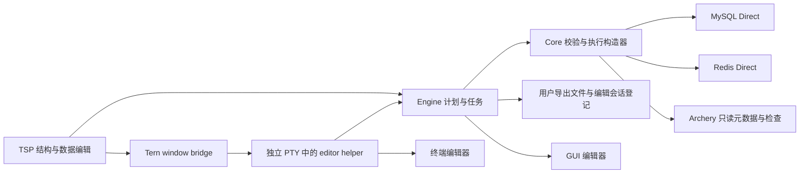
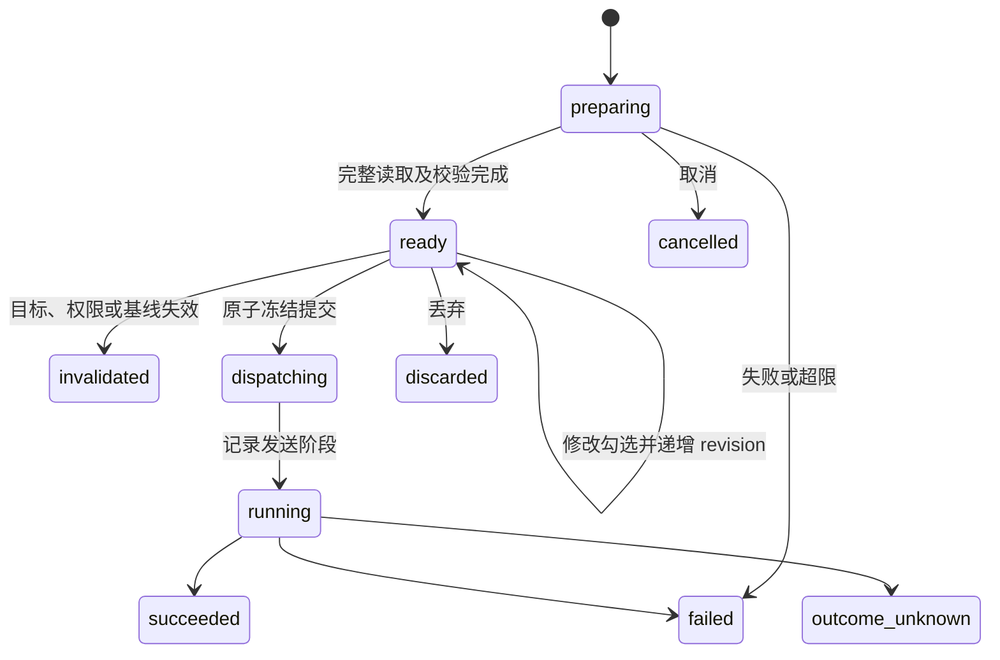

# Datapier 0.3.0 技术方案

## 1. 状态、依据与交付范围

本文定义已确认需求对应的 **0.3.0 实施方案**，并在第 13.2 节记录当前实现与运行证据。功能代码、依赖、配置 schema 4 和 IPC v4 已接入；本机验证不代表六目标原生验收或正式发布。

设计依据为 [产品规划](product-plan.md)、[贡献指南](../CONTRIBUTING.md)、[0.1.0 技术方案](technical-design-0.1.0.md)、[0.1.1 技术方案](technical-design-0.1.1.md) 和 [0.2.0 技术方案](technical-design-0.2.0.md)。设计起点为 `feature/0.2.0` 的 `f922e3933dc26b849cb6efdf6ed995ea5af5ed58`；实施先接入该分支工作区，现已变基至合入 0.2.0 最终实现的 `main`（`1df742d`）。上游查询、授权、通知及 UI 修正与本版结构、替换和值编辑合并；历史测试结论不自动继承。

0.1.x 文档保留为历史；0.3.0 承接 0.2.0 的共享 Engine、实时分页、有界内存、查询结果与原值基线不落盘、权限及审批，不恢复旧结果缓存。用户已确认一项限定例外：显式生成的图片／SVG 派生预览允许由 Tern 缓存在宿主磁盘，具体边界见第 7.3 节；这不是结果恢复或内存溢出存储。提交、推送、合并和发布仍需各自授权。

### 1.1 已确认的需求

| 领域 | 0.3.0 交付 |
|---|---|
| MySQL 结构设计 | 建表与改表；字段、表选项、主外键、CHECK 及各类索引表单；视图和触发器使用结构属性表单与 SQL 正文编辑器 |
| 结构执行 | 变更前后、完整生成 DDL、影响与提交语义预览；Direct 确认执行并读回，多条 DDL 遇错停止 |
| 可更新视图 | 对可证明单一基表映射和可靠键的视图，分别判断插入、更新、删除能力；DML 发往视图本身 |
| MySQL 批量替换 | 文本／正则查找替换，作用于当前表选中行、当前页或当前筛选范围；冻结预览、排除条目、丢弃、提交和冲突反馈 |
| Redis 批量替换 | 已选 key 的 String、Hash value、List value，以及 key、Hash field、Set／ZSet member 的文本替换；身份碰撞拒绝，跨 key 遇错停止 |
| 高级值处理 | Hex、JSON、XML 编辑与适用校验；图片／SVG 预览；单值文件导入导出；应用启动外部编辑器，显式读取修改并回填草稿 |
| MCP | 沿用 0.2.0 的工具和 SQL／命令执行，不增加结构化变更、文件或进程启动工具 |
| Archery | 保持只读，支持适用的值预览、结构 SQL 草拟、复制及已有 MySQL SQL 检查，不增加工单提交与执行 |

数据库沿用 MySQL 5.7／8.0／8.4、Redis 6.2／7.2／8.0 单节点及已适配 Archery 来源。保留 macOS、Linux GNU、Windows MSVC 的 x86-64／arm64 六目标实现。本次实施仅验收 **macOS arm64、Tern 0.9.18 与 tern-sdk 0.2.0**；不要求本次验证 Tern 0.9.9 或其他平台。已实测 `tern --version` 为 `0.9.18 6f1fa0f`，不能据此认定候选运行验收完成。其他平台历史证据不作为本次门禁，正式发布仍按发布指南另行核对。

### 1.2 边界

- 分区管理、在线 schema 迁移编排、跨实例 schema diff、整库迁移和项目文件继续按后续规划；已有自由 SQL 不受表单支持范围替代。
- 不扩展 JOIN 等多基表视图的数据编辑；任意 SQL 结果仍只读。
- Redis 替换范围为用户已选 key，不自动扫描整个 DB 形成替换任务；不提供身份覆盖、成员合并或自动处理改名循环。
- 不新增数据库类型、Redis Cluster／Sentinel、远端 MCP transport、普通终端 TUI 数据 grid。
- 不自动提交外部编辑内容，不自动重放失败或结果未知的写入；不承诺 DDL、非事务表及 Redis 脚本运行错误的整批回滚。

## 2. 架构与职责

沿用 Core → Engine → TSP 的既有边界，不新增业务 crate。数据模型和实际语句构造只有一份，预览与执行使用同一个不可变计划。

| 模块 | 0.3.0 职责 |
|---|---|
| `datapier-core` | 结构化 schema、版本能力、DDL 计划、视图映射、替换计算、类型校验、真实 SQL／Redis 计划、单值编解码及媒体转换 |
| `datapier-engine` | 计划与值编辑句柄、预算、冻结与一次提交、权限、任务与发送记录、文件登记、GUI 编辑器启动及 terminal helper 交接 |
| `datapier-tsp` | 结构设计 tab、SQL 正文、替换条件／预览、值编辑与媒体展示；只持有当前展示窗口，用户动作通过 IPC 请求 Engine |
| `datapier-tui` | 复用全局设置表单，提供编辑限制及外部编辑器配置；不新增编辑工作台 |
| `datapier-mcp` | 保留 23 个 tools；现有结构描述可返回新增元数据，原生 SQL／命令沿用权限证明与审批 |
| `datapier` 与 plugin | 新增内部 terminal editor helper；plugin 通过现有窗口桥接打开独立 terminal pane，不持有数据库凭据 |



### 2.1 当前代码与依赖接缝

实际实现沿用六个 crate，新增业务代码保留在既有 Core／Engine／TSP 职责层。

| 落点 | 当前职责 |
|---|---|
| `crates/datapier-core/src/model/{schema,replace,editing}.rs` | 类型化结构、冻结替换条件、编辑限制与文件登记模型 |
| `providers/mysql/schema/`、`schema.rs` | 结构完整性、版本能力、无损 DDL 构造、依赖指纹、独立执行和读回 |
| `providers/mysql/view.rs`、`changes.rs`、`replace.rs` | 单基表视图映射、可见原值冲突校验及有界冻结替换 |
| `providers/redis/{edit,replace,values}.rs` | 普通编辑、共同 WATCH 的固定脚本替换、期限和成员身份保护 |
| `crates/datapier-core/src/value/` | 值缓冲、字节 patch、JSON／XML 与有界媒体派生 |
| `crates/datapier-engine/src/server/editing/` | 计划、值和文件的归属、revision、预算、任务绑定及断线收尾 |
| `storage/edit_files.rs`、`edit_files/draft.rs` | 文件登记、受控路径、工作区引用切换、恢复与清理 |
| `crates/datapier-tsp/src/advanced/` | 结构设计、替换预览、高级值和外部文件的实际 UI 接线 |
| `crates/datapier/src/value_editor.rs`、plugin window bridge | 独立终端 pane 的一次性交接与受限 helper |

0.2.0 的内存结果、AccessProof、profile revision、审批和分页接口已复用；未建立旧结果缓存兼容层。未知服务端版本的 Archery 只生成保守本地草稿，预览注明上下文未知，计划不可提交；真实 Direct 执行仍重新校验版本和 SQL 模式。

### 2.2 共同执行约束

1. Engine 句柄均绑定 engine ID、客户端、工作区、profile／配置 revision、目标和 generation；句柄不能代替权限，每次读取、预览和提交都重新校验。
2. 草稿与预览 revision 分开：修改条件、勾选条目、schema 意图或新值后，旧预览摘要失效。提交携带 `expected_revision` 与 `plan_digest`，Engine 原子冻结一次；重复请求只返回同一 execution，不重复发送。
3. 发送前持久记录执行身份、目标、阶段及必要摘要。日志不保存数据库原值、完整批量值、图片或外部编辑文件内容，也不能用于重试原写入。
4. TSP 人工操作使用既有显式确认／提交，不产生自己审批自己的循环。MCP 自由 SQL／命令仍按 0.2.0 权限与审批处理，不能调用内部结构、文件或启动接口。
5. 成功后刷新相关结构与数据；失败或结果未知时保留用户意图，令旧 token 失效。刷新不得伪造原任务已确认成功。

最终发送门与客户端断开、会话关闭共同序列化：owner 或数据库会话失效时，尚未发送的任务不得退化为人工入口或继续发出；已发送写入继续按实际协议终态和结果未知规则收尾。关闭先解除结果消费背压，再等待会话收尾。MCP 的授权预检、会话信息和结果依赖重验同样受客户端取消与查询期限约束，中断后不复用协议边界未确认的物理连接；任务正文和历史详情应用与任务摘要相同的内存终态覆盖。

MySQL 普通 DML 不结束显式事务；COMMIT、隐式提交或再次 BEGIN 前，授权检查必须包含该事务已经触及的范围。执行 USE 或其他改变数据库上下文的操作后，从物理连接同步真实当前数据库，后续权限、任务上下文和查询目标均使用实际状态；无法确认时不得假定切换成功。

## 3. 结构模型、能力与表单

### 3.1 类型化结构

新增私有 schema 模块；共享协议模型可被 Engine/TSP 使用，但 provider 特有执行细节留在 MySQL 内。结构模型与结果列分开，避免每页行数据携带整份 DDL。

| 模型 | 必需内容 |
|---|---|
| `SchemaSnapshot` | 稳定来源、完整目标、服务端版本与 sql_mode、对象种类、类型化定义、原始 SHOW CREATE、依赖、完整性、指纹 |
| `ColumnDefinition` | 名称、原生类型及参数、顺序、nullable、默认值种类、ON UPDATE、自增、生成表达式及 virtual/stored、字符集／排序规则、可见性、注释 |
| `IndexDefinition` | 名称、primary／unique／normal／fulltext／spatial、列或表达式、顺序、前缀长度、方向、可见性、索引方法及保留选项 |
| `ConstraintDefinition` | 主外键、引用库表列、ON UPDATE／DELETE；CHECK 表达式及实际 enforcement；保留服务端名称 |
| `TableDefinition` | 字段、索引、约束、engine、字符集／排序规则、注释及需原样保留的其他 table options |
| `ViewDefinition` | SELECT 正文、列别名、ALGORITHM、DEFINER、SQL SECURITY、CHECK OPTION、定义字符集和排序规则 |
| `TriggerDefinition` | 库／名称／所属表、时机、事件、正文、DEFINER、sql_mode、创建字符集／排序规则和同类触发器顺序 |
| `SchemaEditIntent` | 基线指纹、用户操作和目标定义；新旧字段／索引使用本地稳定 ID，明确区分改名与删除后新增 |

默认值必须区分未指定、SQL NULL、字符串字面量和表达式，不能根据输入字符串猜测。注释、引号、中文、反引号标识符及 `NO_BACKSLASH_ESCAPES` 以实际会话模式处理；DDL 值不能使用不受 MySQL 支持的参数占位语法。复用统一标识符与字面量编码器，表达式按明确 SQL 输入校验，禁止将普通字段文本拼接为任意 SQL。

目录完整性细分 `complete/incomplete/unknown/unavailable`，同时返回对象或属性级原因。缺少索引、约束或原始定义不能等价于“没有”。仅凭版本号不能推定账号能取得定义或执行变更。

`SHOW CREATE` 与 catalog 共同提供结构，解析器不是数据库全部语法的替代。未理解但可定位、且不受本次变更影响的条款按原 token 保留；不能证明等价保留时，禁用相应表单提交并说明具体属性，允许复制原定义到 SQL 编辑器。不通过重建整张表丢弃未知属性。

### 3.2 能力矩阵

能力由版本、对象、engine、元数据完整性与实际权限共同决定，返回 `available/unsupported/unknown` 和原因。以下是目标能力，不是当前运行结果。

| 属性 | MySQL 5.7 | MySQL 8.0／8.4 |
|---|---|---|
| 字段类型、默认值、自增、注释、顺序、生成列 | 按实际类型与 engine 开放 | 按实际类型与 engine 开放 |
| 主外键、普通／唯一／全文／空间索引 | 校验 engine 与索引限制 | 校验 engine 与索引限制 |
| CHECK enforcement | 不展示为可执行约束；已有忽略语义明确说明 | 8.0.16 起按实际能力提供 enforced／not enforced |
| 表达式默认值、函数索引 | 不开放对应创建 | 从支持的具体 minor 版本开放并校验限制 |
| 索引可见性、降序 key part | 不把被忽略语法显示为已支持 | 按版本能力开放 |
| 隐藏列 | 不开放 | 按支持版本开放，完整保留既有属性 |

结构表单覆盖新增／修改／删除字段、顺序调整，新增／修改／删除索引和约束，以及表注释、engine、字符集与排序规则。更改 engine、类型收窄、字符集转换、删除字段／索引／约束均展示实际 SQL 和潜在影响；不生成自动补数据、禁用外键或降低严格模式的隐式操作。

### 3.3 TSP 结构设计流程

结构设计遵循 [UI 设计规范](ui-guidelines.md#10-结构替换和值编辑)：既有表直接复用该表的“结构”tab，统一浏览、编辑及冻结 DDL 预览，不额外提供“设计结构”按钮或菜单项，也不新开既有表的设计标签。新建表／视图、触发器列表与定义编辑保留具名入口，新建对象及视图／触发器定义可使用独立工作台。字段与其他结构对象的主要属性在紧凑 grid 内原位编辑，复杂属性放在下方选中项扩展区；视图和触发器使用属性区＋SQL 正文。字段使用稳定 ID，不依赖拖拽排序，上移／下移／删除统一置于行末操作列。

一次操作流程为：读取基线 → 编辑意图 → 生成计划 → 查看差异与完整 DDL → 确认执行 → 查看逐条结果 → 读回。编辑结构的第三级 tab 为字段、索引、外键、CHECK、表选项和预览 DDL；计划生成成功后自动切入预览 tab，集中展示真实 SQL、分页、风险和计划摘要。字段 grid 分开显示类型与长度，DECIMAL 在长度格使用 `18,4`；主键／外键以具名 icon 展示，快速主键操作直接维护原有索引定义并同步非空约束。索引列及外键本表列／引用表／引用列在 grid 内选择并保持有序复合映射；外部候选复用真实资源列表与结构描述，请求按客户端、tab／generation、会话和引用目标核对，迟到响应不能改写已切换的草稿。下方保留自增、生成表达式、字符集／排序规则及未在 grid 重复的扩展属性。主要动作位置稳定，最终执行确认显示冻结目标、破坏原因及不可自动回滚的影响；关闭或刷新检查草稿及在途状态。相关数据草稿冲突时返回 busy，不隐式丢弃其他窗口草稿。原生渲染及交互的本次验证范围单独记录，不由设计文档推断验收完成。

DATETIME、TIMESTAMP、TIME 的长度按 MySQL 小数秒精度处理：允许 `0–6`，缺省为 `0`，零精度以不带括号的类型名进入计划，避免与服务端规范化后的读回结果产生假差异。结构三级分区的新增入口使用具名 plus icon，统一与 grid 间隔 `8px`；行非控件区域选择当前项并切换扩展属性，输入与行内动作保持独立。

字段类型使用下拉选择，NULL 使用 checkbox；主键字段禁用 NULL 切换，取消可空时清除 NULL 默认值，避免生成 `NOT NULL DEFAULT NULL`。约束列展示主外键 icon，快捷主键和移动／删除置于操作列，默认值控件同一行排列；扩展属性复用行选择。

生成 DDL 预览为只读。用户要修改生成 SQL 时，显式“转到查询编辑器”，冻结原结构草稿，不再把自由文本假装成结构化计划；查询走正常执行流程。视图 SELECT 和触发器正文属于结构意图本身，可直接编辑。

## 4. DDL 计划与执行

### 4.1 计划与基线

`SchemaPlan` 包含来源、profile revision、对象及依赖指纹、目标定义、按序步骤、每步前置条件、生成 DDL、破坏性原因、可能锁表／重建说明和 `plan_digest`。同一次表调整尽量组合为一个合法 ALTER TABLE；不能安全合并的步骤明确分开。

指纹包含与修改有关的完整结构和定义上下文，不把无关统计量或 AUTO_INCREMENT 当前计数当作结构冲突。预览前重新读取，发送前再次复核；同一 Engine 的对象执行门串行化相关结构与数据提交。外部客户端仍可能在复核和发送间修改对象，不能宣称客户端指纹消除了并发 DDL 竞态；服务端错误及执行后读回是最终事实。

CREATE 的前置条件是目标不存在；DROP 后 CREATE 的下一步前置条件为目标仍不存在，不能复用原对象存在的指纹。多步计划执行后更新本计划自己的预期状态，外部偏离则停止，不把自身上一步修改误判为外部冲突。

### 4.2 执行语义

DDL 使用独立数据库会话并复用已保存的连接配置，避免隐式提交查询 tab 中的用户事务。MySQL 传输和结果固定 `utf8mb4`；关闭 SQLx 通过 `SET sql_mode` 追加 `PIPES_AS_CONCAT` 和 `NO_ENGINE_SUBSTITUTION` 的选项。官方 SQLx 0.9 的握手固定启用 `IGNORE_SPACE`，没有公开关闭选项，因此不能承诺会话模式与服务器全局模式完全一致；本版按不补丁、不换驱动的约束保留该限制。执行计划读取并核对实际会话模式，不写回计划模式或旧触发器模式；对象原创建字符集与排序规则用于基线展示，不覆盖执行连接。时区使用连接配置，缺省 `+00:00` 保持旧连接语义，显式服务器默认表示不设置时区；连接／查询超时可覆盖全局值，留空继承，单位秒。不承诺 ONLINE 或无锁；预览说明 ALTER 可能等待元数据锁、锁表或重建。需要用户指定的 ALGORITHM／LOCK 作为显式高级选项，服务端拒绝时保留错误，不自动降级到更强锁。

ENUM／SET 成员按实际执行 SQL 模式重新编码；解析器的 AST Display 只用于展示，不能直接作为可安全重发的 MySQL 字符串编码。仅修改注释或顺序时同样保持成员字节语义。DDL 和写入依赖完整性证明需考虑 `SHOW GRANTS` 的 partial revoke 及相应库名匹配规则；无法证明完整可见时返回不完整，不将权限过滤后的空列表解释为没有依赖。

已有非 UTF-8 上下文对象按当前 UTF-8 连接环境重新定义，不换驱动、不补丁、不引入第二驱动。预览说明创建上下文可能迁移，读回按实际执行连接的模式、字符集及排序规则核对，不将预期迁移误报为失败；这不承诺旧上下文及全部表达式语义不变。显式字符集字面量仍按真实 SQL 语义处理，不能将任意编码原始字节伪装为 UTF-8。新建数据库属于连接级操作，名称、可选数据库字符集和排序规则随输入形成冻结 CREATE DATABASE 计划与实时预览，不要求用户先点击预览；只有与当前输入一致的计划就绪后才启用执行。发送前核对名称不存在，使用独立连接执行并读回，创建成功刷新对应导航而不扩大已保存的显示或 MCP 授权范围。

执行 DDL 等待期间不持有原查询会话锁；`COMMIT/ROLLBACK [WORK]`、`BEGIN`、`START TRANSACTION` 和会话级开启 autocommit 可绕过该执行门，使原事务能够释放元数据锁。混合 SQL 批次和全局设置不使用此旁路。数据提交按 edit token 绑定的绝对表身份检查草稿占用，省略请求 target 不改变目标；显式 target 与 token 不符时拒绝发送。

MySQL 原子 DDL 不等于用户事务中的多语句回滚。计划按顺序执行，首个失败即停止；每步分别标记 `not_sent/running/applied/failed/outcome_unknown`。保存原定义便于人工核对，但不自动执行逆向 DDL 或宣称可恢复已删除数据。

触发器不存在 ALTER TRIGGER；修改由显式 DROP＋CREATE 完成，预览必须显示两条语句及中间空窗。CREATE 失败时明确“原触发器已删除，新触发器创建失败”，提供原定义复制，不自动重建或重试。记录并重建原有同事件、同时机的触发器顺序，不能因重建而静默移到队尾。正文作为单条 CREATE 请求发送，不插入 DELIMITER，也不按内部分号拆分。

视图修改使用适用的 ALTER VIEW；原有 DEFINER、SQL SECURITY、ALGORITHM 和 CHECK OPTION 不因编辑 SELECT 被重置。新对象的这些属性在表单中可见；账号不具备指定 definer 的权限时显示服务端错误，不伪装身份。

取消等待沿用真实发送阶段。KILL QUERY 成功也必须等原会话终态；可能已生效时保留待确认，不重放。成功读回与目标不同则标记 `verification_mismatch`，区分“DDL 已成功”与“目标定义核对失败”。结果未知时读回只作为当前状态证据，不能自动把历史执行改成已确认成功。

### 4.3 结构失效通知

DDL 成功或结果未知时失效相关 catalog、视图映射、表浏览、补全和 edit token。已存在的用户新值保留为需重新确认的草稿，不继续使用旧列序和旧指纹。raw SQL 中可识别的 DDL 也触发失效；无法识别影响对象的人工读写 SQL，保守失效该连接的结构缓存，不能只让结构表单路径更新。

## 5. 可更新视图

### 5.1 证明与操作能力

服务端 `IS_UPDATABLE=YES` 只是必要线索，不能直接开放全部操作。解析完整定义及可证明的嵌套单基表视图链，取得视图列到同一基表列的直接映射；表达式列不可写，别名保留映射。定义不可见、依赖循环、无法证明的语法和多基表映射明确只读。

视图必须直接投影完整可靠基表键，键列非空，不能使用前缀／表达式索引或不完整复合键。不能从当前结果“看起来唯一”推导键，也不通过隐藏查询偷偷补出未投影键。

| 操作 | 开放条件 |
|---|---|
| 更新 | 单基表与可靠键已证明，目标列直接映射、可写；全部视图可见原值能完整读取且可靠比较 |
| 删除 | 满足可靠定位及完整可见基线，并证明服务端允许该视图删除 |
| 插入 | 单基表与可靠键映射已证明，另证明可插入性、无非法重复／表达式映射，未投影必填基表列具有合法默认值或服务端生成方式 |

操作能力分别返回原因，插入不支持不能连带禁用合法更新和删除。生成列禁止普通赋值；省略列、NULL、DEFAULT 与用户新值分别表达。插入的最终类型、权限和 CHECK OPTION 仍由服务器判定。

### 5.2 实际写入与冲突

所有 DML 发往视图本身，保留 SQL SECURITY、视图权限和 LOCAL／CASCADED CHECK OPTION；基表只用于元数据证明，不直接改写为基表 DML。

UPDATE／DELETE 在同一实际语句的 WHERE 中包含映射后的完整视图键和全部可见原值，复用现有 NULL、精确类型和二进制比较。零匹配表示行已删除、已变化或已不满足视图条件；不通过重查换基线重试。整项新值与基线相同时不生成 UPDATE，但预览与提交仍包含对原目标及完整可见原值的 SELECT 校验；未匹配仍报告冲突，匹配才返回 unchanged，不触发 UPDATE 副作用。不能仅凭“新值等于基线”认定当前行未变化。

文本原值先统一为可逆的 UTF-8 编码再按字节比较，保留大小写和尾随空格检测；Bytes 继续比较原字节。时间新值按目标 TIME／DATETIME／TIMESTAMP 的 FSP 检查可精确表示性，允许等值尾零，拒绝服务端会静默舍入的输入。基表与视图 token 均绑定打开时的结构指纹，外部列、键或引擎变化在下一次预览／提交发送前拒绝，保留用户新值重新确认。

InnoDB 的同一变更集在独立事务内执行，任一冲突或失败回滚整组；非事务基表逐项报告，不声称整组回滚。InnoDB 基表的同值项沿用完整基线锁定读；视图批次使用独立的 READ COMMITTED 事务，使无锁校验读取每条语句的新快照，避免复用前项的一致性旧快照。视图路径仅查询视图自身，不依赖额外的基表 SELECT 或锁定读权限。

非事务表已发送语句收到服务端错误时，当前项仍可能部分生效，返回 `outcome_unknown`、逐项 `unknown` 并保留原始错误；不能仅凭错误包判定未写入。导入进度单独累计 `unknown` 行，不计入已确认完成或普通失败；存在未确认行时，`remaining=after_current_batch_not_executed` 只说明当前批之后没有执行。

并发保护范围是**视图可观察的完整原值**，不包含未投影基表列。UI 在视图编辑说明中明确这一点。视图条件、映射或底层键结构变化使 token 失效；提交前重新证明并核对指纹。MCP 通过原 SQL 写视图时，继续沿用 0.2.0 对视图、触发器、级联和函数的 AccessProof，不以本版 TSP 编辑能力扩大 Agent 权限。

## 6. 批量查找替换

### 6.1 条件与预览

`ReplaceSpec` 包含目标、范围、选定列／内容角色、literal 或 regex、pattern、replacement、大小写敏感、多行与点匹配换行选项。literal 替换把 `$` 和反斜线作为普通文本；regex 替换支持 `$1`／`${name}` 捕获引用及 `$$` 字面美元，未知捕获引用在准备前报错。使用 regex crate 的语法，不支持 look-around 或 pattern backreference，不宣称 PCRE 兼容。空 literal pattern 拒绝；合法零宽 regex 按 UTF-8 边界推进，并限制输出大小。

MySQL 仅选择可写文本列，隐藏列需显式勾选，不自动纳入；NULL 不参与文本替换。JSON／XML 不作为隐式普通文本列转换，结构化值在值编辑器处理。Redis 按原始字节身份定位，只有合法 UTF-8 的所选内容参与文本替换；非 UTF-8、类型不适用及无变化项分别计数并说明，不转成显示用 Base64 后替换。

预览列出稳定项 ID、完整目标、原值／新值、命中数、有效性、碰撞和排除状态，数据按页取回，大值只展示有标记的摘要并提供完整详情。支持排除条目，修改勾选后重新计算计划及碰撞，旧摘要失效。条件、目标或原始选择改变必须重新准备，不能沿用旧预览提交。

### 6.2 MySQL 范围冻结

- 选中行和当前页使用已有稳定行键，不能使用页号／行号作为提交身份；用户选定列与筛选条件一同冻结。
- 当前筛选范围使用独立有界读取任务，一次受控 SELECT 流读取全部目标范围，不沿 live_page 的 OFFSET 翻页拼接。InnoDB 使用独立只读一致性读取，在收集完成后结束读取事务，不等待人工预览时持锁。
- 仅匹配且确实变化的行保留完整受保护原值、可靠键及新值；未变化行流过即释放。非事务表说明收集不是全表快照，仍以逐行完整原值 CAS 保护提交。
- 只有完整收集结束且全部校验完成才进入 ready。超时、取消、断线、行／字节超限返回明确原因和已扫描／命中数量，预览可查看但不可提交，不能把已读前缀称为完整筛选范围。
- 提交只处理 ready 计划中未被排除的固定行键，不再执行筛选条件寻找另一批行；收集后新增的匹配行不会被加入。

提交复用基表变更构造器和冲突策略：InnoDB 整组事务，失败回滚；非事务表遇错停止并逐项报告。不能为扩大规模偷偷拆成多个已提交事务。超过计划预算时要求缩小筛选范围或用户显式使用 SQL。

### 6.3 Redis 内容和身份

内容角色包括 String value、Hash value、List value；身份角色包括 key、Hash field、Set member、ZSet member。ZSet score 不做文本替换，成员改名保留原 score；List 以同一有效基线中的 index 定位，保留重复值和顺序。

碰撞按原始目标字节判断：目标身份已存在，或多个来源产生同一目标，均阻止提交。即使目标也在本次选集中，改名链／交换仍按目标已存在处理，不借临时名称偷偷改变策略。无变化项不算碰撞。Hash field 改名保留对应 value；Set／ZSet 不做合并；key 改名只使用不覆盖语义。

本版每次 Redis 计划最多 128 个已选 key、1000 条实际写命令及 4 MiB 写参数；它们是初始硬预算，不是性能承诺。准备时在同一专属物理连接上 WATCH 全部源 key，再读取基线；派生目标 key 后 WATCH 目标并检查不存在。全部后续预览和确认沿用该连接，断线／租约过期即失效。完整基线、扫描状态和新值计入客户端预算，不给每个 key 新开专属连接。

Hash／Set／ZSet 收集采用原生扫描及有界去重；在 WATCH 后读取，提交前如发生任何源 key 修改则 EXEC 拒绝。String／List 完整目标内容也受预算限制，不能只改已加载前缀却标为整个 key。

### 6.4 Redis 遇错即停的执行

普通 MULTI/EXEC 的单项错误不会阻止后续命令，因此不能将所有写命令直接排队后声称“遇错即停”。本版固定脚本版本和参数格式，在 MULTI/EXEC 中只入队一条有界 EVAL：

1. Engine 完整预检计划、碰撞、类型、预算和权限；消费提交 token，持久化发送阶段。
2. EXEC 的 WATCH 冲突返回 null 时整组未执行，不自动重新 WATCH 并提交。
3. 固定脚本在写入前再次验证所有目标的存在／类型及身份碰撞；全部 key 名显式通过 KEYS 传入，值和操作通过 ARGV 传入，不动态生成脚本或接受用户代码。
4. 按冻结的 key／操作顺序执行，每个 Redis 调用使用 `redis.pcall` 并检查错误；首个运行错误立即返回，后续操作不再调用。返回每条已生效操作、失败位置和未执行范围。
5. Hash／Set／ZSet 身份改名先创建新身份再移除原身份，避免最后一个成员移除导致 key 先消失；保留 value／score。String 使用 KEEPTTL，原位更新与 RENAMENX 保留原有到期时间，不重置剩余 TTL。

Redis 8.0 的 Hash field 还可能具有独立过期时间，不能只保留 key TTL。支持该能力时，在 WATCH 后通过 HPEXPIRETIME 取得所选 field 的绝对到期时间；Hash value 的 HSET 更新及 field 改名创建新 field 后，必须在同一固定脚本中用 HPEXPIREAT 恢复该绝对期限，再移除旧 field。永久 field 仍永久，已过期／不存在的源 field 进入冲突；期限以精确整数文本传参，不经 Lua 浮点往返。额外读取和写命令计入预算；无法读取或恢复字段期限时，在写入前拒绝，不能把未知期限当作永久。验收同时覆盖 key TTL、field TTL、字段自然过期和缺少过期命令权限。

脚本执行期间 Redis 会阻塞其他请求；以 key 数、命令数、输入字节、输出大小及有限循环限制工作量，不在脚本中 SCAN 全库或执行无界遍历。EVAL 权限不足直接报错，不降级为不受监视的普通命令。

脚本隔离执行不代表运行错误回滚：当前 key 可能部分变更，此前 key 的已生效操作保留。返回结构化错误时逐项如实展示；若脚本回复无法完整取得或 EXEC 后失联，可能发送的范围进入 outcome_unknown，不推测失败位置。取消等待不宣称脚本已撤销，不对已写脚本使用 SCRIPT KILL 或重发。

## 7. 高级值编辑与预览

### 7.1 单值会话

`ValueEditSession` 绑定目标身份、列或 Redis 内容角色、原始类型、schema／映射指纹、父 change token、草稿 revision、原值引用和新值缓冲。只读值也可打开查看会话，但没有 stage 权限；Archery 只读及来源 fidelity 不因新编辑器改变。

打开可写会话必须先取得完整原值和有效编辑基线，再允许修改。视图、基表、Redis 均复用相应冲突模型；结果过期时不能通过重查伪装成当时值。若明确重新读取，创建新会话并要求确认基线。

| 模式 | 读取与写回语义 |
|---|---|
| Text | 合法 UTF-8 文本；保留换行、空字符串和空字节；不自动添加 BOM 或换行 |
| Hex | 可编辑二进制值，输入完整十六进制字节对，空白仅作为分隔；奇数位、非 Hex 报具体位置；不能把 NULL 映射为空字节 |
| JSON | 校验、显式格式化和编辑；精确数字及对象顺序保留，不经 f64；重复键文档不做会丢键的格式化 |
| XML | UTF-8 文本编辑与 XML well-formedness 校验；不是 XSD 校验，不请求外部 DTD／实体；保留原始声明、CDATA、注释和混合内容 |
| Image／SVG | 只读预览派生图像；切模式、缩放、解析或渲染都不修改原始数据库值 |

JSON／XML 视图不把任意文本自动升级为数据库类型。原生 JSON 列必须满足 JSON 校验；普通文本可以显示校验错误并回到 Text 编辑，数据库允许的普通文本仍可保留。格式化是一次可撤销的显式修改，不在切换模式或打开预览时进行。XML 不对 mixed content 或 `xml:space=preserve` 插入缩进；不能保证内容语义时拒绝格式化，仍允许原文编辑与校验。

确认编辑只将类型化新值 stage 到父草稿，不直接写库。格式模式切换共享同一原始缓冲，不能以展示字符串反向构造 Bytes。Set／ZSet member 的值编辑也执行身份碰撞检查；score 保持独立数值编辑。

### 7.2 大值与资源

单值新旧缓冲、解析树、撤销及派生图片都计入客户端总预算；分块传输不能用来规避完整编辑基线的预算。Hex 使用窗口化字节区块和相对偏移 patch，避免将整个值扩成双倍字符后反复传输；文本完整编辑设独立上限，超限保留分块查看、单值文件操作及明确原因，不把截断内容交给编辑器。

XML 格式化先按深度、范围及预计输出尺寸检查预算，再生成展开缩进，不能先积累全部缩进字符串后拒绝。Redis CSV／JSON 导入同样在单记录／单值解析前限制输入，Owner 预留覆盖解析、编码、解码和参数副本，批次同时受行数及字节约束。

值 patch 携带 `expected_revision`、字节偏移／范围、编码与数据；文本偏移落在 UTF-8 边界，TSP 光标继续用 UTF-16 并显式转换。每次 patch 先验证尺寸和类型，再移动／更新缓冲，不为 render 重复深拷贝整个值。

### 7.3 图片与 SVG

支持 PNG、JPEG、GIF、WebP 和 SVG 的静态预览；GIF／WebP 使用首帧，不承诺动画编辑。识别依据字节内容及解析结果，不依赖扩展名。损坏、不支持和超限分别报告，原始值仍可 Hex 查看或按允许范围导出。

Tern 文档规定 raster image 最大单边 4096 px，SVG blob 最大 256 KiB，且 SVG 会挂载为真实节点。本版在 Rust 侧解码／栅格化生成 PNG 再通过 `Session::blob` 和 `image` 展示，不把用户 SVG 直接送入宿主节点树。原始值、文件导出与写回始终使用原字节。

Tern 会按 SHA-256 将 blob 保存到宿主缓存，重启后仍可能命中；公开 API 没有按预览句柄删除缓存的能力。按已确认需求，仅在用户显式点击“生成预览”后发送派生 PNG，入口说明该图片会被宿主缓存；打开值、识别格式、切换 tab 和后台任务都不自动生成。关闭预览释放 Engine／TSP 内存及节点引用，但不承诺删除宿主缓存，不能直接删除 Tern 共享缓存目录或声称图片全链路不落盘。该缓存只用于派生 PNG，派生图仍呈现对应图像内容；缓存不承担原始值读取、数据库结果恢复或编辑基线恢复。

SVG 使用 resvg/usvg 的静态渲染管线，关闭任意字符串的外部 image 解析、网络和文件引用；前置 XML 校验拒绝 DTD、外部实体、script、foreignObject 与外部资源链接，文档内 `#id` 引用可以保留。不调用 SVG 内脚本、不打开浏览器、不加载外部 CSS；对不支持的资源给出预览限制。嵌入 data image 的解码和递归 SVG 同样受预算与深度限制，不使用默认无限解析器。

SVG 文字使用本机可用系统字体；只有原图或嵌入 SVG 含文字时才首次扫描字体，并在 Engine 进程内共享只读字体库。无系统字体时明确报告限制，不将文字静默显示为空白。字体库属于进程共享资源，不计入单个值的派生预算；该预算仍不代表整个进程的 RSS 硬上限。

媒体工作在有界后台 worker，预检编码尺寸、像素数和预计分配，再解码；解析树、滤镜中间图和 PNG 编码均记账。输出单边不超过 4096，输出像素不超过 4,194,304，编码后的 PNG 字节不超过 16 MiB，且仍满足客户端剩余预算。编码器使用有界 writer，发布预览句柄和发送 blob 前检查最终字节数；像素合规但编码超限同样返回 resource_limit。tab／值 revision 改变时丢弃迟到预览并释放应用内引用，宿主缓存保留行为按上段处理；内存预算不描述为整个进程 RSS 上限。

## 8. 单值文件与外部编辑器

### 8.1 文件导入导出

新增 UI 专用的字节文件接口。导出需要用户明确路径，写入同目录唯一临时文件，flush 后按确认的覆盖策略发布；未确认不能覆盖已有文件。导出 Bytes 是原字节，Text／JSON 是明确标注的 UTF-8 内容，不导出 Value 的 JSON 协议包装或显示用 Base64。

导入先检查文件种类、大小和编码，将内容读入有界新值缓冲，验证目标类型并展示变化，确认后 stage 到草稿。二进制不转码；Text／JSON／XML 不静默修复无效 UTF-8，不自动去掉 BOM 或补换行。NULL 是独立操作，零字节文件不是 NULL。导入、导出失败保留原草稿和真实原因。

只读结果允许导出当前完整且可读取的单值；Archery 导出明确平台返回保真度，不声称原始二进制。文件写入是用户主动操作，与查询结果不落盘的约束分别建模。

Redis 类型化 CSV／JSON 数据交换使用版本 2。CSV 的末列 `field_expires_at_ms` 对 Hash item 必填；JSON 的 `records` 中 Hash item 行第三个值为 `Value::Integer`。`-1` 表示永久，否则为 Unix 绝对毫秒期限。版本 1 导入直接拒绝，避免旧格式静默丢失 Hash 字段 TTL。Redis 6.2／7.2 根据 `INFO server` 版本判定不支持字段过期，导出字段期限为 `-1`；7.4 及以上使用 `HPEXPIRETIME` 读取，权限不足时显式报错，不能当作永久。导入有限期限需要目标 Redis 7.4 及以上并支持 `HPEXPIREAT`，不支持时返回错误。

登记文件的读取、导出和清理以受限目录句柄及文件身份为边界，使用 no-follow 打开并核对被操作对象；父目录或文件被替换时拒绝操作，不沿替换后的链接访问或删除目录外内容。

### 8.2 编辑器配置与启动

全局设置增加 `external_editor`：`mode=gui|terminal`、`program`、`args`；`args` 是字符串数组，其中恰好一个 `{file}` 参数或参数内占位被替换为完整绝对路径。默认不配置程序，用户在 TSP／TUI 设置；不将环境变量中的 shell 命令字符串自动当作程序加参数解析。

GUI 模式由 Engine 使用原生进程 argv 启动，stdin/stdout/stderr 不继承 TSP／MCP 协议流。启动返回只表示进程已创建，GUI launcher 退出不表示编辑结束。程序不存在或启动失败保留文件，允许修改配置重试启动，不写数据库。

终端模式复用 0.2.0 已绑定的 window bridge，在当前本机 Tern 窗口打开独立 terminal pane。Tern `Launch.command` 是 shell command，`Launch.args` 只属于 plugin block，不能作为程序 argv。新增内部 `datapier value-editor --handoff <id>` helper：

1. Engine 创建短期、一次性的随机 handoff，绑定源客户端、文件会话、配置 revision 和同一 data-dir；交接内容不含数据库凭据。
2. plugin 使用固定 helper 启动模板，按既有 OS shell 引用规范处理可信二进制／数据目录路径，用户 editor program、args、文件内容都不进入 shell 字符串；handoff 只允许生成的 ASCII ID。
3. helper 在独立 PTY 中向 Engine 消费 handoff，取得程序、参数和文件身份，再用原生 argv 启动编辑器；仅子进程继承该独立 PTY，不能继承原 TSP 或 MCP 的 stdio。
4. helper 以受限 `client_kind=value_editor` 注册租约，只能访问自身交接及生命周期，不具有数据库操作权限；编辑器活跃期间属于真实用户客户端。退出上报进程终态，但不触发自动回填。

helper 是内部启动用途，不增加 MCP tool 或普通终端 TUI 工作台。无可用本机窗口桥接时明确返回 terminal unavailable，用户仍可选择 GUI 编辑器或手动导出。实施必须完成独立 PTY 的真实 smoke，不能以 `spawn` 成功替代终端可交互证明。

### 8.3 文件状态与回填

Engine 在私有 `edit-files/<session UUID>/` 中创建 `create_new` 的单值文件；Unix 目录 0700、文件 0600，Windows 仅当前用户可访问。文件名由 session ID 和受控格式扩展名组成，不使用数据库名称或用户值作为路径。登记先于创建；路径只在登记目录内解析，拒绝 symlink／reparse point 和非普通文件。外部编辑器通过原子替换保存的普通文件可以接受，不把 inode 不变作为要求。

`external` 文件生命周期为 `preparing → ready → opened → returned → cleanup_pending → removed`；源客户端退出或 Engine 重启后未完成会话进入 orphaned。进程退出只更新诊断，不代表用户已完成编辑。`draft` 文件的引用保护与清理按第 9.3 节执行，不能因值编辑器关闭或客户端退出就清理已保存草稿。

“读取修改”执行以下步骤：

1. 校验文件会话归属、源目标、草稿 revision、配置及当前权限；打开受控目录中的普通文件，按上限读取并核对读取期间的尺寸／修改状态，遇到并发保存返回 file_busy，不无限重读。
2. 验证文件内容和类型，计算新值；未变化不产生新草稿。
3. 重新检查数据库基线：MySQL 按可靠键与完整可观察原值比较；Redis 在原 WATCH 物理连接上通过 `CLIENT INFO` 的 `flags` 检查 dirty 标记，再核对值、期限和成员属性，全程不消费原监视。原 token 已失效时重新读取并要求用户确认，不能恢复旧 token。
4. 数据、结构、目标或本地草稿改变时显示冲突，保留编辑文件和新内容，不覆盖数据库或另一个草稿。检查通过后 stage 新值，最终提交仍重新校验。

文件导入或外部回读成功后刷新值会话的空闲时间，避免刚回填的新值按回填前的活动时间被清理；已失效的会话不能借导入恢复，成功回填后再次空闲仍按既有限制回收。

`CLIENT INFO` 自 Redis 6.2 起提供，只读取当前连接状态，需允许相应 `@connection` 命令权限；缺少状态或权限时保留文件并拒绝回填。不能用只读 EXEC、重新 WATCH 或单独 PING 代替检查：EXEC 会结束原监视，重新监视之间的 ABA 无法由值重读证明；保留原 WATCH 后，检查期间及之后的修改仍会使再次回填或最终 EXEC 冲突。

正常回填后文件仍可能被 GUI 编辑器占用，界面提供“结束文件会话并清理”；该动作说明后续保存不会再被应用接收。取消或关闭编辑时明确选择保留文件或结束会话，不能自动杀死用户编辑器。删除失败记 cleanup_pending，保留可重试入口，不因配置行删除而丢失文件清理依据。

重启后从登记中列出遗留文件，允许用户导出／清理或显式选择目标重新导入；不自动启动编辑器、不恢复旧基线、不把文件自动写库。编辑文件是用户主动导出的副本，不能被用作后台结果缓存或持久原值基线。

TSP 设置提供“编辑文件”管理页，通过持久登记分页发现 external／draft 文件。当前同一 OS 用户的 UI 可显式领取遗留记录的管理权，领取以记录 revision 条件更新；活跃的其他 UI／helper 仍占用时返回 busy。领取只授权本地文件导出和安全清理，不恢复数据库 token，也不绕过数据库访问权限。即使原 profile／workspace 已删除，仍可按文件记录 ID 导出或清理；需要重新导入时必须重新选择有效目标并取得新基线。仍被已保存工作区引用的 draft 文件不可直接清理，须先显式丢弃对应草稿并保存成功。

## 9. 生命周期、限制与持久化

### 9.1 计划状态



`prepared_prefix` 可作为失败收集的只读诊断，不是 ready 状态。schema／replace／value 句柄受父客户端租约、idle deadline 和内存预算约束；编辑草稿显式固定必要引用，但不能无限制保留结果页。窗口关闭按既有整批草稿／任务保护处理，不自动迁移到另一客户端执行。

Redis key 浏览沿 SCAN cursor 显式加载更多，不使用本地页码切换；界面在保留预算内累计 key，受限时说明原因。放弃的扫描通过 `resource.scan.discard` 幂等释放；续取刷新空闲时间，provider 请求前按 `result_idle_seconds` 回收过期扫描，过期 cursor 返回 `handle_expired`。复合值浏览的去重辅助预算随取消、结果释放及 owner 收尾回收，不能遗留仅记账的占用。

### 9.2 初始限制

| 设置或硬上限 | 初始值 | 行为 |
|---|---:|---|
| `editing.max_plan_items` | 10000 | MySQL 匹配行或普通计划条目上限 |
| `editing.max_plan_bytes` | 32 MiB | 单计划保留的完整基线、新值及索引等总量；仍受客户端总预算约束 |
| `editing.max_value_bytes` | 16 MiB | 单值文件导入、外部回填和二进制编辑上限；旧值＋新值及其他内存另行记账 |
| `editing.max_text_editor_bytes` | 1 MiB | 单个原生文本编辑器的完整文本上限，超限可用 Hex 窗口／文件路径 |
| `editing.preview_rows` | 100 | 新预览初始行数，沿用统一分页和字节预算 |
| Redis 替换硬上限 | 128 key／1000 写命令／4 MiB 写参数 | 防止固定脚本执行无界工作；不由 MCP 参数提高 |
| 媒体输出硬上限 | 4096 单边／4,194,304 像素／编码 PNG 16 MiB | 最终编码字节与像素分别检查；编码、解析树和渲染中间内存仍受客户端总预算约束 |
| terminal handoff 有效期 | 60 秒 | 一次消费，到期可显式重新创建交接，不自动重启编辑器 |

除 Redis／媒体／handoff 硬上限外，编辑限制可在 TSP／TUI 设置中按 revision 更新，Engine 校验相互约束和正值。单项限制提高不能突破客户端总预算、IPC 帧或宿主限制；修改限制不让已经失败或丢失的计划自动恢复。

文件新值、缓存大值引用和工作区恢复都在解析前按编码字节与 JSON 节点预留内存；主键、完整原值和新值中的引用使用同一规则。解析树、规范化及绑定期间的并存副本计入预算，密集的小 JSON 不能仅按文件大小通过检查。超限时保留已保存的工作区、原缓存和用户草稿，不以截断值继续提交。

IPC 保留 8 MiB 帧、默认 1 MiB 业务响应；完整计划与值按引用分页／分块，单次原始值块最多 256 KiB，编码和封装后也必须满足响应预算。为复杂计划请求引入受 revision 约束的增量更新，不能把 16 MiB 新值塞进一次请求。

### 9.3 配置 schema 4 与工作区

从 0.2.0 配置 schema 3 事务迁移到 4，旧版本依次迁移。保留 profiles、授权、审批、执行历史、设置 revision、工作区与凭据账户名；不重新创建 `cache.sqlite3` 或 `values/`。

配置 SQLite 在初始化阶段完成迁移并打开固定的四条连接，运行期仅借用该集合，不因连接丢失按原绝对路径重新扩容；连接失效返回明确 `storage` 错误，需显式重开 Store 恢复。配置查询、事务及编辑文件登记使用同一固定集合，避免打开后数据根目录被替换时转向另一份配置库。

工作区在 `tabs[*].schema_draft`、`tabs[*].replace_draft` 和 `pending` 中保存结构、替换及数据编辑意图，包括目标、可靠键、必要基线摘要、新值或用户编辑文件引用和 revision，不保存未编辑的完整结果行。replace 恢复只恢复条件、选择及用户明确修改内容，匹配集合与原值基线必须重新准备；schema 保留操作序列，恢复时读取当前结构重新生成差异。

整个工作区的内联编辑内容共享 256 KiB 编码预算，包含全部标签的结构／替换意图、数据新值及 Redis 新身份（含 Hash `new_field`、改名 `new_key_b64`）。超额内容在显式 stage 或规范化保存时发布为受登记的不可变草稿文件；结构和替换 section 仅在持久快照中替换为版本化 `$datapier_intent` 标记，wire 恢复原有意图类型，数据大值继续使用受 revision 约束的 Large 引用。新身份的文件描述符同样参与引用收集、另存副本改写和恢复，提交前还原原有类型。只在规定的元数据位置识别文件声明，普通列名和用户 JSON 中的同名字段不参与引用识别或重写。文件不得附带未编辑结果行、before 值和完整 catalog。写入使用临时文件、flush 和原子发布，现有标记的读取及预算检查在 CAS 前完成；失败保留原快照及内存草稿，不把提交后恢复失败报告成未保存。原值和匹配集合仍只在有界内存中保留，此路径不用于查询结果溢出。

draft 文件发布后不可原位改写；新 revision 写新文件。`workspace.save` 在同一 SQLite 事务内校验草稿文件登记 revision、保存工作区引用并提交引用切换，确认成功后旧的无引用文件才进入 cleanup_pending。崩溃后仍被已保存工作区引用的 ready 文件保留，不转为可自动清理的 orphan；恢复读取用户新值后仍需重新确认数据库基线。没有工作区引用且没有活跃操作持有的文件才可领取清理，不能将“结束外部编辑会话”实现为删除仍被草稿引用的文件。

完整快照通过 `workspace.save.begin/append/commit/read/close` 冻结并分块传输，每块原始数据最多 256 KiB，偏移、总长度、Base64 和进度均校验；编码及 IPC 封装也受响应预算约束。解析前按文本与 JSON 节点预留 Owner 内存，规范化、文件解码及响应编码共享该预算。`workspace.load` 对小快照直接返回状态，大快照返回 Owner 隔离的 `load_handle`，通过同一读取／关闭接口恢复；只有完整且仍属于当前工作区的响应才能设置已加载状态，失败不能触发空快照覆盖。

另存副本为每个文件生成独立 ID 并同步重写描述符与 Large 引用，源文件继续受原工作区保护。TSP 收到规范化结果后仅在没有新编辑和活动编辑器冲突时重绑定；完成 `workspace.activate` 后才切换本地及 Backend 的工作区身份。读取和保存句柄在关闭、断线及空闲到期后释放预算。

配置库新增 `value_edit_files`，登记 `external` 单值文件和 `draft` 用户新值文件的归属与清理依据，不保存值内容；完整 migration 在实施阶段随 schema 校验交付。目标结构如下，ID／JSON 字段还需 Store 做业务校验。

```sql
CREATE TABLE value_edit_files (
    id TEXT NOT NULL PRIMARY KEY,
    workspace_id TEXT NOT NULL,
    profile_id TEXT NOT NULL,
    relative_dir TEXT NOT NULL UNIQUE,
    purpose TEXT NOT NULL CHECK (purpose IN ('external', 'draft')),
    target_json TEXT NOT NULL CHECK (json_valid(target_json)),
    state TEXT NOT NULL CHECK (state IN (
        'preparing', 'ready', 'opened', 'returned',
        'orphaned', 'cleanup_pending'
    )),
    format TEXT NOT NULL,
    baseline_digest TEXT NOT NULL,
    draft_revision INTEGER NOT NULL CHECK (draft_revision > 0),
    revision INTEGER NOT NULL CHECK (revision > 0),
    created_at_ms INTEGER NOT NULL,
    updated_at_ms INTEGER NOT NULL
);
CREATE INDEX value_edit_files_workspace_state
    ON value_edit_files (workspace_id, state);
PRAGMA user_version = 4;
```

该表不对 profile／workspace 使用删除级联，避免配置删除时丢失遗留文件；ID 为归属快照，删除配置先处理活跃文件会话，遗留文件只能导出或清理。移除记录必须在自身文件清理成功后；文件缺失可清除记录，其他错误保留诊断。启动扫描仅限已登记目录和受控 UUID 目录，不递归删除用户目录。

schema 4 与 IPC v4 不兼容旧程序。升级前关闭旧客户端／Engine 并备份一致的数据目录；不强杀活动实例。回退恢复升级前备份，新增编辑文件先显式导出；凭据不随 SQLite 回退。当前文档不执行任何升级。

## 10. IPC v4 与事件

新增方法只供有对应能力的 TSP／TUI／内部 helper 使用，MCP adapter 不转发任意 method。以下为目标契约，复用 0.2.0 client、任务和错误框架。

所有计划状态读取返回 `PlanSummary { id, revision, state, complete, total_items, plan_digest, submittable }`。`schema.plan`、`schema.preview` 和 `replace.read` 都包含该摘要；preparing／不完整计划的 digest 为 null 且不可提交，ready 时由 Engine 对完整计划生成 digest。预览的每一页绑定同一 revision／digest，意图或勾选变化后重算；首次直接确认预览也能取得完整提交参数，不要求先调用 update。

| 方法族 | 输入 | 返回与关键语义 |
|---|---|---|
| `resource.scan.discard` | session ID、原扫描 cursor | 校验所属会话后幂等释放 Redis key 扫描及辅助预算；不新增 MCP tool |
| `schema.describe` | session、target、refresh | 完整／不完整结构、指纹、对象与操作能力 |
| `schema.plan` | session、target、baseline fingerprint、intent、expected revision | 计划 ID、revision、DDL 步数、诊断、来源及可执行状态 |
| `schema.preview` | plan ID、revision、cursor | 差异、实际 DDL、完整性、提交与锁语义；超限分块而非截断后执行 |
| `schema.submit` | plan ID、revision、digest | 一次绑定的 execution ID；仅 Direct 可写来源 |
| `schema.discard` | plan ID、revision | 释放计划；已发送任务通过 execution.cancel 处理 |
| `replace.prepare` | session、target／selected key、ReplaceSpec | preparing 计划／任务 ID，完整读取结束才 ready |
| `replace.read` | plan ID、revision、page／cursor | 前后值、有效性、匹配数、排除状态及范围完整性 |
| `replace.update` | plan ID、expected revision、item selection | 新 revision 与 digest；批次更新也受帧预算约束 |
| `replace.submit/discard` | plan ID、revision、digest | 复用 change 执行与逐项结果，不能提交失败收集前缀 |
| `value.open/read` | edit token 或只读 value reference、内容角色、offset | 有归属的值会话、模式能力、完整长度和有界块 |
| `value.patch/stage/release` | value session、revision、patch 或 stage | 类型校验、新 revision；stage 进入父草稿，不写库 |
| `value.preview` | value session、revision、mode | 校验结果或有界派生 PNG 句柄；不会改变新值 |
| `value.file.import/export` | value session、revision、用户路径、明确覆盖选择 | 导入新缓冲或导出任务；操作真实字节，路径不作为权限凭据 |
| `value.external.open` | value session、revision、format | 文件会话 ID、真实目标、创建状态，显式启动前展示导出位置 |
| `value.external.launch/read/close` | file session、revision、用户决定 | 启动／读取并冲突校验／保留或清理；都不直接提交 |
| `value.editor.claim/finish` | 一次 handoff／helper 身份、状态 | 仅 helper 自身的程序描述与终态；无 DB 或其他文件访问能力 |
| `value.files.list/get` | workspace 可选、state／purpose、cursor 或 file record ID | 登记文件的分页摘要、记录 revision、占用和草稿引用状态；不依赖原 value session，列表不返回文件内容 |
| `value.files.claim` | file record ID、expected record revision | 当前 TSP 领取遗留文件管理权；与活跃所有者互斥，不授予数据库权限 |
| `value.files.export/cleanup` | file record ID、record revision；导出另含用户路径和覆盖选择 | 脱离旧 token 导出或清理受控文件；清理检查 workspace 引用，失败保留登记 |

结构方法的 Archery 分支仅可 describe、plan、preview、discard 和经既有接口 check_sql；submit 在 Engine/Core 拒绝。只读来源不得通过 value.stage／file.import 或替换方法形成数据库写入。

新增 `schema.changed`、`edit_plan.changed`、`value_file.changed`，与既有执行／设置事件共用序号。事件只带 ID、状态、revision 和失效范围引用，不广播 SQL、原值、新值、文件内容或完整本地路径。丢事件用有界状态查询补齐。

错误至少区分 `metadata_incomplete`、`unsupported_attribute`、`schema_conflict`、`data_conflict`、`identity_collision`、`resource_limit`、`plan_incomplete`、`stale_revision`、`handle_expired`、`file_busy`、`file_cleanup_failed`、`editor_unavailable` 和 `outcome_unknown`，保留服务端原始错误码。错误不携带超出当前授权的对象定义和内容。

## 11. Archery 与 MCP

Archery 结构草拟以实际可取得的元数据为依据。完整性不足时允许新建独立 SQL 草稿、编辑已知部分与复制原定义；禁止根据缺失字段／约束生成声称完整的改表计划。只读与数据库账号权限不影响用户在本地写 SQL 文本，但实际检查仍受平台权限和配置约束。

草拟结果显示 Archery 来源、实际目标、元数据完整性、未执行状态与 DDL；用户可复制到平台或发起既有 MySQL SQL 检查。检查通过不等于可执行、不创建工单。触发器定义不可见时说明原因，不伪造空触发器列表。

MCP 的结构描述可以增加类型化定义、完整性和逐操作能力字段，仍按字节续取及当前权限过滤；现有 tool 数量和参数身份体系不变。Agent 通过 execute_command 发送 DDL／DML 时继续生成 AccessProof、分类危险操作并走既有审批。内部固定脚本不意味着允许 MCP 任意 EVAL，文件和编辑器配置不暴露为 tools。

MySQL `autocommit=0` 的隐式事务同样累计 MCP 已发送操作的授权范围，COMMIT 或再次 BEGIN 前重新核对全部累计范围；确认提交／回滚后才清理。不能仅依赖客户端曾发送显式 BEGIN 来判断事务授权范围。Archery 批量连接配置保留完整 Profile 身份、revision 及审批策略，取消已有实例后重新选择恢复原基线；预览和未知回包核对使用同一完整对象。

## 12. 依赖与实施切片

### 12.1 技术选型

| 能力 | 决定 |
|---|---|
| SQL 结构与表达式 | 复用 sqlparser、现有 MySQL tokenizer 和 catalog；保留未解析条款，不以 parser 不完整静默重建 |
| 文本／正则 | `regex = 1.13.1`，Core 明确依赖；每份条件只编译一次 |
| JSON | 复用启用 arbitrary_precision／preserve_order 的 serde_json；格式化前检测重复键，保留大数与用户原文 |
| XML | `quick-xml = 0.42.0` 与 `roxmltree = 0.21.2`，检查完整文档、属性和命名空间；不作 XSD 验证 |
| Raster | `image = 0.25.10`，关闭默认格式集合，仅启用 PNG／JPEG／GIF／WebP；解码限制与预算前置 |
| SVG | `resvg = 0.49.0` 及其 usvg／tiny-skia，关闭无关默认能力，显式外部资源 resolver；只产生内存 PNG，不调用外部程序 |
| 摘要与进程 | 复用 sha2、Tokio 与 std 进程／文件 API；GUI 及 helper 均使用 argv，不引入 shell 执行依赖 |
| 旧缓存清理 | `cap-std = 4.0.3`、`cap-fs-ext = 4.0.3`；Store 持有数据目录句柄，逐级 no-follow 打开子目录，按已打开父目录和单个名字检查／删除；不重新解析绝对路径，不递归扩大确认集合 |

`result.value` 对数据库原值及工作区草稿文件统一返回 `offset`、`data_b64`、`next`、`total_bytes`。TSP 的单元格 drawer、CLI、复制与恢复均按该契约读取；drawer 内切换大字段时保留本次加载的打开意图，用户主动离开后迟到响应只缓存原目标，不替换新表单。分块回归直接使用真实 Store 的结果响应，避免客户端 fixture 与 Engine 契约各自漂移。

新增依赖已精确锁定并在本机完成解析、编译和链接。quick-xml／image／resvg 的上游 MSRV 分别为 Rust 1.86／1.88／1.85，许可证分别为 MIT、MIT OR Apache-2.0、Apache-2.0 OR MIT；roxmltree 为 MIT OR Apache-2.0。实际依赖与 features 以根 manifest 和 Cargo.lock 为准，六目标兼容性仍须由各原生 runner 验证。

### 12.2 纵向实施切片

| 顺序 | 主要落点 | 完成用户路径 |
|---|---|---|
| 1 | Core model/schema、MySQL catalog、TSP 结构只读展示 | 完整元数据、版本能力与无损 roundtrip，缺失信息可见；与 0.2.0 最终接口对齐 |
| 2 | MySQL 新 `schema.rs`、Engine 计划／任务、TSP schema editor | 建表、字段／索引／约束／选项调整 → DDL 预览 → 独立执行 → 读回；视图和触发器同路径 |
| 3 | MySQL view mapping、changes、TSP grid capability | 单基表视图分项增删改与真实冲突、CHECK OPTION、权限验收 |
| 4 | Core 新 replace 模块、MySQL读取与既有 changes、TSP 替换视图 | 当前页／选集／筛选范围的完整有界预览、排除与提交；失败不提交前缀 |
| 5 | Redis 新 replace 模块／固定脚本、Engine 计划、TSP 选集 | 内容和身份替换、共同 WATCH、碰撞拒绝、TTL／score、首错停止 |
| 6 | Core value codec/media、Engine 值会话、TSP 值编辑 | Hex／JSON／XML、静态图像、单值导入导出与草稿往返 |
| 7 | Engine 文件登记／进程、内部 helper、plugin window bridge、TSP／TUI 设置 | GUI／terminal 编辑器启动、显式回填、基线冲突、孤儿文件恢复与清理 |
| 8 | migration／IPC、Archery 草拟检查、MCP 元数据、文档与安装 smoke | 完整升级、只读边界与现有入口回归；新版本分发不遗漏 helper 或资源 |

新模块在现有 crate 内按功能组织，不预建未接线模块，不另设通用插件／计划执行框架。测试遵循各 crate 的 tests 目录规则；UI 设计的永久更新仍使用唯一 HTML 入口及说明，在对应功能实施时同步真实交互，不在本次方案阶段绘制假实现截图。

## 13. 验收与证据

### 13.1 必须观察的行为

| 场景 | 通过标准 |
|---|---|
| 结构保真 | 含中文注释、表达式默认值、生成列、ON UPDATE、隐藏列、前缀／表达式索引及未知保留条款的表，仅改一个属性不会丢掉其他结构 |
| 版本能力 | MySQL 5.7 与 8.0／8.4 按实际能力开放，5.7 不将忽略的 CHECK 或降序语法报告为生效 |
| DDL 完整流程 | 表单调整字段／索引，预览与实际执行语句一致，读回核对；其他查询 tab 的未提交事务不被隐式提交 |
| DDL 失败与竞态 | 外部改结构、缺权限、元数据锁等待、第二条失败、取消及发送后失联，逐条状态准确，不自动回放；触发器重建失败清楚说明原对象是否已删除 |
| 视图数据 | 列别名、复合键、过滤、表达式列、生成列、必填缺列和 CHECK OPTION；增删改分别开放，实际 DML 指向视图，不能绕过视图权限 |
| 视图并发 | 包括同值更新在内，可见原值变化、行删除或退出视图条件时冲突；同值预览包含真实基线校验，不发送 UPDATE 或触发其副作用；明示未投影基表列不在保护范围，不伪称全基表冲突检测 |
| MySQL 批量 | 跨页筛选只处理准备时冻结的键；并发新增行不被带入；完整原值变化冲突；InnoDB 回滚整组、非事务表保留真实已生效范围 |
| 收集失败 | 内存／条数／超时、读取取消、宽行或大字段超限后不能提交已收集前缀，不重新按筛选抓另一批行 |
| 正则 | 中文、emoji、多行、捕获引用、literal 美元、零宽匹配、非法表达式和输出膨胀；无变化不生成写入，NULL 和二进制不被隐式转文本 |
| Redis 碰撞 | 已有目标、多个来源同名、改名链、Hash field、Set／ZSet member；碰撞拒绝且原数据不变，不能静默合并或覆盖 |
| Redis 基线与期限 | 双客户端改源或目标使 EXEC 冲突；TTL 自然流逝不重置；String／成员改名保留到期时间和 score；List 重复值按 index 正确处理 |
| Redis 首错停止 | 构造真实 ACL／运行错误，观察后续命令未执行、此前生效项保留；脚本错误／回复丢失不被解释为整批回滚 |
| 值保真 | 含 NUL、非 UTF-8、空字节、NULL、JSON 大数及重复键、XML CDATA／mixed content，模式切换不写回，二进制文件往返摘要一致 |
| 媒体 | 真实 Tern 中 PNG／JPEG／GIF／WebP 首帧和 SVG 派生预览；只有显式生成才出现宿主 blob 缓存，关闭／重启后的缓存事实与入口说明一致；损坏、外部引用、迟到结果及像素合规但编码字节超限处理正确，无外部资源请求 |
| 外部编辑 | GUI launcher 提前退出、terminal 真实交互、空格／中文路径、程序参数特殊字符、文件原子替换保存；协议 stdout 不混入编辑器输出 |
| 回填冲突 | 编辑期间数据库、schema、本地草稿或选定目标改变时保留文件并报冲突；回填只进草稿，提交仍校验 |
| 文件收尾 | 正常结束、取消、源 UI 退出、Engine 崩溃／重启、文件缺失／忙、清理失败均有可恢复或清理入口；原 profile／workspace 删除后仍能按登记发现、导出和安全清理；引用中的 draft 文件受保护，旧 token 不恢复 |
| 权限与 Archery | Direct 只读拒绝新增写路径；Archery 只草拟、检查和适用预览，不能通过 file.import／submit 写库；平台限制随值保留 |
| MCP 回归 | 工具数及无 Tern 使用保持原契约，结构元数据权限过滤正确，原 SQL DDL／危险写仍审批，内部文件／启动方法不可调用 |
| 迁移与分发 | schema 3→4、旧版本逐级升级、备份／回退与遗留编辑文件；本次在 macOS arm64 编译、默认测试、组包，并验证安装后 helper、Tern 0.9.18 主 UI 与 MCP 入口实际可用；正常窗口实际完成 bridge、pane 绑定、终端编辑器与显式回填 |

永久测试聚焦上述消费者可见边界和状态迁移，不测试文档词句、工具名称、机械转发或默认值副本。复用既有数据库隔离 fixture，只创建和清理本次 UUID 对象；真实数据库与实际 Tern 的 smoke 不能由 mock 或 cargo test 成功代替。

### 13.2 本次完成状态

本轮为 review 修复后的 macOS arm64 开发候选，使用 Tern 0.9.18、tern-sdk 0.2.0 与官方 SQLx 0.9。完成原生复验的 `target/debug/datapier` SHA-256 为 `70e6f26b13d7e71846b7d4764def9095307b5361fa115171611fa001a96b5375`，实际 plugin 缓存程序与其一致。以下仅记录当前代码实际完成的检查；修复前的正常 Tern 窗口证据移入 13.3，不能代替本候选复验。

| 范围 | 当前实际结果 |
|---|---|
| 构建与默认回归 | 开发构建、Rust 格式检查、Clippy `--workspace --all-targets --locked -- -D warnings` 通过；workspace 默认测试 **619 passed／110 ignored** |
| 真实 Core／Engine 生命周期 | MySQL 8.4 与 Redis 8.0 隔离实例下，Core 库内专项 **6 项**、Engine 库内专项 **14 项**通过；包含普通 MCP 查询与结果消费、2 MiB worker、流式关闭释放锁、授权预检 deadline／失联 EOF，以及跨库隐式事务撤权后的 COMMIT／BEGIN 拒绝 |
| MySQL 跨版本适用回归 | MySQL 5.7.42 的 `mysql_edges` **26 项**、8.0.46 的 **27 项**通过。5.7 排除 invisible column／expression index；8.0 排除明确限定 5.7／8.4 的 JSON 版本对照用例；本次这两个版本均未运行该文件的 TLS 专项，不将不适用项记为通过 |
| Redis 编辑与替换 | Redis 8.0 的四套编辑、WATCH 与替换专项共 **38 项**通过；Redis 6.2.24／7.2.17 各有 **34 项**适用回归通过，排除四项要求 7.4+ 的 Hash field TTL 用例 |
| 真实 MCP 权限与写入结果 | stdio 调用验证：账户可见元数据隐藏了跨库级联外键时，在发送写入前拒绝；隐式事务写 A 后切到仍获授权的 B，撤销 A 后 COMMIT 与再次 BEGIN 均拒绝，独立连接确认未提交；MyISAM AFTER INSERT 触发器报错后独立读到已写行，导入返回 `outcome_unknown` 并累计 `unknown=1` |
| TUI 与重选消费回归 | 真实 PTY 中连接列表、全局设置字段范围、返回连接页及正常退出通过；TUI **5 项**回归包含重选时保留原 UUID、revision、名称和审批策略、优先保留本轮修改，以及新实例采用默认策略。这不等于 Archery 真实登录和实例重选的运行验收 |
| HTML 设计稿 | 实际浏览器验证设置宽屏双列、窄屏单列、常规底部仅重新加载／保存、跨 tab 保留未保存输入；key 加载由 3 项追加为 6 项并可切换树视图，Redis 空 DB 可打开导入并显示所选 DB，只读连接的入口禁用。设计稿不连接数据库，不能代替原生界面验收 |
| 原生 Tern 工作台与退出保护 | 正常桌面窗口完成分页编辑，独立读取确认修改落到 id 4、id 1 保留原值；后台新增行表单以及已应用但未加入草稿的高级值均阻止全局退出并保留输入。设置布局／footer 和单元格编辑器的可访问名称已在原生界面检查 |
| 原生 Redis 浏览与导入 | SCAN 从 100 项追加到 355 项，保留选择、当前值和树目录展开状态，完成后禁用“加载更多”；空 DB 14 和未选 key 状态可进入导入，JSON 导入完成后独立读取确认内容写入 DB 14，DB 15 未出现该 key |
| 原生 Archery wizard | 受控 HTTP fixture 完成服务认证、实例／DB 发现、完整 Profile 新增及已有连接重选；未改动时显示“没有连接变更”。将默认 DB 从 db_a 改为 db_b 后，revision 精确从 2 增至 3，UUID、名称、非默认审批策略 off 和原数据库范围保持不变。此证据不等于真实 Archery 各版本登录验收 |
| 原生 plugin 与终端编辑器 | 实际加载的 window bridge 与当前源码一致；缓存程序缺失后重新准备，替换为未验证的可执行探针后显示摘要校验错误且探针未执行，验证程序已恢复。正常缓存下通过真实 vi 修改文件、保存退出、显式读取、加入草稿及 SET 参数预览，再显式提交；独立读取 Redis 确认 42 字节新值精确写入，文件会话已清理 |

真实 Archery 各版本登录及完整系统凭据矩阵本轮未重跑；Archery wizard 仅有上述受控 HTTP fixture 证据。其他平台和旧 Tern 不作为本轮门禁。本轮 TUI、MCP、TSP、独立 Tern 窗口、Engine、HTTP fixture、数据库容器与临时数据／缓存均已收尾；用户原 Tern plugin 与验收前备份逐文件一致。开发构建保留在 `target/debug/datapier`。未提交、推送、合并、打 tag 或发布。


### 13.3 历史候选证据

以下记录来自此前候选，包含不同 Tern、测试数量及 Linux arm64 运行结果，仅保留历史范围，不能替代 13.2 的本轮候选证据。

#### Tern 0.9.18 修复前候选

本轮验收基线为 macOS arm64、Tern **0.9.18（6f1fa0f）**、tern-sdk 0.2.0 与官方 SQLx 0.9。当前开发构建位于 `target/debug/datapier`，SHA-256 为 `e208d405b121d0e9ae479b05dd38354a416fc8dd26710917011b5ab3baf8a6df`；以下是本轮实际证据，不代表正式发布或其他平台验收。

| 范围 | 本轮实际结果 |
|---|---|
| 构建与回归 | Rust 格式检查、Clippy `--workspace --all-targets --locked -- -D warnings`、开发构建通过；workspace 默认测试 **599 passed／102 ignored**。隔离 MySQL 的 Core 连接／取消库内回归 **5 项**、结构专项 **2 项**和 Engine 元数据超时／锁释放专项 **1 项**通过 |
| 真实 MySQL IPC | 时区 `+08:00`、UTF-8 传输及连接级两秒安全查询超时生效；无默认库建库、冻结 SQL、提交与读回通过；重复库名、只读连接及 MCP 内部结构入口被拒绝 |
| 服务器下拉候选 | 与真实 MySQL 8.0.46 的元数据逐项对照，**41 个字符集、286 个排序规则**集合完全一致；原生下拉显示服务端默认值，选择 `ascii` 后对应默认排序规则为 `ascii_general_ci`；不完整响应与服务端错误不会回退到内置列表 |
| 正常 Tern 新交互 | 实际窗口中随输入自动显示 DDL，单一执行按钮完成建库并刷新资源树，取消不二次确认；关闭连接移除所属 tab 并清树，再次点击建立新连接；新建和编辑连接均验证通用名称、默认折叠且位于 TLS 上方的超时设置 |
| MySQL／Redis 删除 | 真实窗口中分别确认删除，所属 tab 和配置移除，其他连接保留；独立检查 MySQL 测试账户会话数及 Redis DB 15 客户端数均为 **0**。默认回归同时覆盖多 tab、关闭途中新草稿、其他窗口 busy、失败保留配置及迟到目录结果 |
| 窗口 bridge 与终端编辑 | 正常窗口 plugin 自动完成 window／pane 绑定并从摘要匹配的缓存启动当前构建 helper 与 `vi`；中文／空格数据目录下的登记文件修改后，通过“读取修改”回填值会话并显式加入草稿；独立读取 Redis 仍为原值。随后确认清理编辑文件、关闭值会话并丢弃验收草稿，未直接写库 |
| 浏览器设计稿 | 实际浏览器验证实时 SQL、单一执行入口、直接取消、关闭清树、禁用未连接建库、重新点击连接及 MySQL／Redis 删除闭环；新建与编辑表单的折叠组、通用名称和非法超时定位通过，未观察到脚本错误；相关资源 `dprint check` 通过 |

保留的驱动限制：已关闭 SQLx 通过 `SET sql_mode` 追加模式的选项，但官方驱动握手仍固定启用 `IGNORE_SPACE`，没有公开关闭选项；DDL 按实际 UTF-8 会话上下文执行和读回，不承诺保留旧对象的全部表达式语义。具体边界见第 4.2 节。

本轮隔离后台 job、Engine 服务、容器与临时资源已清理，原 Tern plugin 及缓存指针已恢复。真实 Archery 各版本登录及完整系统凭据矩阵本轮未重跑；其他平台和旧 Tern 不作为本轮门禁。未提交、推送、合并、打 tag 或发布。

#### Tern 0.9.16 候选

本轮验收基线为 macOS arm64、Tern **0.9.16（41a10a5）** 与 tern-sdk 0.2.0。当前 `datapier 0.3.0` release 候选的 SHA-256 为 `f9809573ebc44a8434af63cce58f548101ce135c32b052603c18e5936cea5c8a`；以下仅列实际执行的检查与运行范围，不代表完整原生窗口验收或正式发布。

界面与脚本资源的 `dprint check` 通过；89 个本地文档链接及章节锚点检查无错误。本轮隔离连接及凭据、数据库容器、进程、缓存与临时验证文件已清理，最终构建程序保留在 `target/aarch64-apple-darwin/release/datapier`。

| 范围 | 本轮实际结果 |
|---|---|
| 构建与默认回归 | Rust 格式检查、Clippy `--workspace --all-targets --locked -- -D warnings`、macOS arm64 release 构建通过；workspace 默认测试 **583 passed／99 ignored**。删除菜单入口的专项同时覆盖当前／后台标签，确认不会覆盖编辑器、清空输入或发送关闭／删除请求 |
| MySQL 8.4／Redis 8.0 修复专项 | 五套 MySQL 专项合计 30 项、Redis 与交换五套专项合计 42 项通过；覆盖实时查询与 COUNT 取消、事务保留、DECIMAL 原值比较、类型别名读回、间接写函数防重放、WATCH、身份碰撞、部分失败及文件往返。MySQL 8.4 的私有 CA TLS 成功与错误 CA／身份拒绝通过 |
| 旧数据库适用回归 | MySQL 5.7.42／Redis 6.2.24 组合合计 **66 项**、MySQL 8.0.46／Redis 7.2.17 组合合计 **67 项**通过。5.7 不运行 8.0 专属 invisible column／expression index；8.0 不运行明确限定 5.7／8.4 的版本对照用例；旧 Redis 排除 4 项需 7.4+ field TTL 的专项，不将不适用项记为通过 |
| Redis 文件期限 | CSV／JSON 五类型二进制 key 与绝对期限往返在 Redis 6.2／7.2／8.0 分别通过；8.0 同时核对有限／永久 Hash field 期限，旧版本验证永久字段语义 |
| 实际 Tern 渲染交互 | 在 0.9.16 `serve` 渲染宿主运行真实候选：`USE` 后当前查询目标同步；List 混合删除与高级值编辑提交后独立读取正确；CSV／JSON key 导出及中文／空格路径输入正确；仅有已应用但未加入草稿的高级值时，删除菜单入口保留编辑器与输入并拒绝删除。合法 1 MiB 内存预算下，对长 key 的真实 SCAN 显示“扫描受内存限制，结果不完整”，不显示完成 |
| MCP 权限与 cursor | 真实 stdio 调用验证撤权后 COMMIT／再次 BEGIN 拒绝、ROLLBACK 可用、旧只读配置会话在发送前拒绝写入；连接、数据库、资源 cursor 续页集合完整且无重复，改变条件／跨连接／跨操作拒绝。平台历史经受控 HTTP fixture 验证 9 条记录的三页续取与条件绑定，不能视为真实 Archery 验收 |
| 生命周期 | 强制终止 Engine 后，待审批执行恢复为 cancelled／sent=false，审批 invalidated／engine_restart，未重发 SQL；最后客户端离开后，3600 秒查询超时配置下 Engine 在 **30.69 秒**退出，已发送写入保存为 outcome_unknown |
| TUI 与浏览器 | 实际 PTY 的 64×20／80×24 长字段、光标末端显示、表单滚动、帮助换行、页面错误清理及历史分页保存通过。浏览器设计稿保留大整数、负数及指数数字原 token，并通过键盘选择模式、输入和首次应用回填；设计稿不访问数据库 |
| 单目标分发与缓存 | 真实 macOS arm64 归档仅含固定 `datapier` 成员；解包后的摘要、版本与架构一致。安装器从带空格的重命名源程序发布到中文／空格缓存目录，固定缓存程序名及摘要、`--version` 核对通过 |

本轮保留的限制与待决策项：

- **非 UTF-8 对象定义未修复**：原驱动缺少安全的原始字节执行入口，`ALTER VIEW`／`CREATE TRIGGER` 不支持 PREPARE；按用户要求不补丁 SQLx，保留发送及读回编码风险，等待决策。
- **正常窗口 bridge／terminal editor 闭环未验收**：独立配置、预启 daemon、app bundle 及 Aqua 启动均未观察到可见窗口或运行 PTY，控制端保持 0 帧；原因尚未确认。缓存发布通过不代表 helper 已启动，`serve` 渲染交互也不能替代真实 window／pane 绑定与终端 editor 回填。
- 本轮未重跑真实 Archery 各版本登录、TUI Archery 凭据保存的真实认证或完整系统凭据矩阵；平台历史仅有上述 HTTP fixture 证据。其他五个平台及 Tern 0.9.9 按用户要求不作为本轮门禁。最新正式版本仍为 0.2.0，本轮没有提交、推送、合并、打 tag 或发布。


#### Tern 0.9.12 及更早候选

| 范围 | 实际结果 |
|---|---|
| MySQL 5.7.42／8.0.46／8.4.13 | 通过真实 Engine IPC 完成表结构修改、完整 DDL 预览、执行与读回；字段注释修改保留索引、外键和表选项，8.x 覆盖 CHECK；视图和 trigger 新建／调整、别名与 CHECK OPTION、冻结替换及原值冲突均实测 |
| Redis 6.2／7.2／8.0 | 通过真实 Engine IPC 验证 List 重复项、身份碰撞、WATCH 冲突、TTL／score 和有界准备；6.2 的 ACL 运行错误保留此前生效项并停止后续项，7.2／8.0 在 ACL 预检阶段拒绝；8.0 实测 Hash field 绝对期限保留 |
| Redis Core 回归 | 6.2、7.2 分别 27 项通过，8.0 为 30 项通过；旧版本明确排除 3 项仅支持 field expiry 的用例 |
| 单值与文件 | 真实 IPC 完成二进制往返、JSON 大数／重复键、XML mixed content、GUI argv／原子保存、回填冲突、只读和受限客户端拒绝、Engine 崩溃后的文件发现／导出／清理；409600 字节新值只以用户草稿持久化，数据库不变，工作区引用阻止提前清理 |
| 正常 Tern 外部编辑闭环 | 正常桌面窗口使用与交付源码摘要一致的 `window_bridge.luau`：独立 PTY 中运行真实 vi，打开中文／空格路径，输入中文、保存退出；工作台显式读取后加入草稿，独立读取 Redis 确认提交前仍为原值；冻结预览包含 SET 和完整参数，显式提交后精确读回 `edited-终端\n` 的 14 字节，草稿清空并完成文件会话清理。重启遗留文件经实际设置界面发现、领取、导出到中文／空格路径并确认清理 |
| Tern 控件与 HTML 示例 | 本机 Tern 0.9.12（e498b49）的 `serve` 渲染宿主中观察到高级值编辑与带文字 SVG 派生 PNG／blob 显示；Redis 工作台完成准备、冻结预览、排除／重新包含及提交，结果为 1 条命令生效，独立读取确认未选 key 不变；HTML 中英文计划切换、逐项排除、丢弃及五种高级值模式已通过浏览器操作验证 |
| 并发与非事务表 | 16 个真实客户端并发保存同一工作区得到 1 次成功、15 次 revision conflict，无 database_busy；MyISAM 同值写入及精确原值冲突在三个 MySQL 版本上通过 |
| 同值更新冲突 | MySQL 5.7／8.0／8.4 的真实回归覆盖 InnoDB／MyISAM 基表与视图：可见值变化、其他可见列变化、隐藏条件导致行退出及删除均冲突；同值项不触发 UPDATE 触发器，混合批次保留事务回滚／非事务已生效语义。MySQL 8.0 的真实 Engine IPC 另行确认预览仅含 check、未变化返回 unchanged、行退出视图返回 conflict |
| 升级与独立入口 | 真实程序完成 schema 3→4 并保留连接／revision／权限规则／历史／工作区，不创建结果缓存；MCP stdio 保持 23 个工具且拒绝内部文件工具；普通终端 PTY 实际打开编辑器设置并正常退出 |
| Archery 1.8.4／1.12／1.13／1.14 | 真实登录和 MySQL 会话中生成完整的新建表 SQL 草稿与预览；source=archery、submittable=false，未知上下文提示保留，提交返回 permission_denied |
| macOS arm64 分发 | release 构建、归档解包与摘要核对通过；解包后的 MCP stdio 保持 23 个工具，内置 helper 通过中文／空格数据目录到达 Engine，缺失 handoff 拒绝且 stdout 为空 |
| Linux arm64 分发 | Debian 12／glibc 2.36 的原生容器中通过 workspace 默认测试、release 构建及版本／四个入口 help smoke；原生单目标组包、解包摘要与实际 `--version` 通过。未把 help smoke 计为 Linux TUI／Tern／Secret Service 完整运行验收 |
| 最终并发与目标绑定 | 真实 Engine IPC 验证省略 target 时仍按 token 的绝对表检查其他会话草稿、伪造 target 在发送前拒绝、DDL 使另一会话旧 token 与列缓存失效；实际观察到元数据锁等待后，`COMMIT WORK` 成功解除等待并完成独立 DDL。三个 MySQL 版本的新建表缺省属性读回和事务释放回归均通过 |
| 最终预算与恢复 | 9,600,000 字节结构草稿以 225 字节内联标记保存，分块恢复内容完整，副本使用独立文件，降低预算返回 resource_limit 且保留原草稿；密集 JSON 缓存基线在解码前拒绝超额。1024／8192 字节响应专项验证完整分页、基线失效保留新值，以及反复图片预览释放后回到原内存记账 |
| 最终正常桌面候选 | 当前二进制在正常 Tern 窗口中连接隔离 MySQL，取得草稿保护 ACK 后原位输入中文和 emoji，显示 1 项待提交；独立读取数据库仍为 original，随后丢弃该测试草稿。已有触发器入口和完整原定义转到独立查询编辑器也已在正常窗口观察 |
| TLS 专项 | 私有 CA 的隔离 MySQL 8.4 与 Redis 8.0 实测成功连接、错误 CA 和错误身份拒绝；本机 5.7.42 镜像为 OpenSSL 1.0.2k，TLS 握手失败，属于 0.1.0 技术方案已记录的旧构建限制，未降低验证或回退明文 |
| macOS 系统凭据 | 显式运行本机凭据专项通过：真实系统凭据在 Store 重开后可读，秘密不进入 SQLite；更新配置保留凭据，切到仅会话保存后清除持久条目，删除配置与测试收尾完成清理 |

变基前的 `cargo fmt --all --check`、`cargo clippy --workspace --all-targets --locked -- -D warnings` 通过；macOS arm64 与 Linux arm64 的 workspace 默认测试均为 **499 passed／87 ignored**，发布脚本 **25 项通过**。该候选重新执行了结构／视图／冻结替换的 7 个 IPC 场景、单值与文件的 27 个场景，以及工作区、跨会话分页、token 目标和执行门专项。新建表与元数据锁回归在 MySQL 5.7／8.0／8.4 上分别通过；Redis 原 WATCH 撤权验证及值分页／派生句柄回收专项已显式运行。默认 ignored 不等于专项全部未执行，也不将未满足环境前置条件或不适用的用例记为通过。

变基至 `main`（`1df742d`）后，macOS arm64 的 workspace 默认测试为 **504 passed／88 ignored**，Clippy、Rust 格式、合并文件 dprint、版本检查及 **25 项发布脚本回归**通过。独立非 strict／私有 CA TLS 的 MySQL 8.4 与既有 Redis 8.0 上，查询诊断、实时分页、DDL、视图、替换和 WATCH 专项 **41 项通过**；MySQL 8.0／Redis 8.0 的 7 个真实 IPC 场景再次通过。实际程序完成 schema 3→4 数据保留、MCP 23 个工具及内部文件工具拒绝、普通终端 PTY 设置与退出；Tern 0.9.12 离屏宿主经真实按钮操作与 layer 快照验证设置及 MCP 待办弹窗。该轮未重做 Linux、其他目标或分发包验收，截图只保留本地。

本轮 UI 整改后，macOS arm64 的 workspace 默认测试为 **554 passed／88 ignored**，Clippy、Rust 格式及本轮界面资源 dprint 检查通过。HTML 的 72 个状态在中英文、明暗主题及 760／1280px 下完成 576 组布局检查，无应用脚本异常或整体横向越界；实际编辑两列索引、两组外键映射、CHECK、表选项及字段注释／NULL，全部进入冻结 DDL。实际 Tern 0.9.12 与独立 MySQL 8.4 中，VARCHAR(128)、DECIMAL(18,4)、DATETIME 的 0／3／6 位小数秒、复合主键、普通索引和两组复合外键均经冻结预览、最终确认执行及独立读回；新增外键默认引用当前库，快捷主键清除冲突的 NULL 默认值。MySQL 自动生成的同名外键支持索引仅在精确满足所请求外键且原定义无可复用索引时纳入核对，其他额外索引及列差异继续拒绝，执行成功后界面正常回到可编辑状态。原生与 HTML 均验证新增 icon、行热区选择扩展属性、行末移动／删除及 grid 到新增按钮的 8px 间距；空结构字段的键盘 fallback、中文和 emoji 删除及冻结只读有回归覆盖。普通终端实测字段错误、修正保存及确认期间另一客户端更新后的 revision conflict，正常退出。真实目录替换回归与 Engine RPC 验证旧缓存清理不会穿过替换后的父链接删除外部文件；真实 MySQL／Tern 验证 drawer 从普通字段切换至 20,000 字符大字段，完整读取后重新打开 payload，分块回归使用真实 Store 响应。本轮未重跑完整跨平台、Archery、Redis、外部编辑器或分发矩阵；截图和逐项整改证据仅保留本地 target，不进入正式设计资源。

字段控件补充验收：workspace 默认测试 **555 passed／88 ignored**，TSP 回归 **321 passed／1 ignored**，Clippy 与格式检查通过。实际 Tern 0.9.12 的类型下拉完成 TEXT／VARCHAR 切换与长度控件更新；6 个 NULL checkbox 均具有“允许 NULL”可访问名称，主键 checkbox 禁用，主外键 icon 具名。取消 amount 的 NULL 后清除 NULL 默认值，经冻结预览、最终确认与独立 MySQL 8.4 读回，`DECIMAL(18,4)` 保持精度且 `IS_NULLABLE=NO`。HTML 字段页完成中英文、明暗主题及 760／1280px 的 8 组布局检查，checkbox 无下拉残留或整体横向越界。本地已安装 plugin 经原有内容哈希缓存及版本校验，并从 GUI 命令面板成功启动最终 release 程序；该本机安装不代表正式发布。

其他平台及 Tern 0.9.9 已由用户明确排除在本次实施验收范围外，不作为本次交付阻塞；其余四个目标的构建／运行、Linux 完整桌面／终端及 Secret Service、Windows Named Pipe／ConPTY 和完整跨平台凭据矩阵仍未完成。正式发布未执行，六目标分发须届时按发布指南另行核对。MySQL 5.7 兼容 TLS 构建仍需单独环境，版本专属用例继续遵守各自前置条件。通知范围沿用 0.2.0 的窗口 toast 与待办面板，系统通知及通知点击定位列入后续规划；本次仅按授权提交与变基，未推送、合并、打 tag 或发布。

## 14. 参考依据

- [MySQL 8.0 隐式提交](https://dev.mysql.com/doc/refman/8.0/en/implicit-commit.html)：DDL 与用户事务的提交边界。
- [MySQL 可更新与可插入视图](https://dev.mysql.com/doc/refman/8.0/en/view-updatability.html)：操作能力、表达式及缺省列限制。
- [MySQL 触发器语法](https://dev.mysql.com/doc/refman/8.0/en/trigger-syntax.html)：CREATE／DROP、正文、顺序及失败语义。
- [Redis Lua scripting](https://redis.io/docs/latest/develop/programmability/eval-intro/)：阻塞隔离、参数化脚本、pcall、SCRIPT KILL 与缓存边界。
- [Redis Hash 字段过期](https://redis.io/docs/latest/commands/hexpire/)：HSET／HDEL 清除字段期限，Hash 值替换及 field 改名需显式保留独立到期时间。
- [regex 1.13.1](https://docs.rs/regex/1.13.1/regex/)：语法、Unicode、捕获替换与不支持的特性。
- [Tern 持久化](https://docs.stencil.so/tern/protocol/operations.md#persistence)、[blob 传输](https://docs.stencil.so/tern/protocol/transport.md#blobs)：宿主磁盘缓存、共享缓存生命周期与单 blob 16 MiB 字节上限。
- [quick-xml 0.42.0](https://docs.rs/quick-xml/0.42.0/quick_xml/)、[版本元数据](https://crates.io/api/v1/crates/quick-xml/0.42.0)：事件解析、完整性检查及版本要求。
- [image 0.25.10](https://docs.rs/image/0.25.10/image/)、[版本元数据](https://crates.io/api/v1/crates/image/0.25.10)：支持格式与解码限制。
- [resvg 0.49.0](https://docs.rs/resvg/0.49.0/resvg/)、[版本元数据](https://crates.io/api/v1/crates/resvg/0.49.0)：离线 SVG 渲染及 Rust 要求；usvg 外部资源 resolver 必须显式配置。
- [Tern image](https://docs.stencil.so/tern/elements/data.md#image)、[输入事件](https://docs.stencil.so/tern/protocol/input.md)：blob 媒体边界、UTF-16 编辑事件及真实宿主约束。
- [Tern Window API](https://docs.stencil.so/tern/reference/api-window.md#launch)：独立 pane 和 shell command／block args 的区别。
