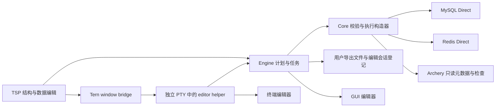
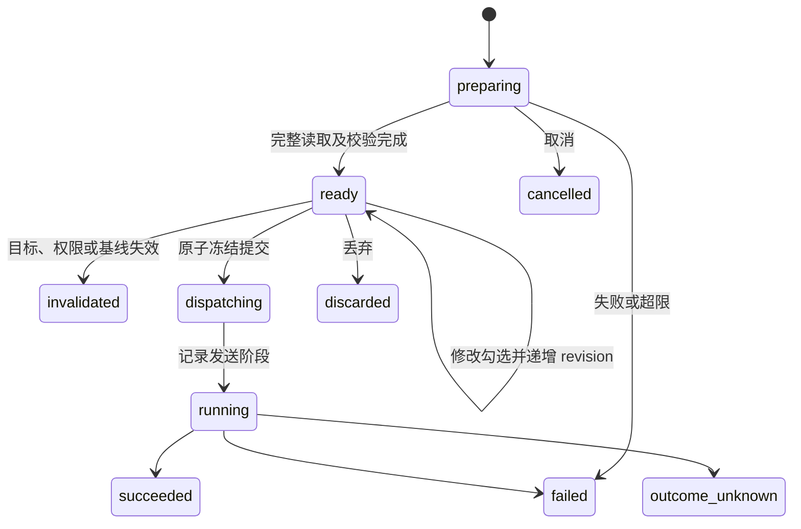

# Datapier 0.3.0 技术方案

## 1. 状态、依据与交付范围

本文定义已确认需求对应的 **0.3.0 实施方案**，不代表功能已经实现、编译、运行验收或发布。本次只编写方案和同步文档入口，不调整产品版本、依赖、migration 或功能代码。

设计依据为 [产品规划](product-plan.md)、[贡献指南](../CONTRIBUTING.md)、[0.1.0 技术方案](technical-design-0.1.0.md)、[0.1.1 技术方案](technical-design-0.1.1.md) 和 [0.2.0 技术方案](technical-design-0.2.0.md)。本方案基于 `feature/0.2.0` 的文档提交 `f922e3933dc26b849cb6efdf6ed995ea5af5ed58` 编写；0.2.0 正由另一线程实现，接口名称与代码落点在接入前按最终实现核对，不把设计接口写成已有能力。

0.1.x 文档保留为历史；0.3.0 承接 0.2.0 的共享 Engine、实时分页、有界内存、查询结果与原值基线不落盘、权限及审批，不恢复旧结果缓存。用户已确认一项限定例外：显式生成的图片／SVG 派生预览允许由 Tern 缓存在宿主磁盘，具体边界见第 7.3 节；这不是结果恢复或内存溢出存储。提交、推送、合并和发布仍需各自授权。

### 1.1 已确认的需求

| 领域 | 0.3.0 交付 |
|---|---|
| MySQL 结构设计 | 建表与改表；字段、表选项、主外键、CHECK 及各类索引表单；视图和触发器使用结构属性表单与 SQL 正文编辑器 |
| 结构执行 | 变更前后、完整生成 DDL、影响与提交语义预览；Direct 确认执行并读回，多条 DDL 遇错停止 |
| 可更新视图 | 对可证明单一基表映射和可靠键的视图，分别判断插入、更新、删除能力；DML 发往视图本身 |
| MySQL 批量替换 | 文本／正则查找替换，作用于当前表选中行、当前页或当前筛选范围；冻结预览、排除条目、丢弃、提交和冲突反馈 |
| Redis 批量替换 | 已选 key 的 String、Hash value、List value，以及 key、Hash field、Set／ZSet member 的文本替换；身份碰撞拒绝，跨 key 遇错停止 |
| 高级值处理 | Hex、JSON、XML 编辑与适用校验；图片／SVG 预览；单值文件导入导出；应用启动外部编辑器，显式读取修改并回填草稿 |
| MCP | 沿用 0.2.0 的工具和 SQL／命令执行，不增加结构化变更、文件或进程启动工具 |
| Archery | 保持只读，支持适用的值预览、结构 SQL 草拟、复制及已有 MySQL SQL 检查，不增加工单提交与执行 |

数据库沿用 MySQL 5.7／8.0／8.4、Redis 6.2／7.2／8.0 单节点及已适配 Archery 来源。保留 macOS、Linux GNU、Windows MSVC 的 x86-64／arm64 六目标实现。本版原生交互验收基线沿用 macOS arm64、Tern 0.9.9 与 tern-sdk 0.2.0；其余目标完成编译、默认测试和打包验证，运行记录分别报告。实施中如确需升级宿主基线，先明确具体缺失能力和影响，不能以新文档代替旧宿主的运行证据。

### 1.2 边界

- 分区管理、在线 schema 迁移编排、跨实例 schema diff、整库迁移和项目文件继续按后续规划；已有自由 SQL 不受表单支持范围替代。
- 不扩展 JOIN 等多基表视图的数据编辑；任意 SQL 结果仍只读。
- Redis 替换范围为用户已选 key，不自动扫描整个 DB 形成替换任务；不提供身份覆盖、成员合并或自动处理改名循环。
- 不新增数据库类型、Redis Cluster／Sentinel、远端 MCP transport、普通终端 TUI 数据 grid。
- 不自动提交外部编辑内容，不自动重放失败或结果未知的写入；不承诺 DDL、非事务表及 Redis 脚本运行错误的整批回滚。

## 2. 架构与职责

沿用 Core → Engine → TSP 的既有边界，不新增业务 crate。数据模型和实际语句构造只有一份，预览与执行使用同一个不可变计划。

| 模块 | 0.3.0 职责 |
|---|---|
| `datapier-core` | 结构化 schema、版本能力、DDL 计划、视图映射、替换计算、类型校验、真实 SQL／Redis 计划、单值编解码及媒体转换 |
| `datapier-engine` | 计划与值编辑句柄、预算、冻结与一次提交、权限、任务与发送记录、文件登记、GUI 编辑器启动及 terminal helper 交接 |
| `datapier-tsp` | 结构设计 tab、SQL 正文、替换条件／预览、值编辑与媒体展示；只持有当前展示窗口，用户动作通过 IPC 请求 Engine |
| `datapier-tui` | 复用全局设置表单，提供编辑限制及外部编辑器配置；不新增编辑工作台 |
| `datapier-mcp` | 保留 23 个 tools；现有结构描述可返回新增元数据，原生 SQL／命令沿用权限证明与审批 |
| `datapier` 与 plugin | 新增内部 terminal editor helper；plugin 通过现有窗口桥接打开独立 terminal pane，不持有数据库凭据 |



### 2.1 当前代码与依赖接缝

以下代码事实来自 0.1.1，迁移接缝以 0.2.0 最终实现为准。

| 现有落点 | 当前行为 | 0.3.0 接入方向 |
|---|---|---|
| `core/src/model/mod.rs` 的 `Column`／`TableSchema` | 基础列、键、DDL 与非结构化 details | 增加类型化 schema、完整性、对象能力与视图映射；行结果列仍保持轻量 |
| `providers/mysql/catalog.rs` | 表／视图描述；视图 keys 为空 | 完整结构读取和单一基表视图证明；共享目录查询与标识符处理 |
| `providers/mysql/changes.rs` | 基表键与原值比较；空 engine 拒绝视图 | 按目标类型分派，保留基表提交，新增发往视图的原值谓词 |
| `providers/redis/edit.rs` | 单 key WATCH、MULTI/EXEC、RENAMENX、TTL | 保留普通编辑；批量替换使用共同 WATCH 与有界固定脚本 |
| `tsp/src/views/schema.rs`、`views.rs` | 结构和 DDL 展示 | 结构设计 tab、按能力开放的编辑与 SQL 草拟 |
| `tsp/src/values.rs`、`views/redis_detail.rs` | 完整值读取、Text／JSON／HEX 展示 | 接入 0.2.0 内存句柄后新增真正的值编辑会话 |
| `engine/src/server/rpc.rs` 的 `file.open/save` | SQL UTF-8 文本文件 | 不拿它充当二进制值接口；新增有类型的字节文件操作 |
| `tsp/src/runtime.rs`、`views/icons.rs` | 内置 SVG blob 与 image | 复用 blob 展示用户图片的派生 PNG；不直接挂载用户 SVG |

`0.2.0 ResultRegistry`、worker、AccessProof、profile revision、审批和新分页器是接入前置。0.3.0 不重写这些模块，不复刻权限规则；相关 API 尚在实施时，先完成契约对齐再接线，不创建兼容旧 cache 的路径。

### 2.2 共同执行约束

1. Engine 句柄均绑定 engine ID、客户端、工作区、profile／配置 revision、目标和 generation；句柄不能代替权限，每次读取、预览和提交都重新校验。
2. 草稿与预览 revision 分开：修改条件、勾选条目、schema 意图或新值后，旧预览摘要失效。提交携带 `expected_revision` 与 `plan_digest`，Engine 原子冻结一次；重复请求只返回同一 execution，不重复发送。
3. 发送前持久记录执行身份、目标、阶段及必要摘要。日志不保存数据库原值、完整批量值、图片或外部编辑文件内容，也不能用于重试原写入。
4. TSP 人工操作使用既有显式确认／提交，不产生自己审批自己的循环。MCP 自由 SQL／命令仍按 0.2.0 权限与审批处理，不能调用内部结构、文件或启动接口。
5. 成功后刷新相关结构与数据；失败或结果未知时保留用户意图，令旧 token 失效。刷新不得伪造原任务已确认成功。

## 3. 结构模型、能力与表单

### 3.1 类型化结构

新增私有 schema 模块；共享协议模型可被 Engine/TSP 使用，但 provider 特有执行细节留在 MySQL 内。结构模型与结果列分开，避免每页行数据携带整份 DDL。

| 模型 | 必需内容 |
|---|---|
| `SchemaSnapshot` | 稳定来源、完整目标、服务端版本与 sql_mode、对象种类、类型化定义、原始 SHOW CREATE、依赖、完整性、指纹 |
| `ColumnDefinition` | 名称、原生类型及参数、顺序、nullable、默认值种类、ON UPDATE、自增、生成表达式及 virtual/stored、字符集／排序规则、可见性、注释 |
| `IndexDefinition` | 名称、primary／unique／normal／fulltext／spatial、列或表达式、顺序、前缀长度、方向、可见性、索引方法及保留选项 |
| `ConstraintDefinition` | 主外键、引用库表列、ON UPDATE／DELETE；CHECK 表达式及实际 enforcement；保留服务端名称 |
| `TableDefinition` | 字段、索引、约束、engine、字符集／排序规则、注释及需原样保留的其他 table options |
| `ViewDefinition` | SELECT 正文、列别名、ALGORITHM、DEFINER、SQL SECURITY、CHECK OPTION、定义字符集和排序规则 |
| `TriggerDefinition` | 库／名称／所属表、时机、事件、正文、DEFINER、sql_mode、创建字符集／排序规则和同类触发器顺序 |
| `SchemaEditIntent` | 基线指纹、用户操作和目标定义；新旧字段／索引使用本地稳定 ID，明确区分改名与删除后新增 |

默认值必须区分未指定、SQL NULL、字符串字面量和表达式，不能根据输入字符串猜测。注释、引号、中文、反引号标识符及 `NO_BACKSLASH_ESCAPES` 以实际会话模式处理；DDL 值不能使用不受 MySQL 支持的参数占位语法。复用统一标识符与字面量编码器，表达式按明确 SQL 输入校验，禁止将普通字段文本拼接为任意 SQL。

目录完整性细分 `complete/incomplete/unknown/unavailable`，同时返回对象或属性级原因。缺少索引、约束或原始定义不能等价于“没有”。仅凭版本号不能推定账号能取得定义或执行变更。

`SHOW CREATE` 与 catalog 共同提供结构，解析器不是数据库全部语法的替代。未理解但可定位、且不受本次变更影响的条款按原 token 保留；不能证明等价保留时，禁用相应表单提交并说明具体属性，允许复制原定义到 SQL 编辑器。不通过重建整张表丢弃未知属性。

### 3.2 能力矩阵

能力由版本、对象、engine、元数据完整性与实际权限共同决定，返回 `available/unsupported/unknown` 和原因。以下是目标能力，不是当前运行结果。

| 属性 | MySQL 5.7 | MySQL 8.0／8.4 |
|---|---|---|
| 字段类型、默认值、自增、注释、顺序、生成列 | 按实际类型与 engine 开放 | 按实际类型与 engine 开放 |
| 主外键、普通／唯一／全文／空间索引 | 校验 engine 与索引限制 | 校验 engine 与索引限制 |
| CHECK enforcement | 不展示为可执行约束；已有忽略语义明确说明 | 8.0.16 起按实际能力提供 enforced／not enforced |
| 表达式默认值、函数索引 | 不开放对应创建 | 从支持的具体 minor 版本开放并校验限制 |
| 索引可见性、降序 key part | 不把被忽略语法显示为已支持 | 按版本能力开放 |
| 隐藏列 | 不开放 | 按支持版本开放，完整保留既有属性 |

结构表单覆盖新增／修改／删除字段、顺序调整，新增／修改／删除索引和约束，以及表注释、engine、字符集与排序规则。更改 engine、类型收窄、字符集转换、删除字段／索引／约束均展示实际 SQL 和潜在影响；不生成自动补数据、禁用外键或降低严格模式的隐式操作。

### 3.3 TSP 结构设计流程

数据库菜单提供“新建表／视图”，表菜单提供“设计结构”和“触发器”；现有结构 tab 仍可只读查看。结构设计使用独立 tab，分为字段、索引、约束、表选项；视图和触发器使用属性区＋SQL 正文。字段列表用稳定 ID，编辑区使用公开表单控件；不依赖拖拽排序，以前移／后移提供确定路径。

一次操作流程为：读取基线 → 编辑意图 → 生成计划 → 查看差异与完整 DDL → 确认执行 → 查看逐条结果 → 读回。关闭或刷新先处理草稿；与同一 Engine 内相关数据草稿冲突时返回 busy，不隐式丢弃其他窗口草稿。

生成 DDL 预览为只读。用户要修改生成 SQL 时，显式“转到查询编辑器”，冻结原结构草稿，不再把自由文本假装成结构化计划；查询走正常执行流程。视图 SELECT 和触发器正文属于结构意图本身，可直接编辑。

## 4. DDL 计划与执行

### 4.1 计划与基线

`SchemaPlan` 包含来源、profile revision、对象及依赖指纹、目标定义、按序步骤、每步前置条件、生成 DDL、破坏性原因、可能锁表／重建说明和 `plan_digest`。同一次表调整尽量组合为一个合法 ALTER TABLE；不能安全合并的步骤明确分开。

指纹包含与修改有关的完整结构和定义上下文，不把无关统计量或 AUTO_INCREMENT 当前计数当作结构冲突。预览前重新读取，发送前再次复核；同一 Engine 的对象执行门串行化相关结构与数据提交。外部客户端仍可能在复核和发送间修改对象，不能宣称客户端指纹消除了并发 DDL 竞态；服务端错误及执行后读回是最终事实。

CREATE 的前置条件是目标不存在；DROP 后 CREATE 的下一步前置条件为目标仍不存在，不能复用原对象存在的指纹。多步计划执行后更新本计划自己的预期状态，外部偏离则停止，不把自身上一步修改误判为外部冲突。

### 4.2 执行语义

DDL 使用独立数据库会话，显式设置和记录必要 sql_mode／字符集上下文，避免隐式提交查询 tab 中的用户事务。不承诺 ONLINE 或无锁；预览说明 ALTER 可能等待元数据锁、锁表或重建。需要用户指定的 ALGORITHM／LOCK 作为显式高级选项，服务端拒绝时保留错误，不自动降级到更强锁。

MySQL 原子 DDL 不等于用户事务中的多语句回滚。计划按顺序执行，首个失败即停止；每步分别标记 `not_sent/running/applied/failed/outcome_unknown`。保存原定义便于人工核对，但不自动执行逆向 DDL 或宣称可恢复已删除数据。

触发器不存在 ALTER TRIGGER；修改由显式 DROP＋CREATE 完成，预览必须显示两条语句及中间空窗。CREATE 失败时明确“原触发器已删除，新触发器创建失败”，提供原定义复制，不自动重建或重试。记录并重建原有同事件、同时机的触发器顺序，不能因重建而静默移到队尾。正文作为单条 CREATE 请求发送，不插入 DELIMITER，也不按内部分号拆分。

视图修改使用适用的 ALTER VIEW；原有 DEFINER、SQL SECURITY、ALGORITHM 和 CHECK OPTION 不因编辑 SELECT 被重置。新对象的这些属性在表单中可见；账号不具备指定 definer 的权限时显示服务端错误，不伪装身份。

取消等待沿用真实发送阶段。KILL QUERY 成功也必须等原会话终态；可能已生效时保留待确认，不重放。成功读回与目标不同则标记 `verification_mismatch`，区分“DDL 已成功”与“目标定义核对失败”。结果未知时读回只作为当前状态证据，不能自动把历史执行改成已确认成功。

### 4.3 结构失效通知

DDL 成功或结果未知时失效相关 catalog、视图映射、表浏览、补全和 edit token。已存在的用户新值保留为需重新确认的草稿，不继续使用旧列序和旧指纹。raw SQL 中可识别的 DDL 也触发失效；无法识别影响对象的人工读写 SQL，保守失效该连接的结构缓存，不能只让结构表单路径更新。

## 5. 可更新视图

### 5.1 证明与操作能力

服务端 `IS_UPDATABLE=YES` 只是必要线索，不能直接开放全部操作。解析完整定义及可证明的嵌套单基表视图链，取得视图列到同一基表列的直接映射；表达式列不可写，别名保留映射。定义不可见、依赖循环、无法证明的语法和多基表映射明确只读。

视图必须直接投影完整可靠基表键，键列非空，不能使用前缀／表达式索引或不完整复合键。不能从当前结果“看起来唯一”推导键，也不通过隐藏查询偷偷补出未投影键。

| 操作 | 开放条件 |
|---|---|
| 更新 | 单基表与可靠键已证明，目标列直接映射、可写；全部视图可见原值能完整读取且可靠比较 |
| 删除 | 满足可靠定位及完整可见基线，并证明服务端允许该视图删除 |
| 插入 | 单基表与可靠键映射已证明，另证明可插入性、无非法重复／表达式映射，未投影必填基表列具有合法默认值或服务端生成方式 |

操作能力分别返回原因，插入不支持不能连带禁用合法更新和删除。生成列禁止普通赋值；省略列、NULL、DEFAULT 与用户新值分别表达。插入的最终类型、权限和 CHECK OPTION 仍由服务器判定。

### 5.2 实际写入与冲突

所有 DML 发往视图本身，保留 SQL SECURITY、视图权限和 LOCAL／CASCADED CHECK OPTION；基表只用于元数据证明，不直接改写为基表 DML。

UPDATE／DELETE 在同一实际语句的 WHERE 中包含映射后的完整视图键和全部可见原值，复用现有 NULL、精确类型和二进制比较。零匹配表示行已删除、已变化或已不满足视图条件；不通过重查换基线重试。相同值更新在构造时剔除，不单凭 changed rows 为零推断冲突，验证驱动的 matched-row 行为。

InnoDB 的同一变更集在独立事务内执行，任一冲突或失败回滚整组；非事务基表逐项报告，不声称整组回滚。视图路径不依赖额外的基表 SELECT 或 SELECT FOR UPDATE 权限。

并发保护范围是**视图可观察的完整原值**，不包含未投影基表列。UI 在视图编辑说明中明确这一点。视图条件、映射或底层键结构变化使 token 失效；提交前重新证明并核对指纹。MCP 通过原 SQL 写视图时，继续沿用 0.2.0 对视图、触发器、级联和函数的 AccessProof，不以本版 TSP 编辑能力扩大 Agent 权限。

## 6. 批量查找替换

### 6.1 条件与预览

`ReplaceSpec` 包含目标、范围、选定列／内容角色、literal 或 regex、pattern、replacement、大小写敏感、多行与点匹配换行选项。literal 替换把 `$` 和反斜线作为普通文本；regex 替换支持 `$1`／`${name}` 捕获引用及 `$$` 字面美元，未知捕获引用在准备前报错。使用 regex crate 的语法，不支持 look-around 或 pattern backreference，不宣称 PCRE 兼容。空 literal pattern 拒绝；合法零宽 regex 按 UTF-8 边界推进，并限制输出大小。

MySQL 仅选择可写文本列，隐藏列需显式勾选，不自动纳入；NULL 不参与文本替换。JSON／XML 不作为隐式普通文本列转换，结构化值在值编辑器处理。Redis 按原始字节身份定位，只有合法 UTF-8 的所选内容参与文本替换；非 UTF-8、类型不适用及无变化项分别计数并说明，不转成显示用 Base64 后替换。

预览列出稳定项 ID、完整目标、原值／新值、命中数、有效性、碰撞和排除状态，数据按页取回，大值只展示有标记的摘要并提供完整详情。支持排除条目，修改勾选后重新计算计划及碰撞，旧摘要失效。条件、目标或原始选择改变必须重新准备，不能沿用旧预览提交。

### 6.2 MySQL 范围冻结

- 选中行和当前页使用已有稳定行键，不能使用页号／行号作为提交身份；用户选定列与筛选条件一同冻结。
- 当前筛选范围使用独立有界读取任务，一次受控 SELECT 流读取全部目标范围，不沿 live_page 的 OFFSET 翻页拼接。InnoDB 使用独立只读一致性读取，在收集完成后结束读取事务，不等待人工预览时持锁。
- 仅匹配且确实变化的行保留完整受保护原值、可靠键及新值；未变化行流过即释放。非事务表说明收集不是全表快照，仍以逐行完整原值 CAS 保护提交。
- 只有完整收集结束且全部校验完成才进入 ready。超时、取消、断线、行／字节超限返回明确原因和已扫描／命中数量，预览可查看但不可提交，不能把已读前缀称为完整筛选范围。
- 提交只处理 ready 计划中未被排除的固定行键，不再执行筛选条件寻找另一批行；收集后新增的匹配行不会被加入。

提交复用基表变更构造器和冲突策略：InnoDB 整组事务，失败回滚；非事务表遇错停止并逐项报告。不能为扩大规模偷偷拆成多个已提交事务。超过计划预算时要求缩小筛选范围或用户显式使用 SQL。

### 6.3 Redis 内容和身份

内容角色包括 String value、Hash value、List value；身份角色包括 key、Hash field、Set member、ZSet member。ZSet score 不做文本替换，成员改名保留原 score；List 以同一有效基线中的 index 定位，保留重复值和顺序。

碰撞按原始目标字节判断：目标身份已存在，或多个来源产生同一目标，均阻止提交。即使目标也在本次选集中，改名链／交换仍按目标已存在处理，不借临时名称偷偷改变策略。无变化项不算碰撞。Hash field 改名保留对应 value；Set／ZSet 不做合并；key 改名只使用不覆盖语义。

本版每次 Redis 计划最多 128 个已选 key、1000 条实际写命令及 4 MiB 写参数；它们是初始硬预算，不是性能承诺。准备时在同一专属物理连接上 WATCH 全部源 key，再读取基线；派生目标 key 后 WATCH 目标并检查不存在。全部后续预览和确认沿用该连接，断线／租约过期即失效。完整基线、扫描状态和新值计入客户端预算，不给每个 key 新开专属连接。

Hash／Set／ZSet 收集采用原生扫描及有界去重；在 WATCH 后读取，提交前如发生任何源 key 修改则 EXEC 拒绝。String／List 完整目标内容也受预算限制，不能只改已加载前缀却标为整个 key。

### 6.4 Redis 遇错即停的执行

普通 MULTI/EXEC 的单项错误不会阻止后续命令，因此不能将所有写命令直接排队后声称“遇错即停”。本版固定脚本版本和参数格式，在 MULTI/EXEC 中只入队一条有界 EVAL：

1. Engine 完整预检计划、碰撞、类型、预算和权限；消费提交 token，持久化发送阶段。
2. EXEC 的 WATCH 冲突返回 null 时整组未执行，不自动重新 WATCH 并提交。
3. 固定脚本在写入前再次验证所有目标的存在／类型及身份碰撞；全部 key 名显式通过 KEYS 传入，值和操作通过 ARGV 传入，不动态生成脚本或接受用户代码。
4. 按冻结的 key／操作顺序执行，每个 Redis 调用使用 `redis.pcall` 并检查错误；首个运行错误立即返回，后续操作不再调用。返回每条已生效操作、失败位置和未执行范围。
5. Hash／Set／ZSet 身份改名先创建新身份再移除原身份，避免最后一个成员移除导致 key 先消失；保留 value／score。String 使用 KEEPTTL，原位更新与 RENAMENX 保留原有到期时间，不重置剩余 TTL。

Redis 8.0 的 Hash field 还可能具有独立过期时间，不能只保留 key TTL。支持该能力时，在 WATCH 后通过 HPEXPIRETIME 取得所选 field 的绝对到期时间；Hash value 的 HSET 更新及 field 改名创建新 field 后，必须在同一固定脚本中用 HPEXPIREAT 恢复该绝对期限，再移除旧 field。永久 field 仍永久，已过期／不存在的源 field 进入冲突；期限以精确整数文本传参，不经 Lua 浮点往返。额外读取和写命令计入预算；无法读取或恢复字段期限时，在写入前拒绝，不能把未知期限当作永久。验收同时覆盖 key TTL、field TTL、字段自然过期和缺少过期命令权限。

脚本执行期间 Redis 会阻塞其他请求；以 key 数、命令数、输入字节、输出大小及有限循环限制工作量，不在脚本中 SCAN 全库或执行无界遍历。EVAL 权限不足直接报错，不降级为不受监视的普通命令。

脚本隔离执行不代表运行错误回滚：当前 key 可能部分变更，此前 key 的已生效操作保留。返回结构化错误时逐项如实展示；若脚本回复无法完整取得或 EXEC 后失联，可能发送的范围进入 outcome_unknown，不推测失败位置。取消等待不宣称脚本已撤销，不对已写脚本使用 SCRIPT KILL 或重发。

## 7. 高级值编辑与预览

### 7.1 单值会话

`ValueEditSession` 绑定目标身份、列或 Redis 内容角色、原始类型、schema／映射指纹、父 change token、草稿 revision、原值引用和新值缓冲。只读值也可打开查看会话，但没有 stage 权限；Archery 只读及来源 fidelity 不因新编辑器改变。

打开可写会话必须先取得完整原值和有效编辑基线，再允许修改。视图、基表、Redis 均复用相应冲突模型；结果过期时不能通过重查伪装成当时值。若明确重新读取，创建新会话并要求确认基线。

| 模式 | 读取与写回语义 |
|---|---|
| Text | 合法 UTF-8 文本；保留换行、空字符串和空字节；不自动添加 BOM 或换行 |
| Hex | 可编辑二进制值，输入完整十六进制字节对，空白仅作为分隔；奇数位、非 Hex 报具体位置；不能把 NULL 映射为空字节 |
| JSON | 校验、显式格式化和编辑；精确数字及对象顺序保留，不经 f64；重复键文档不做会丢键的格式化 |
| XML | UTF-8 文本编辑与 XML well-formedness 校验；不是 XSD 校验，不请求外部 DTD／实体；保留原始声明、CDATA、注释和混合内容 |
| Image／SVG | 只读预览派生图像；切模式、缩放、解析或渲染都不修改原始数据库值 |

JSON／XML 视图不把任意文本自动升级为数据库类型。原生 JSON 列必须满足 JSON 校验；普通文本可以显示校验错误并回到 Text 编辑，数据库允许的普通文本仍可保留。格式化是一次可撤销的显式修改，不在切换模式或打开预览时进行。XML 不对 mixed content 或 `xml:space=preserve` 插入缩进；不能保证内容语义时拒绝格式化，仍允许原文编辑与校验。

确认编辑只将类型化新值 stage 到父草稿，不直接写库。格式模式切换共享同一原始缓冲，不能以展示字符串反向构造 Bytes。Set／ZSet member 的值编辑也执行身份碰撞检查；score 保持独立数值编辑。

### 7.2 大值与资源

单值新旧缓冲、解析树、撤销及派生图片都计入客户端总预算；分块传输不能用来规避完整编辑基线的预算。Hex 使用窗口化字节区块和相对偏移 patch，避免将整个值扩成双倍字符后反复传输；文本完整编辑设独立上限，超限保留分块查看、单值文件操作及明确原因，不把截断内容交给编辑器。

值 patch 携带 `expected_revision`、字节偏移／范围、编码与数据；文本偏移落在 UTF-8 边界，TSP 光标继续用 UTF-16 并显式转换。每次 patch 先验证尺寸和类型，再移动／更新缓冲，不为 render 重复深拷贝整个值。

### 7.3 图片与 SVG

支持 PNG、JPEG、GIF、WebP 和 SVG 的静态预览；GIF／WebP 使用首帧，不承诺动画编辑。识别依据字节内容及解析结果，不依赖扩展名。损坏、不支持和超限分别报告，原始值仍可 Hex 查看或按允许范围导出。

Tern 文档规定 raster image 最大单边 4096 px，SVG blob 最大 256 KiB，且 SVG 会挂载为真实节点。本版在 Rust 侧解码／栅格化生成 PNG 再通过 `Session::blob` 和 `image` 展示，不把用户 SVG 直接送入宿主节点树。原始值、文件导出与写回始终使用原字节。

Tern 会按 SHA-256 将 blob 保存到宿主缓存，重启后仍可能命中；公开 API 没有按预览句柄删除缓存的能力。按已确认需求，仅在用户显式点击“生成预览”后发送派生 PNG，入口说明该图片会被宿主缓存；打开值、识别格式、切换 tab 和后台任务都不自动生成。关闭预览释放 Engine／TSP 内存及节点引用，但不承诺删除宿主缓存，不能直接删除 Tern 共享缓存目录或声称图片全链路不落盘。该缓存只用于派生 PNG，派生图仍呈现对应图像内容；缓存不承担原始值读取、数据库结果恢复或编辑基线恢复。

SVG 使用 resvg/usvg 的静态渲染管线，关闭任意字符串的外部 image 解析、网络和文件引用；前置 XML 校验拒绝 DTD、外部实体、script、foreignObject 与外部资源链接，文档内 `#id` 引用可以保留。不调用 SVG 内脚本、不打开浏览器、不加载外部 CSS；对不支持的资源给出预览限制。嵌入 data image 的解码和递归 SVG 同样受预算与深度限制，不使用默认无限解析器。

媒体工作在有界后台 worker，预检编码尺寸、像素数和预计分配，再解码；解析树、滤镜中间图和 PNG 编码均记账。输出单边不超过 4096，输出像素不超过 4,194,304，编码后的 PNG 字节不超过 16 MiB，且仍满足客户端剩余预算。编码器使用有界 writer，发布预览句柄和发送 blob 前检查最终字节数；像素合规但编码超限同样返回 resource_limit。tab／值 revision 改变时丢弃迟到预览并释放应用内引用，宿主缓存保留行为按上段处理；内存预算不描述为整个进程 RSS 上限。

## 8. 单值文件与外部编辑器

### 8.1 文件导入导出

新增 UI 专用的字节文件接口。导出需要用户明确路径，写入同目录唯一临时文件，flush 后按确认的覆盖策略发布；未确认不能覆盖已有文件。导出 Bytes 是原字节，Text／JSON 是明确标注的 UTF-8 内容，不导出 Value 的 JSON 协议包装或显示用 Base64。

导入先检查文件种类、大小和编码，将内容读入有界新值缓冲，验证目标类型并展示变化，确认后 stage 到草稿。二进制不转码；Text／JSON／XML 不静默修复无效 UTF-8，不自动去掉 BOM 或补换行。NULL 是独立操作，零字节文件不是 NULL。导入、导出失败保留原草稿和真实原因。

只读结果允许导出当前完整且可读取的单值；Archery 导出明确平台返回保真度，不声称原始二进制。文件写入是用户主动操作，与查询结果不落盘的约束分别建模。

### 8.2 编辑器配置与启动

全局设置增加 `external_editor`：`mode=gui|terminal`、`program`、`args`；`args` 是字符串数组，其中恰好一个 `{file}` 参数或参数内占位被替换为完整绝对路径。默认不配置程序，用户在 TSP／TUI 设置；不将环境变量中的 shell 命令字符串自动当作程序加参数解析。

GUI 模式由 Engine 使用原生进程 argv 启动，stdin/stdout/stderr 不继承 TSP／MCP 协议流。启动返回只表示进程已创建，GUI launcher 退出不表示编辑结束。程序不存在或启动失败保留文件，允许修改配置重试启动，不写数据库。

终端模式复用 0.2.0 已绑定的 window bridge，在当前本机 Tern 窗口打开独立 terminal pane。Tern `Launch.command` 是 shell command，`Launch.args` 只属于 plugin block，不能作为程序 argv。新增内部 `datapier value-editor --handoff <id>` helper：

1. Engine 创建短期、一次性的随机 handoff，绑定源客户端、文件会话、配置 revision 和同一 data-dir；交接内容不含数据库凭据。
2. plugin 使用固定 helper 启动模板，按既有 OS shell 引用规范处理可信二进制／数据目录路径，用户 editor program、args、文件内容都不进入 shell 字符串；handoff 只允许生成的 ASCII ID。
3. helper 在独立 PTY 中向 Engine 消费 handoff，取得程序、参数和文件身份，再用原生 argv 启动编辑器；仅子进程继承该独立 PTY，不能继承原 TSP 或 MCP 的 stdio。
4. helper 以受限 `client_kind=value_editor` 注册租约，只能访问自身交接及生命周期，不具有数据库操作权限；编辑器活跃期间属于真实用户客户端。退出上报进程终态，但不触发自动回填。

helper 是内部启动用途，不增加 MCP tool 或普通终端 TUI 工作台。无可用本机窗口桥接时明确返回 terminal unavailable，用户仍可选择 GUI 编辑器或手动导出。实施必须完成独立 PTY 的真实 smoke，不能以 `spawn` 成功替代终端可交互证明。

### 8.3 文件状态与回填

Engine 在私有 `edit-files/<session UUID>/` 中创建 `create_new` 的单值文件；Unix 目录 0700、文件 0600，Windows 仅当前用户可访问。文件名由 session ID 和受控格式扩展名组成，不使用数据库名称或用户值作为路径。登记先于创建；路径只在登记目录内解析，拒绝 symlink／reparse point 和非普通文件。外部编辑器通过原子替换保存的普通文件可以接受，不把 inode 不变作为要求。

`external` 文件生命周期为 `preparing → ready → opened → returned → cleanup_pending → removed`；源客户端退出或 Engine 重启后未完成会话进入 orphaned。进程退出只更新诊断，不代表用户已完成编辑。`draft` 文件的引用保护与清理按第 9.3 节执行，不能因值编辑器关闭或客户端退出就清理已保存草稿。

“读取修改”执行以下步骤：

1. 校验文件会话归属、源目标、草稿 revision、配置及当前权限；打开受控目录中的普通文件，按上限读取并核对读取期间的尺寸／修改状态，遇到并发保存返回 file_busy，不无限重读。
2. 验证文件内容和类型，计算新值；未变化不产生新草稿。
3. 重新检查数据库基线：MySQL 按可靠键与完整可观察原值比较，Redis 在原 WATCH 连接上执行不写入的 MULTI/EXEC 检查并在重新 WATCH、重读后核对原始基线；原 token 已失效时重新读取并要求用户确认，不能恢复旧 token。
4. 数据、结构、目标或本地草稿改变时显示冲突，保留编辑文件和新内容，不覆盖数据库或另一个草稿。检查通过后 stage 新值，最终提交仍重新校验。

Redis 的只读 EXEC 会清除 WATCH，因此重新 WATCH 后的基线再次核对不可省略；中间变化导致不一致则冲突。不能只调用 PING 就声称 WATCH 基线仍有效。

正常回填后文件仍可能被 GUI 编辑器占用，界面提供“结束文件会话并清理”；该动作说明后续保存不会再被应用接收。取消或关闭编辑时明确选择保留文件或结束会话，不能自动杀死用户编辑器。删除失败记 cleanup_pending，保留可重试入口，不因配置行删除而丢失文件清理依据。

重启后从登记中列出遗留文件，允许用户导出／清理或显式选择目标重新导入；不自动启动编辑器、不恢复旧基线、不把文件自动写库。编辑文件是用户主动导出的副本，不能被用作后台结果缓存或持久原值基线。

TSP 设置提供“编辑文件”管理页，通过持久登记分页发现 external／draft 文件。当前同一 OS 用户的 UI 可显式领取遗留记录的管理权，领取以记录 revision 条件更新；活跃的其他 UI／helper 仍占用时返回 busy。领取只授权本地文件导出和安全清理，不恢复数据库 token，也不绕过数据库访问权限。即使原 profile／workspace 已删除，仍可按文件记录 ID 导出或清理；需要重新导入时必须重新选择有效目标并取得新基线。仍被已保存工作区引用的 draft 文件不可直接清理，须先显式丢弃对应草稿并保存成功。

## 9. 生命周期、限制与持久化

### 9.1 计划状态



`prepared_prefix` 可作为失败收集的只读诊断，不是 ready 状态。schema／replace／value 句柄受父客户端租约、idle deadline 和内存预算约束；编辑草稿显式固定必要引用，但不能无限制保留结果页。窗口关闭按既有整批草稿／任务保护处理，不自动迁移到另一客户端执行。

### 9.2 初始限制

| 设置或硬上限 | 初始值 | 行为 |
|---|---:|---|
| `editing.max_plan_items` | 10000 | MySQL 匹配行或普通计划条目上限 |
| `editing.max_plan_bytes` | 32 MiB | 单计划保留的完整基线、新值及索引等总量；仍受客户端总预算约束 |
| `editing.max_value_bytes` | 16 MiB | 单值文件导入、外部回填和二进制编辑上限；旧值＋新值及其他内存另行记账 |
| `editing.max_text_editor_bytes` | 1 MiB | 单个原生文本编辑器的完整文本上限，超限可用 Hex 窗口／文件路径 |
| `editing.preview_rows` | 100 | 新预览初始行数，沿用统一分页和字节预算 |
| Redis 替换硬上限 | 128 key／1000 写命令／4 MiB 写参数 | 防止固定脚本执行无界工作；不由 MCP 参数提高 |
| 媒体输出硬上限 | 4096 单边／4,194,304 像素／编码 PNG 16 MiB | 最终编码字节与像素分别检查；编码、解析树和渲染中间内存仍受客户端总预算约束 |
| terminal handoff 有效期 | 60 秒 | 一次消费，到期可显式重新创建交接，不自动重启编辑器 |

除 Redis／媒体／handoff 硬上限外，编辑限制可在 TSP／TUI 设置中按 revision 更新，Engine 校验相互约束和正值。单项限制提高不能突破客户端总预算、IPC 帧或宿主限制；修改限制不让已经失败或丢失的计划自动恢复。

IPC 保留 8 MiB 帧、默认 1 MiB 业务响应；完整计划与值按引用分页／分块，单次原始值块最多 256 KiB，编码和封装后也必须满足响应预算。为复杂计划请求引入受 revision 约束的增量更新，不能把 16 MiB 新值塞进一次请求。

### 9.3 配置 schema 4 与工作区

从 0.2.0 配置 schema 3 事务迁移到 4，旧版本依次迁移。保留 profiles、授权、审批、执行历史、设置 revision、工作区与凭据账户名；不重新创建 `cache.sqlite3` 或 `values/`。

工作区 JSON 新增版本化 `schema_drafts`／`replace_drafts`／`value_drafts`：保存用户意图、目标、可靠键、必要基线摘要、新值或用户编辑文件引用和草稿 revision，不保存未编辑的完整结果行。replace 草稿恢复只恢复条件、选择及用户明确修改内容，完整匹配集合与原值基线必须重新准备。schema 草稿保留意图而非原始完整 catalog 副本，恢复时与当前结构重新生成差异。

工作区内联编辑内容的编码预算为 256 KiB；更大的用户新值由 Engine 在显式 stage 后写入受登记的草稿文件，工作区只保存文件会话 ID、revision、类型和摘要。草稿文件仅包含用户新值或类型化替换意图，禁止附带未编辑结果行、before 值和完整原始 catalog。写入采用临时文件＋flush＋原子发布，成功登记后才确认工作区保存；失败保留内存草稿并报告未保存。原值和匹配集合仍只在有界内存保留。此路径用于持久保存用户编辑，不作为查询结果溢出存储。

draft 文件发布后不可原位改写；新 revision 写新文件。`workspace.save` 在同一 SQLite 事务内校验草稿文件登记 revision、保存工作区引用并提交引用切换，确认成功后旧的无引用文件才进入 cleanup_pending。崩溃后仍被已保存工作区引用的 ready 文件保留，不转为可自动清理的 orphan；恢复读取用户新值后仍需重新确认数据库基线。没有工作区引用且没有活跃操作持有的文件才可领取清理，不能将“结束外部编辑会话”实现为删除仍被草稿引用的文件。

配置库新增 `value_edit_files`，登记 `external` 单值文件和 `draft` 用户新值文件的归属与清理依据，不保存值内容；完整 migration 在实施阶段随 schema 校验交付。目标结构如下，ID／JSON 字段还需 Store 做业务校验。

```sql
CREATE TABLE value_edit_files (
    id TEXT NOT NULL PRIMARY KEY,
    workspace_id TEXT NOT NULL,
    profile_id TEXT NOT NULL,
    relative_dir TEXT NOT NULL UNIQUE,
    purpose TEXT NOT NULL CHECK (purpose IN ('external', 'draft')),
    target_json TEXT NOT NULL CHECK (json_valid(target_json)),
    state TEXT NOT NULL CHECK (state IN (
        'preparing', 'ready', 'opened', 'returned',
        'orphaned', 'cleanup_pending'
    )),
    format TEXT NOT NULL,
    baseline_digest TEXT NOT NULL,
    draft_revision INTEGER NOT NULL CHECK (draft_revision > 0),
    revision INTEGER NOT NULL CHECK (revision > 0),
    created_at_ms INTEGER NOT NULL,
    updated_at_ms INTEGER NOT NULL
);
CREATE INDEX value_edit_files_workspace_state
    ON value_edit_files (workspace_id, state);
PRAGMA user_version = 4;
```

该表不对 profile／workspace 使用删除级联，避免配置删除时丢失遗留文件；ID 为归属快照，删除配置先处理活跃文件会话，遗留文件只能导出或清理。移除记录必须在自身文件清理成功后；文件缺失可清除记录，其他错误保留诊断。启动扫描仅限已登记目录和受控 UUID 目录，不递归删除用户目录。

schema 4 与 IPC v4 不兼容旧程序。升级前关闭旧客户端／Engine 并备份一致的数据目录；不强杀活动实例。回退恢复升级前备份，新增编辑文件先显式导出；凭据不随 SQLite 回退。当前文档不执行任何升级。

## 10. IPC v4 与事件

新增方法只供有对应能力的 TSP／TUI／内部 helper 使用，MCP adapter 不转发任意 method。以下为目标契约，复用 0.2.0 client、任务和错误框架。

所有计划状态读取返回 `PlanSummary { id, revision, state, complete, total_items, plan_digest, submittable }`。`schema.plan`、`schema.preview` 和 `replace.read` 都包含该摘要；preparing／不完整计划的 digest 为 null 且不可提交，ready 时由 Engine 对完整计划生成 digest。预览的每一页绑定同一 revision／digest，意图或勾选变化后重算；首次直接确认预览也能取得完整提交参数，不要求先调用 update。

| 方法族 | 输入 | 返回与关键语义 |
|---|---|---|
| `schema.describe` | session、target、refresh | 完整／不完整结构、指纹、对象与操作能力 |
| `schema.plan` | session、target、baseline fingerprint、intent、expected revision | 计划 ID、revision、DDL 步数、诊断、来源及可执行状态 |
| `schema.preview` | plan ID、revision、cursor | 差异、实际 DDL、完整性、提交与锁语义；超限分块而非截断后执行 |
| `schema.submit` | plan ID、revision、digest | 一次绑定的 execution ID；仅 Direct 可写来源 |
| `schema.discard` | plan ID、revision | 释放计划；已发送任务通过 execution.cancel 处理 |
| `replace.prepare` | session、target／selected key、ReplaceSpec | preparing 计划／任务 ID，完整读取结束才 ready |
| `replace.read` | plan ID、revision、page／cursor | 前后值、有效性、匹配数、排除状态及范围完整性 |
| `replace.update` | plan ID、expected revision、item selection | 新 revision 与 digest；批次更新也受帧预算约束 |
| `replace.submit/discard` | plan ID、revision、digest | 复用 change 执行与逐项结果，不能提交失败收集前缀 |
| `value.open/read` | edit token 或只读 value reference、内容角色、offset | 有归属的值会话、模式能力、完整长度和有界块 |
| `value.patch/stage/release` | value session、revision、patch 或 stage | 类型校验、新 revision；stage 进入父草稿，不写库 |
| `value.preview` | value session、revision、mode | 校验结果或有界派生 PNG 句柄；不会改变新值 |
| `value.file.import/export` | value session、revision、用户路径、明确覆盖选择 | 导入新缓冲或导出任务；操作真实字节，路径不作为权限凭据 |
| `value.external.open` | value session、revision、format | 文件会话 ID、真实目标、创建状态，显式启动前展示导出位置 |
| `value.external.launch/read/close` | file session、revision、用户决定 | 启动／读取并冲突校验／保留或清理；都不直接提交 |
| `value.editor.claim/finish` | 一次 handoff／helper 身份、状态 | 仅 helper 自身的程序描述与终态；无 DB 或其他文件访问能力 |
| `value.files.list/get` | workspace 可选、state／purpose、cursor 或 file record ID | 登记文件的分页摘要、记录 revision、占用和草稿引用状态；不依赖原 value session，列表不返回文件内容 |
| `value.files.claim` | file record ID、expected record revision | 当前 TSP 领取遗留文件管理权；与活跃所有者互斥，不授予数据库权限 |
| `value.files.export/cleanup` | file record ID、record revision；导出另含用户路径和覆盖选择 | 脱离旧 token 导出或清理受控文件；清理检查 workspace 引用，失败保留登记 |

结构方法的 Archery 分支仅可 describe、plan、preview、discard 和经既有接口 check_sql；submit 在 Engine/Core 拒绝。只读来源不得通过 value.stage／file.import 或替换方法形成数据库写入。

新增 `schema.changed`、`edit_plan.changed`、`value_file.changed`，与既有执行／设置事件共用序号。事件只带 ID、状态、revision 和失效范围引用，不广播 SQL、原值、新值、文件内容或完整本地路径。丢事件用有界状态查询补齐。

错误至少区分 `metadata_incomplete`、`unsupported_attribute`、`schema_conflict`、`data_conflict`、`identity_collision`、`resource_limit`、`plan_incomplete`、`stale_revision`、`handle_expired`、`file_busy`、`file_cleanup_failed`、`editor_unavailable` 和 `outcome_unknown`，保留服务端原始错误码。错误不携带超出当前授权的对象定义和内容。

## 11. Archery 与 MCP

Archery 结构草拟以实际可取得的元数据为依据。完整性不足时允许新建独立 SQL 草稿、编辑已知部分与复制原定义；禁止根据缺失字段／约束生成声称完整的改表计划。只读与数据库账号权限不影响用户在本地写 SQL 文本，但实际检查仍受平台权限和配置约束。

草拟结果显示 Archery 来源、实际目标、元数据完整性、未执行状态与 DDL；用户可复制到平台或发起既有 MySQL SQL 检查。检查通过不等于可执行、不创建工单。触发器定义不可见时说明原因，不伪造空触发器列表。

MCP 的结构描述可以增加类型化定义、完整性和逐操作能力字段，仍按字节续取及当前权限过滤；现有 tool 数量和参数身份体系不变。Agent 通过 execute_command 发送 DDL／DML 时继续生成 AccessProof、分类危险操作并走既有审批。内部固定脚本不意味着允许 MCP 任意 EVAL，文件和编辑器配置不暴露为 tools。

## 12. 依赖与实施切片

### 12.1 技术选型

| 能力 | 决定 |
|---|---|
| SQL 结构与表达式 | 复用 sqlparser、现有 MySQL tokenizer 和 catalog；保留未解析条款，不以 parser 不完整静默重建 |
| 文本／正则 | `regex = 1.13.1`，基线锁文件已有传递依赖，实施时提升为 Core 明确依赖；每份条件只编译一次 |
| JSON | 复用启用 arbitrary_precision／preserve_order 的 serde_json；格式化前检测重复键，保留大数与用户原文 |
| XML | `quick-xml = 0.42.0`，关闭无关 features，使用事件读取、完整文档及属性／命名空间检查；不把普通 Reader 当作 XSD 验证器 |
| Raster | `image = 0.25.10`，关闭默认格式集合，仅启用 PNG／JPEG／GIF／WebP；解码限制与预算前置 |
| SVG | `resvg = 0.49.0` 及其 usvg／tiny-skia，关闭无关默认能力，显式外部资源 resolver；只产生内存 PNG，不调用外部程序 |
| 摘要与进程 | 复用 sha2、Tokio 与 std 进程／文件 API；GUI 及 helper 均使用 argv，不引入 shell 执行依赖 |

quick-xml、image、resvg 的版本、MSRV 和许可证已查询公开元数据：分别要求 Rust 1.86／1.88／1.85，不高于仓库 Rust 1.94；许可证分别为 MIT、MIT OR Apache-2.0、Apache-2.0 OR MIT。仅核对元数据和公开 API，尚未依赖解析、链接或六目标编译。实施时精确锁定完整依赖树、核对许可证和实际 features，不因文档选型直接声称兼容性已验收。

### 12.2 纵向实施切片

| 顺序 | 主要落点 | 完成用户路径 |
|---|---|---|
| 1 | Core model/schema、MySQL catalog、TSP 结构只读展示 | 完整元数据、版本能力与无损 roundtrip，缺失信息可见；与 0.2.0 最终接口对齐 |
| 2 | MySQL 新 `schema.rs`、Engine 计划／任务、TSP schema editor | 建表、字段／索引／约束／选项调整 → DDL 预览 → 独立执行 → 读回；视图和触发器同路径 |
| 3 | MySQL view mapping、changes、TSP grid capability | 单基表视图分项增删改与真实冲突、CHECK OPTION、权限验收 |
| 4 | Core 新 replace 模块、MySQL读取与既有 changes、TSP 替换视图 | 当前页／选集／筛选范围的完整有界预览、排除与提交；失败不提交前缀 |
| 5 | Redis 新 replace 模块／固定脚本、Engine 计划、TSP 选集 | 内容和身份替换、共同 WATCH、碰撞拒绝、TTL／score、首错停止 |
| 6 | Core value codec/media、Engine 值会话、TSP 值编辑 | Hex／JSON／XML、静态图像、单值导入导出与草稿往返 |
| 7 | Engine 文件登记／进程、内部 helper、plugin window bridge、TSP／TUI 设置 | GUI／terminal 编辑器启动、显式回填、基线冲突、孤儿文件恢复与清理 |
| 8 | migration／IPC、Archery 草拟检查、MCP 元数据、文档与安装 smoke | 完整升级、只读边界与现有入口回归；新版本分发不遗漏 helper 或资源 |

新模块在现有 crate 内按功能组织，不预建未接线模块，不另设通用插件／计划执行框架。测试遵循各 crate 的 tests 目录规则；UI 设计的永久更新仍使用唯一 HTML 入口及说明，在对应功能实施时同步真实交互，不在本次方案阶段绘制假实现截图。

## 13. 验收与证据

### 13.1 必须观察的行为

| 场景 | 通过标准 |
|---|---|
| 结构保真 | 含中文注释、表达式默认值、生成列、ON UPDATE、隐藏列、前缀／表达式索引及未知保留条款的表，仅改一个属性不会丢掉其他结构 |
| 版本能力 | MySQL 5.7 与 8.0／8.4 按实际能力开放，5.7 不将忽略的 CHECK 或降序语法报告为生效 |
| DDL 完整流程 | 表单调整字段／索引，预览与实际执行语句一致，读回核对；其他查询 tab 的未提交事务不被隐式提交 |
| DDL 失败与竞态 | 外部改结构、缺权限、元数据锁等待、第二条失败、取消及发送后失联，逐条状态准确，不自动回放；触发器重建失败清楚说明原对象是否已删除 |
| 视图数据 | 列别名、复合键、过滤、表达式列、生成列、必填缺列和 CHECK OPTION；增删改分别开放，实际 DML 指向视图，不能绕过视图权限 |
| 视图并发 | 可见原值变化或行退出条件时冲突；明示未投影基表列不在保护范围，不伪称全基表冲突检测 |
| MySQL 批量 | 跨页筛选只处理准备时冻结的键；并发新增行不被带入；完整原值变化冲突；InnoDB 回滚整组、非事务表保留真实已生效范围 |
| 收集失败 | 内存／条数／超时、读取取消、宽行或大字段超限后不能提交已收集前缀，不重新按筛选抓另一批行 |
| 正则 | 中文、emoji、多行、捕获引用、literal 美元、零宽匹配、非法表达式和输出膨胀；无变化不生成写入，NULL 和二进制不被隐式转文本 |
| Redis 碰撞 | 已有目标、多个来源同名、改名链、Hash field、Set／ZSet member；碰撞拒绝且原数据不变，不能静默合并或覆盖 |
| Redis 基线与期限 | 双客户端改源或目标使 EXEC 冲突；TTL 自然流逝不重置；String／成员改名保留到期时间和 score；List 重复值按 index 正确处理 |
| Redis 首错停止 | 构造真实 ACL／运行错误，观察后续命令未执行、此前生效项保留；脚本错误／回复丢失不被解释为整批回滚 |
| 值保真 | 含 NUL、非 UTF-8、空字节、NULL、JSON 大数及重复键、XML CDATA／mixed content，模式切换不写回，二进制文件往返摘要一致 |
| 媒体 | 真实 Tern 中 PNG／JPEG／GIF／WebP 首帧和 SVG 派生预览；只有显式生成才出现宿主 blob 缓存，关闭／重启后的缓存事实与入口说明一致；损坏、外部引用、迟到结果及像素合规但编码字节超限处理正确，无外部资源请求 |
| 外部编辑 | GUI launcher 提前退出、terminal 真实交互、空格／中文路径、程序参数特殊字符、文件原子替换保存；协议 stdout 不混入编辑器输出 |
| 回填冲突 | 编辑期间数据库、schema、本地草稿或选定目标改变时保留文件并报冲突；回填只进草稿，提交仍校验 |
| 文件收尾 | 正常结束、取消、源 UI 退出、Engine 崩溃／重启、文件缺失／忙、清理失败均有可恢复或清理入口；原 profile／workspace 删除后仍能按登记发现、导出和安全清理；引用中的 draft 文件受保护，旧 token 不恢复 |
| 权限与 Archery | Direct 只读拒绝新增写路径；Archery 只草拟、检查和适用预览，不能通过 file.import／submit 写库；平台限制随值保留 |
| MCP 回归 | 工具数及无 Tern 使用保持原契约，结构元数据权限过滤正确，原 SQL DDL／危险写仍审批，内部文件／启动方法不可调用 |
| 迁移与分发 | schema 3→4、旧版本逐级升级、备份／回退与遗留编辑文件；六目标编译组包及本机安装后 helper、主 UI、MCP 入口实际可用 |

永久测试聚焦上述消费者可见边界和状态迁移，不测试文档词句、工具名称、机械转发或默认值副本。复用既有数据库隔离 fixture，只创建和清理本次 UUID 对象；真实数据库与实际 Tern 的 smoke 不能由 mock 或 cargo test 成功代替。

### 13.2 本次完成状态

本次已完成需求确认、0.1.1 相关代码只读调查、0.2.0 设计依赖梳理、上游语义与依赖元数据核对、技术方案及直接引用更新。文档验证结果见本次交付说明。

未修改或运行功能实现；未执行数据库写入、Tern 媒体／终端编辑器 smoke、依赖解析、Rust 构建、migration 或发布。表中行为均为后续实施验收要求，不能将既有版本运行记录扩展为本版验收。

## 14. 参考依据

- [MySQL 8.0 隐式提交](https://dev.mysql.com/doc/refman/8.0/en/implicit-commit.html)：DDL 与用户事务的提交边界。
- [MySQL 可更新与可插入视图](https://dev.mysql.com/doc/refman/8.0/en/view-updatability.html)：操作能力、表达式及缺省列限制。
- [MySQL 触发器语法](https://dev.mysql.com/doc/refman/8.0/en/trigger-syntax.html)：CREATE／DROP、正文、顺序及失败语义。
- [Redis Lua scripting](https://redis.io/docs/latest/develop/programmability/eval-intro/)：阻塞隔离、参数化脚本、pcall、SCRIPT KILL 与缓存边界。
- [Redis Hash 字段过期](https://redis.io/docs/latest/commands/hexpire/)：HSET／HDEL 清除字段期限，Hash 值替换及 field 改名需显式保留独立到期时间。
- [regex 1.13.1](https://docs.rs/regex/1.13.1/regex/)：语法、Unicode、捕获替换与不支持的特性。
- [Tern 持久化](https://docs.stencil.so/tern/protocol/operations.md#persistence)、[blob 传输](https://docs.stencil.so/tern/protocol/transport.md#blobs)：宿主磁盘缓存、共享缓存生命周期与单 blob 16 MiB 字节上限。
- [quick-xml 0.42.0](https://docs.rs/quick-xml/0.42.0/quick_xml/)、[版本元数据](https://crates.io/api/v1/crates/quick-xml/0.42.0)：事件解析、完整性检查及版本要求。
- [image 0.25.10](https://docs.rs/image/0.25.10/image/)、[版本元数据](https://crates.io/api/v1/crates/image/0.25.10)：支持格式与解码限制。
- [resvg 0.49.0](https://docs.rs/resvg/0.49.0/resvg/)、[版本元数据](https://crates.io/api/v1/crates/resvg/0.49.0)：离线 SVG 渲染及 Rust 要求；usvg 外部资源 resolver 必须显式配置。
- [Tern image](https://docs.stencil.so/tern/elements/data.md#image)、[输入事件](https://docs.stencil.so/tern/protocol/input.md)：blob 媒体边界、UTF-16 编辑事件及真实宿主约束。
- [Tern Window API](https://docs.stencil.so/tern/reference/api-window.md#launch)：独立 pane 和 shell command／block args 的区别。
