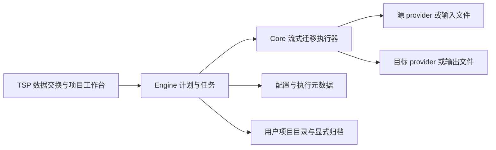
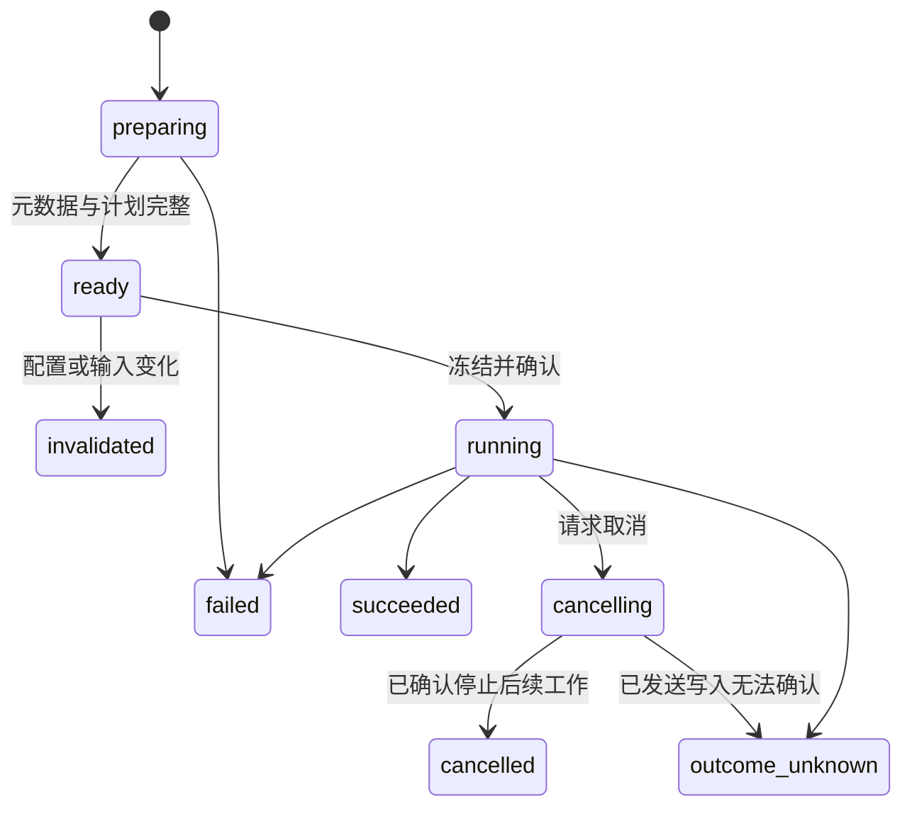

# Datapier 0.4.0 技术方案

## 1. 状态、依据与已确认范围

本文是本次需求讨论确认后的 **0.4.0 实施前设计**，不代表已经实现、编译、运行验收或发布。本次只编写方案和同步文档入口，不调整产品版本、依赖、数据库 migration 或功能代码。

依据为 [产品规划](product-plan.md)、[贡献指南](../CONTRIBUTING.md)、[0.1.0](technical-design-0.1.0.md)、[0.1.1](technical-design-0.1.1.md)、[0.2.0](technical-design-0.2.0.md) 和 [0.3.0](technical-design-0.3.0.md) 技术方案。本方案基于 `feature/0.3.0` 文档提交 `f1976b1`，其前置 0.2.0 文档基线为 `f922e3933dc26b849cb6efdf6ed995ea5af5ed58`。0.2.0、0.3.0 正由其他线程实现；接口名称、schema 与模块落点须在接入前对照最终实现核对，不能把设计接口写成已有能力。

### 1.1 需求基线

| 编号 | 已确认需求 | 本文落点 |
|---|---|---|
| R1 | 人工触发、配置可复用，面向开发／测试数据准备与数据搬运 | 第 3、10、12 节 |
| R2 | 自身 SQL 导出可往返，兼容明确范围的常见 mysqldump 文件 | 第 6 节 |
| R3 | 项目可放入 Git 并供团队共享 | 第 10 节 |
| R4 | 新增流程通过 TSP 使用，MCP 沿用既定边界 | 第 2、11、12 节 |
| R5 | 同类数据库直接迁移与文件中转两条路径 | 第 3、5、7 节 |
| R6 | MySQL 表、索引／约束、数据、视图、触发器、过程、函数和事件 | 第 5、6 节 |
| R7 | 多文件 CSV／Datapier 类型化 JSON；SQL 另走恢复 | 第 4、6 节 |
| R8 | 新增、跳过、覆盖；MySQL 更新映射列，Redis 替换整个 key | 第 5.3、7.2 节 |
| R9 | MySQL InnoDB 默认在同一只读事务中一致性读取 | 第 5.1 节 |
| R10 | 报告后人工续作，不自动重放或承诺重启后精确续传 | 第 8、9 节 |
| R11 | 可创建缺失表，也可比较并调整已有表结构 | 第 4.3、5.2 节 |
| R12 | 既有数据库版本矩阵内允许跨版本，按目标能力检查 | 第 2、5、7 节 |
| R13 | 显式 DEFINER 映射、保留 SQL SECURITY、数据后建触发器、事件默认禁用 | 第 6.3 节 |
| R14 | Redis 选 key／pattern／DB、前缀映射、保留绝对到期时间 | 第 7 节 |
| R15 | 项目携带可复用的导入、导出和迁移配置 | 第 10 节 |
| R16 | 连接使用逻辑引用，在本机显式绑定 | 第 10.2 节 |
| R17 | 结构差异逐项选择，破坏性变更单独确认 | 第 5.2 节 |
| R18 | 多表、逐表条件过滤、显式库／表／列映射 | 第 5 节 |
| R19 | 默认首错停止，可预先选择跳过明确的数据转换错误 | 第 4、8 节 |
| R20 | 日常使用 Git 项目目录，单文件归档交换 | 第 10.1、10.4 节 |
| R21 | 本机工作区自动保存，共享项目显式保存 | 第 10.3 节 |

### 1.2 范围与继承关系

- 数据库沿用 MySQL 5.7／8.0／8.4、Redis 6.2／7.2／8.0 单节点。跨版本不等于自动转换不兼容类型、排序规则、索引或存储对象语法。
- 0.2.0 的查询结果、原值基线不落盘和有界内存约束继续生效。用户显式导出的数据文件可持久化；迁移执行日志只保存白名单元数据，不借迁移恢复隐藏结果缓存。
- 0.3.0 的结构模型、DDL 计划、提交前复核和对象执行门是设计复用基础；跨实例结构比较、批量创建依赖对象、SQL 恢复属于本版新增。
- Direct 是数据库迁移、SQL 备份／恢复的来源和目标。Archery 保持只读，只能沿用仍保留响应的结果导出，不能作为完整数据库备份源、直接迁移源或写入目标。
- 不新增 MCP 文件、项目或迁移工具，普通终端 TUI 不增加迁移向导。UI 与 agent 权限仍在 Engine/Core 统一执行，不能通过内部 transfer 方法绕过入口边界。
- 不包含持续同步、CDC、调度备份、复制追平、在线切换、跨数据库类型转换、物理备份、账号授权迁移、Redis Cluster／Sentinel；0.5.0 的图表、显示规则引擎和维护能力不提前实现。

## 2. 架构、复用与模块边界

沿用单一 Engine、Core/providers 和 TSP，不新增业务 crate、外部迁移服务或对 mysqldump／redis-cli 的运行时依赖。



| 层／设计落点 | 职责与复用边界 |
|---|---|
| `core/model` | TransferSpec／计划摘要、映射、冲突策略、范围、进度、错误与项目文件模型 |
| `core/execution/transfer` | 复用 CSV／JSON 类型转换及 writer，新增多输入调度、流式背压、数据块和报告；不再经结果落盘路径中转 |
| `core/providers/mysql` | 源端一致性读取、目标类型检查、批量 DML、结构模型／差异／DDL、SQL 逻辑导出与受控恢复 |
| `core/providers/redis` | SCAN、逐 key 读取一致性、临时对象所有权、目标 WATCH 与发布、到期语义 |
| `core/storage` | 预设、项目绑定和运行元数据的事务存储、schema 升级；不保存数据块或 before 值 |
| `engine/server` | 计划 registry、源目标资源所有权、执行日志、客户端租约、取消、文件登记、项目保存与导入 |
| `tsp` 现有 navigation／workbench／views | 具名入口、向导、差异与样本预览、任务进度／报告、项目绑定与保存；只持有当前展示页 |
| CLI／MCP／plugin | 沿用入口与启动行为；不增加公开子命令或 MCP 工具，不复制迁移逻辑 |

### 2.1 方案取舍

| 问题 | 本版选择 | 理由 |
|---|---|---|
| 直接搬运还是全部先备份 | 两条用户路径共用有界数据流，直接迁移不自动生成源数据副本 | 保留已确认使用方式及不落盘约束 |
| 恢复是否调用外部 mysql 客户端 | Rust 内部受控脚本 reader＋现有 SQLx | 统一类型、权限、任务、取消和跨平台安装 |
| MySQL 覆盖 | 显式定位后 UPDATE／INSERT，不使用 REPLACE 或无条件 ON DUPLICATE KEY UPDATE | 避免删除副作用和多个唯一键导致更新错误行 |
| 结构同步 | 复用 SchemaPlan，新增跨连接差异与显式名称映射 | 不维护第二套 DDL 构造器，不猜测改名 |
| Redis 覆盖 | 临时 key 完整构建后一次受保护发布 | 不让目标暴露半个集合，覆盖与源读取分别检查并发 |
| 项目文件 | 可读目录＋显式 ZIP 归档 | Git diff 可读，归档适合单文件交接，数据文件不自动打包 |

### 2.2 依赖与实施基线

复用 SQLx、redis-rs、Serde、csv、sha2、现有 tokenizer 与 sqlparser。SQL 恢复 reader 在 tokenizer 之上处理客户端分隔符和版本化注释；sqlparser 不被当作完整 MySQL 语法判定器。

新增依赖限定为 `encoding_rs` 的严格流式转码，以及 `zip` 的项目归档读写；ZIP 首版使用 Stored，不开启加密和不需要的压缩后端。最终精确版本、MSRV、许可证、features 和六目标解析结果须在实施时以 registry 与 Cargo.lock 核对，本方案不伪造已完成依赖验证。`encoding_rs` 已核对存在 without-replacement 流式接口，不能使用自动替换错误字符的路径。

宿主和平台先沿用 0.3.0：macOS arm64／Tern 0.9.9／tern-sdk 0.2.0 为原生交互验收基线；其余五个目标完成编译、默认测试与打包验证，运行状态单独报告。若前置版本实际升级基线，接入时统一更新，不能同时维护两套未验证契约。

## 3. 迁移配置、计划与执行

### 3.1 数据模型

| 模型 | 必需字段与不变量 |
|---|---|
| `TransferSpec` | `version=1`、模式 import/export/copy/sql_dump/sql_restore、源与目标逻辑描述、按序输入、对象选择、映射、冲突／错误策略、读取一致性、输出及格式选项；只表达用户意图 |
| `ResolvedTransfer` | 本机 profile ID／revision、源目标实际数据库身份、资源范围、能力与权限、文件身份、工作区和客户端归属；不进入共享项目 |
| `TransferPlan` | ID、revision、完整性、选中步骤、有序依赖、schema 指纹、输入指纹、预览样本、诊断、破坏性项、digest 和失效时间 |
| `PlanStep` | ordinal、对象／文件、阶段、动作、依赖、前置条件、实际 DDL 或参数化 DML 模板、策略及可确认边界 |
| `DataChunk` | 内部所有权移动的类型化行／Redis 内容、来源定位和字节记账；不序列化进日志，不在 IPC 搬运整批数据 |
| `TransferRun` | execution ID、冻结配置摘要、计划 digest、开始／结束时间、计数、当前步骤、输入与目标事实、终态 |
| `StepOutcome` | 未发送／已发送／已生效／已回滚／失败／跳过／待确认，定位元数据、错误码、影响数及确认依据 |

源和目标使用独立专属数据库会话，不接管查询 tab 的未提交事务、临时表或 WATCH。MySQL 同源实例的多个库可以共用一个源快照；不同源实例是不同快照，不能标为同一时刻。

### 3.2 准备与确认

流程为：选择操作 → 选择源／输入和目标 → 设置对象、映射与策略 → 准备计划 → 查看结构步骤与数据样本 → 明确确认 → 执行 → 查看并导出报告。

准备阶段不写数据库。计划 ready 要求**元数据、映射、依赖、所选结构步骤及支持性检查完整**，不代表已经逐行验证全部数据。样本初始每对象 100 行，受总内存及页字节限制；明确显示抽样范围，转换错误仍可能在后续数据中出现。CSV／JSON 的数据读取不为了预览而扫描并保存全量输入。

SQL 恢复另需完整输入扫描以发现不支持的语句并形成可重排的对象依赖；仅持久登记文件偏移、校验摘要和语句类别等输入索引，不保存解析后的行值。索引也是有配额、可取消、可清理的文件处理产物。

意图、勾选、映射、路径或破坏性确认变化均推进计划 revision 并重算 digest。执行冻结 `plan_id + revision + digest`；重复确认只返回同一个 execution ID，不创建第二次写入。目标、配置、权限或输入发生变化使计划失效，要求重新准备。

### 3.3 有界数据流

provider 在拥有连接的 worker 中读取；内部有界通道向目标 writer 传递批次，目标变慢时施加背压。迁移流可在消费后释放数据块，不承担结果 grid 的回看承诺，也不把普通单次查询结果的保留策略改成自动淘汰。

MySQL 源表使用一次流式 SELECT，不通过反复 OFFSET 拼接整个表；无主键表可读取并在“新增”策略下导入，不能因 grid 编辑要求可靠键而一概拒绝插入。过滤使用类型化条件树及绑定参数，字段和标识符从 catalog 取值，不接受任意脚本作为迁移过滤器。任意查询仍可沿既有显式导出路径生成数据文件后导入。

初始上限：数据批次最多 500 行且应用保留数据不超过 1 MiB，内部通道最多 2 批；超宽单行走单项批次并计入客户端总预算。单值／原生 SQL 语句上限初始 16 MiB，超限明确失败，不把该上限解释为字段级网络流式能力。MySQL 包大小、Redis 原生响应解码及驱动临时分配仍是额外边界。

计划摘要初始上限 10000 个结构／对象步骤和 32 MiB，不限制一个已接受对象的数据总行数。每次 RPC 响应默认 1 MiB、IPC 帧 8 MiB，预览／报告分页，单次原始文件和值块最多 256 KiB。所有保留缓冲与前置版本客户端总预算共同记账；提高局部设置不能突破总预算。

## 4. 多文件数据导入与导出

### 4.1 格式与解析

保持 0.1.0 的 Direct MySQL／Redis `format/version=1` 类型化 JSON 和 CSV 编码契约，不重命名既有文件格式；Archery 查询结果格式仍是独立的 `datapier-query-result`，不能冒充可恢复数据库备份。

- MySQL 支持多个 CSV／JSON 对应一张表，或不同文件映射不同表；文件按用户可见顺序执行，相同目标共享已确认映射或逐文件覆盖。文件顺序会影响键冲突，预览明确列出。
- Redis 使用已有包含 key、原生类型、完整内容和绝对到期时间的 CSV／JSON，不把普通表格 JSON 猜成 key 备份。
- CSV 默认 UTF-8，可选 UTF-8 BOM、UTF-16LE／BE、GB18030、GBK；编码由用户指定或 BOM 确定，其他猜测只作建议。严格解码，错误返回原始字节偏移，不静默替换为 U+FFFD。
- CSV 分隔符支持逗号、制表符、分号、竖线及其他单个有效 ASCII 字符；转码后复用 csv reader，支持引号内换行及引号转义。表头、NULL 标记、反斜线规则、二进制 Base64 沿现有语义显式选择。
- JSON 使用 UTF-8，逐记录读取，保持整数／Decimal／JSON 数字词法、二进制与 NULL；不实现普通外部 JSON 的类型猜测或嵌套摊平。
- 重复表头／重复映射目标列、列数不符、未知类型和非法 Base64 给出文件、记录号、列及字节定位。CSV 记录号和物理文本行号分开；不能把含换行字段的记录号写成文件行号。

“跳过转换错误”只对能够可靠继续到下一记录的错误生效。引号未闭合、无可靠记录边界、文件截断、编码失步和 JSON 容器损坏停止该任务，不猜测后续记录。

### 4.2 文件身份与输出发布

准备时记录规范路径、文件身份、大小、时间及内容校验摘要。输入文件使用同一打开句柄，处理大文件时生成有界分块校验索引；发送每个输入块前校验其与准备版本一致，不能只靠 mtime 或路径相同判断内容未变。输入索引保存偏移和哈希，不含记录值；索引准备进度与数据执行进度分开。发现变化停止后续步骤，已提交范围保留。

输出采用同目录唯一临时文件，完成 flush／关闭后以不覆盖方式发布；目标已存在时让用户重新选择路径。失败／取消的文件标为 partial，不作为完整 SQL 备份或正常项目归档发布。系统不支持可靠发布操作时明确失败，不静默覆盖。

输出按对象可选择独立文件，或以一个 SQL 文件承载应用库逻辑备份；数据文件的“导出全部”必须从已确认源范围独立读取，不能只导出 grid 当前页。Archery 和不可安全重放结果继续遵守 0.2.0 的保留范围导出限制。

### 4.3 表创建与字段映射

目标表缺失时，MySQL 源表和类型化 JSON 可给出明确候选类型；CSV 仅从样本提出候选，必需用户确认类型、长度、NULL、自增和键。样本不能保证剩余数据可转换；运行时严格检查，溢出／编码错误按错误策略处理。

已有表调用第 5.2 节结构差异流程；结构调整先于对应数据写入，用户可只选映射、不调整结构。省略列使用目标默认值；空字符串、NULL、默认值和列未映射分别表达。生成列不直接写入，自增列默认保留源值，也允许显式选择由目标生成并在预览说明关联数据风险。列映射不得静默改变字符集、精度或日期／时区语义。

## 5. MySQL 直接迁移与结构比较

### 5.1 源端快照和兼容性

默认源读取会话使用 REPEATABLE READ 的只读一致性事务，所有选中 InnoDB 表顺序从该会话读取；目标写入使用另一专属连接和独立批次事务。支持同实例不同库，拒绝源表与目标表实际相同的自拷贝，避免重复插入与快照／写入互相混淆。

一致性仅覆盖 InnoDB 数据，不覆盖所有 DDL、存储对象定义和非事务表。开始前和对象读取后核对结构指纹，相关 DDL 变化或服务端错误使任务失败；客户端检查不能消除外部 DDL 竞态。非事务表默认阻止“事务一致性”模式，用户可以明确接受尽力读取并在任务和备份头部记录较弱保证，不自动锁源库。

准备时检查服务端版本、引擎、原生类型、字符集／排序规则、索引、CHECK enforcement、生成表达式及对象权限。8.x 特性不能静默降级为 5.7 的近似语义。不兼容项阻止相关计划提交，用户可改映射或取消选中对象，再重新准备。

源账号只需读取相应对象的实际权限；元数据不可见不等于对象不存在。未取得的定义列为 incomplete／denied，不能生成声称完整的应用库备份。

### 5.2 跨实例结构差异

源、目标分别读取 SchemaSnapshot，并将用户指定的库／表／列名称映射正规化后比较。明确区分新增、删除、修改、未变化和无法判断；未映射的目标独有表默认保留。字段改名必须由用户明确映射，不能凭位置或类型相似猜测。

复用 0.3.0 SchemaPlan 和实际 DDL 构造器，展示每一步前置条件、完整 SQL、锁／重建风险、可能的数据损失和提交语义。新增字段／索引可选择；删除字段／索引／约束、类型收窄、字符集／engine 改变、删除后重建非表对象均要求逐类单独确认。**不使用 DROP TABLE＋CREATE TABLE 代替已有表同步。** 服务端 ALTER 自身可能重建表，应显示实际风险。

每步发送前重新校验目标指纹；执行门与同 Engine 的结构／数据草稿协调，占用则 busy，不丢弃他人草稿。每步成功读回后推进本计划的预期指纹，多条 DDL 首错停止，不能把自身上一条修改误判成外部冲突。

依赖图包含表、主外键、视图、触发器和存储程序可确定的静态引用；缺失依赖展示补选，需用户确认。循环外键的新表先建无循环外键的表并导入数据，再添加外键，由服务端验证已有数据；已有表保持现存约束，无法满足装载顺序则停止并要求显式结构处理。不自动设置 `foreign_key_checks=0`；重新启用外键检查不能替代数据验证。

### 5.3 三种数据冲突策略

| 策略 | 定位与执行 |
|---|---|
| 新增 | 参数化 INSERT；重复键报错，无可靠键的基表也允许新增 |
| 跳过 | 按用户选定的完整主键／可靠唯一键判断；只有已证明的键冲突可记 skipped，其他约束、转换和权限错误仍失败 |
| 覆盖 | 按选定可靠键在目标事务读取并锁定当前行，存在则只更新映射列，不存在则 INSERT；其他唯一键冲突报错，不改写另一行 |

可靠键沿既有完整、非前缀、非表达式且定位值非 NULL 等约束；多个候选键要求明确选择。没有可靠键时只开放新增。源文件／批次中的重复定位键同样按选定策略逐条处理，影响顺序与最终覆盖关系在预览说明。

不使用 INSERT IGNORE 吞掉非键错误，不使用 REPLACE 删除旧行，不把 ON DUPLICATE KEY UPDATE 的任意唯一键命中当成选定定位键。INSERT 的并发竞争、死锁、锁超时和其他唯一键冲突明确报告，默认不自动重试。

InnoDB 每批最多 500 行／1 MiB，在一个事务中执行，转换在发送前完成；批次失败回滚当前批次并分别报告失败、已回滚和未执行项，此前提交批次保留。非事务表逐项记录生效范围。覆盖授权针对**执行时锁定的目标行**，数据样本不是全库原值基线；同一次锁定读取到写入之间维持事务保护，不能把预览样本声称为全量并发冻结。

## 6. MySQL SQL 逻辑导出与恢复

### 6.1 导出对象和可往返性

支持库级或选定对象、仅结构／仅数据／结构＋数据，包含表选项、字段、索引、约束、表数据、视图、触发器、过程、函数和事件。视图导出定义，不把查询结果当作视图备份数据。每个对象记录读取完整性、版本、字符集／sql_mode 和依赖缺失。

自生成 SQL 使用 UTF-8，首行注释为 `-- datapier-sql format=datapier-sql version=1`，头部注明源范围、快照保证、过滤和列裁剪及对象清单。最后一个非空行必须是 `-- datapier-sql complete sha256=<digest>`，digest 覆盖其之前的全部原始字节；恢复预检校验支持版本、尾标记、摘要和声明对象完整性，缺失或不匹配在首次写入前拒绝。外部 mysqldump 按第 6.2 节单独识别，不要求具有此标记。带过滤或列裁剪的导出标为部分数据，不称为完整库备份。数据使用明确列名、可往返字面量和有界多行 INSERT，原始值不经过 UI 显示格式。BIGINT／Decimal 保持完整词法，binary／BIT 使用可逆形式，生成列从 INSERT 中排除；自增值、时间类型、JSON 数字和必要会话模式逐项保持。

存储对象定义保留原始正文和定义上下文，输出正确 DELIMITER 包装；事件原启用状态作为来源信息保留，但恢复计划默认禁用。只在所有选中对象及数据写入成功后发布完整文件；权限不足或某对象无法读取时不能悄悄少导。

### 6.2 mysqldump 互通子集

兼容目标为 MySQL 5.7／8.0／8.4 生成的**应用库文本 SQL**，包括常见 `--opt` 包装、extended INSERT，以及显式 `--routines --events` 的定义。完整应用库建议输入由以下配置生成；这是互通范围说明，不是 Datapier 的外部命令依赖：

```sh
mysqldump --single-transaction --quick --hex-blob --routines --events --triggers --set-gtid-purged=OFF app_db
```

账号权限、服务端构建和实际版本仍影响导出成功；mysqldump 默认不包含过程和事件，不能从输入缺失推断源库没有这些对象。

| 输入构造 | 本版解释 |
|---|---|
| CREATE DATABASE／USE、限定库表名 | 映射到明确目标范围；创建缺失库需在计划中单独确认，越界引用停止 |
| ALTER DATABASE ... CHARACTER SET／COLLATE 上下文包装 | 识别存储对象创建前切换及创建后恢复数据库默认值的配对语句，绑定映射后的库及对应对象；依赖重排时上下文跟随对象，不能丢弃或作为普通会话 SET 执行 |
| CREATE／ALTER TABLE、索引／约束、视图与存储对象 | 形成结构步骤，比较已有定义；未知条款不能安全保留或映射时阻止提交 |
| INSERT INTO ... VALUES | 支持显式列清单和默认省略列清单的形式；后者从输入 CREATE TABLE／源列定义确定顺序，纯数据文件未带定义时要求用户明确源列顺序，不能套用已改动的目标列序。literal tuple 流式重组有界批次，复用既定冲突策略，不执行任意表达式取值 |
| NULL、数字、字符串、hex／bit literal、合法字符集 introducer | 按输入字符集、sql_mode 和目标列严格解码；不把 literal 内 SQL 当指令 |
| DELIMITER | 客户端切句指令，只供 reader 使用，不发送到数据库；支持存储程序内部语句和分号 |
| `/*!version ... */` | 作为版本约束下的可执行内容解析，保留对象定义及会话语义，不当普通注释丢弃 |
| SET NAMES／创建对象所需字符集、sql_mode、时区及保存恢复变量 | 只解释明确支持的会话白名单，形成执行上下文；未知变量或改变全局状态的语句拒绝 |
| mysqldump 视图占位表、后续真实视图 | 识别为同一逻辑对象的依赖阶段，不把占位表作为独立用户表迁移 |
| DROP TABLE／VIEW／TRIGGER／ROUTINE 等 | 不直接执行；转为同名对象差异与显式替换确认，已有表仍走 ALTER，不删除重建 |
| LOCK／UNLOCK TABLES、DISABLE／ENABLE KEYS 包装 | reader 识别；计划明确展示按独立会话、事务及依赖策略替代这些包装的语义变化，用户确认后执行，不能静默忽略 |
| FOREIGN_KEY_CHECKS／UNIQUE_CHECKS 的关闭包装 | 不照抄执行；保留检查并按依赖装载，预览列出转换，不能满足时停止 |
| GTID_PURGED、SQL_LOG_BIN、复制／账号／实例管理语句 | 拒绝应用库恢复并定位，要求重新生成合适输入，不以全局替换静默删除 |
| SOURCE、系统命令、LOAD DATA 路径读取、任意 DML／CALL | 不属于该恢复子集，预检拒绝；一般查询编辑器的既有执行能力不受此 reader 替代 |

完整输入扫描先于第一次目标写入，报告所有已识别的不支持项。SQL reader 维护引号、注释、分隔符、字符集、sql_mode 和文件字节定位；超大 INSERT 按 tuple 流式处理，不为拆批构造整个文件 AST。未知语句不能“尽力执行”。未知的、应被目标版本忽略的版本注释保留版本判断事实，不能将目标应执行的对象定义无声省略后标为完整恢复。

存储对象可能在不同于当前默认值的数据库字符集／排序规则下创建；自生成 SQL 和 mysqldump 恢复均须保留该上下文。需要 ALTER DATABASE 的步骤显示真实库级影响、目标权限和配对恢复动作并单独确认，建议在协调好的变更窗口执行。预先登记目标原默认值及预期值，失败／取消后仅执行已确认的上下文收尾并记录结果；外部默认值变化、恢复失败或结果未知时保留待核对项，不强行覆盖，不声称已还原。该库级操作无法仅靠独立会话隔离其他客户端。

### 6.3 身份、依赖与恢复次序

恢复前按对象显示原 DEFINER 与目标映射；默认映射到目标当前账号，可显式保留原账号。保留 SQL SECURITY，说明 definer 改变会改变实际权限上下文。不同 MySQL 版本检查实际定义权限，不凭统一 SUPER 假设执行。

执行次序由依赖图生成：库／表与必要列索引 → 必要静态依赖对象 → 数据 → 延后外键／约束验证 → 视图和剩余存储对象 → 触发器 → 禁用状态的事件 → 读回。函数、视图、生成表达式之间有依赖时按实际图前移，不能使用固定类别顺序掩盖循环或缺失依赖。

目标新建触发器在数据之后安装。若目标已有触发器，普通 INSERT／UPDATE 会触发它：预览必须列出并要求明确确认，不能声称“导入不会触发业务逻辑”，也不能自动 DROP 现有触发器。事件默认禁用；用户要启用时，在恢复完成后明确发起新的操作。

只对可解析且确定归属映射对象的静态标识符做语法级库／表／列改写，保留字符串和注释。动态 SQL、正文中的字符串拼接、外部库引用、无法证明的列绑定显示为未解决引用并阻止该对象 ready；用户可在 SQL 正文编辑中明确修订，重新生成和确认计划。不能全局字符串替换，也不能为绕开难题静默排除过程、函数或事件。

恢复不是任意 SQL 脚本执行，也不是整库事务。每步展示真实提交边界；已提交数据、DDL 和存储对象创建分别记账，首错后不继续依赖步骤，不自动执行逆向 SQL。

## 7. Redis 类型、范围与 TTL 迁移

### 7.1 选择、读取与重叠范围

支持 String／Hash／List／Set／ZSet；key、field、member 保留字节，List 保留顺序和重复项，ZSet score 使用可往返表示。可选显式 key 列表、pattern 或整个 DB；可映射目标 DB 和统一的源前缀→目标前缀，按字节前缀处理，不用显示文本改写二进制 key。

SCAN 允许空批次和重复，cursor 为零才结束。直接迁移在逐 key 操作日志中写入源 key 的完整 SHA-256 摘要与目标摘要，并以唯一索引避免对同一源 key 重复执行；这属于写入发送去重元数据，不保存原始 key 或可还原编码，不能作为资源树或旧读取结果。日志读取分页、内存缓存有界；日志存储失败时停止发送，不退回无界 HashSet 或无去重执行。不同源身份映射到同一目标摘要时报告映射冲突，不由覆盖策略吞掉。此去重表只用于数据库 SCAN；文件中的重复 key 属于有序输入记录，按新增／跳过／覆盖策略处理，不因相同目标摘要被误判为映射冲突。

源端在专属连接 WATCH 当前 key，然后读取类型、内容和绝对到期时间；大集合分块读取并增量写目标临时对象，读取结束通过受 WATCH 保护的只读 EXEC 校验源未发生变化，再允许发布。源变化、过期、类型变化或读取失败时丢弃本任务临时对象并报告，不能把混合版本集合当成完整 key。校验后的源仍可继续变化，跨实例不存在原子读写事务。

用可取得的服务端身份（如 Redis run_id）、连接目标及 DB 判定源目标关系，不能只按 profile UUID 判断不同实例。源目标可能同实例同 DB 时，只有能证明扫描源范围与写入目标范围不相交，或显式选定 key 与目标集合互不覆盖，才允许直接搬运；完全相同的源目标 key 不作为复制执行。无法证明、身份未知或映射循环要求用户改范围，或**显式选择文件中转**，不自动将源值落入隐藏文件。

本任务临时 key 使用随机所有权标记和登记身份，扫描只排除经过验证的本任务临时对象，不能仅靠前缀误排用户 key。其他迁移任务与源写入仍是外部并发，整个 DB 不承诺在线一致性快照。

### 7.2 临时构建与冲突发布

复用既有 `import.begin/append/finish/discard` 的临时对象和随机标记所有权机制，替换被新计划取代的调用方，不留另一套导入实现。逐 key 临时对象由限量批次构建，任何追加、标记轮换、发布和清理都原子验证归属，外部替换的对象不能被删除。

| 策略 | 发布行为 |
|---|---|
| 新增 | 目标不存在才发布，目标已存在为冲突 |
| 跳过 | 目标存在则跳过整个 key，源到期亦单独报告过期跳过 |
| 覆盖 | 完整替换目标原类型、内容和到期时间，不做集合合并 |

目标在构建前由独立物理连接 WATCH，再读取必要存在／类型信息；同一连接保持到发布。最终 MULTI／EXEC 只调一个经过审阅的发布脚本：先验证目标条件、临时对象所有权和期限，完成临时对象整理，再以 RENAMENX 或 RENAME 最后发布。EXEC 冲突不自动换基线重试。覆盖目标变化、过期或淘汰均需重新准备和确认；此保护不意味着预览时冻结了整个目标 DB。

脚本运行错误不构成回滚保证。将可能失败的条件检查置于发布前，发布后的响应丢失仍标为待确认；不因清理临时对象成功就推断目标未写入。覆盖大 key 的服务端释放可能产生延迟，预览说明，任务取消不声称撤销已发送 RENAME。

### 7.3 绝对到期时间

沿用 `expires_at_ms` 字符串或永久语义，Redis 6.2 通过固定只读脚本结合 TIME／PTTL，较新版本可用相应能力。目标以自身服务器 TIME 判断是否已经到期；已到期时跳过且不覆盖现有目标，永久保持永久。

绝对期限在临时对象发布前设置，并在最终脚本再次核验；传输不重置为最初剩余 TTL。临时对象的清理期限与用户数据的最终期限分别管理。展示两端测得的服务器时间与采样误差，两端时钟不一致会改变实际剩余寿命，不能声称客户端已修正服务器时钟。

不支持的 Redis 类型或不能容纳的单响应返回明确错误；不降级为 String，不用 Lua 一次拼出整个无界集合。逐 key 成功不等于跨 key 回滚或全库快照。

## 8. 任务、取消、错误与人工续作

### 8.1 状态与确认边界



终态不能掩盖部分生效。`succeeded` 允许存在按策略明确跳过项，计数分别展示；failed／cancelled 可包含已生效对象或批次。只有服务端／驱动已确认的提交计入 completed，发送后未取得确认单列 unknown，不算失败后可直接重试。

默认首错停止整个任务后续步骤，而非只停止当前表。用户预先开启 skip_conversion_errors 时，只跳过可可靠定位和继续解析的记录转换错误；数据库错误、目标变化、源结构变化、输入损坏和存储错误仍停止。键冲突跳过是独立策略，不能拿转换跳过选项解释权限或约束错误。

### 8.2 日志与进度

写入／COMMIT／发布前先落盘发送事实，接收响应后记录真实终态。日志记录对象、文件记录区间／字节范围、批次号、源目标摘要、策略、影响数、耗时、数据库错误及必要指纹，不保存 rows、before、字段值、完整输入 literal 或数据库返回内容。SQL 数据步骤日志只保存模板和摘要；结构 DDL 也采用必要摘要／引用，不借执行参数保存完整源 catalog 副本。

显示已处理字节、已读取行／key、已确认写入／跳过／失败／待确认数、当前对象及阶段。文件总字节数可知；数据库总行／key 数默认未知，不自动 COUNT／DBSIZE 冒充精确目标数。只能在已知分母时显示准确百分比，否则显示累计与当前阶段。

报告可分页查看，并显式导出 JSON／CSV 到用户路径。默认报告只有定位与错误元数据；用户明确勾选包含失败输入记录时才导出仍可从原输入重新读取的记录内容，并复核输入指纹。不能在后台先保存所有失败行再称为普通日志。原始错误中若包含参数值，落盘前脱敏并保留错误码。

### 8.3 取消与离线

取消首先阻止未发送步骤。MySQL 正在读取可发 KILL QUERY 并等待原连接终态；当前目标事务按真实阶段回滚或确认，COMMIT 失联为待确认。Redis 停止追加，未发布临时对象按所有权清理；发布已发送则等待结果，不能把丢弃 future 当作撤销。

源只读事务在结束后回滚／关闭。专属连接完成取消竞态和协议尾部清理前不能回池。关闭一个 UI 只影响所属任务；最后客户端离开仍沿用 10 秒心跳、45 秒租约、30 秒无客户端收尾，不新增无人永久后台任务。无法清理的文件／临时对象保留登记和明确状态。

### 8.4 人工再次执行

“再次执行”创建新计划、新 execution ID 和新权限／基线检查，并关联原 run ID。文件输入未变时，可显式选择 `failed`、已确认 `rolled_back` 和 `not_sent` 的记录范围，并保持原输入顺序；已回滚不能被当成已完成而漏掉。MySQL 直接迁移旧快照消失后不能用旧行号／OFFSET 当断点，只能重新选择对象、可靠键条件或新范围，并说明读取的是当前数据。Redis 可重新选择范围，日志摘要用于核对已执行事实，不恢复源 key 结果集。

待确认写入必须先人工核对，不能自动加入可重试范围。输入文件、过滤、映射、目标结构或策略改变后，原范围只作诊断，不能宣称无重复精确续传。重启保留配置、定位摘要和发送事实，不保留流、连接、事务、WATCH、旧结果或可直接执行的原数据块。

## 9. 本地持久化与升级

### 9.1 配置 schema 5

目标从 0.3.0 的配置 schema 4 事务迁移到 5；旧版本依次执行既有迁移。保留 profiles、凭据追踪、授权／审批、历史／写入事实、设置和工作区。不创建新查询结果库。若前置实现调整 schema 编号，接入时整体顺延并同步文档，不能复用相同编号承载不同结构。

新增表职责如下；完整约束和迁移验证须随实现交付，不能运行时临时补表：

```sql
CREATE TABLE transfer_presets (
    id TEXT NOT NULL PRIMARY KEY,
    workspace_id TEXT NOT NULL,
    revision INTEGER NOT NULL CHECK (revision > 0),
    name TEXT NOT NULL,
    spec_json TEXT NOT NULL CHECK (json_valid(spec_json)),
    updated_at_ms INTEGER NOT NULL
);
CREATE TABLE transfer_runs (
    id TEXT NOT NULL PRIMARY KEY,
    execution_id TEXT NOT NULL UNIQUE,
    workspace_id TEXT NOT NULL,
    spec_digest TEXT NOT NULL,
    context_json TEXT NOT NULL CHECK (json_valid(context_json)),
    state TEXT NOT NULL CHECK (state IN (
        'running', 'cancelling', 'succeeded', 'failed', 'cancelled', 'outcome_unknown'
    )),
    progress_json TEXT NOT NULL CHECK (json_valid(progress_json)),
    retry_of TEXT,
    revision INTEGER NOT NULL CHECK (revision > 0),
    created_at_ms INTEGER NOT NULL,
    finished_at_ms INTEGER
);
CREATE TABLE transfer_steps (
    run_id TEXT NOT NULL REFERENCES transfer_runs(id) ON DELETE RESTRICT,
    ordinal INTEGER NOT NULL CHECK (ordinal >= 0),
    locator_json TEXT NOT NULL CHECK (json_valid(locator_json)),
    phase TEXT NOT NULL,
    state TEXT NOT NULL CHECK (state IN (
        'not_sent', 'sent', 'applied', 'rolled_back', 'failed', 'skipped', 'outcome_unknown'
    )),
    digest TEXT NOT NULL,
    outcome_json TEXT NOT NULL CHECK (json_valid(outcome_json)),
    PRIMARY KEY (run_id, ordinal)
);
CREATE TABLE transfer_key_ops (
    run_id TEXT NOT NULL REFERENCES transfer_runs(id) ON DELETE RESTRICT,
    source_digest TEXT NOT NULL,
    target_digest TEXT NOT NULL,
    step_ordinal INTEGER NOT NULL CHECK (step_ordinal >= 0),
    PRIMARY KEY (run_id, source_digest),
    UNIQUE (run_id, target_digest)
);
CREATE TABLE transfer_artifacts (
    id TEXT NOT NULL PRIMARY KEY,
    run_id TEXT,
    owner_client_id TEXT,
    kind TEXT NOT NULL CHECK (kind IN (
        'input_index', 'export_partial', 'report', 'project_stage', 'redis_temporary'
    )),
    state TEXT NOT NULL CHECK (state IN (
        'preparing', 'ready', 'published', 'cleanup_pending', 'outcome_unknown', 'recovery_conflict'
    )),
    identity_json TEXT NOT NULL CHECK (json_valid(identity_json)),
    revision INTEGER NOT NULL CHECK (revision > 0)
);
CREATE TABLE project_bindings (
    project_id TEXT NOT NULL,
    binding_group TEXT NOT NULL,
    connection_alias TEXT NOT NULL,
    profile_id TEXT NOT NULL,
    database_json TEXT NOT NULL CHECK (json_valid(database_json)),
    revision INTEGER NOT NULL CHECK (revision > 0),
    PRIMARY KEY (project_id, binding_group, connection_alias)
);
CREATE INDEX transfer_runs_workspace_created
    ON transfer_runs(workspace_id, created_at_ms);
CREATE INDEX transfer_steps_run_state ON transfer_steps(run_id, state, ordinal);
CREATE INDEX transfer_artifacts_state ON transfer_artifacts(state);
PRAGMA user_version = 5;
```

JSON 字段不是任意 payload 通道：Store 用类型化白名单校验，拒绝原值、结果行、密码、token、Cookie、TOTP 和完整输入 SQL 数据正文。项目预设只保存用户输入的选择和映射；扫描出来的原始 key 列表不进入 spec。`transfer_key_ops` 只存操作摘要，不保存原始 key 或可还原编码，不提供结果读取接口。

`transfer_runs.execution_id` 与前置版本持久执行事实绑定，不能级联到可独立清理的历史展示记录。transfer 日志与发送状态在同一 SQLite 事务提交；schema 接入时对照最终执行日志表建立关联，不在两个表之间先后写入却声称原子。JSON 业务结构、UUID、摘要长度、关系一致性还需 Store 校验。

### 9.2 资源、清理与恢复

输入索引、partial 输出、项目 staging 与 Redis 临时对象都登记准确归属和 revision；只有属于本任务的未发布资源可清理，已发布用户文件不因任务历史清理被删除。记录不存在、路径变化、符号链接替换或所有权不符时拒绝删除并报告。

SQLite／磁盘满时停止新写入发送；已发送结果按既有 outcome_unknown 和内存诊断规则处理，不能因为无法保存日志就继续批量搬运。Redis 操作摘要日志大小随 key 数增长，属于执行元数据磁盘成本，运行前展示可用空间，运行中检查存储错误；不宣称固定磁盘开销。

Engine 重启将仍处于 sent 的步骤保守标为待确认、未发送步骤保留未执行。已登记 Redis 临时对象只允许按所有权显式核对／清理；不自动发布，不自动恢复源 WATCH。project stage 和 partial 文件可找回、导出或安全清理，不自动宣布成功。

遗留资源管理沿用 0.3.0 value.files.claim 的思路：当前同一 OS 用户的 TSP 可按 artifact ID 和 expected revision 显式领取，事务更新 owner_client_id 和 revision；原所有者仍活跃则 busy。领取只授予本地文件导出、项目发布恢复和安全清理权限，不恢复数据库会话、WATCH 或写入权限。Redis 临时对象核对／清理仍需重新取得对应数据库权限和验证所有权标记，领取本地登记本身不能授权发送数据库命令。

schema 5／IPC v5 不向旧程序兼容。升级前备份一致数据目录；回退恢复升级前备份，先保留本版新增文件与日志，系统凭据不随 SQLite 回退。本文不执行数据库升级或发布操作。

## 10. Git 项目目录与单文件交换

### 10.1 文件契约

项目目录以 `datapier.project.json` 为唯一 manifest，`format=datapier-project/version=1`，含稳定 project UUID、名称、逻辑连接、查询清单、布局／已有显示配置和 transfer spec 清单。查询正文使用独立 UTF-8 `.sql`／`.redis` 文件，迁移配置使用独立可读 JSON；manifest 引用项目内相对路径。

| manifest 字段 | version 1 契约 |
|---|---|
| `format/version/id/name` | 固定格式名、整数版本、项目 UUID 和可编辑名称；项目 ID 不代表权限 |
| `connections` | 按 alias 唯一的逻辑连接，含 provider、source_kind、逻辑数据库需求和说明，不含本机 profile ID |
| `queries` | 稳定 ID、名称、项目内 path、语言、connection_alias 和逻辑数据库；正文不重复嵌入 manifest |
| `transfers` | 稳定 ID、名称、项目内 JSON path；其中 TransferSpec 使用 connection_alias 和具名路径参数，不引用运行计划 ID |
| `layout` | 查询／资源稳定 ID、标签顺序、分栏和共享列设置；不引用 result ID、事务或活动任务 |
| `display` | 仅已有显示配置的版本化结构；不支持的功能明确诊断，不能写入未来规则后静默忽略 |

同一项目内 ID、alias 和规范化路径唯一，所有引用需闭合。布局引用被移除的查询／资源时，在保存预览中明确同步移除引用；不自动重新创建用户已删除对象。

```text
example-project/
  datapier.project.json
  queries/
    inspect-orders.sql
    inspect-cache.redis
  transfers/
    refresh-test-data.json
```

示例描述的是用户创建的项目目录，不在本次仓库预建模板文件。字段使用稳定 ID 关联，文件名只作展示和路径定位；导入较新 format version 明确拒绝，不静默丢字段。文件排序与 JSON 输出确定，避免每次保存重排造成无意义 Git diff。

包含用户保存的查询、共享布局／列配置、已有显示配置和迁移配置；不保存结果、历史、事务、运行 token、未提交数据草稿、完整本机 workspace 或活动任务。0.5.0 尚不存在的显示规则不预建空配置引擎。

项目不导出连接地址、账号、CA／私钥绝对路径、Agent 授权、凭据和认证状态。用户自己写入 SQL 或查询注释中的敏感字面量不会因“项目无凭据”自动消失：保存预览必须展示将写入的查询与配置内容，不能宣称任意用户文本都已自动去密。

### 10.2 逻辑连接与路径绑定

逻辑连接包含 alias、数据库类型、来源要求 Direct／Archery、库／DB 需求和用途说明。首次打开需显式绑定本机 profile；同名、同 host 或相同 UUID 都不能自动授权绑定。缺失连接通过现有连接管理创建，凭据仍由本机获取。

允许为开发／测试等保存本机绑定组。共享配置使用 alias；profile ID、实际目标库、环境绑定、绝对输入输出路径覆盖项存在本机工作区／project_bindings，不能回写 Git 项目。绑定修改推进本机 revision，使相关未执行计划失效；绑定不能改变数据库类型，也不能把 Archery 绑定成可写迁移目标。

项目数据文件仅保存相对路径或具名路径参数，不自动打包 CSV／JSON／SQL dump。项目外文件通过本机路径覆盖项明确选择。共享输出路径只是候选，执行前显示实际规范路径与源目标，不能打开项目就读取外部文件或写入默认生产库。

### 10.3 保存、打开与并发修改

本机工作区继续自动保存编辑和布局；“保存项目”是显式动作，展示新增、修改、移除的项目文件、查询和配置。保存项目不把未提交数据库草稿转成共享内容，也不提交／推送 Git。

打开只加载配置与查询，不自动连接、执行 SQL、迁移、恢复或启动程序。项目首次使用及归档导入后均需完成本机绑定，随后每次执行仍经过正常预览和确认。

Engine 记录打开时各受管理文件摘要，保存时与磁盘版本核对；外部编辑器／Git 切换／另一窗口改变文件则返回冲突，不覆盖。同项目的 Datapier 写入通过 OS 文件锁串行，锁及恢复文件不进归档。项目发布前为每个受影响文件登记旧／新摘要、可恢复的旧版文件、新文件及发布阶段，先发布正文和配置，再发布 manifest。目录内多文件替换不是跨平台原子事务，不能对不遵守该锁的外部程序承诺内容 CAS。

发布中断后按逐文件摘要核对：当前内容仍为旧版时可继续发布，仍为本次新版且旧版完整保留时可回退；出现第三种内容、外部新增／删除或旧版无法取得时进入 `recovery_conflict`。保留 staging、原版和本机编辑，提供只读查看、导出及人工合并后重新准备保存；不强制先完成／回退才允许查看项目，也不覆盖用户后续 Git／编辑器改动。旧文件在受控临时位置保留至发布核对完成，遇到可能仍被外部编辑的文件保留冲突副本供人工处理，不能以清理为由丢失未合并内容。

UI 工作区不保存 Git 工作树副本；查询文件正文是用户明确选择共享的文本，保存过程登记可用于恢复本次用户写文件操作，不能借此备份数据库结果。

### 10.4 归档导入导出

导出只收集 manifest 白名单引用的查询／配置／布局文件，不递归打包整个目录、不跟随符号链接、不带 `.git`、本机绑定、数据文件和凭据。默认扩展名 `.datapier.zip`，内部仍为 version 1 项目目录；完成后发布归档，不覆盖已有目标。

导入到新目录，先在登记的 staging 目录完整校验 manifest、引用与格式，再发布为用户指定的不存在目录。拒绝绝对路径、盘符／UNC、NUL、父目录穿越、符号链接／特殊文件、规范化后重名及大小写不敏感平台碰撞；不把危险路径改名后继续导入。逐项检查实际解包字节和总预算，不只信任 ZIP 声明长度。

初始项目限制为 10000 文件、单文件 16 MiB、总展开 64 MiB、manifest 1 MiB，均独立于数据库文件大小。加密归档、未开放压缩算法和不支持的格式明确拒绝。归档导入不创建数据库连接，不继承其他人的本机授权。

## 11. IPC v5、权限与所有权

沿用 UDS／Named Pipe、8 MiB 帧、默认 1 MiB 业务响应、客户端归属、revision 和有界分页。以下方法是设计契约，实际命名在前置版本接入时统一，不暴露给 MCP 任意转发。

| 方法族 | 关键输入 | 返回与行为 |
|---|---|---|
| `transfer.prepare` | workspace、TransferSpec、本机绑定 revision | preparing 计划／准备任务 ID，不写数据库 |
| `transfer.plan.read` | plan ID、revision、section、cursor | 摘要、完整性、分页对象／差异／样本／诊断和 digest |
| `transfer.plan.update` | plan ID、expected revision、映射／勾选 patch | 新 revision，相关准备结果失效或重算 |
| `transfer.submit` | plan ID、revision、digest、所需破坏性确认 | 原子绑定同一个 execution ID，提交前复核 |
| `transfer.discard` | plan ID、revision | 释放未执行资源；运行中任务走 execution.cancel |
| `transfer.run.get/items` | run ID、cursor、state filter | 元数据进度、分页结果与待确认范围，不返回源数据 |
| `transfer.report.export` | run ID、用户输出、格式、可选输入错误记录 | 显式报告任务，包含内容需重校验原文件 |
| `transfer.retry.prepare` | 原 run ID、用户选定范围／新条件 | 新计划，拒绝自动包含待确认项，不恢复旧快照 |
| `transfer.preset.list/save/delete` | workspace、spec、expected revision | 本机可复用配置，不自动执行 |
| `transfer.artifact.list/get/claim/export/cleanup` | 登记 ID、expected revision、明确决定；导出另含用户路径 | 遗留资源可发现、领取、导出与安全清理；活跃所有者阻止领取，不授予数据库写权限 |
| `project.open/preview` | 用户目录／manifest 路径 | 格式、文件清单、共享配置与绑定需求；不执行 |
| `project.bindings.get/save` | project ID、alias、profile／DB、revision | 本机绑定，修改使相关计划失效 |
| `project.save.prepare/commit` | project handle、文件摘要基线、用户选择、digest | 保存 diff／发布结果，外部变更冲突保护 |
| `project.recovery.read/prepare/commit` | 已领取的 project_stage ID、revision、逐文件决定及新 digest | 读取中断状态和冲突副本，重新核对磁盘后完成、回退或准备人工合并后的新保存；不强制覆盖第三种内容 |
| `project.import/export` | 用户路径、项目句柄／归档 | 文件任务及逐阶段结果，原子发布归档或新目录 |

活跃句柄校验 owner client／workspace／revision；持久遗留资源先经过显式 claim，之后以新 owner 和 revision 管理，不能套用旧客户端的失效句柄。本机项目标识不是数据库权限凭据。源与目标分别检查最新 profile 模式、目标范围、实际服务端权限、连接身份和能力；数据写入、DDL 和文件读写分别校验，不因读取源成功就允许写目标。

只读源可导出／迁移读取，可写目标才能执行。project/open 不能导入或提升连接、Agent 策略、审批 policy 或系统设置。内部方法由 Engine 按 client_kind 限定 TSP；普通 TUI 沿用本版既有管理范围，MCP adapter 不获得 transfer/project 方法。

复用 execution 事件，新增 `transfer.changed`／`project.changed` 只包含 ID、状态与 revision，不包含 SQL、原值、key 或秘密。丢事件通过有界轮询核对。跨窗口只读观察继续执行前置版本授权检查，不把打开同一项目当成任意任务读取权。

## 12. TSP 用户流程

### 12.1 数据交换与迁移工作台

连接／数据库／表和 Redis key 入口提供具名“导入数据”“导出数据”“迁移到…”；数据库级另有“导出 SQL”“恢复 SQL”。新建任务进入独立工作台 tab，步骤为来源与目标、对象与映射、策略、预览、执行报告；不在一个小弹窗塞入全部配置。

预览区分结构差异、DDL／DML 模板、数据样本、依赖和警告，破坏性确认与普通执行确认分开。修改策略保留用户已填内容，重新准备时禁止旧响应覆盖新目标。MySQL 类型、数据库、文件以及 Redis DB／字节 key 标识清晰，源目标始终可见。

执行页显示阶段、真实计数、当前对象、取消状态及逐项结果；任务面板可以重新打开报告。取消文案明确已提交部分保留，待确认项提供核对说明。导出 partial 文件有明确入口，不能展示为完整下载／成功备份。

### 12.2 项目操作

工作区菜单提供“打开项目”“保存项目”“导入项目归档”“导出项目归档”；项目标题展示名称及共享内容是否待保存。绑定页按 alias 显示本机连接和 DB，缺失／类型错误／只读目标逐项定位，不凭相同名称自动绑定。

保存预览按文件列差异，移除项目引用不自动删除外部数据文件。项目保存失败保留本机编辑，Git 外部变更提示重新加载或明确合并，不以覆盖按钮隐藏冲突。

所有新界面沿用现有 Tern 公开语义控件、局部样式、分页器、UTF-16 编辑、Command／Ctrl 与简体中文／英文文案；不假设新拖拽／原生文件选择能力。HTML 设计与原生实现任务应在功能实施时同步，不在本次文档任务伪造已运行界面。

## 13. 实施顺序与完整交付

| 切片 | 主要落点 | 完成标准 |
|---|---|---|
| 1. 计划与持久事实 | core/model、storage、engine/server、schema 5／IPC v5 | 输入／配置冻结、权限、发送与进度日志、失效及一次提交可运行，不保存数据块 |
| 2. 文件往返 | core/transfer、MySQL／Redis writer、TSP 导入导出工作台 | 多文件、编码、映射、创建表、三种策略、报告及取消真实往返 |
| 3. MySQL 直接迁移与结构比较 | mysql/catalog／schema／changes、迁移 worker、TSP 差异预览 | 两端真实实例、多表快照、逐项结构调整、映射、过滤、批次失败范围 |
| 4. SQL 备份与恢复 | mysql SQL reader/writer、存储对象目录、依赖计划、TSP SQL 入口 | 全部应用对象、自身往返、声明的 mysqldump 子集、身份映射和事件状态 |
| 5. Redis 迁移 | redis/transfer、源 WATCH、执行摘要去重、TSP 范围与 TTL | 五类型／二进制／大集合、目标冲突、源变化、重叠范围、到期及未知发布 |
| 6. 项目 | core/project 格式、engine 文件发布／绑定、TSP 项目入口 | Git 目录、跨机器绑定、预设、显式保存、外部冲突和归档实际往返 |
| 7. 升级与完整回归 | migrations、各 crate tests、用户说明及安装验证 | 前置契约接入、旧数据保留、六目标构建与实际交互验收范围分别报告 |

切片是实现依赖顺序，不是可缩减范围。每个新增模块随完整纵向路径接线；不能用空能力、返回模拟结果或未接入 UI 的底层函数声称交付。替换既有 transfer RPC／writer 时迁移所有调用方，保持已导出的 CSV／JSON 文件可读，不保留旧接口 shim。

本次文档阶段不修改 Cargo、版本、CHANGELOG、plugin、CI、数据库或 UI 实现。实施时才按贡献／发布指南同步用户能力描述、Changelog、实际版本及所需派生文件；方案不授权提交、推送、合并或发布。

## 14. 验收矩阵与运行证据

### 14.1 核心验收

| 领域 | 场景与必须观察的结果 |
|---|---|
| CSV／JSON | 多文件同表／多表、顺序重复键、含换行 CSV、中文／emoji、各支持编码、BOM、错误字节与损坏记录；定位准确，严格解码不失真 |
| MySQL 类型 | BIGINT／Decimal／NULL／空字符串／二进制／JSON 大数／TIME／日期、自增和生成列；源→文件→目标及直接迁移核对真实值 |
| 表创建与差异 | 缺失表确认创建，CSV 样本类型需确认；已有表新增、改名映射、类型收窄、删除及目标独有表；破坏性单独确认，外部 DDL 冲突停止 |
| 键冲突 | 三种策略、多唯一键指向不同目标行、NULL 唯一键、无键表新增、同值更新、并发插入／更新；不误改其他行，不用 REPLACE／IGNORE 掩盖错误 |
| 事务与一致性 | 多表源端并发 DML，目标多批提交，源 DDL 和非事务表；快照边界准确，当前批回滚与此前提交分别报告 |
| 跨版本 | MySQL 5.7／8.0／8.4、Redis 6.2／7.2／8.0 的同版本及双向跨版本；目标不支持的语法／类型明确阻止，不静默丢属性 |
| SQL 全对象 | 表／外键／视图／触发器／过程／函数／事件，自身导出恢复后比对定义与数据，DEFINER／SQL SECURITY 和事件禁用符合计划；尾标记缺失、版本不支持或摘要不匹配在写入前拒绝 |
| mysqldump | 三个 MySQL 系列的真实工具样本；extended INSERT、隐式列序、DELIMITER、注释、占位视图、不同数据库默认排序规则上下文；不支持的实例语句在第一次写入前定位拒绝 |
| SQL 依赖与改名 | 跨库、库表列映射、循环外键、函数依赖、动态 SQL 和外部引用；未知引用需修订，既有触发器影响明确，缺失依赖不假称完整 |
| Redis 类型与期限 | 五类型、空字节／二进制 key、重复 List、score、永久／将过期／已过期；绝对期限不因搬运重置，过期跳过不覆盖目标 |
| Redis 并发与范围 | 源 WATCH 变化、目标变化／淘汰、SCAN 空批／重复／新增 key、前缀碰撞、同实例重叠、临时对象被外部替换；不重复发布，不误删用户对象 |
| 取消与未知写入 | 读取中取消、事务中失败、COMMIT／RENAME 回应丢失、客户端退出；真实已生效范围保留，待确认不自动重放 |
| 磁盘与恢复 | 日志／输入索引／输出文件磁盘满、发布中断、输入文件被替换、Engine 重启和新客户端领取遗留资源；停止后续发送，资源可找回，活跃所有者不可被抢占，不恢复源数据缓存 |
| 项目 | Git 文件 diff 可读、查询与预设往返、新机器绑定、开发／测试绑定组、本机路径不外泄、共享项目显式保存；打开不执行 |
| 项目异常 | 外部 Git／编辑器修改、双窗口保存、多文件发布中断后再次发生外部修改、恶意归档、超限、平台路径碰撞；进入可导出／合并的 recovery_conflict，不覆盖、不越界、不丢本机编辑 |
| 权限与来源 | 源只读／目标只读、权限变更、Archery、MCP 直接调用内部方法；源目标独立校验，Archery 不迁移，MCP 不扩权 |
| 前置回归 | 0.2.0 实时分页／内存／MCP、0.3.0 结构／视图／替换／单值文件、旧 CSV／JSON 往返；不重建查询结果库 |

### 14.2 大数据与平台

沿用至少十万 MySQL 行、百万 Redis key 的基线，并加入至少 1 GiB CSV／JSON／SQL 输入、单个大集合和超宽字段边界。输入／输出总量可以远大于内存预算；观察首批进度、背压、UI 可操作、计数、日志增长、取消和最终真实数据核对。归档项目受独立 64 MiB 上限，不拿项目限制替代数据文件能力。

记录数据规模、单值大小、服务端版本、硬件／网络、峰值应用保留内存与进程 RSS 的区别、总耗时和取消等待。方案不预先承诺脱离环境的吞吐数字；不以小数据／编译替代大文件和百万 key 运行证据。

macOS arm64 上在实际 Tern 验证迁移、SQL 恢复、结构调整、项目保存／绑定及取消；其余五目标按既有 CI 验证编译、默认测试、版本 smoke 和打包，实际运行未覆盖处单列。含空格／中文路径、Windows 文件占用／多文件发布、Linux 凭据不可用、UDS／Named Pipe、最后会话收尾分别验证。

### 14.3 实施后的检查命令

下列是未来实现的验证要求，不代表本次已经执行：

```sh
cargo fmt --all --check
cargo clippy --workspace --all-targets --locked -- -D warnings
cargo test --workspace --locked
cargo test -p datapier-core --test transfers -- --ignored --test-threads=1
cargo test -p datapier-core --test databases --test mysql_edges --test redis_integration -- --ignored --test-threads=1
```

新增真实迁移／恢复／项目测试沿各 crate `tests/`／`tests/unit/` 现有约定组织，不预先写不存在的测试命令。必须使用隔离测试实例和可公开 fixture，验证失败前后数据库及文件状态；测试不复制实现，不断言源码文本、转发关系或单纯非空。

本次交付只执行 Markdown 链接／锚点、标题、表格／代码块及需求覆盖一致性检查，不启动数据库、不构建、不运行无关测试。这里没有 0.4.0 运行验收记录。

## 15. 风险与接入前核对

| 风险 | 明确处理和完成条件 |
|---|---|
| 0.2.0／0.3.0 实现仍变化 | 接入前按最终协议、schema 和资源模型重核，统一迁移全部调用方，不能把本文路径当成已有源码 |
| 结构、存储程序及 mysqldump 语法复杂 | 全输入预检、未知项拒绝、真实三系列样本与全对象往返；不能靠 parser 接受就宣称服务端兼容 |
| 跨实例没有分布式事务 | 源快照、目标批次、DDL 和 Redis 发布分别记账，失败报告不承诺整体回滚 |
| 一致性读取与长事务成本 | 说明源端版本保留／服务端成本，支持取消，不自动锁库；外部 DDL／非事务表不能伪装为快照 |
| 动态 SQL／身份映射改变行为 | 明确未解决引用及权限变化，人工修订后重准备；不静默删对象或替换字符串 |
| 覆盖与既有触发器的副作用 | 实际模板、目标锁、显式确认、服务端终态与核对；不把覆盖解释为目标数据回滚能力 |
| Redis 扫描、并发及海量操作日志 | WATCH 和发布分离、持久摘要去重、有界缓冲、磁盘错误停发；日志不是可恢复结果集合 |
| 项目保存的跨文件中断 | 文件摘要冲突、发布登记、恢复入口，不能声称目录内多文件写入是原子事务 |
| 用户查询文本可能含敏感内容 | 保存／归档只取白名单文件并展示内容，连接秘密不导出，不伪称任意文本都已去密 |
| 新编码／ZIP 依赖 | 实施时核对精确版本、MSRV、许可证与六目标解析；只开启本版需要的 features |

已确认需求没有待决产品范围；上述接入核对和运行证据是实施前提，不是允许缩减功能的占位。实际实现若发现无法满足已确认范围，应说明具体事实和替代方案后再调整，不静默降为部分交付。

## 16. 公开依据

- [MySQL 5.7 mysqldump](https://dev.mysql.com/doc/refman/5.7/en/mysqldump.html)、[MySQL 8.0 mysqldump](https://dev.mysql.com/doc/refman/8.0/en/mysqldump.html)、[MySQL 8.4 mysqldump](https://dev.mysql.com/doc/refman/8.4/en/mysqldump.html)：应用对象、single-transaction、extended INSERT、GTID 与默认选项。
- [MySQL 可执行注释](https://dev.mysql.com/doc/refman/8.4/en/comments.html)、[存储程序与 DELIMITER](https://dev.mysql.com/doc/refman/8.4/en/stored-programs-defining.html)：恢复 reader 的词法与客户端指令边界。
- [MySQL 存储对象安全](https://dev.mysql.com/doc/refman/8.4/en/stored-objects-security.html)、[外键约束](https://dev.mysql.com/doc/refman/8.4/en/create-table-foreign-keys.html)：DEFINER、SQL SECURITY 与重启外键检查不自动验证旧数据。
- [Redis SCAN](https://redis.io/docs/latest/commands/scan/)、[事务与 WATCH](https://redis.io/docs/latest/develop/using-commands/transactions/)、[Lua 脚本](https://redis.io/docs/latest/develop/programmability/eval-intro/)、[RENAME](https://redis.io/docs/latest/commands/rename/)、[PEXPIREAT](https://redis.io/docs/latest/commands/pexpireat/)：重复扫描、乐观并发、脚本错误与期限。
- [encoding_rs Decoder](https://docs.rs/encoding_rs/latest/encoding_rs/struct.Decoder.html)：without-replacement 严格增量解码。
- [zip crate](https://docs.rs/zip/latest/zip/)：ZIP writer／reader 与受控文件名检查；使用安全路径接口仍需本方案的平台碰撞、符号链接及配额校验。
