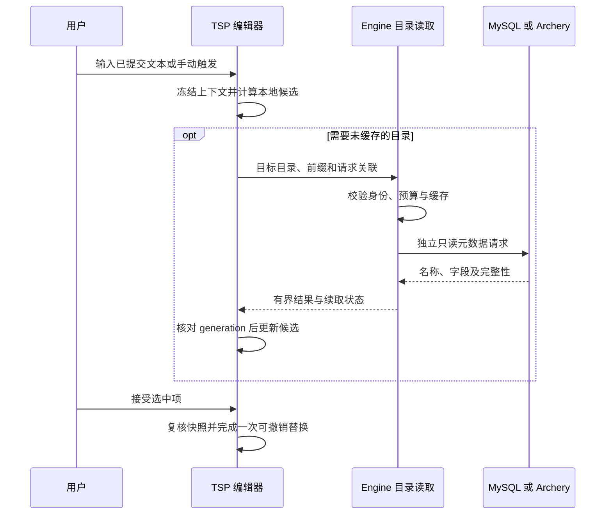

# Datapier 0.5.0 技术方案

## 1. 状态、依据与已确认范围

本文记录 **0.5.0 候选**的 SQL 补全、Tern MCP 自动登记、本机项目／环境与资源推荐、plugin 更新及 O1—O23 集成优化的契约与验收范围。候选代码使用 IPC v6 和配置 schema 6；实际验收见第 8 节。正式发布状态以 [GitHub Releases](https://github.com/huspx/datapier/releases) 为准。

依据为已确认范围、[产品规划](product-plan.md)、[贡献指南](../CONTRIBUTING.md)、[编辑器既有契约](technical-design-0.1.0.md#6-tsp-工作台与编辑器)及当前代码。SQL 补全分析真实表／视图与表别名，不推导 CTE／派生表字段；仓库、环境及实例／DB 关联保存在本机，不增加仓库声明文件或项目权限校验。

用户已确认将全部 Tern 优化清单纳入 0.5.0，包含原 P0—P3 的所有项目，不把低优先级项移至后续版本；随后接受自动更新建议，将 plugin 版本检查、可选自动下载与退出后自动应用正式纳入本版。优化覆盖、归属和完成标准见第 2.4 节，自动更新契约见第 5.5 节。

### 1.1 需求与验收目标

| 编号 | 已确认需求 | 可观察结果 |
|---|---|---|
| R1 | 直连 MySQL 与 Archery MySQL 查询编辑器 | 两种来源具有一致的候选选择和插入操作，保留各自元数据限制 |
| R2 | SQL 关键词、常用内置函数、数据库、表、视图和字段补全 | 根据输入前缀与语法位置提供相应候选，资源来自可访问目录 |
| R3 | 当前语句上下文、真实表／视图及别名 | `FROM` 后优先关系名，`u.` 后只展示该别名对应关系的字段 |
| R4 | 候选说明 | 字段展示真实类型和可用注释；函数展示用法与参数签名 |
| R5 | 自动提示及手动触发 | 输入后自动展示候选；编辑器具备手动触发入口 |
| R6 | 键盘与点击接受 | 方向键选择、Tab／Enter 接受、Esc 关闭，也可点击候选 |
| R7 | 保持编辑与执行行为 | 补全作为一次可撤销的本地文本修改，不自动执行 SQL，不破坏中文、emoji、选区和执行快捷键 |
| R8 | Tern plugin 自动登记 Datapier MCP server | 程序准备并校验成功后，以绝对路径向 `agents.mcp` 登记 stdio 启动项，agent 会话可发现既有工具 |
| R9 | 保留用户 MCP 配置与数据目录语义 | 不覆盖其他 server、用户禁用或自定义项；升级更新受管路径，多窗口不重复登记，MCP 与 plugin 工作台访问同一数据目录 |
| R10 | 本机项目及仓库关联 | 项目名称、说明和一个或多个仓库目录保存在 Datapier，不创建仓库声明文件 |
| R11 | 环境信息及资源用途 | 维护环境名称、类型、用途说明和可选默认环境；按环境引用已有 MySQL／Redis 连接及实际 database／DB |
| R12 | MCP 按当前仓库辅助发现 | 每个 client 根据自己的仓库上下文优先获得项目、环境和推荐资源；其他可访问资源仍可发现和使用 |
| R13 | 明确管理入口 | 主入口位于“项目 → MCP 项目”，连接右键提供“关联到项目…”快捷入口，编辑同一份本机关系 |
| R14 | 自动检查与手动检查正式版本 | 默认自动检查并提示，启动时检查且自动请求最多每日一次；设置中可关闭自动检查，仍可手动检查；跳过草稿、预发布和不高于当前版本的 Release |
| R15 | 可选自动下载、退出后自动应用与更新状态 | 两项默认关闭；启用自动应用须同时启用自动下载，已准备更新不覆盖运行版本；用户可查看检查、下载、校验、待退出、安装或失败状态 |
| R16 | 完整版本切换、并发保护与失败恢复 | plugin 与匹配二进制同版校验后，在旧客户端及 Engine 安全退出后切换；不强杀或覆盖活动 exe，保留旧包，更新受管 MCP 路径，schema 回退使用升级前备份 |

### 1.2 功能拆分与归属

本版包含四个核心功能：**F1：SQL 提示与自动补全**，从输入、查看候选到接受完成文本修改；**F2：Tern MCP 自动注册**，从 plugin 准备程序、登记启动配置到 Tern agent 连接既有 MCP 服务；**F3：本机项目与环境管理、MCP 资源推荐**，从仓库与环境关联维护到 agent 获取当前项目资源；**F4：plugin 检查更新与自动更新**，从发现正式版本、下载校验到安全切换及失败恢复。四项功能分别实现与验收，F4 复用 F2 的程序准备和受管 MCP 路径契约。

| 分类 | 内容 | 归属及方案落点 |
|---|---|---|
| 核心功能 | R1—R6 的提示、选择与插入 | F1，第 3 节 |
| 核心功能 | R8—R9 的自动登记、配置保护与 agent 接入 | F2，第 5 节 |
| 核心功能 | R10—R13 的本机项目、环境、资源用途和仓库发现 | F3，第 6 节 |
| 核心功能 | R14—R16 的版本检查、下载策略、安全安装及恢复 | F4，第 5.5 节 |
| 配套改动 | 词库、目录读取、Caret 候选；plugin 登记与生命周期、待办入口、批量桥接；项目快捷入口、临时预览及 Carly 导航 | F1，第 3、4 节；F2，第 5 节；F3，第 6 节；覆盖清单见第 2.4 节 |
| 兼容性处理 | 编辑器上下文；Tern host 设置、升级及多窗口；已有 Git 项目、本机绑定与无 roots 的 client；触屏长按 | F1，第 3、7 节；F2，第 5 节；F3，第 6 节；第 2.4 节 |
| 横切约束 | 既有权限、异步调度、预算、请求失效、国际化及配置所有权；可见性调度、节点复用、分隔布局、只读列表和长内容布局 | 第 2、4、5、6 节 |
| 回归范围 | R7 的编辑与执行；既有 MCP 权限、审批、stdio、Engine 生命周期及 Git 项目文件操作；第 2.4 节全部优化的真实 Tern 交互 | 第 8 节 |

本版不增加 AI 生成或整段续写、完整 SQL 语法诊断、CTE／派生表字段推导、用户存储函数发现、Redis 命令补全、普通终端查询编辑器或新的 MCP tools。结构设计正文和项目查询表单不自动纳入本版补全入口。现有高亮、语句边界提示和 Archery 上线 SQL 检查沿用原有职责。项目关联不增加仓库声明文件、环境文件扫描、项目级白名单或数据库授权。

## 2. 现状、取舍与模块边界

### 2.1 版本起点与影响面

下表记录 0.4.0 的版本起点及 0.5.0 补足方向；完成状态和验收结果分别以当前代码与第 8 节为准。

| 现有落点 | 版本起点 | 本版补足方向 |
|---|---|---|
| `datapier-tsp/src/editor.rs::completions` | 关键词与调用方资源名按前缀过滤、排序去重 | 类型化候选、语句上下文、限定名与别名、完整替换范围 |
| `datapier-tsp/src/query_ui.rs::panel` | 编辑区下方最多 8 个可点击候选 | 光标附近的候选列表、当前项、候选说明及键盘操作 |
| `datapier-tsp/src/runtime.rs` 的 `Msg::Complete` | 对当前活动查询按传入范围替换 | 冻结目标 tab／文本版本／选区，拒绝过期接受事件，恢复焦点 |
| MySQL `providers/mysql/catalog.rs` | 库表目录及完整结构读取 | 按前缀有界读取关系、按对象轻量读取字段 |
| Archery `providers/archery/catalog.rs` | 平台关系名称、字段类型和注释 | 复用平台范围校验、保留完整性，并避免为补全读取 DDL／索引 |
| Engine `server/discovery.rs`、`server/tasks.rs` | 目录缓存、任务路由与会话所有权 | 独立元数据执行上下文，避免补全等待或占用查询会话锁 |
| TSP `advanced/schema_reference.rs` | 请求关联、上下文失效处理 | 借鉴关联方式；不直接复用面向结构编辑的完整 describe 请求 |
| Core `model/project.rs`、`storage/transfer.rs` 的项目和绑定模型 | Git 项目逻辑连接、绑定组、profile 引用与 MySQL／Redis DB 覆盖 | 无 manifest 的本机项目登记、仓库关联、环境名称／说明和资源用途 |
| Engine `server/project.rs`、`server/mcp/catalog.rs` 与 MCP adapter | 项目 CRUD／绑定、全局授权资源发现 | client 独立仓库上下文及推荐元数据，不将项目关联接入授权判断 |
| TSP `project_workbench.rs` 及项目视图 | 项目工作台、本机绑定页和共享文件操作 | MCP 项目管理与连接快捷关联；项目文件入口保留原 Git 工作流 |

现有 `resource.list` 并非真正分页接口：MySQL 一次读取所选库关系；Archery 目录端点也没有已证实的服务端前缀／游标能力。完整 `resource.describe` 还读取 DDL、索引或视图映射，不适合在输入路径反复调用。

### 2.2 方案选择

SQL 补全选择 **TSP 本地上下文分析和候选计算＋Engine 管理轻量目录缓存＋provider 有界读取**。沿用现有 Rust crate、sqlparser 和 Tern 公开控件，不引入 SQL language server、外部服务或新的业务 crate。Tern MCP 自动注册使用公开设置接口，复用现有 `datapier mcp`，具体见第 5 节。本机项目与资源推荐复用已有连接引用和绑定语义，持久化扩展及 MCP 发现路径见第 6 节。

仅增强现有按钮无法解决字段及别名上下文；直接复用任务型目录接口又会与执行中的 SQL 排队。完整 SQL language server 增加进程、协议和方言维护成本，本版 SQL 补全不需要这条路线。

| 层 | 职责 |
|---|---|
| TSP | 编辑器与补全交互；项目、仓库、环境和资源关联管理及连接快捷入口 |
| Engine | 目录缓存与读取；本机项目存取、client 仓库上下文、推荐解析；继续统一执行既有权限，不以项目关联限权 |
| Core／provider | 元数据读取与方言语义；本机项目／环境模型、SQLite 持久化及连接引用；不增加项目权限规则 |
| MCP／TUI | MCP 沿用 23 个 tools，扩展发现响应及 roots 上下文；TUI 沿用现有配置入口，不新增项目查询界面 |
| Tern plugin | 准备并校验程序、合并 Tern MCP 启动配置、维护受管路径和登记状态、调度版本检查与更新；下载校验与安装切换交给有限原生子进程，不复制 MCP 协议及权限逻辑 |

### 2.3 共用约定

- 补全只修改编辑器草稿；候选不证明 SQL 合法、账号有执行权限或对象在执行时仍存在，服务端执行结果仍是最终依据。
- 只使用目录元数据，不抽样业务行，不将查询结果、编辑器全文或候选缓存写入本地持久化。内置函数词库随程序发布。
- 自动候选沿用工作台可见目录；显示范围不是数据库授权。Engine 仍校验真实会话所有权、连接版本及现有入口权限，provider 受数据库账号和平台权限限制。
- 原始对象名称、类型与注释保真；注释按普通文本展示，不解释为富文本或可执行内容。字段注释使用原文，UI 说明及函数用法支持中英文。
- 新能力通过公开 Tern 协议实现；SDK 有声明不等于实际按键、焦点、浮层或输入法行为已验证。
- 仓库／环境关联只决定推荐排序和用途说明，不授予、收回或限制资源访问；未关联资源继续按现有 MCP 权限可见和可操作。默认环境只是发现偏好，不自动执行或根据 Git 分支切换生产环境。

### 2.4 本版 Tern 集成优化清单

以下优化全部属于 0.5.0。O1—O16 保留原有功能契约，O17—O23 覆盖 Tern 0.9.23 之后的宿主能力，复用现有工作台、Engine 和更新策略。

| 编号 | 优化项与归属 | 实现边界及完成标准 |
|---|---|---|
| O1 | MCP 自动登记与 host 隔离；F2 | 核定设置写入的 host；本机程序路径不写入远端配置，受管记录按 host 与数据目录区分；保留用户配置并完成多窗口和真实 agent 验收 |
| O2 | Plugin 重载与子进程恢复；F2／共享启动 | 使用 `unload`、`process_exit` 处理跨重载存活的安装和桥接进程；重建状态后再消费结果，不重复启动、接受旧代结果或将丢失 callback 视为成功 |
| O3 | 光标附近 SQL 补全；F1 | 公开 Caret overlay、方向键、Tab／Enter／Esc、焦点及一次撤销，完整标准见第 3 节 |
| O4 | 待办原生状态与快捷处理；F2／审批认证 | 通过 OSC 7501 表达真实 waiting／working／终态，以非模态待办提示的“查看”按钮定位具体待办；宿主 toast 没有公开点击事件，不写入无效 action／label；审批权限及单一控制者规则不变 |
| O5 | 持续待办 Widget；F2／审批认证 | `tern.chrome.widget` 展示待审批／待认证数量，点击定位工作台；render 只读缓存，异步更新后 refresh，多窗口不重复消费待办 |
| O6 | 窗口桥接批量化；共享启动 | pane 事件维护候选，保留低频全量对账；一轮通过 stdin 将多项请求交给一个子进程，逐项返回结果，继续校验 nonce、pane、window、数据目录和租约 |
| O7 | 项目数据库快捷入口；F3 | Files 按钮从目录定位“MCP 项目”，保留 host 身份；无法映射到本机目录时明确报告，不按本机路径或仓库名称猜测 |
| O8 | 隐藏 pane 降低刷新成本；工作台 | 处理 `visible`，隐藏时减少非必要轮询与视图构造，恢复可见时同步；IPC 心跳、任务事件及写入终态仍及时处理 |
| O9 | 稳定 UI 子树复用；工作台 | 复用稳定导航、表头等节点及共享 clone，按真实变化更新；测量输入／状态更新路径，保持节点 key 和交互状态稳定 |
| O10 | 原生分隔布局；工作台 | 使用公开 `split` 统一编辑器／结果和 Redis CLI 比例调整；迁移并删除被替代的分隔实现，保留比例、最小空间和键盘操作语义 |
| O11 | 只读列表使用原生组件；工作台 | 在任务／历史等适用只读列表接入 table、menu、pager，保留排序、分页、选择和上下文操作；可编辑 grid 保留单元格、草稿及冲突语义 |
| O12 | 长内容布局优化；工作台 | 对 Redis CLI 记录和任务详情使用 `content-visibility`、固有尺寸及滚动锚定，验证定位、动态追加、复制与结果生命周期 |
| O13 | 删除手写 Base64；共享启动 | 桥接改用 `tern.base64`，移除重复编码实现；中文路径、换行及特殊字符往返不变 |
| O14 | 文件临时预览；F3 | 使用 `how = "glimpse"` 查看已保存查询文件和项目说明，Esc／外部点击关闭；不为预览额外落盘数据库结果，持久打开仍有原入口 |
| O15 | 触屏操作补齐；工作台 | 为资源和列表操作提供 `actions.hold` 长按入口，复用现有动作、禁用和确认规则；范围为本版支持运行环境的触屏交互，不增加 iOS／Android 原生二进制目标 |
| O16 | Carly 导航扩展；F2／F3 | 导出打开 Datapier、定位待办、查看当前项目关联状态的轻量导航；数据库操作仍走现有 MCP／Engine，返回内容不含凭据、结果行或另一套数据库接口 |
| O17 | 待办 Widget 卡片（0.9.27） | 展示已核对的审批和认证数量，分别定位既有分区；未知状态单独表达，命令面板提供对应的键盘入口 |
| O18 | 每窗口常驻桥接（0.9.24） | `tern.process.spawn` 通过逐行 JSON 串行交换有界批次，Rust 每轮复用现有绑定检查；请求超时、子进程退出和卸载收回子进程，丢弃旧代回执 |
| O19 | 原生 Diff（0.9.26） | 已有真实前后版本的项目文件、DDL、文本替换可逐行比较；长行横向滚动，实际待发送 DDL 与参数保持独立 |
| O20 | 项目文档（0.9.25／0.9.29） | 保留文件 Glimpse，Markdown 另提供只读并排预览和标题定位；代码块 Run 关闭。仍通过现有项目文件范围校验读取 |
| O21 | 自适应布局与滚动隔离（0.9.28） | 更新与设置区域保持宽屏双列／窄屏单列，参数列按内容收缩；SQL、结果与 Redis 日志各自处理滚动边界 |
| O22 | 布局过渡与预览恢复（0.9.27／0.9.29） | 待办列表使用稳定身份进行布局过渡，尊重 Reduce Motion；并排文档保留分隔比例，可在原 pane 上临时覆盖，关闭后由宿主还原原 pane |
| O23 | 自更新下载进度（0.9.24） | 现有原生更新器与安装器按插件 ZIP、程序归档分别报告实际接收字节。有可信总量时显示进度条和百分比，未知时只显示已接收量；校验通过才进入待退出 |

**宿主基线。** O1—O16 的历史开发基线为 Tern 0.9.23、Rust SDK 0.2.0；完整 O1—O23 要求 Tern 0.9.29 或更新，使用本机 Tern 0.9.30 验收，继续固定 Rust SDK 0.2.0。

**待办状态来源。** 原生程序状态、可点击待办提示和 Widget 共用 Engine 已确认的摘要与定位身份。存在需用户处理的待办时优先表达 waiting；其他状态依据存活任务和真实终态计算，单个任务完成不能遮蔽其他待办。点击只导航到已有处理入口，重新校验有效性、控制者和权限，不自动批准或认证。公开 toast 没有点击事件，提示使用非模态 overlay 与真实按钮；其它 dialog 打开时不覆盖其操作。window plugin 无窗口时不运行；OSC 7501 的 Inbox／banner、窗口提示和系统通知分别验收，不能互相推导。

**批量与重载。** 桥接以换行分隔请求和回执。每轮按编码后的 JSON 字节数拆批，每批最多 128 项、64 KiB，每窗口收到一批回执后才发送下一批。单项超限时记录对应 pane，其余项继续同步。每项绑定各自数据目录与 Engine；pane 迁移、事件遗漏或进程重建由下一轮对账补足。卸载停止桥接进程，释放本 VM 的计时器、订阅和在途标记；迟到回执须通过进程代次、nonce 和当前 pane 身份复核。业务数据不经窗口桥接传输。

**性能与组件切换。** O8—O12 分别保留修改前后同场景的耗时或刷新／节点构造计数，验证中文输入、分页、隐藏再显示、长记录定位及多窗口。性能收益由测量给出，不预填降幅。新组件必须完成原操作闭环后删除对应旧实现；不整体替换可编辑 grid。`typeahead` 不作为绕过 editor `mode` 约束的手段，`closable` 不跳过草稿和未完成任务保护。

依据为本机《Tern release notes》0.6.0、0.7.0、0.9.8—0.9.23 与公开 [窗口 API](https://docs.stencil.so/tern/reference/api-window.md)、[事件](https://docs.stencil.so/tern/reference/events.md)、[输入协议](https://docs.stencil.so/tern/protocol/input.md)及 [overlay 契约](https://docs.stencil.so/tern/elements/chrome.md#overlay)。release notes 证明能力及引入版本，不能替代 Datapier 接入后的真实运行证据。


### 2.5 既有数据交换工作台的目录选择

0.4.0 的导入导出、迁移与 SQL 备份恢复在本版统一改为真实目录下拉联动：连接、数据库、对象及字段依次选择，上游变化清除不适用的下游值。新建目标保留独立命名和列定义步骤；输入文件路径、筛选值及前缀转换仍是输入项。HTML 仅使用示例候选，原生运行独立验收。

Engine 提供内部 `transfer.catalog`：请求包含 `endpoint`、`provider`、`scope`（`databases`、`objects` 或 `columns`）、可选对象类型 `kind` 和字段目标 `target`，返回解析后的 `endpoint` 与原目录 `catalog`。直连复用迁移端点的类型及可见库校验；Git 项目沿用已确认逻辑连接与本机绑定，显示实际库但不将其写回共享配置。MySQL 使用独立短生命连接；目录包括表、视图、存储过程、函数、事件及触发器，正式准备仍重新检查定义和权限。

Redis 对象发现保留原 `resource.list` 扫描状态：继续读取同时携带 `session_id` 和 `cursor`，相同 UUID 表示同一扫描句柄，不表示游标停滞。会话校验客户端归属及冻结端点／配置指纹，客户端最多保留八个，五分钟到期、扫描完成或失败后释放；用户放弃时通过 `connection.close` 释放。关闭标签后无法消费的迟到结果仍受到期回收保护。

内部 `transfer.input.inspect` 仅预检指定 `TransferInput` 的元数据；CSV 沿用编码、分隔符与表头规则，无表头时把发现的位置列名写入 `csv.columns`；JSON 复用版本化流式读取器；SQL 复用完整预检索引并按真实库、名称与类型归并对象。返回列和对象，不返回数据行，不创建执行计划或写库。扫描持有客户端辅助预算并响应断连取消；正式准备重新验证输入。候选请求具有独立身份和上下文，迟到结果不能覆盖已切换的表单。

## 3. 功能1：SQL 提示与自动补全

### 3.1 功能说明

在 MySQL 查询编辑器输入 SQL 时，根据当前语句、光标所在位置、当前数据库和表别名展示候选。用户可继续缩小前缀、查看候选说明，使用键盘或点击将所选候选插入原位置。

| 输入场景 | 候选规则 |
|---|---|
| `SEL` | 匹配 `SELECT` 等关键词 |
| `SELECT COU` | 匹配 `COUNT` 等常用内置函数和当前表达式可用字段 |
| `SELECT * FROM us` | 当前库的表／视图优先；提供匹配的数据库限定入口 |
| `SELECT * FROM reporting.` | `reporting` 库中的关系，不混入当前库字段 |
| `SELECT u.na FROM users AS u` | 从光标后方的 `FROM` 识别 `u`，匹配 `users` 的字段 |
| `SELECT * FROM users u JOIN orders o ON u.` | 仅匹配当前作用域 `u` 的字段 |
| `INSERT INTO users (na` | 目标关系的可用字段名；不重复推荐已列出的列 |
| `UPDATE users u SET u.na`、`DELETE FROM users WHERE na` | 按目标关系及当前表达式位置补全 |
| 字符串、行注释及块注释内部 | 不展示 SQL 候选；反引号标识符内部仍可补全名称 |

Archery 不预取全库结构。单表表达式可按需读取该表；多表表达式中未限定的字段不发起逐表结构请求，输入明确的 `别名.` 后只读取对应关系。当前使用 `GET instance/instance_resource/` 获取名称，以及 `POST query/` 执行目标对象的 `SHOW FULL COLUMNS`；不调用会额外获取 DDL 的 `describetable`，也不调用同时获取表元数据、字段、索引和建表 SQL 的数据字典 `table_info`。尚未确认符合现有权限契约的批量字段接口，不能以逐表 fan-out 模拟批量。

### 3.2 实现要点

**上下文分析。** 分析光标所属语句的完整文本，包含光标之后的 `FROM`／`JOIN`，不只截取光标前缀。复用已有 SQL 词法与 UTF-16 转换规则，但补全的容错分支独立于执行边界判定：不能为支持输入中的未完成 SQL 放宽执行检查。采用 token 作用域扫描，在不完整语句中识别 SELECT 表达式、FROM／JOIN 关系、限定字段、WHERE／ON、INSERT 列表及 UPDATE SET 等位置；完整 AST 可辅助确认，解析失败不直接清空所有静态候选。

只把当前作用域中明确的真实关系映射为字段来源。别名支持 `AS` 和省略 `AS`；处理反引号、跨库名称、多表 JOIN、自连接及大小写规则。不同数据库／关系的同名字段保留来源，必要时插入限定名。CTE 名称和派生表别名须识别为不可推导来源，禁止误映射到同名真实表；不支持的作用域保留可确定的静态候选，不借用外层或其他语句的字段。存储程序、复杂嵌套、临时表和会话未持久化对象不承诺字段补全，不能把“不提供候选”写成 SQL 错误。

直连使用查询会话最近已确认的 `sql_mode`、数据库、服务端版本及 `lower_case_table_names`。SQL 执行可能改变会话上下文时先使相应快照失效，终态后随现有连接信息刷新恢复；不为每次击键向查询会话发送 `connection.info`。Archery 为无状态来源，未知 SQL 模式按现有无状态共同子集保守识别；不能假定与直连默认模式相同。

**词库与匹配。** 关键词和常用内置函数使用静态类型化词库。首批覆盖聚合、字符串、数值、日期和 NULL 处理，例如 COUNT／SUM／AVG／MIN／MAX、CONCAT／SUBSTRING／LOWER／UPPER、ABS／ROUND、NOW／DATE_FORMAT、COALESCE／IFNULL。每个函数记录签名、简短说明和已知最低版本；已知不支持的函数不推荐，版本未知时仅推荐支持矩阵的共同子集。函数接受只插入函数名，不自动添加括号或参数片段。

优先按语法位置限定种类，再按精确前缀、大小写无关前缀及稳定名称排序。关键词与函数大小写无关匹配；资源保留服务端大小写和身份，不能使用当前的大小写无关全局去重合并两个不同对象。相同字段在多表场景按来源区分。没有前缀时仅手动触发或 `.`、FROM／JOIN 等明确上下文触发展示，不在每个空格后弹出全部候选。

**候选和替换。** 候选至少包含 kind、显示名称、限定来源、插入文本、说明和 UTF-16 替换范围。范围覆盖光标所在完整标识符 token，包含光标后的未完成后缀，保留 `db.`／`alias.` 等外部限定；正确处理已有成对或未闭合反引号。资源名按 MySQL 反引号规则插入并转义内含反引号，不能把显示文案作为 SQL 插入文本。

字段说明展示真实类型、所属库表及可用注释；缺少注释不伪造。Archery 未提供关系类型时标为“对象”，不假标为表或视图。显示说明可有界截断并明确标记，名称不得被截断后用于插入。

接受事件绑定 `tab_id + editor_revision + context_generation + replacement_range + expected_text + candidate_id`；接受前再次核对当前光标和选区。任一条件变化则关闭旧列表，不向当前活动 tab 套用旧范围。一次接受通过现有 Editor 修改形成一次撤销记录，折叠选区并将焦点返回稳定的 query editor 节点。

### 3.3 交互流程

1. SQL 编辑器获得焦点，非空选区时关闭自动候选；输入完成后重新计算词法位置和前缀。
2. 静态及已缓存候选立即参与计算。缺少目录时防抖异步请求，列表显示局部加载状态，继续输入不等待网络。
3. 优先使用非模态 `overlay` 和公开 `Anchor::Caret` 将候选放在 query editor 光标附近，显示当前项、种类、名称及当前项说明；窗口边缘可重定位，长列表在自身区域滚动。
4. 候选打开时，上／下键切换当前项，当前窗口末项继续按下键浏览后续候选，必要时读取目录续页；自身滚动区保持当前项可见。Tab 或不带修饰键的 Enter 接受，Esc 关闭。Command／Ctrl＋Enter 仍走 SQL 执行，不接受候选；Shift＋Enter 保留原有编辑行为。列表关闭或无可接受项时，按键回到原编辑行为。
5. 手动触发使用 Ctrl＋Space，并在编辑器提供具名菜单“SQL 补全”以应对系统输入法占用。帮助中说明实际可用键位；系统快捷键冲突不影响菜单触发。
6. 点击候选与键盘接受共用同一校验与插入路径。失焦、Esc、切 tab、切连接／数据库、执行开始或选区变化关闭当前列表。Esc 后同一文本和光标状态不因迟到响应重新打开，新的输入或手动操作才触发。
7. 中文输入法组合与选字优先由宿主管理；只在已提交文本上触发候选。不得用字符内容或超时猜测 IME 状态后抢占 Enter／方向键。



上述键盘、光标锚定和 IME 行为需按真实 Tern 逐项验收；已观察到候选出现、接受和一次撤销，不能据此推断完整按键、焦点、滚动及输入法矩阵通过。

### 3.4 依赖与契约

| 能力 | 契约 | 关键内容 |
|---|---|---|
| 文本修改 | 现有 `Editor::edit`、UTF-16 转换、应用 undo | 范围有效且快照仍匹配；只写本地文本 |
| UI 事件 | 现有 edit／undo／focus 与查询快捷键路由 | 候选开启时按键有唯一处理方，IME 组合期不抢键 |
| 目录读取 | 内部 `completion.catalog`，见第 4 节 | 不传 SQL 全文，名称与字段按需读取 |
| 目录失效 | 现有 `schema.changed`、连接关闭、配置版本、认证变化 | 推进 generation；旧结果和旧接受事件不可生效 |
| 会话上下文 | 现有 `connection.info` 的已确认快照 | 直连使用真实会话模式；Archery 模式未知时保守处理 |

### 3.5 测试注意项

本功能按 R1—R7 验收。特别覆盖光标在标识符中间、反向选区、反引号内空格或特殊字符、中文和 emoji、SELECT 前缀位于 FROM 之前、多表同名字段、自连接及两个真实对象仅大小写不同的情况。CTE／派生表不得产生同名真实表的错误字段；元数据为空、拒绝或不完整时保留真实状态。

真实 Tern 中验证自动与菜单／快捷键触发、键盘和鼠标接受、说明区、滚动和窗口边缘、焦点及一次撤销。输入法选字不误接受，Enter 不既换行又插入，执行快捷键不重复执行。具体矩阵与命令见第 8 节。

## 4. 元数据读取、调度与缓存契约

### 4.1 内部接口

新增内部只读 RPC `completion.catalog`，只服务本版 TSP 查询入口，不自动成为 MCP tool。Engine 从已有会话取得 owner、profile、认证与目录执行上下文，并在请求开始、返回和缓存命中时校验其有效性。

| 方向 | 字段 | 约束 |
|---|---|---|
| 请求 | `session_id`、`editor_id`、`request_id`、`context_generation` | editor_id 为稳定 tab UUID；关联调用方与上下文，每次请求递增 generation，不能代替 Engine 身份校验 |
| 请求 | `scope`：databases／relations／columns | 类型化目录种类；relations 必须带 database，columns 另带 relation |
| 请求 | `prefix`、`cursor`、`limit` | 有界前缀过滤；游标绑定身份、scope、目标、前缀与缓存 generation |
| 响应 | `request_id`、`context_generation`、`catalog_generation` | TSP 拒绝过期响应；分页不可混用不同目录快照 |
| 响应 | `items` | 原始名称、已知对象类型；字段附类型和可用注释，不含数据行／DDL／索引 |
| 响应 | `completeness`、`next_cursor`、`reason` | 区分完整、不完整、未知；游标仅表示可继续读取，不能证明上游完整 |

`completion.unsubscribe` 携带 `session_id`、`editor_id` 和 `request_id`，仅取消该编辑器对应请求；旧取消迟到不影响新订阅。

候选使用 IPC v6，避免旧 Engine 与新客户端混用。SQL 补全本身不新增持久化字段；本机项目与环境管理使用配置 schema 6，见第 6.2 节。

### 4.2 Provider 读取

**直连 MySQL：** 从 `information_schema` 按库、前缀和稳定名称游标读取库／关系及指定对象字段。使用绑定参数，前缀内 `%`、`_` 等按字面量处理；分页排序与游标比较使用一致语义，保留不同大小写的真实身份。每次取 limit＋1 判断续页，按字节预算封口。字段读取仅包含名称、类型、顺序和注释，不触发完整 schema／可更新视图证明。

**Archery：** 复用当前实例与已选数据库范围、平台资源发现和受控只读查询。关系目录按库缓存平台一次响应，字段按用户当前明确目标缓存单表 `SHOW FULL COLUMNS` 响应；两者均在本地过滤前缀与分页，继续输入不重复向平台取同一份字段。缓存绑定会话、profile revision、认证代次、库／对象和 generation，最多保留 60 秒，结构／认证／配置变化时失效。多表未限定字段不触发逐表读取，不在输入路径调用 `describetable`／数据字典 `table_info`，不额外读取 DDL／索引。平台截断、脱敏或未知完整性传递到候选说明；缓存未完整加载时不能将一次无匹配写成对象不存在。处理前检查上游响应大小；本地分页不代表上游支持分页，也不掩盖单次响应超限。

### 4.3 独立执行与生命周期

目录请求不经当前持有查询 `db.session` 锁的长任务路径，不取得结构写入 gate 后再等待网络。连接创建或认证上下文准备也不得等待执行中的查询；从注册会话的不可变身份与可独立使用的 provider 上下文获取元数据连接／HTTP 请求上下文，执行期间不持 Engine 全局锁。

直连目录连接沿用连接认证、TLS 和超时配置，但不共享查询 tab 的事务、临时表或会话变量。Archery 使用已就绪的共享认证；自动补全遇到认证过期仅显示不可用，不因击键弹登录窗或重放查询，用户从已有认证入口恢复后再显式触发。独立连接不放宽目标校验或只读约束。

同一目录键的并发请求合并，同一编辑器只保留最新订阅。取消某个 tab 的订阅不取消其他订阅仍需要的读取；最后订阅离开、超时或会话关闭时取消并清理。关闭连接后禁止借补全重新建连。返回前再次校验 profile revision、认证代次、会话存活和目录 generation，失效结果不进入可用缓存。

### 4.4 缓存与性能预算

以下为首版实施预算和验收目标，尚无测量结果；实现须计入 Engine 既有辅助内存总预算。

| 项目 | 首版设计值 | 超限或失效行为 |
|---|---|---|
| 自动元数据请求防抖 | 150ms；本地词库及已缓存匹配不等待 | 合并连续输入，只请求最新上下文 |
| 显示候选／单页目录 | 列表最多 50 项，目录每页最多 200 项且响应最多 256KiB | 提示缩小前缀；有合法续页时按需读取 |
| TSP 局部工作集 | 每 UI 最多 2MiB | 丢弃旧目录副本，保留当前可见候选；不复制整个实例目录 |
| Engine 目录缓存 | 单个连接身份最多 8MiB，Engine 合计最多 32MiB | LRU 淘汰；单对象／响应无法容纳时报告受限 |
| 并发目录读取 | 每连接身份最多 2 个，Engine 总计最多 8 个 | 有界排队并合并相同请求；旧订阅取消 |
| 元数据等待期限 | 默认最多 3 秒，同时受连接更短超时约束 | 取消读取并报告超时，不自动循环重试 |
| 缓存有效期 | 最多 60 秒，另支持现有结构刷新入口显式失效 | 过期结果不作为新候选继续推荐；按需重取 |
| 热缓存候选计算目标 | 1MiB 编辑文本、1 万关系目录场景 P95 不高于 20ms | 以实测调整局部计算；不把网络等待算成本地计算 |

缓存键包含来源、profile ID／revision、认证代次、可见范围、数据库、scope、目标对象及过滤／分页条件；字段按对象懒加载，不预取全库所有列。Engine 持有目录缓存，TSP 仅持当前所需页和候选。schema.changed、手动刷新、认证退出或更换、配置修改和会话关闭使相关项失效；外部 DDL 或权限变化通过有效期与显式刷新发现。空结果仅在完整响应内说明本次无匹配，错误不得缓存成空目录。

## 5. 功能2：Tern MCP 自动注册

### 5.1 功能说明

安装并加载 Datapier 的本机 window plugin 后，异步准备对应版本的程序；下载、摘要与版本校验成功后，自动将 Datapier stdio server 登记到 Tern 的 `agents.mcp`。用户在 Tern 支持的 agent 会话中使用现有 23 个 MCP tools，无需手工复制缓存中的程序路径，也无需先打开 Datapier 工作台。

登记属于运行 Datapier 的本机 host 设置，agent 会话及适用范围由 Tern 管理；不能笼统视为所有 host 共用的全局配置。配置写入不等于服务已启动、MCP 握手成功或数据库已连接；这些状态分别验证和报告。普通终端及其他 MCP client 的手工配置方式沿用现有契约。

### 5.2 实现要点

**注册时机与落点。** `plugins/datapier/window.luau` 的窗口初始化路径调度异步 `bootstrap.prepare`，复用等待队列和安装校验，不在窗口 UI 线程执行下载。准备成功后由 `plugins/datapier/lib/mcp_registration.luau` 合并配置；`bootstrap.start` 成功准备程序时也走幂等登记路径。登记失败保留工作台启动能力并显示原因；显式启动工作台或 plugin 重载时可重新尝试。

程序启动与自动登记统一服从第 5.5 节的数据目录更新门禁。安装重载后的新 VM 可以准备、校验候选程序，但在更新提交或回滚完成前不能执行 `bootstrap.start`、发布受管 MCP 路径或启动业务 Engine；核对更新身份与代次后再恢复幂等登记，不能仅凭 `prepare` 成功解除保护。

**条目与数据目录。** 固定名称为 `datapier`，`transport = "stdio"`，`command` 使用准备成功后的 `bootstrap.executable()` 绝对路径，`args` 为 `mcp` 的独立 argv。路径不拼成 shell 命令。原生程序解析并返回绝对数据目录，工作台启动及受管 MCP 环境均使用同一解析后的目录，即使新终端继承的环境不同也保持一致；不复制整份进程环境或写入数据库凭据。

**配置合并和所有权。** 通过公开 `cx.settings:get/set("agents.mcp")` 读写，不直接修改 `settings.json`。每次实际写回前重新读取并合并最新列表，未发生变化则不写。其他 server 的全部字段和顺序保留，Datapier 条目的 `enabled = false`、`agents` 过滤及用户额外环境字段保留。

Tern 0.9.11 起支持按 host 保存 agents／MCP 设置。实施前在本机窗口、远端 tab 及多 host 场景核定 `cx.settings` 的实际读写归属，只对明确属于本机运行上下文的设置登记本机程序。当前焦点、远端 cwd 或相同 server 名称不能替代 host 身份；无法确定归属时报告原因且不写入。受管记录同时绑定已确认 host 和数据目录，不能跨 host 搬运已校验路径。

在 plugin 自有 `tern.kv` 保存上次受管条目的启动字段，用于区分自动登记和用户自定义。无同名项时追加一项；同名项与上次受管启动字段一致时，只更新本次校验的程序路径及受管数据目录。没有受管记录的同名项，或用户已改写 command／args／transport／数据目录的条目，均保留原配置并说明冲突，不按名称强行接管。已有重复同名项时停止本项自动更新，不删除或重排用户条目。

设置写入成功并读回确认后才更新受管记录；失败不记录为成功。多窗口或重载时合并为同一个条目，不在异步准备前保存整份旧列表后直接覆盖。不同数据目录或版本的窗口不得来回抢写同名受管项；发现当前登记属于另一运行上下文时保留并提示核对。实施时验证 Tern 跨窗口设置同步的实际行为，不能以单窗口幂等代替多窗口验收。

**权限与生命周期。** 注册沿用 Engine 现有 MCP 可见范围、连接模式、细粒度权限、认证和审批；不添加扩大权限的参数或修改用户数据库授权。Tern 负责启动、stdio 和 agent 断开；Datapier 沿用 MCP client EOF 释放所属 Engine 会话的路径。plugin 不自行常驻启动一份 MCP server，也不将 stdio 输出接入 TSP pane。

停用或卸载 plugin 不视为撤销已持久化的 MCP 设置；用户可从 Tern 的 MCP 配置禁用或移除条目。升级后对受管条目更新已校验的程序路径；回退时也须核对该路径和数据目录，不保留指向已删除缓存的可用状态。已有 agent 会话是否热更新尚未验证，未证实前以新建或重新连接会话作为验收入口。

自动登记仍为一份通用 server 配置，不为每个仓库复制条目或把某个窗口当前项目写入全局 args。仓库及环境推荐由各 MCP client 在连接后独立解析，见第 6 节。

### 5.3 依赖与契约

| 能力 | 契约 | 边界 |
|---|---|---|
| Tern 设置 | `cx.settings:get/set("agents.mcp")` | 带名称的数组；stdio 支持 command／args／env，另有 enabled 和 agents 过滤；不清空其他项 |
| 程序准备 | `bootstrap.prepare`、`bootstrap.executable()` | 必须取得本次校验成功的绝对路径，失败不新增或更新可用启动项 |
| 受管记录 | plugin 自有 `tern.kv` | 只记录启动字段及登记状态，不保存凭据，不取代当前 Tern 设置 |
| MCP 启动 | 现有 `datapier mcp` 与 `DATAPIER_DATA_DIR` | stdout 专用于 MCP；不新增 MCP tools 或另一套数据库执行入口 |
| 能力与版本 | 0.5.0 基线为 Tern 0.9.23／SDK 0.2.0；0.9.22 已完成隔离设置读写调查 | host 归属、多窗口及真实 agent 接入仍须验证，不将旧调查扩大为当前端到端通过 |

Tern 的 [Window API](https://docs.stencil.so/tern/reference/api-window.md)提供公开设置读写接口。此前在独立数据目录的 headless Tern 0.9.22（`3fd4def`）中通过真实 `cx.settings` 写入并读回 stdio 条目；该调查仅证明设置能力，不能代替当前自动登记的真实 agent 握手、工具调用和热更新验收。

### 5.4 测试注意项

R8—R9 必须覆盖首次加载即可登记、重复加载／多窗口只有一个条目、缓存路径升级、空格／中文及 Windows 路径、安装校验失败、设置写入失败、缺少设置能力、已有同名用户项和重复项、用户禁用及 agents 过滤保留、自定义数据目录一致性。另按 O1 验证远端 tab、多 host、窗口焦点切换和跨 host 同名项不会写错配置；按 O2 验证安装中重载、daemon 升级及过期子进程结果。接着在真实 Tern agent 会话观察 initialize、tools/list 与受授权的 tools/call，以及退出后所属 MCP／Engine 资源释放。

真实端到端验证不能仅用 headless 设置读回代替；需记录 agent 类型及版本，确认其支持 Tern 下发的 MCP 配置。自动登记不得改变其他 server 的字段或用户原有数据库权限，也不得把“已登记”显示为“已连接”。

### 5.5 Plugin 版本检查与自动更新边界

**当前实现。** plugin 准备固定版本的匹配程序并校验缓存，同时提供正式 Release 检查、可选下载及退出后安装流程。macOS 实现自动安装切换，非 macOS 拒绝自动切换；从 0.4 首次升级须手工备份及安装。开发安装不自动覆盖。完整更新流程的运行证据按第 8 节报告。

Tern 官方[分发与版本文档](https://docs.stencil.so/tern/guides/distribution.md#versioning)明确说明：宿主只展示 plugin manifest 版本，不比较版本，没有 update 命令。正式 plugin 更新方式为下载新 Release 的 plugin zip、解压后执行 `tern plugin install /path/to/datapier --force`。这会替换已安装副本并触发重载；linked 开发目录不能用 `--force` 覆盖，`reload` 也不拉取远端文件。源码目录不含正式发布摘要清单，不能把直接安装默认分支当成正式 Release 更新。

**F4 功能说明。** Plugin 版本检查与自动更新已由用户确认纳入 0.5.0，按 R14—R16 实现。默认自动检查并提示；自动下载、退出后自动应用均为可选设置且默认关闭，启用自动应用须同时启用自动下载。`DATAPIER_BINARY` 及 linked 开发模式明确显示为开发安装，不自动下载或覆盖源码与本地程序。

**检查与设置。** 在“全局设置 → 更新”独立标签提供策略、手动检查和当前状态。策略使用共享 footer 保存，Engine 设置和本机 plugin 策略仍由各自存储负责；同时修改时先确认 Engine 保存，再提交 plugin 策略，后段失败保留更新草稿并显示原因。切换标签保留草稿，关闭与重新加载沿用全局草稿保护。启动时异步调度，自动检查间隔至少 24 小时；手动检查不受该间隔限制，仍遵守服务器限流。记录最近尝试、成功时间、ETag 和正式 Release 身份，多窗口共用检查状态。网络失败或限流保留当前程序，展示原因与下次可检查时间。只接受已公开、非 prerelease、版本更高且附件完整的正式 Release，按三段数字比较版本。

**下载与校验。** 发现更新后可手动下载，启用自动下载时在后台准备。Rust 逐块下载同一正式 Release 的插件包与平台程序归档，核对附件 SHA-256，随后由发布包内置安装器复验固定归档成员、程序摘要和 `--version`。准备阶段使用暂存目录及版本化缓存，当前客户端继续使用已启动版本。任何校验失败均报告原因并结束准备。

**下载进度。** 手动和自动下载使用同一更新器。进度只描述当前附件的网络传输，分段展示插件包与程序包，不将两个不同大小的阶段合并猜测。传输结束后明确切换到校验，只有现有校验链通过才显示已准备。已知总量缺失时仅展示累计字节；下载进行中工作台继续可用。

**切换与并发。** 安装由 plugin VM 之外的有限更新进程协调。按本机 plugin 安装目录取得的排他更新锁只负责串行化安装；另以受影响数据目录内、受 OS 锁保护的持久更新阶段记录约束支持更新协议的启动入口，记录更新身份、所有者代次、目标版本、阶段及备份位置。该门禁独立于 Engine 进程及 window VM，但不能约束未实现该协议的 0.4.0 独立 CLI／MCP。对这些旧候选进程，实际保护来自原有 `engine.lock` 的连续排他持有；必须先证明实例锁可无空窗交接，不能由门禁文件或内存租约替代。后台“已准备／待退出”不设阻断门禁，现有使用继续；准备实际切换时按以下顺序交接：

1. 冻结目标包及受影响数据目录；有存活源 Engine 时核对其更新协议与连续锁交接能力，无 Engine 时直接取得实例锁，不为能力检查启动旧实例；再建立各目录的启动门禁。TSP／TUI／MCP、直接 Engine 和打开 Store 前的入口受门禁约束；门禁不约束 0.4.0 程序。
2. 有存活 Engine 时，通过受限更新控制通道原子复核业务 client、任务和事务已清空并完成业务资源收尾；更新控制通道本身不计作业务占用。源 Engine 在锁交接确认前继续持有原实例锁，不能先退出或解锁再让更新器重试抢锁。仍有其他使用者、草稿保存失败、源 Engine 不支持交接或平台缺少已验证的交接方式时，不执行备份、安装或自动切换，释放本轮门禁并回到“待退出／需手工更新”，保留检查和下载能力。不强杀、不静默断开 MCP。
3. 源 Engine 与更新器完成交接时，原 `engine.lock` 对同一文件对象的排他状态必须连续：更新器确认其有效锁所有权后，源 Engine 才可结束自己的锁持有并退出；任何时刻不得出现两者均未有效持锁的区间。句柄可复制不等于锁可移交，Unix 与 Windows 必须分别证明实际锁语义；普通 unlock／close 后 reopen／try_lock 不算无空窗交接。Engine 已退出或原本不存在时，更新器先直接取得原 `engine.lock` 排他锁并复核目录状态，取得前不声明进入受保护阶段；旧候选抢先持锁则停止本轮切换。只有锁控制权已确认且源 Engine 已安全退出后，才执行一致备份、安装和校验，并持续持锁至提交或回滚完成。整个过程不得删除、重建或替换该锁文件，也不得通过目录整体替换／备份恢复改变其文件身份。
4. 在目录仍受保护时执行 `tern plugin install ... --force`，校验新 plugin 的实际窗口加载结果和匹配程序。新 VM 可运行不连接业务 Engine 的程序准备／摘要／`--version` 校验，但 `bootstrap.start`、业务 Engine 启动及受管 MCP 路径发布必须等待本轮提交；不能因安装触发重载就提前对外使用新版本。
5. 所有目录与安装结果核对成功后持久化提交阶段，再移除阻断并释放实例锁和更新锁，交还新版本正常启动权，随后按 O1 发布受管 MCP 路径。回滚完成时按同一顺序交还旧版本；迟到 VM／子进程事件必须核对更新身份与所有者代次，不能提前解除门禁。不覆盖活动 Windows exe，也不借更新重放数据库操作。

**能力与旧版阻断边界。** 连续持有原实例锁可以使遵守既有 `engine.lock` 的 0.4.0 Engine 候选在打开 Store 前失败，但不能阻止旧 CLI 进程启动或尝试 spawn，也不约束绕过锁的程序。更新提交并释放实例锁后，不承诺永久禁止旧程序再次尝试启动；仍需退出旧 client 并移除其旧 MCP／自动启动配置，IPC／schema 检查不代替安装期间的锁保护。0.4.0 源 Engine 没有本版交接能力，不能被描述为可原位自动升级的起点；首次进入 0.5.0 仍按手工升级流程处理。自动切换须按实际握手能力及平台运行证据启用，版本号、PID、短期无占用观察或“重试后拿到锁”均不能作为连续交接证明。未证明安全性的组合明确显示“更新已准备，需手工更新”，不能标为自动更新验收通过。

自动应用关闭时，准备完成后由用户显式选择“退出后安装更新”，仅持久化本次候选的安装意图，客户端仍可继续使用。Ctrl+Q 返回 shell 或关闭 pane 后，由 plugin 重新检查原生状态；存在其他业务客户端时保持等待，满足退出与备份条件后才安装。候选版本或摘要改变时清除旧意图，不能自动安装用户未选择的新候选；自动应用开启时沿用相同的安全检查。安装成功、更新阶段提交和 MCP 路径登记分别报告，MCP 配置发布失败不伪装为已连接，也不在可能已迁移数据后盲目回退程序。配置写入成功不代表旧 agent 已热更新，需新建或重连会话。

**状态与恢复。** 区分未检查、检查中、已是最新、发现更新、下载中、校验中、已准备／待退出、安装中、安装成功及失败，并显示当前和目标版本；缓存键绑定 host、Release／附件身份和目标平台。多窗口共用一个安装所有者，plugin reload 或 daemon 升级后重新核对锁、持久阶段和候选文件，不依赖旧 callback 或旧“已准备”标记继续安装。所有者失联或租约到期不能直接删除门禁。进程异常退出会释放其 OS 锁，持久门禁对 0.4.0 无效，因此不得声称故障后仍连续阻断旧版；恢复进程必须重新取得原实例锁、核对实际文件及数据状态并推进新代次。发现旧版已重新占用、无法排除中间写入或不能证明恢复条件时，停止自动安装／提交／数据恢复，保留诊断并要求受控手工处理。只有确认状态后，变更前阶段才可撤销，文件替换阶段才可验证候选并完成提交或恢复旧包；无法确认时明确报错。支持新协议的启动入口引导或调度同一有限恢复流程，不自行启动业务 Engine；恢复动作重复执行必须幂等。

失败保留可运行旧包、旧缓存与诊断，安装尚未迁移用户数据时可恢复旧 plugin；数据目录如已升级到 schema 6，必须在全部受影响进程退出、恢复进程持有目录排他控制时恢复升级前一致备份，再切回旧程序，不能将文件级回滚视为 schema 回滚。恢复受管 MCP 路径时仍保留用户禁用、自定义项和其他 server。

**依赖与测试注意项。** F4 复用 `bootstrap.prepare`、安装器、O1 的 host／MCP 所有权、O2 的跨重载恢复和 Engine 实例锁／生命周期。更新调度、有限更新入口和数据目录保护不增加 MCP tools。检查策略、校验、并发、活动 client、备份失败、重载及 schema 回退均须在隔离发布源、plugin 目录与数据目录中验证；非 macOS 不执行自动切换。


## 6. 功能3：本机项目与环境管理、MCP 资源推荐

### 6.1 功能说明与入口

全部关联信息保存在 Datapier 本机：仓库目录关联项目，项目包含多个环境，每个环境引用多个已有连接及其 MySQL database／Redis DB，并可保存用途说明。多个仓库、clone 或 worktree 可以关联同一项目；同一实例也可供不同项目引用不同 DB。无需创建 `datapier.project.json`、修改 `.gitignore` 或向仓库写入任何环境声明。

主入口沿用侧栏“项目”，工作台顶层区分默认的“MCP 项目”和“项目文件”。MCP 项目以平面列表选择项目，主区首先展示项目名及全部仓库路径，路径可折行与复制；描述降为次要信息。项目、环境和关联的辅助操作使用具名 icon，环境使用下划线 tab，当前环境清单按实例、实际 DB、用途和失效状态对齐。新建／编辑／设置使用独立 dialog；选择实例后异步加载真实数据库选项，显示加载、失败重试、空列表及不可用旧值，切实例或关闭后丢弃迟到结果。仓库列表与新增步骤在同一设置 dialog 中切换，不嵌套 modal；保存、取消、移除及默认环境动作沿用 revision 和权限契约。

连接及数据库右键提供“关联到项目…”快捷入口，带入当前连接及已选 DB，选择项目和环境后写入同一份关系。“项目文件”保留 Git 项目的概览、连接映射、查询、布局、迁移预设、保存差异、冲突恢复与归档；MCP 项目不展示 Git 保存 footer。本机项目和环境信息不因普通编辑或发现自动写回共享文件。

### 6.2 本机模型、持久化与兼容

MCP 环境资源以项目、环境、已有 profile 和实际 database／redis_db 的自然身份表达，不要求额外别名；不复制实际连接或凭据。Git 项目文件的逻辑连接映射继续使用原有语义。模型如下：

| 对象 | 关键字段及不变量 |
|---|---|
| 本机项目登记 | 稳定 UUID、名称、说明、可选 default_environment_id、revision；不依赖 manifest 存在，默认环境必须属于本项目 |
| 仓库关联 | project_id、规范化根目录、目录身份、revision；同一规范根只关联一个项目，一个项目可关联多根；目录搬迁后显式修改关联 |
| 环境 | 稳定 UUID、project_id、名称、类型、用途说明、revision；同项目内名称唯一，可使用 dev／test／staging／prod 或自定义类型 |
| 环境资源 | 环境内按 profile 与实际 database／redis_db 区分，保存可选用途 description；同一实例可关联不同 DB |
| client 发现上下文 | roots、可选显式环境、来源与 context_revision；只保留运行期，不保存为 Engine 全局“当前项目” |

本机存储由 schema 5 升为 schema 6：新增项目登记、仓库关联、环境及资源关系，以环境、连接和数据库约束资源身份。迁移须保留现有 project_bindings、绑定确认和 Git 项目数据；既有自由名称 binding_group 不猜测其环境类型，也不自动把共享项目转换成本机项目。

关联既有 Git 项目时通过已有项目身份复用绑定语义；新建本机项目由本地登记分配 UUID。Git 文件执行仍使用原目录及绑定确认规则；纯本机资源推荐不要求打开 manifest，也不增加数据库执行确认。跨窗口编辑沿用 expected_revision 冲突检查；删除关联仅删除本机关系，不删除数据源、仓库目录、数据库或凭据。连接删除或身份变化后，资源显示引用失效，不按同名连接重新绑定。

项目、环境及资源用途作为用户文本保存和返回；不自动解析 `.env`、应用配置或密码文件，不把环境说明当作数据库权限。地址、账号、TLS 和秘密继续由现有连接管理持有，本机关系及说明不进入 Git 项目导出与归档。

### 6.3 MCP 仓库识别与推荐规则

每个 MCP client 优先读取其支持的 MCP roots；roots 更新时推进本 client 的 context_revision。对于不提供 roots 的 client，可用 `datapier mcp --project-root PATH` 显式指定启动上下文，可重复指定根；`--environment NAME` 指定本次发现偏好。未提供可靠上下文时报告“仓库上下文未知”，不把 MCP 进程或 Tern 自身工作目录认定为 agent 当前仓库。

只处理可映射到本机目录的 roots：规范化后按完整路径组件匹配本机仓库关联，子目录选择最深的已关联根；不能按字符串前缀、仓库名称或 Git remote 相同猜测关系。远程 URI、本机无法访问的路径、搬迁或身份已变化的关联返回相应未解析原因，不遍历整个磁盘或修改仓库。一个 client 有多个仓库时分别分组，不任取第一个作为唯一当前项目。

环境优先级为 client 显式指定、项目默认环境、列出全部可用环境。未知环境或未设置默认时说明实际状态，不静默选择生产环境。多项目中同名环境分别解析；没有对应环境的项目保留“环境未匹配”说明。环境选定仅影响推荐，不改变已打开数据库会话、执行目标或全局工作台选择。

推荐解析从环境资源取得 profile 和实际 DB，再与现有 MCP 可见结果合并：关联资源排在前面并附项目、环境、资源用途、实际 DB、绑定状态和实际读写能力。一个连接关联多个环境或 DB 时返回多条关联说明，但仍保持连接身份唯一。未配置项目或关联缺失时，推荐为空且保留既有全局发现；未关联的可访问资源仍可发现和使用。

**关联只辅助发现。** 不将项目／环境关系加入 `allow_connections`，不据此拒绝 open_session、跨库 SQL 或 Redis SELECT，不新增项目 DB 授权。现有 MCP 可见范围、连接模式、细粒度权限和数据库账号检查继续执行，既有授权不可见的资源不会因关联而泄露。仓库识别、环境解析和推荐元数据补充本身不额外连接数据库、执行 SQL 或扫描 Redis key；该限制不改变显式调用既有发现工具的行为。调用 `list_databases` 或显式刷新时，仍沿用原有目录读取、认证、缓存及必要的 provider 建连和元数据查询契约，推荐只附加到既有可见结果，不额外探测资源。

### 6.4 依赖、接口与状态

| 能力 | 契约 | 边界 |
|---|---|---|
| 本机管理 | TSP 使用内部 `local_project.*` 方法族管理项目、目录、环境和资源 | Engine 统一持久化；CRUD 按 revision 检查，不经 MCP 暴露写配置权限 |
| client 上下文 | MCP adapter 在初始化后按能力请求 roots，并将 roots／环境传入内部 `mcp.context.update` | 不宣称任意 client 都提供 roots；上下文只属于对应 MCP owner，不替代权限 |
| 初始化说明 | 扩展既有 `get_server_info` 的 project_context | 返回来源、匹配项目／环境、状态及原因；无上下文仍可正常使用原工具 |
| 资源发现 | 扩展既有 `list_connections`、`list_databases` 响应的 recommendation 元数据 | 保留原身份、字段及目录读取／认证／缓存／刷新行为，全部现有可访问资源可续取；推荐补充不增加探测，本版保持 23 个 tools |
| 分页与刷新 | 推荐列表按关联优先及稳定身份排序，游标绑定筛选和 context_revision | roots、环境或本机关系变化后旧游标失效并要求重新发现，不改变现存数据库会话 |
| 本机变更 | 内部项目变更事件只携带 ID 和 revision，按需重新读取 | 与 Git 文件变更职责区分；不广播凭据、环境说明正文或数据库结果 |

返回状态区分上下文未知、仓库未关联、环境未匹配、资源引用失效和匹配成功；这些均为推荐状态，不能伪装成数据库连接状态。agent 断开释放上下文和游标，不删除本机配置。Tern 自动注册只配置可执行程序，不依赖某个工作台窗口已打开此项目。

### 6.5 测试注意项

R10—R13 的闭环为：不含声明文件的仓库创建本机项目 → 添加环境和连接／DB 用途 → 重启后恢复 → agent roots 匹配 → 发现优先关联资源及其他可访问资源。覆盖同实例不同 MySQL 库和 Redis DB、多仓库 client、嵌套目录、不同 clone／worktree、目录搬迁、无 roots／显式路径、环境缺失、默认变更、失效连接和跨窗口 revision 冲突。

权限回归必须证明：未关联资源仍可按原授权发现及使用，关联资源不扩权，删除关联不改变连接或数据库访问能力；环境说明和默认偏好不能替代实际读写模式。验证 `list_connections`／`list_databases` 全量续取不因推荐排序漏重，roots 更新不混入其他 client，现存会话及任务不因推荐变化自动切换目标。schema 6 验证新建、从 5 升级、失败回滚和旧版拒绝较新 schema；Git 项目文件、归档和绑定确认回归保持原契约。

分别以冷缓存和热缓存验证：roots 更新、项目／环境解析、`get_server_info` 与 `list_connections` 不因推荐新增 provider 建连或查询；随后显式调用 `list_databases` 及刷新，按原契约读取真实目录并附加推荐，分页不漏重、权限不扩大。不得为满足“不额外探测”而把冷缓存返回空目录，也不得因推荐解析隐式触发完整数据库发现。

## 7. 实施计划与影响面

以下实施任务和验收标准对应四项核心功能及 O1—O23，运行结果见第 8 节。

| 顺序 | 任务与落点 | 依赖 | 完成标准 |
|---|---|---|---|
| T1 | 在真实 Tern 验证原生 editor 的按键独占、IME、Caret 浮层与焦点；记录必要宿主／SDK 版本 | 无 | R5／R6／R7 有公开能力支撑；缺能力先解决依赖，不能缩减为点击补全 |
| T2 | 拟新增 `datapier-tsp/src/completion.rs` 及私有子模块；接入 `editor.rs` 的 UTF-16 和现有 SQL 词法语义 | T1 | 上下文、别名、候选排序与完整 token 替换准确；CTE／派生表不误推导 |
| T3 | Core 拟新增 `model/completion.rs` 与 provider 轻量目录读取；扩展 MySQL／Archery catalog | 无，可与 T1／T2 分工 | 真实元数据、有界前缀及分页、完整性与字段注释；不读取业务行和完整 DDL |
| T4 | Engine 拟新增 `server/completion.rs`；接入 `server/rpc.rs`、失效及关闭路径，更新 `protocol.rs` | T3 | owner／revision／认证校验、缓存预算、取消、并发去重；不与长 SQL 争用查询锁；IPC v6 握手拒绝混用 |
| T5 | 接入 `query_ui.rs`、`input.rs`、`runtime.rs`、`backend.rs`、`requests.rs` 与 tab 运行态 | T1／T2／T4 | 自动／手动、说明区、键盘／点击接受及一次撤销；过期响应不显示、不误插入 |
| T6 | 同步 `docs/ui-redesign.md`、唯一 HTML 设计稿及其 SQL／输入静态资源、快捷键帮助和中英文文案 | T5 的交互契约稳定 | 原型和真实工作台行为一致；示例不冒充运行结果 |
| T8 | 拟新增 `plugins/datapier/lib/mcp_registration.luau`；接入 window 初始化、bootstrap 准备成功与升级路径，记录受管启动字段 | 无，可独立于 SQL 补全实现 | R8／R9 的自动登记、配置保护、数据目录、重复及多窗口行为正确；缺能力或失败不伪装成功 |
| T9 | 验证真实 Tern agent 的 MCP 接入，更新安装使用说明和必要的 Tern 版本要求 | T8 | initialize／tools/list／受授权调用及断开清理有真实证据，现有 server／禁用状态／权限保留 |
| T10 | 扩展 Core 项目模型、存储及 schema 6；实现 Engine 本机项目／仓库／环境／资源 CRUD | 无，可与其他功能并行 | 无仓库文件即可保存关系及说明；复用连接与绑定，迁移和 revision 冲突正确 |
| T11 | 调整项目工作台的 MCP 项目和项目文件入口、新建本机项目和连接快捷关联；同步 UI 设计说明及原型 | T10 | R10／R11／R13 可在真实 Tern 完成管理闭环，不创建或自动改写仓库文件 |
| T12 | MCP roots／显式路径上下文、推荐解析及既有发现工具响应扩展；真实 client 验证 | T10 | R12 按 client 独立推荐，不额外探测；冷缓存及刷新仍保留原数据库目录读取，其他资源可用，不引入项目权限限制，23 个 tools 保留 |
| T13 | 共享 bootstrap 的 unload／process_exit 恢复、桥接 stdin 批量协议、pane 候选及低频对账，替换手写 Base64 | O1／O2 的 host 与进程身份契约先确定 | O2／O6／O13 完整验收；nonce、租约、外部编辑器交接、多数据目录及过期结果不回归 |
| T14 | Engine 待办摘要接入 OSC 7501、可点击待办提示与 window Widget，统一导航 | T13 的路由身份稳定；沿用既有审批／认证权限 | O4／O5 在真实窗口、多窗口与待办过期场景可观察，点击定位但不代替用户批准 |
| T15 | Files 项目按钮、glimpse 文件预览及 Carly 导航；接入项目／待办现有入口 | T11 的项目入口、T14 的待办身份 | O7／O14／O16 形成导航闭环，远端目录保留 host，不新增数据库接口或结果落盘 |
| T16 | runtime 可见性调度、稳定节点缓存、原生 split 和只读列表组件、长内容布局及长按动作；同步 UI 规范适用说明、原型和中英文文案 | T1 的宿主能力核实；沿用现有 grid、任务及布局契约 | O8—O12／O15 均完成真实表面验收、性能对照及旧实现清理，草稿、分页、选择和键盘操作不回归 |
| T17 | 通过独立“更新”标签提供正式 Release 检查、ETag、手动入口、更新策略和阶段状态；策略共用全局保存 | F4、O1、O2 | R14／R15 检查和设置闭环完整，24 小时与限流正确，多窗口状态一致，开发安装受保护 |
| T18 | 实现有限原生更新入口、完整包下载校验、持久数据目录门禁、平台实例锁无空窗交接、安装前备份、排他切换及失败恢复，接入受管 MCP 路径更新 | T17、T8／T13、Engine 生命周期契约 | 按源 Engine 握手能力及各平台实际锁语义启用；不支持或不能证明连续交接时禁止自动切换。R16 覆盖无 Engine 抢锁失败、0.4.0 候选、锁文件身份和失联后的恢复边界；Windows 新目录安装及旧版恢复有证据 |
| T19 | 同步更新设置／状态 UI、唯一原型和使用说明；在隔离发布源与真实 Tern 验证两种应用策略及多窗口／重载／回退 | T17／T18 | R14—R16 全路径有实际证据，默认策略不静默下载或安装，自动应用只在退出、备份及校验条件满足后执行 |
| T20 | 接入 Widget、常驻桥接、原生对比、Markdown 预览、布局及真实下载进度，同步唯一 HTML 交互稿 | O1—O16 与 F4 | O17—O23 按第 8 节验收，已有审批、草稿、权限和自更新锁契约继续生效 |
| T7 | 按第 8 节完成四项核心功能与 O1—O23 的相关测试和运行验收 | T2—T6、T8—T20 | 记录候选版本、实际环境及未覆盖场景，按发布指南同步版本和说明 |

TSP、Engine／Core、plugin 登记、本机项目与验收可分别分工，由同一集成负责人维护目录接口、项目模型和 MCP 接入场景。公共导出变更实施前通过 LSP 查询引用并迁移调用方。旧 `editor::completions` 与 `Msg::Complete` 路径在新路径接线后删除或直接改造，不保留第二种接受语义。

根产品版本、plugin、CHANGELOG、schema 与 IPC 已切换至 0.5.0 候选；正式发布及各项运行验收仍以实际证据为准。

## 8. 验收矩阵与验证方式

### 8.1 自动化与真实环境

| 范围 | 场景 | 通过标准 |
|---|---|---|
| 本地上下文 | 未完成 SELECT、FROM 在光标后、跨库、JOIN、自连接、INSERT 列表、UPDATE／DELETE | 候选种类及字段来源正确，无其他语句／作用域字段泄漏 |
| 不支持作用域 | CTE／派生表与真实表同名、复杂子查询、临时表、未完成引号／注释 | 不猜字段、不影响执行文本，静态候选仅在可确定位置出现 |
| 文本正确性 | token 中间光标、中文／emoji、反引号及内含反引号、旧后缀、选区、撤销 | UTF-16 范围准确，接受为一次修改，撤销还原原文本和选区 |
| 请求竞态 | 快速输入、Esc 后迟到响应、切 tab／DB、关闭连接、配置／认证变化、点击旧候选 | 不重开已关闭列表、不改错 tab、不显示旧目录 |
| MySQL 5.7／8.0／8.4 | 隔离实例创建关系与字段，验证注释、大小写、跨库及 `%`／`_` 前缀 | 读取真实元数据，分页不漏重、不合并不同对象，函数版本过滤正确 |
| Archery | 平台所选范围、字段轻量读取、关系类型未知、截断、脱敏、拒绝与认证过期 | 状态如实展示，不扩权、不因自动请求弹登录或重放 SQL |
| 并发与取消 | 执行长 SQL 时读取其他可确定目标目录；两个 tab 共用请求并关闭其一 | 元数据不等待查询锁；不取消其他有效订阅，关闭后资源释放 |
| 容量与耗时 | 1MiB SQL、1 万关系、同一 Engine 多 UI、超大注释与上游响应 | 符合第 4.4 节预算，超限有明确状态，输入无持续阻塞 |
| 真实 Tern | 输入法组合、方向键／Tab／Enter／Esc、系统快捷键冲突、菜单、点击、滚动与边缘 | 无抢键、双重插入、错误焦点或浮层越界；无候选时保留原编辑行为 |
| 既有能力回归 | 全文／选区／当前语句执行、Command／Ctrl＋Enter、格式化撤销、复制剪切、文件草稿 | SQL 请求与原有选择语义一致，补全接受不触发执行 |
| Tern MCP 登记 | 首次加载、重复／多窗口、程序升级、数据目录覆盖、路径含空格／中文、缺少能力、安装／设置失败 | 仅使用已校验绝对路径，登记幂等且可报告失败，不阻断工作台 |
| MCP 配置保护 | 其他 server、同名用户项、重复项、用户禁用、agents 过滤、用户修改启动参数 | 其他配置不丢失，不强行接管或重新启用；冲突有明确反馈 |
| 真实 Tern agent | 初始化、23 个工具发现、受授权调用、认证／审批、断开及已有会话行为 | 新会话可实际调用，权限不扩大，stdout 无杂音；热更新仅按实际观察声明 |
| 本机项目／环境 | 无声明文件创建项目、环境用途、默认环境、连接快捷关联及重启恢复 | 配置全部留在 Datapier，仓库无新增文件，工作台两处入口编辑同一关系 |
| 仓库与 client | roots、显式路径、无上下文、多仓库、嵌套根、worktree、目录搬迁和 roots 更新 | 精确匹配并说明状态，每个 client 独立，不猜测仓库或默认生产环境 |
| 推荐与权限 | 同实例多 DB、关联优先、未关联资源、失效连接、权限不足、冷／热缓存及显式刷新 | 推荐解析不额外建连或查询，显式目录工具保留原读取／认证／缓存／刷新行为，目录续取不漏重；关联不增减权限 |
| 持久化与兼容 | schema 5 → 6、新建、升级失败回滚、Git 文件／绑定与归档 | 原配置保留，较新 schema 被旧程序拒绝，本机关系不写回共享项目 |
| Host 与重载 | 本机／远端 tab、多 host、安装或桥接中 reload／daemon 升级、迟到进程完成 | O1／O2 不跨 host 写配置、不重复安装、不采纳过期结果，状态可恢复 |
| 批量桥接 | 多 pane、多窗口、多数据目录、pane 关闭／恢复／迁移、单项失败、中文及特殊路径、超过单批条目或字节上限 | O6／O13／O18 在单个窗口复用子进程且串行处理批次；逐项身份、租约与外部编辑器交接正确 |
| 待办与通知 | 审批／认证新增、完成、过期、控制者切换、隐藏 pane、多窗口、点击旧提示 | O4／O5 的状态、toast、Widget 共用真实摘要；导航准确，不自动批准、不冒领控制权 |
| 导航与预览 | Files 本机／远端目录、无关联仓库、glimpse 关闭／持久打开、Carly 三类导航 | O7／O14／O16 精确路由并报告无法解析原因，无额外数据库执行和结果落盘 |
| 工作台性能 | 输入、任务轮询、隐藏／恢复、长 Redis CLI、动态追加、跨 tab／窗口缩放 | O8／O9／O12 保留心跳与终态、位置和内容；记录同场景前后耗时或构造／刷新计数 |
| 原生组件与触屏 | split 鼠标／键盘调整和比例恢复、只读列表排序分页与菜单、长按资源操作 | O10／O11／O15 原有闭环完整，权限和确认一致，可编辑 grid 与草稿保护不回归 |
| 更新发现与策略 | 自动检查关闭、启动／每日检查、手动检查、ETag、限流、多窗口、数字版本排序、草稿／预发布及开发安装 | R14／R15 默认只检查并提示，策略持久化正确，不重复请求或将失败显示为最新 |
| 更新下载与完整性 | 自动／手动下载、附件缺失、摘要缺失或错误、非法归档成员、程序版本不符、断网及重载 | 同一 Release 的 plugin 与程序配套校验，错误包不进入已准备或安装态，当前版本保持可用 |
| 宿主新增能力 | Widget 分区跳转、常驻桥接退出／重载、原生 Diff、Markdown 标题与关闭返回、窄屏滚动、减少动态效果、两阶段下载 | O17—O23 在 Tern 0.9.30 按真实触发与回执核对；错误、未知与 100% 后校验分别显示 |
| 更新切换与恢复 | 两种应用策略、活动 TSP／TUI／MCP 与事务、草稿保存失败、备份失败、安装中新接入、并发安装、Windows 文件锁、加载失败和 schema 回退 | R16 只在安全退出和备份后切换，单一安装所有者；不强杀、不覆写活动 exe，恢复旧包／备份及受管 MCP 路径且不改变用户配置 |
| 更新交接与并发启动 | 在源 Engine 交接、退出和备份／安装各阶段注入暂停，用独立进程反复竞争原实例锁，同时启动 0.4.0 CLI／MCP 候选、直接 Engine 及 plugin reload | 正常交接至提交／回滚期间原文件对象持续排他，竞争者不得取得锁，新 VM 不提前发布路径；交接不支持或证明失败则备份／安装均不发生。不能只测新版门禁或交接后的最终持锁状态 |
| 无实例更新与失联恢复 | 无 Engine 时与旧候选竞争实例锁；分别在交接、备份、文件替换阶段终止所有者，注入租约到期、旧版抢启和迟到结果 | 取得锁前不进入更新；失败可见且不强抢。失联后重新取得原锁并核对实际数据及阶段，存在占用／写入不确定性时停止自动切换和数据恢复，不将门禁文件视为对旧版的持续保护 |

测试沿仓库 `tests/` 约定归类：TSP 的纯计算测试拟放 `tests/unit/completion.rs`，路由竞态加入既有 `tests/unit/regression/input_routing.rs`；provider 测试放对应 catalog 单元测试，真实库回归扩展既有 `mysql_edges`。本机项目模型和迁移在 Core 存储测试验证，项目页及快捷关联在 TSP 项目测试验证；Engine／MCP 测试覆盖 roots、client 隔离、发现元数据和原权限不变。测试针对可见行为，不测试源码文字、样式常量或机械转发。

### 8.2 实施阶段验证命令

以下为适用的验证命令；是否执行及结果须单独记录，不能由命令列表推断通过。

```sh
cargo test --locked -p datapier-tsp
cargo test --locked -p datapier-engine
cargo test --locked -p datapier-core --lib
cargo test --locked -p datapier-mcp
cargo test --locked -p datapier-core --test mysql_edges -- --ignored --test-threads=1
cargo clippy --workspace --all-targets --locked -- -D warnings
cargo fmt --all --check
```

真实库命令须先按贡献指南配置隔离实例；分别验证 MySQL 5.7／8.0／8.4，Archery 使用有权限的隔离平台账号。构建后在独立数据目录的真实 Tern 工作台验证编辑器及本机项目／环境入口，在真实 agent 会话验证自动登记后的 MCP 握手、roots／显式路径发现、推荐结果、工具调用和断开清理，记录 Tern／SDK、client、平台及候选版本。默认单测、mock 平台响应、headless 设置读回和 HTML 原型不能代替这些运行证据。

以下早期候选运行记录使用 macOS arm64、Tern 0.9.24／SDK 0.2.0。O17—O23 的后续记录使用 Tern 0.9.30。完整功能的最低目标宿主为 0.9.29。

**已观察的运行证据。** 真实 MySQL 8 隔离库的表、视图、字段和中文注释读取通过；普通 Tern 中观察到 SQL 补全候选、接受与一次撤销。Tern 0.9.24 中的 Codex ACP 2.6.0 实际调用自动登记的 `get_server_info` 与 `list_connections`，均返回 `isError:false`，退出后测试 MCP 进程清理；独立 stdio 验证发现 23 个工具。

在 headless Tern 0.9.24 与真实 MySQL 8.4 的 210 个同前缀表上，确认第 50 项高亮滚入可视区、第 201 项通过目录续页可达；点击接受后一次撤销恢复原 SQL，重新打开回到首屏，未产生查询结果。模拟组合输入提交 Enter 未误接受已有候选。回归另覆盖目录过期后重新读取、迟到续页隔离，以及更新失败时支持、不支持和缺少平台能力字段的控件与操作约束。

数据交换的只读候选接口在独立 MySQL 8.4／Redis 7.2 夹具实测：按保存的可见范围返回两个 MySQL 库、表与视图、存储过程／函数／触发器／事件，字段返回真实生成列标记；CSV 返回三个实际字段，SQL 文件返回实际表与字段。Redis 读取实际 DB 0—3，600 个 key 分 500／100 两批完整读回，跨客户端或更换 DB 复用扫描被拒绝，完成后会话不存在。文件元数据回归覆盖 CSV 编码、无表头位置列、跨库同名表及同名索引所属表；候选不返回数据行。

当前默认 workspace 回归为 812 passed／122 ignored，开发发布脚本测试 25 项通过；最终 debug 构建、workspace 全 target Clippy（`-D warnings`）、Rust 格式和相关 CSS 格式检查通过。忽略项不计入已验收场景。

在独立数据目录的 headless Tern 0.9.24 中完成新版数据交换的实际点击：选择 MySQL 来源与目标库、表及真实字段，映射 `id → order_id`、`email → customer_email`、`total → amount`；候选排除目标生成列。菜单全部候选可命中，滚动内容不覆盖摘要与分区，Escape 关闭后保持滚动位置。

准备预览就绪后，在关闭结构同步的隔离表上确认执行；报告读取 2 行、写入 2 行，失败、回滚、跳过及待确认均为 0。直接从 MySQL 读回两行映射值，并确认目标 `computed_amount` 仍为 STORED GENERATED。原生点击与读回覆盖该 MySQL 路径，不能据此推断全部数据库、导入导出及备份恢复路径均已验收。

本机项目在普通 Tern 验证了项目／环境／仓库／MySQL 与 Redis 关联、编辑、取消、刷新恢复及 README glimpse。实例选择后真实加载 MySQL 8.4 的 `acceptance_db` 等数据库，以及 Redis 7.2 实际配置的 DB 0—3；切换实例清除旧选择，选择后保存并刷新保持。Files 核对真实 host 名称及 `kind=local`，再以 `localhost` 解析已关联目录；Carly 的打开、待办和摘要可用。真实 MCP 写请求在审批前拦截，点击待办提示“查看”定位对应审批；reload 后 Widget 保持计数，UI 拒绝后记录为 `rejected, sent=0`，计数归零。

当前原生 MCP 项目界面还在独立数据目录中验证了新建项目、主区直接展示两个仓库目录、环境与默认环境、实际 MySQL `goal_main` 和 Redis `DB 2` 关联。编辑用途后取消进入丢弃确认，刷新后保留原关联与用途；重开工作台保留项目、仓库、默认环境和两种数据库关联。交互设计稿的实例选择、数据库联动、保存后返回环境清单已在浏览器操作验证。

macOS 隔离夹具中，0.5.0 安排更新后客户端继续运行且无门禁；Ctrl+Q 后未手工 apply 或 reload，自动经历实例锁交接、新 VM 加载确认、安装提交与门禁解除，受管 MCP 路径更新至本地构建的 0.5.1。另验证了活动 MCP 的 `waiting/update_busy`、正常安装和加载失败回滚。0.5.1 为验收夹具，不代表正式 GitHub Release；从 0.4 首次升级仍需手工操作。

SQL 和 Redis CLI 的原生 split 已实际拖动、重开并保持比例；Redis CLI 的方向键、Home／End 和 Tab 返回输入路径通过。历史 table 选择可读取 SQL 正文；长按连接可打开既有菜单并进入、取消删除确认。CLI 在滚到底后追加 PONG 保持末条可见，等待新请求时选择旧记录也不被迟到结果跳走。

独立带日志候选在同一空工作区分别观察 10 秒，仅记录当前场景，不换算成整体性能收益：

| 可见性 | poll 次数 | render 次数 |
|---|---:|---:|
| 隐藏 | 1 | 0 |
| 恢复可见 | 14 | 6 |

恢复期间 draftbar 构造数保持 1，缓存命中从 11 增至 17。

**O17—O23 运行记录。** 在 macOS arm64 的隔离 Tern 0.9.30 窗口，命令面板打开待认证，Widget 悬浮卡显示两类计数并可点击进入待审批。项目 Markdown 并排及覆盖预览均显示正文，代码块显示 Copy；按标题定位、拖动后重开保持比例、关闭覆盖返回原 Datapier pane。通过真实项目打开并编辑 SQL 后，冻结保存预览显示原生 Diff 的独立新增、删除与相同行，检查时磁盘正文仍为原版。

常驻桥接以一个进程在 stdin 保持打开时完成两轮批次，测试覆盖独立 pane 绑定。更新器使用本地 HTTP 响应验证已知和未知总长度、实际字节及错误摘要，Unix 安装器以本机归档验证暂存复用和错误摘要拒绝；真实 Tern 使用隔离进度夹具验证语义进度条、未知总量与校验完成提示。独立“更新”标签验证切换保留策略草稿，从“常规”按共享 footer 保存并读回宿主策略，重新加载和关闭均提示丢弃。浏览器原型同步验证跨标签保存、恢复及下载阶段。0.9.29、本次 GitHub 正式发布源的完整自更新、Windows 安装器、真实 DDL／Redis 新 Diff 路径和滚动隔离的完整矩阵尚待验收。

MySQL 8.4 隔离实例通过视图／触发器与替换共 3 项回归，Redis 8.0 隔离实例通过 11 项替换回归。Redis 7.2 对应套件有 8 项通过，另外 3 项用例依赖该版本没有的 `HPEXPIRE`，在 Redis 8.0 验证。构建、相关 crate 的 Clippy、Rust 格式、变更文件 dprint 检查及发布版本一致性检查通过。窄屏 720px 的原生“更新”页保留五个分区及唯一全局保存按钮。

在 Tern 0.9.30 隔离窗口，以 pane 快照夹具向真实 Rust 子进程发送请求。130 项按 128＋2 分批，5 项含中文、引号及制表符的长路径按 2＋2＋1 分批，两组均在上一批回执后发送下一批。后一组另含一条单项超限请求，其余 5 项仍全部收到回执。

上述证据不覆盖完整矩阵：MySQL 5.7／8.4、本轮真实 Archery 平台、全部物理输入法／快捷键组合、远端多 host、系统通知、物理触屏及其他五目标尚无完整运行验收。最终候选的默认回归、静态与格式检查另按实际结果记录。

## 9. 风险、待验证项与交付状态

| 项目 | 影响 | 实施处理 |
|---|---|---|
| 【待验证】native editing 下补全按键是否可独占、IME 事件顺序 | 可能误换行、误选字或双重处理 | T1 先在真实 Tern 观察；必要时调整公开协议／SDK，不猜测事件 |
| 【待验证】Caret 浮层滚动定位、边缘处理和焦点 | 候选可能错位或抢焦点 | 在长文、窄屏和窗口边缘验收后确定布局 |
| Archery 目录全量响应及权限／截断限制 | 本地分页无法降低上游一次读取成本，可能缺少候选 | 预算检查、按库缓存与明确完整性；超限不展示为完整目录 |
| 独立元数据连接不包含查询事务、临时对象及新会话状态 | 候选不一定覆盖当前查询连接的全部对象 | 本版只承诺可确认的持久关系；上下文变更失效，不伪造完整性 |
| 外部 DDL／权限变化没有本地即时事件 | 缓存可能在有效期内过时 | 60 秒有效期、显式刷新、执行以服务端为准 |
| 大文件词法扫描与重复候选分配 | 可能降低输入响应 | 按 editor revision 缓存词法／作用域结果，光标或前缀变化复用；按预算实际测量 |
| 【待验证】Tern MCP 设置的 host 归属及各 agent 的配置接入 | 本机路径可能误写远端，配置能力不等于可用 MCP | T8／T9 在 0.9.23 验证本机／远端／多 host 与真实 agent，不以窗口焦点决定登记目标 |
| 【待验证】跨窗口设置同步与已有 agent 会话热更新 | 可能丢失并发配置或继续使用旧程序路径 | 写前重新合并、受管字段核对及多窗口验收；未证实热更新前明确要求新建／重连会话 |
| 【待验证】真实 Tern agent 是否提供 MCP roots 及变更通知 | 可能无法自动识别仓库 | T12 先核对能力；无 roots 时支持显式启动路径并返回真实状态，不拿进程 cwd 兜底 |
| 本机项目与原 Git 项目共享绑定语义 | 可能误写共享文件或误套执行确认 | 单一连接引用与绑定存储；本机推荐独立于 manifest、Git 文件写入及执行授权 |
| schema 6 迁移及目录身份变化 | 配置丢失或推荐失配 | 事务升级、revision 冲突检查、目录精确匹配和失配状态；回退恢复升级前数据目录 |
| 【待验证】跨重载子进程完成接收及安装／桥接去重 | 旧 callback 丢失、重复启动或旧结果更新新状态 | T13 核验 unload／process_exit 行为、代次与逐项路由；不假设重载终止子进程 |
| 待办提示、Widget 与 Carly 的宿主路由 | 可能只显示状态但不能定位、或误触发处理 | Waiting 提示、Widget 非零／重载／拒绝归零、Files 与 Carly 已在本机普通窗口观察；可点击提示使用公开 overlay；系统通知单独验收 |
| 原生 split、只读 table、长内容与触屏长按 | 可能丢失比例、选择、复制或键盘操作 | 本机已验证 split 拖拽／比例恢复、Redis 键盘、历史选择、诊断复制和模拟长按；物理触屏与其它平台仍未覆盖 |
| 自动更新期间的并发接入、plugin 重载及 schema 迁移 | 可能混用版本、丢失状态或错误回退数据目录 | T18／T19 分别验证平台锁无空窗交接、0.4.0 候选阻断及异常释放后的恢复边界；门禁只约束新协议入口，能力不足时禁止自动切换，不以 plugin 安装成功代替整体升级成功 |

四项核心功能及 O1—O23 已纳入候选实现，默认自动检查并提示，自动下载和退出后自动应用默认关闭。

本版不执行外部 MySQL／Redis 数据迁移；Datapier 本机配置使用 schema 6，MCP 自动登记写入 Tern 的 `agents.mcp` 及 plugin 自有 kv。从 0.4 首次升级须退出旧客户端与 Engine、手工备份一致的数据目录并手工安装；macOS 自动安装仅适用于满足安全条件的受支持更新，非 macOS 拒绝自动切换。回退前导出需保留的项目／环境说明，退出新进程并在目录排他控制下恢复 schema 5 的升级前备份；旧程序不直接打开 schema 6。另核对或移除自动登记的 MCP 路径，保留其他 server。补全缓存与 client 推荐上下文直接丢弃，不恢复会话或自动重放 SQL。
